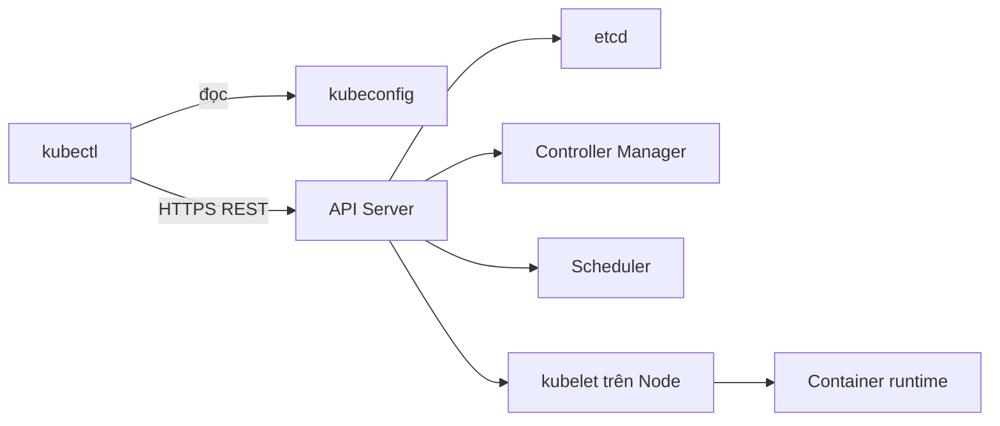

# Slide buổi 23 – kubectl Fundamentals

> **Tóm tắt:** Dùng kubectl để chọn đúng cluster và namespace, apply manifest, đọc trạng thái, log, exec, port-forward và trích dữ liệu bằng -o yaml, jsonpath. Lệnh lab: [Buổi 23 – kubectl Fundamentals](../../labs/week-12/session-23.md).

## Slide 1: Mục tiêu buổi học

- Hiểu kubectl nói chuyện với cluster qua kubeconfig, context và API Server.
- Luôn biết lệnh của mình đang tác động vào cluster nào, namespace nào.
- Chạy vòng đời apply, get, describe, logs, exec, port-forward, delete.
- Trích dữ liệu bằng `-o wide`, `-o yaml`, `-o jsonpath`, `-o custom-columns`.
- Chẩn đoán Deployment lỗi bằng `describe` và events thay vì đoán mò.

---

## Slide 2: Vấn đề thực tế – "Pod biến mất"

- Tối trước buổi sinh hoạt CLB, có tin nhắn "web điểm danh bị lỗi".
- Gõ `kubectl get pods` và nhận `No resources found`.
- Workload không mất: bạn đang nhìn namespace `default`, ứng dụng nằm ở `club`.
- Tệ hơn: `kubectl delete` nhầm vì context cũ vẫn đang được chọn.

---

## Slide 3: kubeconfig, cluster, user, context

- kubectl không "biết" cluster nào, nó đọc file kubeconfig (mặc định `~/.kube/config`).
- cluster: địa chỉ API Server và CA.
- user: thông tin xác thực (chứng chỉ, token).
- context: bộ ba cluster + user + namespace mặc định; current-context là cái đang dùng.
- Cluster của khóa học: context `kind-club`.

---

## Slide 4: Namespace – ranh giới logic

- Namespace nhóm và tách tài nguyên trong cùng một cluster; tên chỉ cần duy nhất trong một namespace.
- Không chỉ định thì dùng namespace của context (mặc định `default`).
- Node, Namespace, PersistentVolume là cluster-scoped, không thuộc namespace nào.
- Demo: cùng lệnh `get pods` với và không có `-n club` cho hai kết quả khác nhau.

---

## Slide 5: Kiến trúc – kubectl chỉ là client HTTP

- kubectl không tạo Pod, nó gửi yêu cầu tới API Server.
- Các thành phần khác phản ứng với dữ liệu trong etcd.

---

## Slide 6: Chuyện gì xảy ra khi apply

- Desired state được lưu trước, thực tế đuổi theo sau vài giây.
- `logs`, `exec`, `port-forward` đều đi qua API Server.

---

## Slide 7: Declarative và imperative

- Declarative (`apply -f`): nguồn sự thật là file manifest trong Git, tái lập và review được.
- Imperative (`create`, `scale`, `edit`): nguồn sự thật là trạng thái live, không để lại dấu vết.
- Quy tắc khóa học: khai báo bằng file; dùng imperative để thử hoặc khắc phục khẩn.
- Sau khi sửa khẩn, phải đưa thay đổi về manifest.

---

## Slide 8: Demo – ba cú nhìn đầu tiên

- Cú nhìn 1: context và namespace hiện tại, rồi so `get pods` với `-n club`.
- Cú nhìn 2: sinh YAML mẫu bằng `--dry-run=client -o yaml`, không tạo gì trong cluster.
- Cú nhìn 3: cờ `-v=6` cho thấy kubectl thực sự gọi REST tới API Server của kind.
- Xóa một Pod do Deployment quản lý và xem Pod mới xuất hiện: ReplicaSet giữ đủ `replicas`.
- `kubectl explain` để tra cấu trúc ngay trong terminal.

---

## Slide 9: Đọc trạng thái – get, describe, events

- `get` cho bảng ngắn; `-o wide` thêm node và IP.
- `describe` đọc từ trên xuống: Node, IP, Image, State, Conditions, rồi Events.
- Events cho biết Scheduled, Pulled, Created, Started; chỉ lưu khoảng một giờ.
- Pod không chạy thì `describe` trước, nguyên nhân thường nằm ở Events.

---

## Slide 10: Gỡ lỗi – logs, exec, port-forward

- `logs`: lời ứng dụng nói; `--previous` cho lần chạy trước khi restart; `-l` kèm `--prefix` cho nhiều Pod.
- `exec`: chui vào container; dấu `--` tách cờ kubectl khỏi lệnh; image alpine chỉ có `sh`.
- `port-forward`: đường hầm tạm tới một Pod, chỉ bind `127.0.0.1`, không thay Service.
- Thay đổi trong container mất khi Pod bị tạo lại.

---

## Slide 11: Định dạng đầu ra

- `-o yaml`: toàn bộ object, so `spec` (bạn khai báo) với `status` (Kubernetes ghi).
- `-o jsonpath`: lấy đúng trường; đặt trong nháy đơn; `.items` chỉ có khi lấy nhiều object.
- `-o custom-columns` và `--sort-by`: bảng tự dựng và sắp xếp.
- Jsonpath rỗng: chạy `-o yaml` để xem cấu trúc rồi viết lại đường dẫn.

---

## Slide 12: Drift – lệnh tay bị manifest ghi đè

- `scale` đổi trạng thái live nhưng manifest vẫn ghi giá trị cũ, nên `apply` đưa cluster về như file.
- Muốn giữ thay đổi: sửa file rồi apply.
- `kubectl diff` cho thấy khác biệt và trả exit code 1 khi có khác biệt, dùng được trong CI.
- Thói quen: diff, apply, rollout status.

---

## Slide 13: Phá lỗi – ImagePullBackOff

- Tag image không tồn tại: Pod mới `ErrImagePull` rồi `ImagePullBackOff`, Pod cũ vẫn `Running`.
- Rolling update giữ Pod cũ tới khi Pod mới Ready, nên dịch vụ chưa sập (may mắn của mặc định).
- Điều tra: `get`, `describe` đọc Events, kiểm tra tag, rồi `rollout undo` và sửa manifest để Git khớp cluster.
- Lỗi thường gặp khác: quên `-n`, cổng port-forward bị chiếm (xem bảng Gặp lỗi? trong bài lab).

---

## Slide 14: Recap

- kubectl là client của API Server; context chọn cluster, namespace chọn nơi nhìn.
- Manifest trong Git là nguồn sự thật: diff, apply, rollout status.
- `describe` và events là nơi đầu tiên tìm nguyên nhân; `logs` cho thấy ứng dụng nói gì.
- `exec` và `port-forward` để gỡ lỗi, không phải giải pháp triển khai.
- Buổi sau: [Slide buổi 24 – Kubernetes Services](session-24.md).
