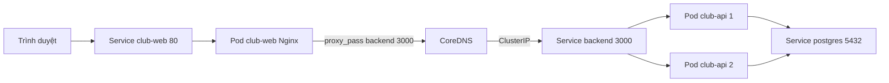
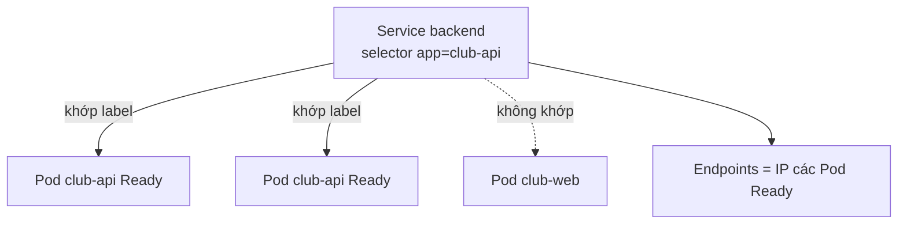

# Slide buổi 24 – Kubernetes Services

> **Tóm tắt:** Dùng Service (ClusterIP, NodePort, LoadBalancer) và DNS nội bộ của Kubernetes để nối Frontend với Backend, rồi chẩn đoán Service có Endpoints rỗng. Lệnh lab: [Buổi 24 – Kubernetes Services](../../labs/week-12/session-24.md). Kịch bản dạy: [Kịch bản mentor buổi 24](../../mentors/sessions/session-24.md).

## Slide 1: Mục tiêu buổi học

- Giải thích vì sao Pod cần Service và Service chọn Pod bằng label selector.
- Phân biệt ClusterIP, NodePort, LoadBalancer và dùng loại nào trong kind.
- Đọc đúng `get svc`, `get endpoints`, `describe svc`.
- Kiểm thử service discovery bằng tên DNS ngắn và FQDN.
- Phân biệt `port`, `targetPort`, `containerPort`, `nodePort`.
- Chẩn đoán Service có Endpoints rỗng do selector sai.

---

## Slide 2: Vấn đề – IP của Pod thay đổi

- API chạy 2 replica; Pod mới sau mỗi lần xóa hoặc rolling update có IP khác.
- Frontend hard-code IP Pod backend thì một lần rolling update là trang báo 502.
- Có hai replica, frontend gửi request cho Pod nào?
- Nginx của frontend chỉ cần `proxy_pass http://backend:3000;`.

---

## Slide 3: Service là gì

- Địa chỉ mạng ổn định (ClusterIP ảo và tên DNS) cho một nhóm Pod.
- `selector`: tập label dùng để chọn Pod, ví dụ `app: club-api`.
- `ports`: `port` Service lắng nghe, `targetPort` trên Pod.
- Service không chạy process; `kube-proxy` trên mỗi node chuyển traffic tới Pod đang Ready.

```yaml
spec:
  selector:
    app: club-api
  ports:
    - port: 3000
      targetPort: 3000
```

---

## Slide 4: Ba loại Service

| Loại | Ai truy cập | Trong kind |
| --- | --- | --- |
| ClusterIP (mặc định) | Chỉ trong cluster | Truy cập từ máy bằng `port-forward` |
| NodePort | Qua IP node, cổng 30000-32767 | Chưa mở ra host nếu thiếu `extraPortMappings` |
| LoadBalancer | Qua load balancer của cloud | `EXTERNAL-IP` luôn `pending` |

- Backend dùng ClusterIP; frontend xem qua `port-forward`; buổi 27 dùng Ingress.

---

## Slide 5: Bốn loại cổng dễ nhầm

| Tên | Nằm ở đâu | Ý nghĩa |
| --- | --- | --- |
| `containerPort` | Pod spec | Khai báo cổng container nghe (tài liệu hóa) |
| `targetPort` | Service | Cổng trên Pod nhận traffic |
| `port` | Service | Cổng client gọi, ví dụ `backend:3000` |
| `nodePort` | Service NodePort | Cổng mở trên mọi node |

- Bỏ `targetPort` thì dùng giá trị bằng `port`.
- `targetPort` sai: Endpoints vẫn có, nhưng kết nối bị từ chối.

---

## Slide 6: Service discovery và DNS

| Cách gọi | Hoạt động khi |
| --- | --- |
| `backend` | Pod cùng namespace |
| `backend.club` | Pod ở namespace khác |
| `backend.club.svc.cluster.local` | Luôn đúng (FQDN) |

- CoreDNS tạo bản ghi `ten-service.namespace.svc.cluster.local`.
- Tên ngắn hoạt động nhờ `search` domain trong `/etc/resolv.conf` của Pod.
- Vì vậy `proxy_pass http://backend:3000` chạy được khi cùng namespace `club`.

---

## Slide 7: Endpoints – danh sách Pod Ready

- Endpoints là danh sách `IP:port` của các Pod khớp selector và đang Ready.
- Pod fail readiness probe bị loại khỏi Endpoints, nhưng không bị restart.
- Endpoints rỗng nghĩa là Service không có nơi nào để gửi traffic.
- Từ Kubernetes 1.33, `kubectl get endpoints` in cảnh báo deprecated (không phải lỗi); tương đương là `kubectl get endpointslices`.

---

## Slide 8: Kiến trúc – đường đi của một request



- Trình duyệt vào frontend qua `port-forward`; API gọi database qua `DB_HOST=postgres`.

---

## Slide 9: Selector khớp label



- Chỉ Pod cùng namespace, khớp label và Ready mới vào Endpoints.
- Gõ nhầm `club-apii` thì không Pod nào khớp.

---

## Slide 10: Demo outline – Service và Endpoints

- Xem các Service trong namespace `club`: `backend`, `club-web`, `postgres`.
- Endpoints của `backend` có hai địa chỉ `10.244.x.x:3000`, trùng IP hai Pod API.
- Xóa Pod API và quan sát danh sách địa chỉ đổi, ClusterIP không đổi.
- Database cũng cần Service để API gọi tên `postgres` thay vì IP.
- Chạy `nslookup backend` từ một Pod tạm để thấy tên đổi thành ClusterIP.

---

## Slide 11: Phá lỗi – Endpoints rỗng

- Gõ nhầm selector: Endpoints là `<none>`, Nginx trả 502.
- Pod vẫn `Running`, Deployment vẫn khỏe: `get pods` không thấy gì bất thường.
- Điều tra từ ngoài vào trong: `get endpoints`, `describe svc` đọc Selector, so với `--show-labels`.
- Sửa selector về đúng rồi kiểm tra lại Endpoints.
- `targetPort` sai là lỗi khác: Endpoints có địa chỉ nhưng `Connection refused`.

---

## Slide 12: Lỗi thường gặp

| Triệu chứng | Nguyên nhân | Hướng xử lý |
| --- | --- | --- |
| Endpoints `<none>` | Selector sai hoặc Pod chưa Ready | So `describe svc` với `--show-labels` |
| Có Endpoints nhưng `Connection refused` | `targetPort` sai | Sửa về cổng ứng dụng |
| `bad address 'backend'` | Pod khác namespace | Dùng `backend.club` |
| Nginx trả 502 | Backend không có Endpoints | `get endpoints backend`, xem log API |

---

## Slide 13: Recap

- Service cho Pod một IP ảo và tên DNS ổn định; Pod đến rồi đi, Service ở lại.
- Service chọn Pod bằng label selector; chỉ Pod Ready nằm trong Endpoints.
- ClusterIP cho nội bộ, NodePort mở cổng trên node, LoadBalancer cần cloud (trong kind là `pending`).
- Tên DNS: `backend`, `backend.club`, `backend.club.svc.cluster.local`.
- Nghi ngờ Service: `get endpoints` trước, rồi `describe svc` và `--show-labels`.
- Buổi sau: [Slide buổi 25 – Configuration Management](session-25.md).
