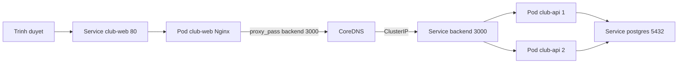
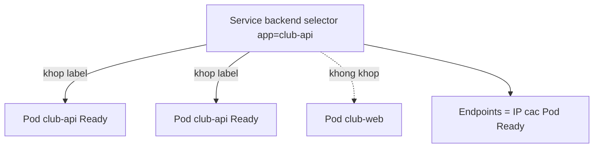

# Slide buổi 24 – Kubernetes Services

> **Tóm tắt:** Dùng Service (ClusterIP, NodePort, LoadBalancer) và DNS nội bộ của Kubernetes để nối Frontend với Backend, rồi chẩn đoán Service có Endpoints rỗng. Bài lab đầy đủ: [Buổi 24](../../labs/week-12/session-24.md).

## Slide 1: Mục tiêu buổi học

- Giải thích vì sao Pod cần Service và Service chọn Pod bằng label selector.
- Phân biệt ClusterIP, NodePort, LoadBalancer và dùng loại nào trong kind.
- Đọc đúng `get svc`, `get endpoints`, `describe svc`.
- Kiểm thử service discovery bằng tên DNS ngắn và FQDN.
- Phân biệt `port`, `targetPort`, `containerPort`, `nodePort`.
- Chẩn đoán Service có Endpoints rỗng do selector sai.

::: details Ghi chú giảng viên
Đọc nhanh (2 phút). Nhắc điều kiện: cluster kind chạy, image `club-api:1.0.0` và `club-web:1.0.0` đã nạp, namespace `club` có Postgres từ các buổi trước.
:::

---

## Slide 2: Vấn đề – IP của Pod thay đổi

- API chạy 2 replica; Pod mới sau mỗi lần xoá hoặc rolling update có IP khác.
- Frontend hard-code IP Pod backend thì một lần rolling update là trang báo 502.
- Có hai replica, frontend gửi request cho Pod nào?
- Nginx của frontend chỉ cần `proxy_pass http://backend:3000;`.

::: details Ghi chú giảng viên
Hỏi lớp: "Nếu bạn là Nginx, bạn lưu địa chỉ của backend ở đâu?" Dẫn tới ý: cần một địa chỉ ổn định và tự cân bằng tải (2 phút).
:::

---

## Slide 3: Service là gì

- Địa chỉ mạng ổn định (ClusterIP ảo và tên DNS) cho một nhóm Pod.
- `selector`: tập label dùng để chọn Pod, ví dụ `app: club-api`.
- `ports`: `port` Service lắng nghe, `targetPort` trên Pod.
- Service không chạy process; `kube-proxy` trên mỗi node chuyển traffic tới Pod đang Ready.

```yaml
spec:
  selector:
    app: club-api
  ports:
    - port: 3000
      targetPort: 3000
```

::: details Ghi chú giảng viên
Nhấn: selector là liên kết duy nhất giữa Service và Pod, không có tham chiếu tới tên Deployment. Hỏi: "Đổi tên Deployment thì Service có hỏng không?"
:::

---

## Slide 4: Ba loại Service

| Loại | Ai truy cập | Trong kind |
| --- | --- | --- |
| ClusterIP (mặc định) | Chỉ trong cluster | Truy cập từ máy bằng `port-forward` |
| NodePort | Qua IP node, cổng 30000-32767 | Chưa mở ra host nếu thiếu `extraPortMappings` |
| LoadBalancer | Qua load balancer của cloud | `EXTERNAL-IP` luôn `pending` |

- Backend dùng ClusterIP; frontend xem qua `port-forward`; buổi 27 dùng Ingress.

::: details Ghi chú giảng viên
Giải thích vì sao kind không có cloud load balancer. Cloud-provider-kind và MetalLB nằm ngoài phạm vi buổi này. Hỏi: "Database nên dùng loại nào?"
:::

---

## Slide 5: Bốn loại cổng dễ nhầm

| Tên | Nằm ở đâu | Ý nghĩa |
| --- | --- | --- |
| `containerPort` | Pod spec | Khai báo cổng container nghe (tài liệu hoá) |
| `targetPort` | Service | Cổng trên Pod nhận traffic |
| `port` | Service | Cổng client gọi, ví dụ `backend:3000` |
| `nodePort` | Service NodePort | Cổng mở trên mọi node |

- Bỏ `targetPort` thì dùng giá trị bằng `port`.
- `targetPort` sai: Endpoints vẫn có, nhưng kết nối bị từ chối.

::: details Ghi chú giảng viên
Vẽ đường đi: client gọi `port`, Service chuyển tới `targetPort`. Hỏi: "Client gọi 8080 mà Pod nghe 3000, cấu hình thế nào?" (Chuẩn bị cho thử thách 1.)
:::

---

## Slide 6: Service discovery và DNS

| Cách gọi | Hoạt động khi |
| --- | --- |
| `backend` | Pod cùng namespace |
| `backend.club` | Pod ở namespace khác |
| `backend.club.svc.cluster.local` | Luôn đúng (FQDN) |

- CoreDNS tạo bản ghi `ten-service.namespace.svc.cluster.local`.
- Tên ngắn hoạt động nhờ `search` domain trong `/etc/resolv.conf` của Pod.
- Vì vậy `proxy_pass http://backend:3000` chạy được khi cùng namespace `club`.

::: details Ghi chú giảng viên
Cho lớp đoán: Pod ở namespace `lab24` gọi `backend` có chạy không? (Không, search domain chỉ chứa namespace của Pod.) Kiểm chứng ở thử thách 2.
:::

---

## Slide 7: Endpoints – danh sách Pod Ready

- Endpoints là danh sách `IP:port` của các Pod khớp selector và đang Ready.
- Pod fail readiness probe bị loại khỏi Endpoints, nhưng không bị restart.
- Endpoints rỗng nghĩa là Service không có nơi nào để gửi traffic.
- Từ Kubernetes 1.33, `kubectl get endpoints` in cảnh báo deprecated (không phải lỗi); tương đương: `kubectl get endpointslices -l kubernetes.io/service-name=backend`.

::: details Ghi chú giảng viên
Nhấn: lệnh đầu tiên khi nghi ngờ Service là `get endpoints`. Đừng sa đà vào EndpointSlice, chỉ nhắc để học viên không hoang mang khi thấy cảnh báo.
:::

---

## Slide 8: Kiến trúc – đường đi của một request



- Trình duyệt vào frontend qua `port-forward`; API gọi database qua `DB_HOST=postgres`.

::: details Ghi chú giảng viên
Đi theo từng mũi tên (3 phút): Nginx hỏi CoreDNS tên `backend`, nhận ClusterIP, `kube-proxy` chọn một trong hai Pod. Chỉ ra ba Service trong sơ đồ.
:::

---

## Slide 9: Selector khớp label



- Chỉ Pod cùng namespace, khớp label và Ready mới vào Endpoints.
- Gõ nhầm `club-apii` thì không Pod nào khớp.

::: details Ghi chú giảng viên
Sơ đồ này là nền cho phần Phá lỗi. Hỏi lớp: "Pod vẫn Running mà Service không có Endpoints, có thể do những lý do nào?"
:::

---

## Slide 10: Demo – Service và Endpoints

```bash
kubectl get svc -n club
kubectl get endpoints backend -n club
kubectl get pods -n club -l app=club-api -o wide
```

```text
NAME       TYPE        CLUSTER-IP   EXTERNAL-IP   PORT(S)    AGE
backend    ClusterIP   10.96.x.x    <none>        3000/TCP   20m
club-web   ClusterIP   10.96.x.x    <none>        80/TCP     20m
postgres   ClusterIP   10.96.x.x    <none>        5432/TCP   25m
```

- Cột `ENDPOINTS` của `backend` có hai địa chỉ `10.244.x.x:3000`, trùng IP hai Pod.
- Database cũng cần Service để API gọi tên `postgres` thay vì IP.

::: details Ghi chú giảng viên
Câu hỏi mở rộng: vì sao StatefulSet thường dùng headless Service (`clusterIP: None`)? Chỉ gợi mở, đừng giải thích sâu. Thời lượng 3 phút.
:::

---

## Slide 11: Demo – xoá Pod và DNS từ Pod tạm

```bash
kubectl delete pod -n club -l app=club-api --wait=false
kubectl get endpoints backend -n club -w
kubectl run dns-demo -n club --rm -it --restart=Never --image=busybox:1.36 -- nslookup backend
```

```text
Name:   backend.club.svc.cluster.local
Address: 10.96.x.x
```

- Danh sách địa chỉ đổi khi Pod mới Ready; ClusterIP không đổi.
- Thoát chế độ `-w` bằng Ctrl+C.

::: details Ghi chú giảng viên
Hỏi lớp: nếu frontend gọi thẳng IP Pod thì chuyện gì xảy ra? Pod mới có Ready ngay không, và vì sao readiness probe quan trọng với Endpoints?
:::

---

## Slide 12: Lab phần 1 – đọc Service backend

```bash
mkdir -p ~/devops-labs/lab-24/{source,screenshots,evidence}
cd ~/devops-labs/lab-24
kubectl config set-context --current --namespace=club
kubectl get svc backend -o yaml
kubectl get pods --show-labels
kubectl describe svc backend
```

```yaml
spec:
  ports:
  - port: 3000
    targetPort: 3000
  selector:
    app: club-api
  type: ClusterIP
```

- Ghi lại: Service chọn Pod nào, `port` và `targetPort` bằng bao nhiêu.

::: details Ghi chú giảng viên
Cho học viên 5 phút. Nếu thiếu Pod, nhắc apply lại theo thứ tự: namespace, configmap, Secret, postgres, backend, frontend trong `starter-project/k8s/`.
:::

---

## Slide 13: Lab phần 2 – gọi Service bằng DNS

```bash
kubectl run debug --rm -it --restart=Never --image=busybox:1.36 -- sh
```

```bash
nslookup backend
nslookup backend.club.svc.cluster.local
cat /etc/resolv.conf
wget -qO- http://backend:3000/health
```

```text
search club.svc.cluster.local svc.cluster.local cluster.local
{"status":"healthy","service":"club-api"}
```

- Ba cách gọi tên cùng trả về một ClusterIP.
- Gõ `exit` để thoát; Pod debug tự xoá.

::: details Ghi chú giảng viên
Lệnh nhóm hai chạy bên trong shell của Pod debug. Nếu `wget` báo lỗi kết nối nhưng `nslookup` ra IP, Service tồn tại và lỗi nằm sau Service.
:::

---

## Slide 14: Lab phần 3 – nối frontend và backend

```bash
kubectl exec deploy/club-web -- wget -qO- http://backend:3000/health
kubectl port-forward svc/club-web 8081:80
```

```bash
curl -s http://localhost:8081/api/members
curl -s -o /dev/null -w "%{http_code}\n" http://localhost:8081/
```

```text
{"status":"healthy","service":"club-api"}
200
```

- Lệnh `exec` đi đúng đường mà `proxy_pass http://backend:3000` đi.
- Dùng cổng 8081 để không đụng 8080 của Compose.

::: details Ghi chú giảng viên
Lệnh `port-forward` giữ terminal; chạy `curl` ở terminal thứ hai. Nếu cổng bận: đổi sang `8082:80`.
:::

---

## Slide 15: Lab phần 4 – NodePort và LoadBalancer

```bash
kubectl expose deployment club-web --name=club-web-np --type=NodePort --port=80 --target-port=80
kubectl expose deployment club-web --name=club-web-lb --type=LoadBalancer --port=80 --target-port=80
kubectl get svc club-web-np club-web-lb
kubectl delete svc club-web-np club-web-lb
```

```text
club-web-np   NodePort       10.96.x.x   <none>      80:3xxxx/TCP
club-web-lb   LoadBalancer   10.96.x.x   <pending>   80:3xxxx/TCP
```

- `EXTERNAL-IP` là `<pending>` mãi mãi vì kind không có cloud load balancer.
- Mở `localhost:NodePort` không được vì cổng nằm trên container node của kind.

::: details Ghi chú giảng viên
Nhấn: không sửa Service gốc `club-web`. Nhóm L1 hoàn thành checklist 6 mục sau phần này. Nhắc dọn hai Service thử nghiệm.
:::

---

## Slide 16: Phá lỗi – Endpoints rỗng

```bash
kubectl patch svc backend -p '{"spec":{"selector":{"app":"club-apii"}}}'
kubectl get endpoints backend
curl -s -o /dev/null -w "%{http_code}\n" http://localhost:8081/api/members
```

```text
NAME      ENDPOINTS   AGE
backend   <none>      30m
502
```

- Pod vẫn `Running`, Deployment vẫn khỏe: `get pods` không thấy gì bất thường.
- Điều tra: `get endpoints`, `describe svc` đọc Selector, so với `--show-labels`.
- Sửa selector về `app: club-api` rồi kiểm tra lại Endpoints.

::: details Ghi chú giảng viên
Để lớp tự điều tra từ ngoài vào trong trong 5 phút trước khi tiết lộ. Tình huống phụ: `targetPort` sai (3001) cho Endpoints có địa chỉ nhưng `Connection refused`; khác biệt với selector sai là Endpoints không rỗng.
:::

---

## Slide 17: Lỗi thường gặp

| Triệu chứng | Nguyên nhân | Cách xử lý |
| --- | --- | --- |
| Endpoints `<none>` | Selector sai hoặc Pod chưa Ready | `describe svc` so với `--show-labels` |
| Có Endpoints nhưng `Connection refused` | `targetPort` sai | Sửa về 3000 |
| `bad address 'backend'` | Pod khác namespace | Dùng `backend.club` |
| Nginx trả 502 | Backend không có Endpoints | `get endpoints backend`, xem log API |
| `port-forward` báo address already in use | Cổng local bị chiếm | Đổi cổng local |

::: details Ghi chú giảng viên
Hỏi lớp: "Frontend trả 502 mà mọi Pod đều Running, kiểm tra gì đầu tiên?" Đáp án: `kubectl get endpoints backend`.
:::

---

## Slide 18: Thử thách nâng cao

- Thử thách 1: tự viết Service `backend-lab` với `port: 8080`, `targetPort: 3000`, không copy từ `backend.yaml`.
- Tiêu chí: `get endpoints backend-lab` có hai địa chỉ cổng 3000; `wget -qO- http://backend-lab:8080/health` trả JSON.
- Thử thách 2: tạo namespace `lab24`, gọi backend ở `club` bằng `backend.club`.
- Thử thách 3: ghi từng bước điều tra Endpoints rỗng vào `report.md`.
- Kiểm tra cú pháp: `kubectl apply --dry-run=client -f source/backend-svc-lab.yaml`.

::: details Ghi chú giảng viên
Gợi ý cho thử thách 1: chỉ cần đúng ba thứ là `metadata.name`, `selector` và cặp `port`/`targetPort`. Với thử thách 2, nhắc xoá namespace `lab24` khi xong.
:::

---

## Slide 19: Recap

- Service cho Pod một IP ảo và tên DNS ổn định; Pod đến rồi đi, Service ở lại.
- Service chọn Pod bằng label selector; chỉ Pod Ready nằm trong Endpoints.
- ClusterIP cho nội bộ, NodePort mở cổng trên node, LoadBalancer cần cloud (trong kind là `pending`).
- Tên DNS: `backend`, `backend.club`, `backend.club.svc.cluster.local`.
- Nghi ngờ Service: `get endpoints` trước, rồi `describe svc` và `--show-labels`.
- Buổi sau: [Configuration Management](session-25.md).

::: details Ghi chú giảng viên
Cho học viên tự nói lại đường đi của một request từ trình duyệt tới database. Nhắc nộp `report.md` về tình huống Endpoints rỗng.
:::
