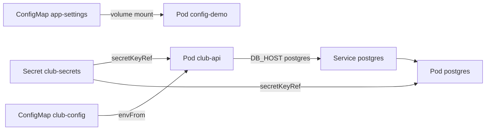
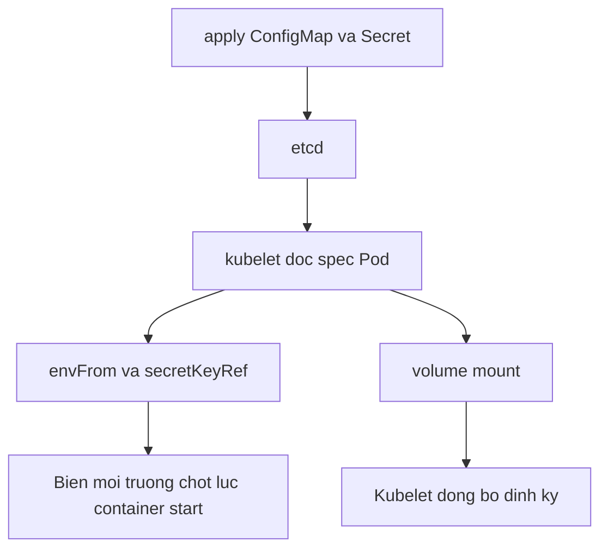

# Slide buổi 25 – Configuration Management

> **Tóm tắt:** Tách cấu hình khỏi image bằng ConfigMap và Secret, nạp qua biến môi trường hoặc file mount, và hiểu khi nào Pod thấy giá trị mới. Bài lab đầy đủ: [Buổi 25](../../labs/week-13/session-25.md).

## Slide 1: Mục tiêu buổi học

- Giải thích vì sao cấu hình phải nằm ngoài image; chọn ConfigMap hay Secret.
- Tạo ConfigMap và Secret bằng `kubectl create` và bằng manifest.
- Nạp cấu hình bằng `env`, `envFrom` và volume mount để `club-api` kết nối PostgreSQL.
- Chứng minh base64 trong Secret chỉ là encoding, không phải encryption.
- Dự đoán hành vi cập nhật: biến môi trường cần restart, file mount được đồng bộ, `subPath` thì không.
- Chẩn đoán lỗi cấu hình từ `describe`, `logs` và readiness.

::: details Ghi chú giảng viên
Đọc nhanh (2 phút). Nhắc điều kiện: cluster kind, image `club-api:1.0.0` và `club-web:1.0.0` đã nạp, đã học Deployment và Service ở buổi 22-24.
:::

---

## Slide 2: Vấn đề – mật khẩu nằm trong image

- CLB có nhiều môi trường: máy thành viên, máy demo của mentor, cụm dùng chung sau này.
- Mỗi nơi cần `DB_HOST` và mật khẩu database khác nhau.
- Viết cứng vào image: phải build lại cho mỗi môi trường, và ai pull được image đều đọc được mật khẩu trong layer.
- Nguyên tắc Twelve-Factor: cùng một image, nhiều cấu hình.

::: details Ghi chú giảng viên
Hỏi lớp: "Nếu image đẩy lên GHCR công khai mà có mật khẩu bên trong thì sao?" Dẫn tới việc cần tách cấu hình ra ngoài (2 phút).
:::

---

## Slide 3: ConfigMap và Secret

| Tiêu chí | ConfigMap | Secret |
| --- | --- | --- |
| Dùng cho | Cấu hình thường | Mật khẩu, token |
| Lưu | Chuỗi trong `data` | base64 trong `data`; `stringData` cho chuỗi thường |
| `describe` | Hiện giá trị | Chỉ hiện tên key và số byte |
| Trong etcd | Không mã hoá | Mặc định không mã hoá |
| Mount volume | Đĩa của node | tmpfs (RAM) |

- Giới hạn kích thước của cả hai là 1 MiB.

::: details Ghi chú giảng viên
Nhấn điểm quan trọng nhất ở slide sau: base64 không phải bảo mật. Secret chỉ hơn ConfigMap ở chỗ phân quyền RBAC riêng, không in ra `describe`, và có thể bật mã hoá khi lưu.
:::

---

## Slide 4: Base64 không phải bảo mật

```bash
kubectl create secret generic demo-secret -n club --from-literal=token='demo-only-value'
kubectl get secret demo-secret -n club -o jsonpath='{.data.token}' | base64 -d; echo
```

```text
secret/demo-secret created
demo-only-value
```

- Ai có quyền `get secret` đều giải mã được bằng một lệnh.
- Không bao giờ commit manifest Secret chứa giá trị thật; chỉ commit `secret.example.yaml` với giá trị giả.
- `echo 'abc' | base64` khác `echo -n 'abc' | base64`: dấu xuống dòng thừa bị mã hoá theo.

::: details Ghi chú giảng viên
Chạy trực tiếp và cho lớp thấy `kubectl describe secret demo-secret -n club` ẩn giá trị trong khi `get -o yaml` cộng `base64 -d` lộ hết. Hỏi: "Dán YAML này vào kênh chat thì ai đọc được mật khẩu?" Dọn bằng `kubectl delete secret demo-secret -n club`.
:::

---

## Slide 5: Ba cách đưa cấu hình vào container

| Cách | Khi nào dùng | Khi ConfigMap đổi |
| --- | --- | --- |
| `env` với `configMapKeyRef` hoặc `secretKeyRef` | Chọn từng key, đổi tên biến | Cần restart Pod |
| `envFrom` với `configMapRef` | Cả bộ key như `DB_*` | Cần restart Pod |
| Volume mount | File cấu hình | Kubelet đồng bộ, có độ trễ |

- Ngoại lệ: mount bằng `subPath` không bao giờ tự cập nhật.
- ConfigMap hoặc Secret `immutable: true` không thể sửa.

::: details Ghi chú giảng viên
Cho lớp dự đoán trước: đổi ConfigMap xong, biến môi trường đổi không? File mount đổi không? Ghi dự đoán lên bảng rồi kiểm chứng ở lab phần 4.
:::

---

## Slide 6: Cấu hình của club-api

| Biến | Nguồn | Giá trị |
| --- | --- | --- |
| `DB_HOST` | ConfigMap `club-config` | `postgres` |
| `DB_PORT` | ConfigMap `club-config` | `5432` |
| `DB_NAME` | ConfigMap `club-config` | `clubdb` |
| `DB_USER` | ConfigMap `club-config` | `club` |
| `DB_PASSWORD` | Secret `club-secrets`, key `db-password` | Bạn tự tạo |

- Giá trị ConfigMap luôn là chuỗi: viết `DB_PORT: "5432"` có nháy.
- Nếu thiếu nháy, `kubectl apply` báo lỗi unmarshal number.

::: details Ghi chú giảng viên
Mở `starter-project/backend/db.js` cho lớp thấy `process.env`. Nhấn: `PORT=3000` viết thẳng trong Deployment, không cần ConfigMap.
:::

---

## Slide 7: Kiến trúc – cấu hình chảy vào Pod



- Cùng một Secret phục vụ cả API và Postgres.

::: details Ghi chú giảng viên
Đi theo từng mũi tên (3 phút). Hỏi: "Nếu Secret và Postgres khác mật khẩu thì lỗi xuất hiện ở đâu?" (API báo password authentication failed.)
:::

---

## Slide 8: Kubelet nạp cấu hình thế nào



- Thiếu ConfigMap hoặc Secret: Pod dừng ở `CreateContainerConfigError`.
- Ứng dụng Node.js đọc `process.env` một lần khi tạo `pg.Pool`, nên vẫn phải khởi động lại tiến trình.

::: details Ghi chú giảng viên
Giải thích cơ chế symlink `..data` đổi nguyên tử, và vì sao `subPath` bỏ qua cơ chế này. Không cần đào sâu, chỉ cần học viên nhớ kết luận.
:::

---

## Slide 9: Demo – ConfigMap bằng lệnh

```bash
kubectl create namespace club
kubectl create configmap app-settings -n club \
  --from-literal=club-name="HCMUTE DSC" \
  --from-literal=log-level=info
kubectl get configmap app-settings -n club -o yaml
```

```text
data:
  club-name: HCMUTE DSC
  log-level: info
kind: ConfigMap
```

- Nếu namespace `club` đã tồn tại, lệnh đầu báo `AlreadyExists`: bỏ qua.
- Tạo bằng lệnh thì giá trị không nằm trong file để lỡ tay commit.

::: details Ghi chú giảng viên
Demo 3 phút. Cho lớp so sánh hai cách tạo: lệnh nhanh cho thử nghiệm, manifest trong Git cho cấu hình không nhạy cảm cần review.
:::

---

## Slide 10: Lab phần 1 – namespace và ConfigMap bằng manifest

```bash
mkdir -p ~/devops-labs/lab-25/{source,screenshots,evidence}
cd ~/devops-labs/lab-25
kubectl apply -f source/k8s/namespace.yaml
kubectl apply -f source/k8s/configmap.yaml
kubectl describe configmap club-config -n club
```

```text
namespace/club created
configmap/club-config created
```

- Thư mục `source/k8s` được sao chép từ `starter-project/k8s`.
- Không có `DB_PASSWORD` trong ConfigMap: mật khẩu không thuộc ConfigMap.

::: details Ghi chú giảng viên
Nếu `club` còn tài nguyên từ buổi trước, hướng dẫn xoá sạch bằng `kubectl delete namespace club --ignore-not-found` (chỉ trên cluster của chính học viên) để bắt đầu từ trạng thái rõ ràng.
:::

---

## Slide 11: Lab phần 2 – Secret bằng lệnh

```bash
read -r -s -p "Mat khau DB local: " DB_PASS; echo
kubectl create secret generic club-secrets -n club --from-literal=db-password="$DB_PASS"
kubectl describe secret club-secrets -n club
```

```text
secret/club-secrets created
Type:  Opaque
db-password:  N bytes
```

- Dùng mật khẩu chỉ dành cho lab, không dùng mật khẩu thật của dịch vụ nào khác.
- Nếu ghi terminal bằng `script`, mật khẩu giải mã sẽ nằm trong bằng chứng: che giá trị trước khi nộp.

::: details Ghi chú giảng viên
`read -s` không in mật khẩu lên màn hình. Cho học viên tự giải mã `db-password` bằng `base64 -d` để làm checklist L1.
:::

---

## Slide 12: Lab phần 3 – chạy Postgres và API

```bash
kubectl apply -f source/k8s/postgres.yaml
kubectl rollout status statefulset/postgres -n club --timeout=120s
kubectl apply -f source/k8s/backend.yaml
kubectl rollout status deployment/club-api -n club --timeout=120s
kubectl exec -n club deploy/club-api -- printenv DB_HOST DB_PORT DB_NAME DB_USER
```

```text
deployment "club-api" successfully rolled out
postgres
5432
clubdb
club
```

- Không in `DB_PASSWORD`; chỉ kiểm tra tồn tại bằng `test -n "$DB_PASSWORD"`.
- PVC cũ còn mật khẩu khác sẽ làm API không đăng nhập được.

::: details Ghi chú giảng viên
Lỗi `password authentication failed` thường do PVC cũ: xoá namespace (kèm PVC) rồi làm lại. Nếu `rollout status` quá thời gian, chuyển ngay sang phần Phá lỗi.
:::

---

## Slide 13: Lab phần 3 – chứng minh API nối được DB

```bash
kubectl port-forward -n club svc/backend 13000:3000
```

```bash
curl -s localhost:13000/health; echo
curl -s localhost:13000/ready; echo
curl -s localhost:13000/api/members; echo
```

```text
{"status":"healthy","service":"club-api"}
{"status":"ready"}
[]
```

- `/ready` chạy `SELECT 1` trên database: `ready` chứng minh cả ConfigMap lẫn Secret đúng.
- Danh sách `[]` là bình thường khi chưa nạp dữ liệu mẫu.

::: details Ghi chú giảng viên
Chạy `port-forward` ở terminal thứ hai. Hỏi lớp: "Vì sao `/health` có thể healthy trong khi `/ready` lỗi?" (`/health` không chạm database.)
:::

---

## Slide 14: Lab phần 4 – file mount và hành vi cập nhật

```bash
kubectl apply -f source/config-demo.yaml
kubectl patch configmap app-settings -n club --type merge -p '{"data":{"log-level":"debug"}}'
kubectl exec -n club config-demo -- printenv LOG_LEVEL
kubectl exec -n club config-demo -- cat /etc/club/log-level
```

```text
info
debug
```

- Biến môi trường vẫn là `info` suốt buổi; file đổi sang `debug` sau khoảng 10 giây đến vài phút.
- Muốn biến mới: xoá và tạo lại Pod; với Deployment dùng `rollout restart`.
- Mỗi key trở thành một file, tên file là key.

::: details Ghi chú giảng viên
Pod `config-demo` được tạo từ manifest ở bài lab, đọc cấu hình theo cả hai đường. Dòng `debug` có thể chưa xuất hiện ngay: dùng vòng lặp `sleep 10` để quan sát. Nhóm L1 hoàn thành checklist sau phần này.
:::

---

## Slide 15: Lab phần 5 – rollout để nhận biến mới

```bash
kubectl patch configmap club-config -n club --type merge -p '{"data":{"LOG_LEVEL":"debug"}}'
kubectl exec -n club deploy/club-api -- printenv LOG_LEVEL
kubectl rollout restart deployment/club-api -n club
kubectl rollout status deployment/club-api -n club --timeout=120s
kubectl exec -n club deploy/club-api -- printenv LOG_LEVEL
```

```text
command terminated with exit code 1
deployment.apps/club-api restarted
debug
```

- Lệnh `printenv` đầu không in gì: Pod cũ chưa restart.
- Rolling restart chạy từng Pod nên API không gián đoạn.

::: details Ghi chú giảng viên
`club-api` không dùng biến `LOG_LEVEL`; bài chỉ dùng để quan sát cơ chế nạp. Nhấn: readiness chặn Pod chưa sẵn sàng nhận traffic trong lúc rollout.
:::

---

## Slide 16: Phá lỗi – DB_HOST sai

```bash
kubectl patch configmap club-config -n club --type merge -p '{"data":{"DB_HOST":"postgress"}}'
kubectl rollout restart deployment/club-api -n club
kubectl get pods -n club -l app=club-api -w
```

```text
club-api-7f9d6c8b4-abcde   0/1   Running   0   40s
club-api-6d8f7b9c5d-4xk2m  1/1   Running   0   10m
```

- Pod mới `Running` nhưng `0/1`: container sống, readiness probe đang fail, không phải lỗi image.
- Điều tra: `describe pod` thấy `Readiness probe failed ... 503`; `exec printenv DB_HOST` thấy `postgress`.
- Log "sạch" không có nghĩa app khỏe: gọi `/api/members` rồi xem log có `ENOTFOUND postgress`.
- Hai Pod cũ vẫn phục vụ nhờ rolling update chặn Pod chưa Ready.

::: details Ghi chú giảng viên
Cho lớp 5 phút tự điều tra theo năm bước (`get pods`, `describe`, `logs`, `printenv`, đọc ConfigMap). Sửa bằng patch `DB_HOST` về `postgres` rồi `rollout restart`. Liên quan scenario-03 và scenario-10 trong `examples/troubleshooting`.
:::

---

## Slide 17: Lỗi thường gặp

| Triệu chứng | Cách xử lý |
| --- | --- |
| `CreateContainerConfigError`, `secret "club-secrets" not found` | `get secret -n club`, tạo lại đúng namespace |
| `couldn't find key db-password` | Tạo lại với `--from-literal=db-password=...` |
| Đổi ConfigMap mà app dùng giá trị cũ | `kubectl rollout restart deployment/ten` |
| File mount không bao giờ đổi | Có `subPath` hoặc `immutable`: mount cả thư mục |
| Đăng nhập lỗi dù mật khẩu đúng | Secret tạo bằng `echo` có xuống dòng thừa: dùng `echo -n` |
| Mật khẩu lỡ commit lên Git | Đổi mật khẩu ngay, rồi mới dọn lịch sử |

::: details Ghi chú giảng viên
Nhấn dòng cuối: xoá file ở commit sau không đủ vì lịch sử Git vẫn còn bản cũ; coi mật khẩu đã lộ. Kiểm tra trước khi push bằng `git grep -n -i -E "stringData|kind: Secret"`.
:::

---

## Slide 18: Thử thách nâng cao

- Thử thách A: tạo ConfigMap `app-config` từ file `app.properties` bằng `--from-file`.
- Mount một file vào `/etc/club/app.properties` bằng `subPath` mà không che các file khác.
- Giải thích: vì sao cần `subPath`, và vì sao dùng `subPath` thì file không tự cập nhật.
- Thử thách B: mount `club-secrets` thành volume tại `/etc/secrets` với `defaultMode: 0400`, kiểm tra bằng `ls -lL /etc/secrets`.
- Nêu hai cách bảo vệ Secret tốt hơn base64: RBAC chặt, encryption at rest, Sealed Secrets, External Secrets.

::: details Ghi chú giảng viên
Gợi ý: biến môi trường dễ lọt vào log hoặc crash dump, còn file mount chỉ lộ cho tiến trình có quyền đọc. Dọn bằng `kubectl delete pod config-demo config-demo2 secret-demo -n club --ignore-not-found`; giữ `club-api` và `postgres` cho buổi 26.
:::

---

## Slide 19: Recap

- Cùng một image, nhiều cấu hình: ConfigMap cho dữ liệu thường, Secret cho dữ liệu nhạy cảm.
- Base64 chỉ là encoding; kiểm soát RBAC và không commit Secret thật.
- Biến môi trường chốt lúc container start; đổi cấu hình cần `rollout restart`.
- Volume mount được đồng bộ (có độ trễ), `subPath` thì không, và ứng dụng phải tự đọc lại file.
- Thiếu ConfigMap hoặc Secret gây `CreateContainerConfigError`; giá trị sai lộ ra qua readiness và log.
- Truy ngược bằng `describe`, `logs`, `exec printenv`.

::: details Ghi chú giảng viên
Cho học viên tự trả lời 3 câu: vì sao tách cấu hình, vì sao base64 không an toàn, khi Pod mới `0/1` thì kiểm tra gì đầu tiên. Nhắc nộp `report.md` phân tích lỗi `DB_HOST` và không đưa mật khẩu thật vào repo.
:::
