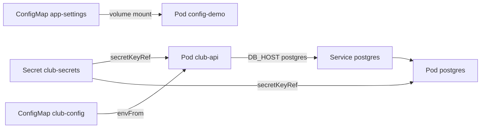
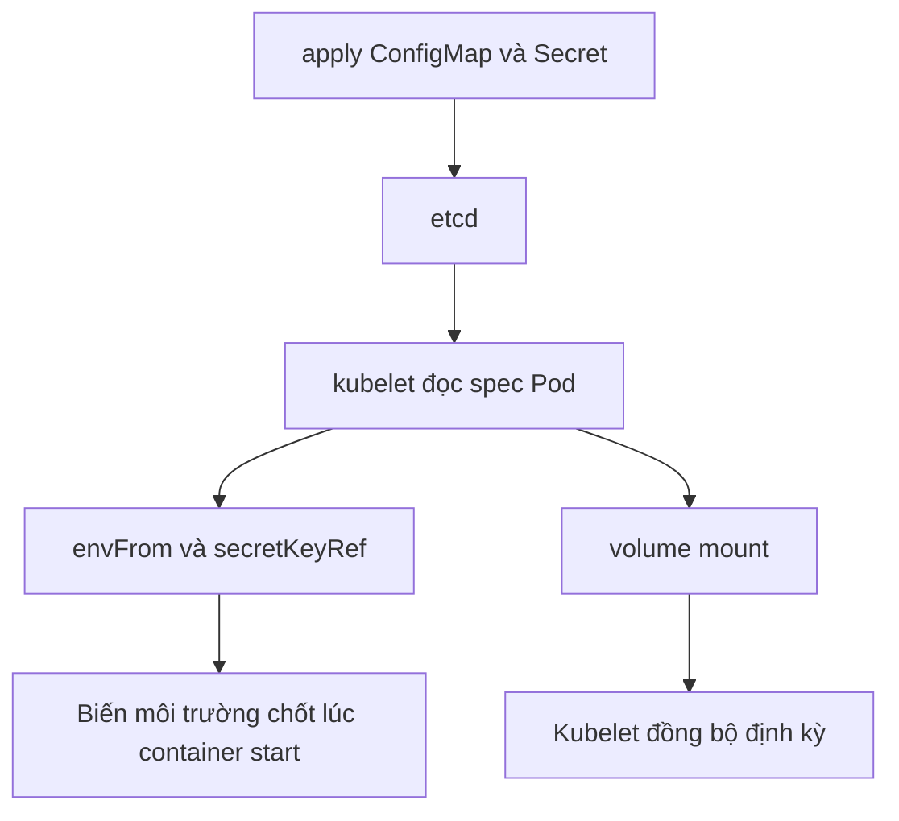

# Slide buổi 25 – Configuration Management

> **Tóm tắt:** Tách cấu hình khỏi image bằng ConfigMap và Secret, nạp qua biến môi trường hoặc file mount, và hiểu khi nào Pod thấy giá trị mới. Bài lab đầy đủ: [Buổi 25 – Configuration Management](../../labs/week-13/session-25.md).

## Slide 1: Mục tiêu buổi học

- Giải thích vì sao cấu hình phải nằm ngoài image; chọn ConfigMap hay Secret.
- Nạp cấu hình bằng `env`, `envFrom` và volume mount để `club-api` kết nối PostgreSQL.
- Chứng minh base64 trong Secret chỉ là encoding, không phải encryption.
- Dự đoán hành vi cập nhật: biến môi trường cần restart, file mount được đồng bộ, `subPath` thì không.
- Chẩn đoán lỗi cấu hình từ `describe`, `logs` và readiness.

---

## Slide 2: Vấn đề – mật khẩu nằm trong image

- CLB có nhiều môi trường: máy thành viên, máy demo của mentor, cụm dùng chung sau này.
- Mỗi nơi cần `DB_HOST` và mật khẩu database khác nhau.
- Viết cứng vào image: phải build lại cho mỗi môi trường, và ai pull được image đều đọc được mật khẩu trong layer.
- Nguyên tắc Twelve-Factor: cùng một image, nhiều cấu hình.

---

## Slide 3: ConfigMap và Secret

| Tiêu chí | ConfigMap | Secret |
| --- | --- | --- |
| Dùng cho | Cấu hình thường | Mật khẩu, token |
| Lưu | Chuỗi trong `data` | base64 trong `data`; `stringData` cho chuỗi thường |
| `describe` | Hiện giá trị | Chỉ hiện tên key và số byte |
| Trong etcd | Không mã hoá | Mặc định không mã hoá |
| Mount volume | Đĩa của node | tmpfs (RAM) |

- Giới hạn kích thước của cả hai là 1 MiB.

---

## Slide 4: Base64 không phải bảo mật

- Ai có quyền `get secret` đều giải mã được bằng một lệnh `base64 -d`.
- `describe` ẩn giá trị, nhưng `get -o yaml` cộng giải mã thì lộ hết.
- Không bao giờ commit manifest Secret chứa giá trị thật; chỉ commit `secret.example.yaml` với giá trị giả.
- Tạo Secret bằng `echo` mà thiếu `-n` sẽ dính dấu xuống dòng thừa vào mật khẩu.
- Dán YAML Secret lên kênh chat là lộ mật khẩu cho mọi người trong kênh.

---

## Slide 5: Ba cách đưa cấu hình vào container

| Cách | Khi nào dùng | Khi ConfigMap đổi |
| --- | --- | --- |
| `env` với `configMapKeyRef` hoặc `secretKeyRef` | Chọn từng key, đổi tên biến | Cần restart Pod |
| `envFrom` với `configMapRef` | Cả bộ key như `DB_*` | Cần restart Pod |
| Volume mount | File cấu hình | Kubelet đồng bộ, có độ trễ |

- Ngoại lệ: mount bằng `subPath` không bao giờ tự cập nhật.
- ConfigMap hoặc Secret `immutable: true` không thể sửa.

---

## Slide 6: Cấu hình của club-api

| Biến | Nguồn | Giá trị |
| --- | --- | --- |
| `DB_HOST` | ConfigMap `club-config` | `postgres` |
| `DB_PORT` | ConfigMap `club-config` | `5432` |
| `DB_NAME` | ConfigMap `club-config` | `clubdb` |
| `DB_USER` | ConfigMap `club-config` | `club` |
| `DB_PASSWORD` | Secret `club-secrets`, key `db-password` | Bạn tự tạo |

- Giá trị ConfigMap luôn là chuỗi: viết `DB_PORT: "5432"` có nháy.
- Nếu thiếu nháy, `kubectl apply` báo lỗi unmarshal number.

---

## Slide 7: Kiến trúc – cấu hình chảy vào Pod

- Cùng một Secret phục vụ cả API và Postgres.

---

## Slide 8: Kubelet nạp cấu hình thế nào

- Thiếu ConfigMap hoặc Secret: Pod dừng ở `CreateContainerConfigError`.
- Ứng dụng Node.js đọc `process.env` một lần khi tạo `pg.Pool`, nên vẫn phải khởi động lại tiến trình.

---

## Slide 9: Demo

- Tạo ConfigMap bằng lệnh, xem lại bằng `-o yaml`.
- Tạo Secret rồi giải mã: so sánh `describe` với `get -o yaml` cộng `base64 -d`.
- Câu hỏi cho lớp: dán YAML này lên chat thì ai thấy mật khẩu? Đổi ConfigMap xong thì biến và file có đổi không?
- Lệnh chi tiết do người hướng dẫn chạy trực tiếp trên cluster; bạn quan sát và ghi lại dự đoán của mình.

---

## Slide 10: Lab – năm phần trong 60 phút

- Phần 1: ConfigMap `club-config` bằng manifest.
- Phần 2: Secret `club-secrets` bằng lệnh, tự giải mã để thấy base64 không an toàn.
- Phần 3: chạy Postgres và `club-api` bằng cấu hình đã tách, chứng minh `/ready` trả `ready`.
- Phần 4: file mount ở namespace `lab25`, quan sát file đổi còn biến thì không.
- Phần 5: làm sai `DB_HOST` và chẩn đoán.
- Lệnh và kết quả mong đợi nằm trong bài lab: [Buổi 25 – Configuration Management](../../labs/week-13/session-25.md#hands-on-lab).

---

## Slide 11: Phá lỗi – DB_HOST sai

- Triệu chứng: Pod mới `Running` nhưng `0/1`, hai Pod cũ vẫn `1/1`.
- Container sống, readiness probe đang fail: không phải lỗi image.
- Điều tra năm bước: `get pods`, `describe` (Events `Readiness probe failed ... 503`), `logs` hoặc `exec` gọi API (`ENOTFOUND` kèm tên sai), `printenv DB_HOST`, đọc ConfigMap.
- Log "sạch" không có nghĩa app khỏe: lỗi chỉ hiện khi có request chạm database.
- Hai Pod cũ vẫn phục vụ nhờ rolling update chặn Pod chưa Ready.

---

## Slide 12: Lỗi thường gặp

| Triệu chứng | Cách xử lý |
| --- | --- |
| `CreateContainerConfigError`, `secret "club-secrets" not found` | Tạo lại Secret đúng namespace |
| `couldn't find key db-password` | Tạo lại với `--from-literal=db-password=...` |
| Đổi ConfigMap mà app dùng giá trị cũ | `kubectl rollout restart deployment/ten` |
| File mount không bao giờ đổi | Có `subPath` hoặc `immutable`: mount cả thư mục |
| Đăng nhập lỗi dù mật khẩu đúng | Secret có xuống dòng thừa: dùng `echo -n` hoặc `--from-literal` |
| Mật khẩu lỡ commit lên Git | Đổi mật khẩu ngay, rồi mới dọn lịch sử |

---

## Slide 13: Thử thách nâng cao

- Thử thách A: mount một file bằng `subPath` mà không che các file khác; giải thích vì sao `subPath` thì file không tự cập nhật.
- Thử thách B: mount Secret thành volume với quyền `0400`; nêu hai cách bảo vệ Secret tốt hơn base64 (RBAC chặt, encryption at rest, Sealed Secrets, External Secrets).
- Chi tiết: [Buổi 25 – Thử thách nâng cao](../../labs/week-13/session-25-challenge.md).

---

## Slide 14: Recap

- Cùng một image, nhiều cấu hình: ConfigMap cho dữ liệu thường, Secret cho dữ liệu nhạy cảm.
- Base64 chỉ là encoding; kiểm soát RBAC và không commit Secret thật.
- Biến môi trường chốt lúc container start; đổi cấu hình cần `rollout restart`.
- Volume mount được đồng bộ (có độ trễ), `subPath` thì không, và ứng dụng phải tự đọc lại file.
- Thiếu ConfigMap hoặc Secret gây `CreateContainerConfigError`; giá trị sai lộ ra qua readiness và Events.
