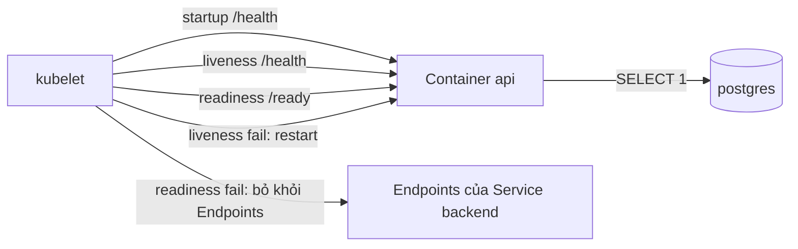
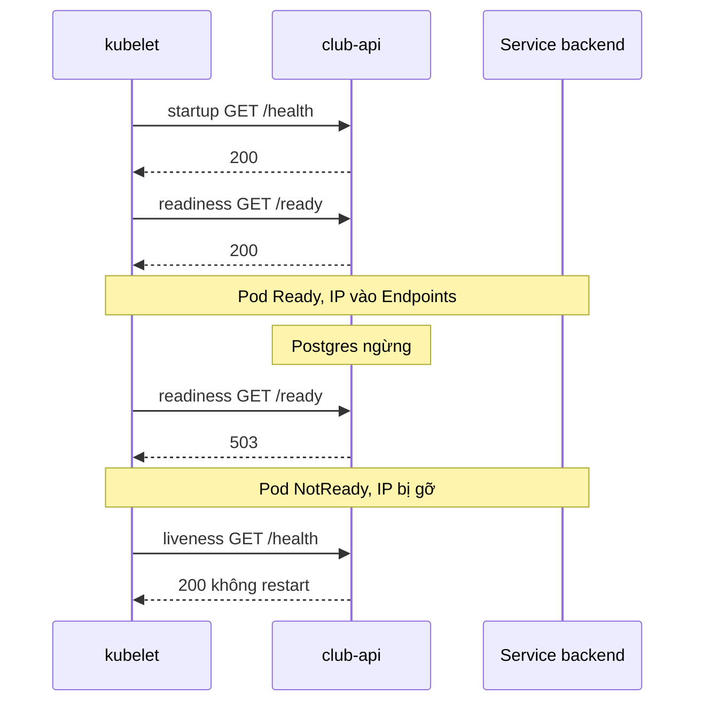

# Slide buổi 26 – Resource & Health

> **Tóm tắt:** Đặt requests/limits và ba loại probe cho backend club-api, mô phỏng OOMKilled và readiness probe fail, rồi chẩn đoán bằng describe, events và logs.

## Slide 1: Mục tiêu buổi học

- Phân biệt `requests` (scheduler dùng) và `limits` (kernel cưỡng chế).
- Đoán được QoS class của Pod từ manifest.
- Cấu hình `startupProbe`, `readinessProbe`, `livenessProbe` cho club-api.
- Tái hiện và nhận ra OOMKilled (exit code 137).
- Chẩn đoán Pod `Running` nhưng `0/1` (Tình huống 10).

::: details Ghi chú giảng viên
Đọc nhanh 5 mục tiêu, 2 phút. Nhấn mạnh: cuối buổi học viên phải tự phá và tự sửa được hai loại lỗi, không chỉ nghe. Hỏi lớp: ai từng thấy container chết mà log không có lỗi?
:::

---

## Slide 2: Vấn đề thực tế

- API chạy ổn trên máy dev, lên cluster thì người dùng nhận 502.
- Pod "đang chạy" nhưng chưa nối được DB mà vẫn nhận traffic.
- Pod chết lặp lại, log không có lỗi nào: bị kernel giết vì vượt memory.
- Cả hai là lỗi cấu hình tài nguyên và health check, không phải lỗi code.

::: details Ghi chú giảng viên
Kể tình huống như một buổi sinh hoạt CLB bị gián đoạn. 3 phút. Câu hỏi: "Kubernetes cần biết gì về app của bạn để quản lý tốt?" Dẫn tới hai ý: cần bao nhiêu tài nguyên, và khi nào app khỏe.
:::

---

## Slide 3: Requests và limits

| | `requests` | `limits` |
| --- | --- | --- |
| Ai dùng | Scheduler | kubelet và kernel |
| Ý nghĩa | Mức tối thiểu để xếp Pod vào Node | Trần tối đa lúc chạy |
| Vượt CPU | Không áp dụng | Bị throttle (chậm) |
| Vượt memory | Không áp dụng | OOMKilled |

- Không đủ chỗ theo `requests`: Pod `Pending`.

::: details Ghi chú giảng viên
Vẽ lên bảng hai cột "xếp chỗ" và "cưỡng chế". 3 phút. Câu hỏi: "CPU và memory khác nhau ở điểm nào khi vượt limit?" (CPU nén được, memory thì không.)
:::

---

## Slide 4: Đơn vị CPU và memory

- CPU: `1` là 1 core, `500m` là 0,5 core.
- Memory: `128Mi`, `1Gi` (lũy thừa của 2).
- `128M` là 10^6 byte, khác `128Mi` là 2^20 byte.
- Luôn dùng hậu tố `Mi`, `Gi` để tránh nhầm.

```yaml
resources:
  requests:
    cpu: 100m
    memory: 128Mi
  limits:
    cpu: 500m
    memory: 256Mi
```

::: details Ghi chú giảng viên
Đây là cấu hình hiện tại của club-api. 2 phút. Hỏi nhanh: `250m` là bao nhiêu core?
:::

---

## Slide 5: QoS class

| QoS class | Điều kiện |
| --- | --- |
| Guaranteed | Mọi container có requests và limits, requests bằng limits (cpu và memory) |
| Burstable | Có khai báo nhưng không đủ điều kiện Guaranteed |
| BestEffort | Không khai báo gì |

- Node thiếu memory: đuổi BestEffort trước, rồi Burstable, cuối cùng Guaranteed.
- club-api hiện tại (100m/128Mi và 500m/256Mi) là Burstable.

::: details Ghi chú giảng viên
2 phút. Câu hỏi cho lớp: "Muốn club-api thành Guaranteed thì đổi gì?" (Đặt requests bằng limits.) Để học viên L2 làm ở Thử thách A.
:::

---

## Slide 6: Ba loại probe

| Probe | Câu hỏi | Khi fail |
| --- | --- | --- |
| `startupProbe` | Đã khởi động xong chưa? | Hết ngưỡng thì restart |
| `readinessProbe` | Có nên gửi traffic không? | Gỡ khỏi Endpoints, không restart |
| `livenessProbe` | Process có bị kẹt không? | kubelet restart container |

- Tham số chính: `periodSeconds`, `timeoutSeconds`, `failureThreshold`.
- Cơ chế: `httpGet`, `tcpSocket`, `exec`.

::: details Ghi chú giảng viên
Đây là slide quan trọng nhất của phần lý thuyết, dừng 4 phút. Yêu cầu học viên nhắc lại: probe nào làm Pod restart, probe nào chỉ gỡ khỏi Endpoints.
:::

---

## Slide 7: Endpoint của club-api

| Endpoint | Hành vi | Dùng cho |
| --- | --- | --- |
| `/health` | Luôn trả 200, không chạm DB | liveness, startup |
| `/ready` | Chạy `SELECT 1`, lỗi thì trả 503 | readiness |

- Thiết kế cố ý: liveness hỏi "còn sống", readiness hỏi "phục vụ được không".
- Liveness không nên phụ thuộc DB: restart không sửa được DB.

::: details Ghi chú giảng viên
Mở `starter-project/backend/app.js` cho lớp xem hai route. 2 phút. Hỏi: "Nếu liveness trỏ vào /ready và DB sập thì sao?" Giữ đáp án cho demo.
:::

---

## Slide 8: Kiến trúc probe



::: details Ghi chú giảng viên
Chỉ theo từng mũi tên, 2 phút. Nhấn: kubelet là bên gọi probe, còn Service chỉ nhìn kết quả qua Endpoints.
:::

---

## Slide 9: Khi DB sập, chuyện gì xảy ra



- Startup chạy trước, xong mới bật liveness và readiness.
- DB quay lại: Pod tự Ready lại, không cần can thiệp.

::: details Ghi chú giảng viên
3 phút. Câu hỏi: "Trong khoảng DB sập, người dùng thấy gì?" (Không có backend nào nhận traffic, nhưng không có Pod nào bị restart.)
:::

---

## Slide 10: Demo 1 – xem requests/limits và QoS

```bash
kubectl -n club get deploy club-api -o jsonpath='{.spec.template.spec.containers[0].resources}{"\n"}'
kubectl -n club get pods -l app=club-api -o jsonpath='{range .items[*]}{.metadata.name}{"  "}{.status.qosClass}{"\n"}{end}'
```

Kết quả mong đợi:

```text
{"limits":{"cpu":"500m","memory":"256Mi"},"requests":{"cpu":"100m","memory":"128Mi"}}
club-api-7d9c6b8f5-abcde  Burstable
club-api-7d9c6b8f5-fghij  Burstable
```

- Lỗi hay gặp: namespace sai, báo `No resources found`.

::: details Ghi chú giảng viên
Chạy thật trên cluster kind. 3 phút. Tên Pod trên máy bạn sẽ khác. Nếu output rỗng, kiểm tra `kubectl -n club get pods` và label `app=club-api`.
:::

---

## Slide 11: Demo 2 – tắt DB, quan sát readiness

Terminal A:

```bash
kubectl -n club get pods -l app=club-api -w
```

Terminal B:

```bash
kubectl -n club scale statefulset postgres --replicas=0
kubectl -n club get endpoints backend
```

Kết quả mong đợi sau khoảng 30 giây:

```text
NAME      ENDPOINTS   AGE
backend   <none>      3h
```

- Cột READY chuyển `1/1` sang `0/1`, RESTARTS giữ nguyên.

::: details Ghi chú giảng viên
Chia màn hình hai terminal. 5 phút. Kubernetes 1.33 trở lên có thể in cảnh báo Endpoints deprecated, vẫn dùng được; cách mới là `get endpointslices -l kubernetes.io/service-name=backend`. Hỏi: "Pod vẫn Running, vì sao Service không có endpoint?"
:::

---

## Slide 12: Demo 3 – bật DB lại

```bash
kubectl -n club scale statefulset postgres --replicas=1
kubectl -n club rollout status statefulset/postgres
kubectl -n club get endpoints backend
```

- Sau khoảng 30 giây hai IP trở lại Endpoints.
- Không Pod nào bị restart.
- Nếu liveness trỏ `/ready`: cả hai Pod bị restart dây chuyền.

::: details Ghi chú giảng viên
3 phút. Đây là điểm chốt của demo: readiness xử lý phụ thuộc ngoài, liveness chỉ xử lý "treo". Câu hỏi: "Restart có làm DB lên nhanh hơn không?"
:::

---

## Slide 13: Lab L1 – thêm probe và quan sát

- Tạo `source/backend-deploy.yaml` có requests, limits và đủ 3 probe.
- Áp dụng và chờ rollout.
- Xem probe đã ghi nhận.

```bash
kubectl apply -f source/backend-deploy.yaml
kubectl -n club rollout status deploy/club-api
kubectl -n club describe pod -l app=club-api | grep -E "Liveness|Readiness|Startup"
```

```text
    Liveness:   http-get http://:3000/health delay=0s timeout=2s period=10s #success=1 #failure=3
    Readiness:  http-get http://:3000/ready delay=0s timeout=2s period=5s #success=1 #failure=3
    Startup:    http-get http://:3000/health delay=0s timeout=1s period=2s #success=1 #failure=15
```

- Lỗi hay gặp: thiếu image trong kind thì Pod `ErrImageNeverPull` hoặc `ImagePullBackOff`; chạy lại `kind load docker-image club-api:1.0.0`.

::: details Ghi chú giảng viên
Phát YAML trong bài lab (Phần 2). 5 phút giải thích: `startupProbe` cho tối đa 2 x 15 = 30 giây, nên không cần `initialDelaySeconds`. Nhắc học viên lưu output vào `evidence/command-output.txt`.
:::

---

## Slide 14: Lab L1 – OOMKilled

Pod thử nghiệm dùng image `club-api:1.0.0`, limit memory `64Mi`, cố ý cấp phát bộ nhớ:

```bash
kubectl apply -f source/oom-demo.yaml
kubectl -n club get pod oom-demo -w
kubectl -n club get pod oom-demo -o jsonpath='{.status.containerStatuses[0].state.terminated.reason}{" "}{.status.containerStatuses[0].state.terminated.exitCode}{"\n"}'
```

```text
oom-demo   0/1     OOMKilled           0          6s
OOMKilled 137
```

- Log dừng đột ngột, không có stack trace: SIGKILL = 128 + 9 = 137.
- Dọn dẹp: `kubectl -n club delete pod oom-demo`.

::: details Ghi chú giảng viên
Nhắc `restartPolicy: Never` để giữ nguyên trạng thái lỗi. Số dòng `allocated` có thể khác tùy máy. Hỏi lớp: "Vì sao log không có thông báo lỗi?" (Process bị giết từ bên ngoài, không kịp ghi.)
:::

---

## Slide 15: Lab L1 và L2 – readiness fail (Tình huống 10)

Phá bằng cách đặt sai path:

```bash
kubectl -n club patch deploy club-api --type=json -p='[{"op":"replace","path":"/spec/template/spec/containers/0/readinessProbe/httpGet/path","value":"/readyy"}]'
kubectl -n club describe pod -l app=club-api | grep -B2 -A4 "Readiness probe failed"
```

```text
  Warning  Unhealthy  5s (x12 over 55s)  kubelet  Readiness probe failed: HTTP probe failed with statuscode: 404
```

- Pod mới `Running` nhưng `0/1`; hai Pod cũ vẫn phục vụ, rollout treo.
- 404 là sai path, 503 là app chưa sẵn sàng (thường do DB), `connection refused` là sai cổng.
- Khôi phục: `kubectl apply -f source/backend-deploy.yaml`.

::: details Ghi chú giảng viên
Học viên chỉ nhận triệu chứng, tự điều tra theo thứ tự: `get pods`, `get endpoints`, `describe`, `exec wget`. 8 phút. Hỏi: "RESTARTS bằng 0 loại trừ những khả năng nào?" (Liveness và OOM.)
:::

---

## Slide 16: Lỗi thường gặp

| Triệu chứng | Nguyên nhân | Xử lý |
| --- | --- | --- |
| `Running` nhưng `0/1` | Readiness fail | `describe`, đọc Events |
| RESTARTS tăng, log sạch | OOMKilled | `describe`, xem Last State |
| Mọi Pod restart khi DB sập | Liveness gọi DB | Liveness chỉ dùng `/health` |
| `Pending`, `Insufficient memory` | `requests` quá lớn | Giảm requests, xem Allocatable |
| `kubectl top` lỗi Metrics API | Chưa cài metrics-server | Không cần cho lab |

::: details Ghi chú giảng viên
2 phút. Với `kubectl top`: kind không cài metrics-server mặc định, đây là hành vi bình thường, không phải lỗi của học viên.
:::

---

## Slide 17: Thử thách L2

- A. Guaranteed QoS: đặt requests bằng limits, xác nhận `.status.qosClass` là `Guaranteed`.
- B. Đổi liveness sang `/ready`, tắt Postgres, chứng minh RESTARTS tăng trên cả hai Pod.
- C. Đặt `startupProbe` sai cổng 3001 với `failureThreshold: 3`, giải thích kết quả.
- Mỗi thử thách cần bằng chứng lệnh và output, rồi khôi phục về manifest gốc.

```bash
kubectl -n club get pods -l app=club-api -o jsonpath='{range .items[*]}{.status.qosClass}{"\n"}{end}'
```

::: details Ghi chú giảng viên
Cho học viên L2 làm độc lập, gợi ý chỉ đưa khi họ thật sự kẹt. Thử thách B: cần khoảng 30 giây liveness fail liên tiếp (period 10 giây, ngưỡng 3) mới thấy restart. Nhắc khôi phục Postgres và liveness sau khi xong.
:::

---

## Slide 18: Recap

- `requests` để xếp Pod, `limits` để cưỡng chế: vượt memory thì OOMKilled (exit 137).
- QoS class quyết định thứ tự bị đuổi khi Node thiếu tài nguyên.
- Startup bảo vệ app chậm; thời gian tối đa là `failureThreshold x periodSeconds`.
- Readiness fail gỡ Pod khỏi Endpoints; liveness fail mới restart.
- Pod `Running` nhưng `0/1`: bắt đầu từ `describe`, rồi `exec` gọi endpoint.
- `patch` chỉ để thí nghiệm; manifest trong Git là nguồn sự thật.

::: details Ghi chú giảng viên
2 phút. Hỏi lại 2 câu kiểm tra: "Vì sao liveness không nên gọi DB?" và "Pod chết, log trống, bạn kiểm tra gì?" Nhắc nộp `lab-26/` theo template.
:::
