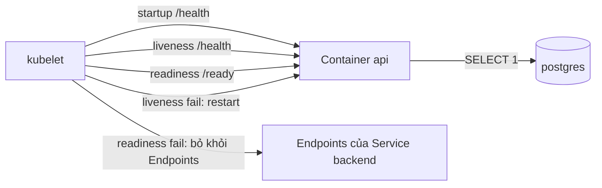
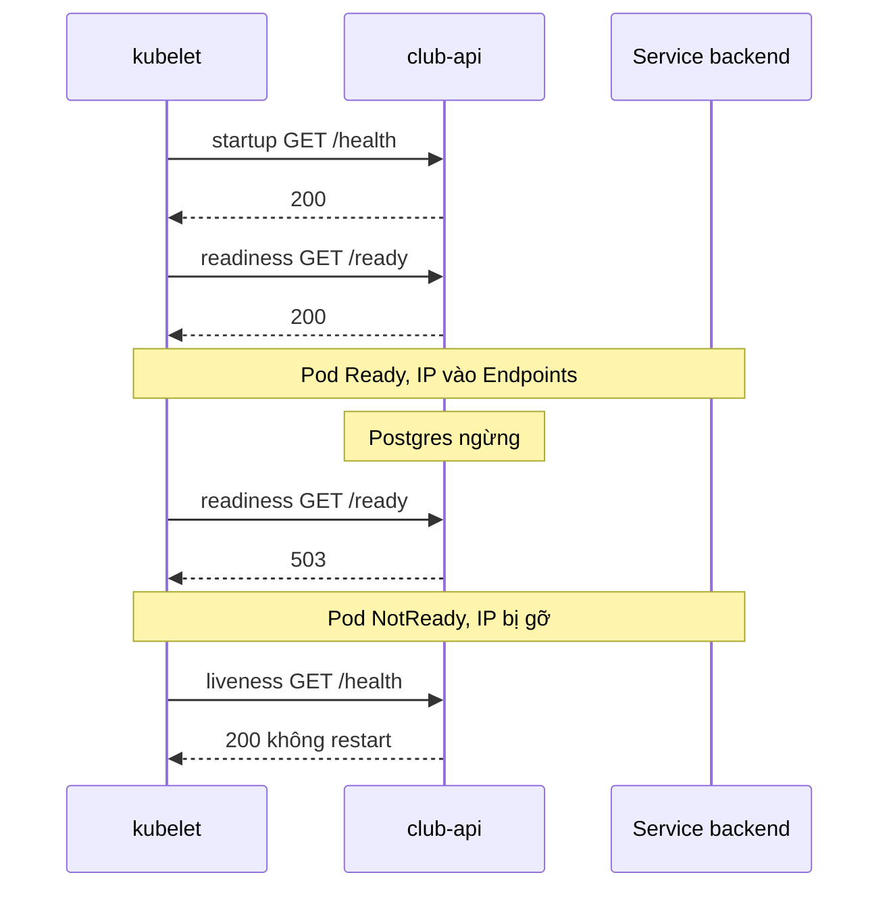

# Slide buổi 26 – Resource & Health

> **Tóm tắt:** Đặt requests/limits và ba loại probe cho backend club-api, mô phỏng OOMKilled và readiness probe fail, rồi chẩn đoán bằng describe, events và logs. Bài lab đầy đủ: [Buổi 26 – Resource & Health](../../labs/week-13/session-26.md).

## Slide 1: Mục tiêu buổi học

- Phân biệt `requests` (scheduler dùng) và `limits` (kernel cưỡng chế).
- Đoán được QoS class của Pod từ manifest.
- Cấu hình `startupProbe`, `readinessProbe`, `livenessProbe` cho club-api.
- Tái hiện và nhận ra OOMKilled (exit code 137).
- Chẩn đoán Pod `Running` nhưng `0/1` (Tình huống 10).

---

## Slide 2: Vấn đề thực tế

- API chạy ổn trên máy dev, lên cluster thì người dùng nhận 502.
- Pod "đang chạy" nhưng chưa nối được DB mà vẫn nhận traffic.
- Pod chết lặp lại, log không có lỗi nào: bị kernel giết vì vượt memory.
- Cả hai là lỗi cấu hình tài nguyên và health check, không phải lỗi code.

---

## Slide 3: Requests, limits và đơn vị

| | `requests` | `limits` |
| --- | --- | --- |
| Ai dùng | Scheduler | kubelet và kernel |
| Ý nghĩa | Mức tối thiểu để xếp Pod vào Node | Trần tối đa lúc chạy |
| Vượt CPU | Không áp dụng | Bị throttle (chậm) |
| Vượt memory | Không áp dụng | OOMKilled |

- Không đủ chỗ theo `requests`: Pod `Pending`.
- CPU: `1` là 1 core, `500m` là 0,5 core. Memory: `128Mi`, `1Gi` (khác `128M`); luôn dùng `Mi`, `Gi`.

---

## Slide 4: QoS class

| QoS class | Điều kiện |
| --- | --- |
| Guaranteed | Mọi container có requests và limits, requests bằng limits (cpu và memory) |
| Burstable | Có khai báo nhưng không đủ điều kiện Guaranteed |
| BestEffort | Không khai báo gì |

- Node thiếu memory: đuổi BestEffort trước, rồi Burstable, cuối cùng Guaranteed.
- club-api hiện tại (100m/128Mi và 500m/256Mi) là Burstable.

---

## Slide 5: Ba loại probe

| Probe | Câu hỏi | Khi fail |
| --- | --- | --- |
| `startupProbe` | Đã khởi động xong chưa? | Hết ngưỡng thì restart |
| `readinessProbe` | Có nên gửi traffic không? | Gỡ khỏi Endpoints, không restart |
| `livenessProbe` | Process có bị kẹt không? | kubelet restart container |

- Tham số chính: `periodSeconds`, `timeoutSeconds`, `failureThreshold`.
- Cơ chế: `httpGet`, `tcpSocket`, `exec`.
- Startup tối đa: `failureThreshold x periodSeconds`.

---

## Slide 6: Endpoint của club-api

| Endpoint | Hành vi | Dùng cho |
| --- | --- | --- |
| `/health` | Luôn trả 200, không chạm DB | liveness, startup |
| `/ready` | Chạy `SELECT 1`, lỗi thì trả 503 | readiness |

- Thiết kế cố ý: liveness hỏi "còn sống", readiness hỏi "phục vụ được không".
- Liveness không nên phụ thuộc DB: restart không sửa được DB.

---

## Slide 7: Kiến trúc probe

---

## Slide 8: Khi DB sập, chuyện gì xảy ra

- Startup chạy trước, xong mới bật liveness và readiness.
- DB quay lại: Pod tự Ready lại, không cần can thiệp.

---

## Slide 9: Demo

- Xem requests, limits và QoS hiện tại của `club-api`.
- Tắt database (scale StatefulSet về 0): quan sát READY chuyển `1/1` sang `0/1`, RESTARTS giữ nguyên, Endpoints của `backend` rỗng.
- Bật database lại: hai IP trở về Endpoints, không Pod nào bị restart.
- Câu hỏi: nếu liveness trỏ `/ready` thì bước tắt database sẽ khác gì?
- Lệnh chi tiết do người hướng dẫn chạy trực tiếp trên cluster; bạn quan sát và ghi lại dự đoán của mình.

---

## Slide 10: Lab – thêm probe và đọc QoS

- Phần 1: đọc requests, limits, QoS; `kubectl top` có thể báo Metrics API not available (bình thường trên kind).
- Phần 2: viết `source/backend-deploy.yaml` có requests, limits và đủ ba probe; apply, chờ rollout, xem probe đã ghi nhận.
- `startupProbe` cho tối đa 2 x 15 = 30 giây nên không cần `initialDelaySeconds`.
- Lệnh và manifest nằm trong bài lab: [Buổi 26 – Resource & Health](../../labs/week-13/session-26.md#hands-on-lab).

---

## Slide 11: Lab – OOMKilled

- Pod thử nghiệm dùng image `club-api:1.0.0`, limit memory `64Mi`, cố ý cấp phát bộ nhớ liên tục, `restartPolicy: Never`.
- Dấu hiệu: trạng thái `OOMKilled`, `Exit Code: 137`.
- Log dừng đột ngột, không có stack trace: SIGKILL = 128 + 9 = 137, app không kịp ghi log.
- Dọn dẹp Pod thử nghiệm ngay sau khi quan sát.

---

## Slide 12: Lab – readiness fail (Tình huống 10)

- Phá bằng cách đặt sai đường dẫn readiness probe.
- Pod mới `Running` nhưng `0/1`, RESTARTS 0; hai Pod cũ vẫn phục vụ, rollout treo.
- Events: `Readiness probe failed` kèm mã HTTP.

| Mã | Ý nghĩa |
| --- | --- |
| 404 | Sai path |
| 503 | App báo chưa sẵn sàng (thường do DB) |
| `connection refused` | Sai cổng hoặc app chưa lắng nghe |

- Khôi phục bằng `apply` lại manifest; `patch` chỉ để thí nghiệm.

---

## Slide 13: Lỗi thường gặp và thử thách L2

| Triệu chứng | Nguyên nhân | Xử lý |
| --- | --- | --- |
| `Running` nhưng `0/1` | Readiness fail | `describe`, đọc Events |
| RESTARTS tăng, log sạch | OOMKilled | `describe`, xem Last State |
| Mọi Pod restart khi DB sập | Liveness gọi DB | Liveness chỉ dùng `/health` |
| `Pending`, `Insufficient memory` | `requests` quá lớn | Giảm requests, xem Allocatable |

- Thử thách L2: A. Guaranteed QoS; B. liveness phụ thuộc DB gây restart dây chuyền; C. startupProbe sai cổng. Chi tiết: [Buổi 26 – Thử thách nâng cao](../../labs/week-13/session-26-challenge.md).

---

## Slide 14: Recap

- `requests` để xếp Pod, `limits` để cưỡng chế: vượt memory thì OOMKilled (exit 137).
- QoS class quyết định thứ tự bị đuổi khi Node thiếu tài nguyên.
- Startup bảo vệ app chậm; readiness fail gỡ Pod khỏi Endpoints; liveness fail mới restart.
- Liveness chỉ hỏi "còn sống", phụ thuộc ngoài như DB thuộc về readiness.
- Pod `Running` nhưng `0/1`: bắt đầu từ `describe`, rồi `exec` gọi endpoint.
- `patch` chỉ để thí nghiệm; manifest trong Git là nguồn sự thật.
