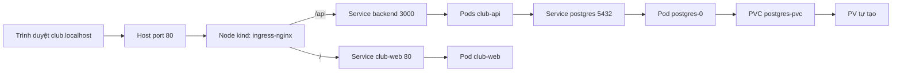
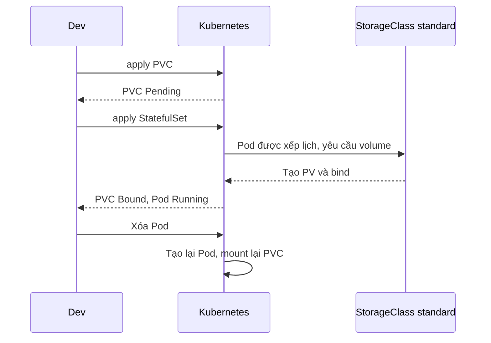

# Slide buổi 27 – Storage & Ingress

> **Tóm tắt:** Dùng PV, PVC, StorageClass để PostgreSQL giữ dữ liệu khi Pod bị xóa, và dùng ingress-nginx trên kind để truy cập ứng dụng qua host club.localhost. Bài lab đầy đủ: [Buổi 27](../../labs/week-14/session-27.md).

## Slide 1: Mục tiêu buổi học

- Giải thích vòng đời PV, PVC, StorageClass.
- Chứng minh dữ liệu Postgres còn sau khi xóa Pod.
- Dự đoán điều gì xảy ra khi xóa PVC (`Delete` và `Retain`).
- Cài ingress-nginx cho kind, truy cập qua `club.localhost`.
- Chẩn đoán PVC Pending và Ingress 404 hoặc 503.

---

## Slide 2: Hai vấn đề của Club Management

- Dữ liệu biến mất: Postgres chạy như một Pod, dữ liệu nằm trong filesystem tạm của container; `kubectl delete pod` là mất danh sách thành viên.
- Chỉ có port-forward: Service `ClusterIP` chỉ truy cập được từ trong cluster, mỗi Service một cổng khác nhau.
- Người dùng thật chỉ gõ một tên miền; cần một cổng vào duy nhất quyết định request đi tới frontend hay API.

---

## Slide 3: Ba đối tượng storage

| Đối tượng | Ý nghĩa | Ai tạo |
| --- | --- | --- |
| PersistentVolume (PV) | Phần dung lượng thật trong cluster | Admin hoặc provisioner |
| PersistentVolumeClaim (PVC) | Yêu cầu dung lượng và access mode | Developer |
| StorageClass | Loại storage, cách tạo PV tự động | Admin |

- Pod tham chiếu PVC, PVC bind với PV, PV trỏ tới storage thật.
- Dynamic provisioning: bạn chỉ tạo PVC, StorageClass tạo PV.
- Ví von: PVC là phiếu đặt chỗ, PV là chỗ ngồi thật, StorageClass là nhà hàng tự xếp chỗ.

---

## Slide 4: Reclaim policy và binding mode

| Thuộc tính | Giá trị | Ý nghĩa |
| --- | --- | --- |
| reclaimPolicy | `Delete` | Xóa PVC thì PV và dữ liệu mất theo |
| reclaimPolicy | `Retain` | PV còn, trạng thái `Released`, dữ liệu giữ lại |
| volumeBindingMode | `WaitForFirstConsumer` | Chờ có Pod dùng PVC mới tạo PV |
| accessModes | `ReadWriteOnce` | Một node đọc/ghi, hợp với database |

- Kind: StorageClass `standard`, policy `Delete`, `WaitForFirstConsumer`.
- PVC `Pending` ngay khi tạo là bình thường.

---

## Slide 5: Vì sao database dùng StatefulSet

- Deployment cho workload không trạng thái; database cần danh tính và storage riêng.
- Pod `postgres-0` giữ tên ổn định khi được tạo lại và mount lại đúng PVC.
- Xóa Pod hoặc StatefulSet không xóa PVC; chỉ xóa PVC mới có thể mất dữ liệu.
- Nhiều replica thì dùng `volumeClaimTemplates`; lab dùng 1 replica và PVC tường minh.

---

## Slide 6: Ingress và Ingress controller

| Thành phần | Vai trò |
| --- | --- |
| Ingress | Luật: host nào, path nào, tới Service nào |
| Ingress controller | Pod proxy thật, đọc Ingress và áp dụng |
| IngressClass | Chọn controller (`ingressClassName: nginx`) |

- Chỉ tạo Ingress mà không cài controller: không có gì xảy ra.
- Path dài hơn thắng: `/api` thắng `/`.
- Ingress ở tầng HTTP (host, path); LoadBalancer ở tầng TCP/UDP.

---

## Slide 7: Kiến trúc truy cập

- `.localhost` luôn trỏ về 127.0.0.1; Docker map port 80 của máy vào node kind nhờ `extraPortMappings`.

---

## Slide 8: Vòng đời PVC khi tạo Pod

- Pod mới mount lại cùng PVC nên thấy cùng dữ liệu.

---

## Slide 9: Demo 1 – StorageClass và PVC Pending

- Xem StorageClass mặc định `standard` của kind.
- Tạo `demo-pvc` 100Mi: `STATUS` là `Pending`, Events nói "waiting for first consumer".
- Câu hỏi: Pending ở đây là lỗi không?

---

## Slide 10: Demo 2 – dữ liệu sống sót qua xóa Pod

- Tạo Pod `demo-writer` dùng PVC, ghi `date` vào `/data/log.txt`.
- PVC chuyển `Bound`, xuất hiện PV tên dạng `pvc-xxxxxxxx`.
- Xóa Pod, tạo lại: file `log.txt` có hai dòng ngày giờ.
- Xóa PVC: `kubectl get pv` không còn PV (policy `Delete`).

---

## Slide 11: Lab L1 – các bước

- Phần 1: làm sạch namespace `club`, nạp image vào kind, thấy PVC `Pending`.
- Phần 2-3: Postgres với PVC, nạp `init.sql`, xóa `postgres-0`, dữ liệu còn.
- Phần 4-5: backend, frontend, ingress-nginx, truy cập qua `club.localhost`.
- Lệnh từng bước nằm trong [Buổi 27 – Storage & Ingress](../../labs/week-14/session-27.md); lỗi hay gặp: port 80 bị chiếm, quên nạp image, gọi curl thiếu header Host.

---

## Slide 12: Debug – PVC Pending, Ingress 404, 503

| Triệu chứng | Nguyên nhân thường gặp | Kiểm tra |
| --- | --- | --- |
| PVC `Pending` mãi | `storageClassName` sai (`fast-ssd`), không provisioner | `describe pvc`, `get storageclass` |
| `404` | Thiếu header Host đúng, thiếu `ingressClassName` | `curl -H "Host: club.localhost"`, `get ingressclass` |
| `503` | Service không tồn tại hoặc không có Pod Ready | `describe ingress`, `get svc,endpoints` |
| `Connection refused` | Cluster thiếu `extraPortMappings` | `docker ps`, cột PORTS |

- Debug theo lớp: PVC, Pod, Service và endpoints, Ingress, cuối cùng log controller.

---

## Slide 13: Thử thách L2

- Vòng đời PV/PVC: dự đoán rồi kiểm chứng, lập bảng dự đoán và kết quả.
- Vì sao xóa PVC khi Pod còn dùng thì PVC ở `Terminating` (finalizer bảo vệ).
- Chuyển PV sang `Retain`, quan sát `Released`, nêu cách phục hồi bằng `claimRef`.
- Thêm host thứ hai `api.club.localhost` chuyển toàn bộ tới Service `backend`.
- Chi tiết: [Buổi 27 – Thử thách nâng cao](../../labs/week-14/session-27-challenge.md).

---

## Slide 14: Recap

- PVC tách dữ liệu khỏi vòng đời Pod; xóa Pod không mất dữ liệu, xóa PVC thì có thể.
- Trên kind: `standard`, policy `Delete`, `WaitForFirstConsumer`.
- Database dùng StatefulSet, RWO, `PGDATA` trỏ thư mục con; chạy `init.sql` là việc của bạn.
- Ingress chỉ là luật; cần controller, và kind cần port mapping cùng nhãn node.
- Path dài hơn thắng: `/api` tới backend, `/` tới frontend.
- Debug theo lớp: PVC, Pod, Service và endpoints, Ingress, log controller.
