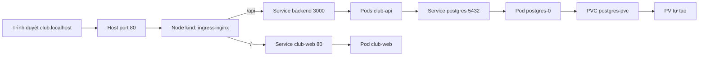
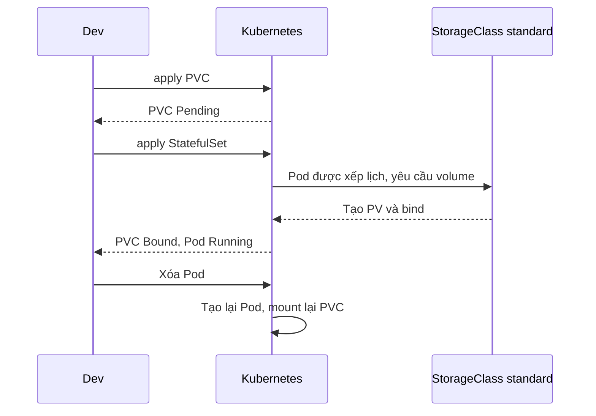

# Slide buổi 27 – Storage & Ingress

> **Tóm tắt:** Dùng PV, PVC, StorageClass để PostgreSQL giữ dữ liệu khi Pod bị xóa, và dùng ingress-nginx trên kind để truy cập ứng dụng qua host club.localhost.

## Slide 1: Mục tiêu buổi học

- Giải thích vòng đời PV, PVC, StorageClass.
- Chứng minh dữ liệu Postgres còn sau khi xóa Pod.
- Dự đoán điều gì xảy ra khi xóa PVC (Delete và Retain).
- Cài ingress-nginx cho kind, truy cập qua `club.localhost`.
- Chẩn đoán PVC Pending và Ingress 404 hoặc 503.

::: details Ghi chú giảng viên
2 phút. Nhấn: buổi này làm cho Club Management thành một ứng dụng thật, có dữ liệu bền và một cổng vào duy nhất.
:::

---

## Slide 2: Vấn đề 1 – dữ liệu biến mất

- Postgres chạy như một Pod, dữ liệu nằm trong filesystem tạm của container.
- `kubectl delete pod` hoặc Node khởi động lại: danh sách thành viên mất.
- Database mất dữ liệu mỗi khi Pod chết thì không dùng được.

::: details Ghi chú giảng viên
2 phút. Liên hệ phần volume ở Docker/Compose và Tình huống 04 database mất dữ liệu. Hỏi: "Ở Compose, ta giải quyết việc này bằng gì?" (Named volume.)
:::

---

## Slide 3: Vấn đề 2 – chỉ có port-forward

- Service `ClusterIP` chỉ truy cập được từ trong cluster.
- Mỗi Service một lệnh `port-forward`, một cổng khác nhau.
- Người dùng thật chỉ gõ một tên miền.
- Cần một cổng vào duy nhất quyết định request đi tới frontend hay API.

::: details Ghi chú giảng viên
2 phút. Câu hỏi: "Nếu có 10 dịch vụ, bạn mở 10 cổng port-forward?" Dẫn sang Ingress.
:::

---

## Slide 4: Ba đối tượng storage

| Đối tượng | Ý nghĩa | Ai tạo |
| --- | --- | --- |
| PersistentVolume (PV) | Phần dung lượng thật trong cluster | Admin hoặc provisioner |
| PersistentVolumeClaim (PVC) | Yêu cầu dung lượng và access mode | Developer |
| StorageClass | Loại storage, cách tạo PV tự động | Admin |

- Pod tham chiếu PVC, PVC bind với PV, PV trỏ tới storage thật.
- Dynamic provisioning: bạn chỉ tạo PVC, StorageClass tạo PV.

::: details Ghi chú giảng viên
3 phút. Ví von: PVC là phiếu đặt chỗ, PV là chỗ ngồi thật, StorageClass là nhà hàng tự xếp chỗ. Hỏi: "Developer thường tạo đối tượng nào?" (PVC.)
:::

---

## Slide 5: Reclaim policy và binding mode

| Thuộc tính | Giá trị | Ý nghĩa |
| --- | --- | --- |
| reclaimPolicy | `Delete` | Xóa PVC thì PV và dữ liệu mất theo |
| reclaimPolicy | `Retain` | PV còn, trạng thái `Released`, dữ liệu giữ lại |
| volumeBindingMode | `WaitForFirstConsumer` | Chờ có Pod dùng PVC mới tạo PV |
| accessModes | `ReadWriteOnce` | Một node đọc/ghi, hợp với database |

- Kind: StorageClass `standard`, policy `Delete`, `WaitForFirstConsumer`.
- PVC `Pending` ngay khi tạo là bình thường.

::: details Ghi chú giảng viên
3 phút. Câu hỏi: "Cluster 3 node mà PV được tạo trước khi biết Pod chạy ở node nào thì sai ở đâu?" (PV local có thể nằm ở node khác Pod.)
:::

---

## Slide 6: Vì sao database dùng StatefulSet

- Deployment cho workload không trạng thái; database cần danh tính và storage riêng.
- Pod `postgres-0` giữ tên ổn định khi được tạo lại.
- `postgres.yaml` của starter tạo `postgres-pvc` tường minh rồi mount vào.
- Xóa Pod hoặc StatefulSet không xóa PVC; chỉ xóa PVC mới có thể mất dữ liệu.

::: details Ghi chú giảng viên
2 phút. Nhiều replica thì dùng `volumeClaimTemplates` để mỗi Pod có PVC riêng; lab dùng 1 replica nên PVC tường minh để nhìn rõ từng đối tượng.
:::

---

## Slide 7: Ingress và Ingress controller

| Thành phần | Vai trò |
| --- | --- |
| Ingress | Luật: host nào, path nào, tới Service nào |
| Ingress controller | Pod proxy thật, đọc Ingress và áp dụng |
| IngressClass | Chọn controller (`ingressClassName: nginx`) |

- Chỉ tạo Ingress mà không cài controller: không có gì xảy ra.
- Path dài hơn thắng: `/api` thắng `/`.
- `Prefix`: `/api` khớp `/api` và `/api/members`.

::: details Ghi chú giảng viên
3 phút. Câu hỏi: "Ingress khác Service LoadBalancer thế nào?" (Ingress ở tầng HTTP, host và path; LoadBalancer ở tầng TCP/UDP.)
:::

---

## Slide 8: Kiến trúc truy cập



::: details Ghi chú giảng viên
Đi theo một request `GET http://club.localhost/api/members`, 3 phút. Nhấn: `.localhost` luôn trỏ về 127.0.0.1; Docker map port 80 của máy vào node kind nhờ `extraPortMappings`.
:::

---

## Slide 9: Vòng đời PVC khi tạo Pod



- Pod mới mount lại cùng PVC nên thấy cùng dữ liệu.

::: details Ghi chú giảng viên
2 phút. Câu hỏi: "PVC Pending ở bước hai có phải lỗi không?" (Không, chỉ đang chờ Pod.)
:::

---

## Slide 10: Demo 1 – StorageClass và PVC Pending

```bash
kubectl get storageclass
kubectl apply -f starter-project/k8s/namespace.yaml
kubectl get pvc -n club demo-pvc
kubectl describe pvc demo-pvc -n club
```

Kết quả mong đợi (rút gọn):

```text
NAME                 PROVISIONER             RECLAIMPOLICY   VOLUMEBINDINGMODE
standard (default)   rancher.io/local-path   Delete          WaitForFirstConsumer
```

- `demo-pvc` ở `Pending`, Events nói "waiting for first consumer".
- Lỗi hay gặp: `get pvc` báo not found vì chưa tạo `demo-pvc` (xem YAML trong bài lab buổi 27).

::: details Ghi chú giảng viên
Tạo `demo-pvc` 100Mi bằng `kubectl apply -n club -f -` với heredoc như trong bài lab. 4 phút. Hỏi lớp: "Pending ở đây là lỗi không?" Sau đó chuyển slide tiếp.
:::

---

## Slide 11: Demo 2 – dữ liệu sống sót qua xóa Pod

```bash
kubectl wait -n club --for=condition=Ready pod/demo-writer --timeout=60s
kubectl get pvc,pv -n club
kubectl delete pod demo-writer -n club
kubectl exec -n club demo-writer -- cat /data/log.txt
```

- PVC chuyển `Bound`, xuất hiện PV tên dạng `pvc-xxxxxxxx`.
- Sau khi apply lại Pod, file `log.txt` có hai dòng ngày giờ.
- Dọn dẹp: xóa Pod và `demo-pvc`, `kubectl get pv` không còn PV (policy Delete).

::: details Ghi chú giảng viên
Pod `demo-writer` dùng `busybox:1.36`, ghi `date` vào `/data/log.txt`. 5 phút. Lưu ý lệnh `exec` chỉ chạy được sau khi apply lại Pod. Hỏi: "Giờ xóa PVC thì file còn không?"
:::

---

## Slide 12: Lab L1 – tạo cluster có port mapping

```bash
kind create cluster --name club --config k8s/kind-config.yaml
kind load docker-image club-api:1.0.0 --name club
kind load docker-image club-web:1.0.0 --name club
```

Kết quả mong đợi:

```text
Creating cluster "club" ...
Set kubectl context to "kind-club"
```

- Cần nhãn `ingress-ready=true` và `extraPortMappings` cho port 80, 443.
- Port mapping chỉ đặt được lúc tạo cluster.
- Lỗi hay gặp: port 80 bị chiếm, hoặc quên nạp image vào kind.

::: details Ghi chú giảng viên
Học viên làm trong WSL. 5 phút. Nếu có cluster `club` cũ mà thiếu port mapping, `kind delete cluster --name club` rồi tạo lại (lệnh này xóa mọi workload trong cluster đó).
:::

---

## Slide 13: Lab L1 – Postgres với PVC

```bash
kubectl apply -f k8s/namespace.yaml
kubectl apply -f k8s/configmap.yaml
kubectl create secret generic club-secrets -n club --from-literal=db-password='lab-local-pass-27'
kubectl apply -f k8s/postgres.yaml
kubectl get pvc -n club
kubectl exec -i -n club postgres-0 -- psql -U club -d clubdb < database/init.sql
```

- PVC `Pending` rồi `Bound`; Pod `postgres-0` thành `1/1 Running`.
- Kubernetes không tự chạy `init.sql` như Compose, bạn phải chạy tay.
- Mật khẩu chỉ dùng cho lab local, không commit.

::: details Ghi chú giảng viên
5 phút. Nếu `postgres-0` vào CrashLoopBackOff và log báo thư mục data không rỗng: thiếu `PGDATA` trỏ thư mục con. Starter đã đặt sẵn; học viên tự chỉnh YAML mới gặp lỗi này.
:::

---

## Slide 14: Lab L1 – xóa Pod, dữ liệu còn

```bash
kubectl delete pod postgres-0 -n club
kubectl exec -n club postgres-0 -- psql -U club -d clubdb -c "SELECT count(*) FROM members;"
```

```text
 count
-------
     3
```

- 3 dòng: Alice, Bob và dòng bạn tự thêm.
- StatefulSet tạo lại Pod cùng tên `postgres-0`, mount lại PVC.
- Lỗi hay gặp: gọi `exec` quá sớm khi Pod chưa Ready.

::: details Ghi chú giảng viên
Chờ Pod `Running` rồi mới truy vấn (`kubectl get pods -n club -w`). 4 phút. Số 3 đúng nếu học viên đã insert thêm một dòng ở bước trước; hỏi lớp nếu kết quả khác.
:::

---

## Slide 15: Lab L1 – cài ingress-nginx và gọi qua host

```bash
kubectl apply -f https://raw.githubusercontent.com/kubernetes/ingress-nginx/controller-v1.12.1/deploy/static/provider/kind/deploy.yaml
kubectl wait --namespace ingress-nginx --for=condition=ready pod --selector=app.kubernetes.io/component=controller --timeout=120s
kubectl apply -f k8s/ingress.yaml
curl -s -H "Host: club.localhost" http://127.0.0.1/api/members
```

- Kết quả mong đợi: JSON danh sách thành viên; `/` trả mã `200`.
- URL ghim tag `controller-v1.12.1` để cả lớp cùng một phiên bản.
- Lưu ý: dự án ingress-nginx đã thông báo ngừng bảo trì; bản ghim vẫn dùng được cho lab local.

::: details Ghi chú giảng viên
Lần đầu kéo image có thể mất 1-2 phút, tranh thủ giải thích file `k8s/ingress.yaml` từng dòng. 6 phút. Hỏi: "Nếu đổi thứ tự hai path thì /api/members đi đâu?" (Vẫn tới backend, vì path dài hơn thắng.)
:::

---

## Slide 16: Debug – PVC Pending mãi

```bash
kubectl describe pvc broken-pvc -n club
kubectl get storageclass
```

```text
storageclass.storage.k8s.io "fast-ssd" not found
```

- Phân biệt với Pending bình thường: ở đó Events nói "waiting for first consumer".
- Nguyên nhân gốc: tên StorageClass sai nên không provisioner nào xử lý.
- Sửa: xóa PVC, tạo lại với `standard` hoặc bỏ `storageClassName`.

::: details Ghi chú giảng viên
Mentor tạo `broken-pvc` với `storageClassName: fast-ssd` (YAML trong bài lab). Học viên chỉ nhận triệu chứng. 4 phút. Liên hệ Tình huống 09 Pod Pending.
:::

---

## Slide 17: Debug – Ingress 404, 503 và Connection refused

| Triệu chứng | Nguyên nhân thường gặp | Kiểm tra |
| --- | --- | --- |
| `404` | Thiếu header Host đúng, thiếu `ingressClassName` | `curl -H "Host: club.localhost"`, `get ingressclass` |
| `503` | Service không tồn tại hoặc không có Pod Ready | `describe ingress`, `get svc,endpoints` |
| `Connection refused` | Cluster thiếu `extraPortMappings` | `docker ps`, cột PORTS |

```bash
kubectl describe ingress club -n club
kubectl logs -n ingress-nginx -l app.kubernetes.io/component=controller --tail=20
```

::: details Ghi chú giảng viên
Cho lớp thử `curl http://127.0.0.1/api/members` không có header Host để thấy 404. 4 phút. Thứ tự debug theo lớp: PVC, Pod, Service và endpoints, Ingress, cuối cùng log controller.
:::

---

## Slide 18: Thử thách L2

- Vòng đời PV/PVC: dự đoán rồi kiểm chứng (xóa StatefulSet, xóa PVC), ghi bảng dự đoán/kết quả.
- Giải thích vì sao xóa PVC khi Pod còn dùng thì PVC ở `Terminating` (finalizer bảo vệ).
- Chuyển PV sang `Retain`, xóa PVC, quan sát PV `Released`, nêu cách phục hồi bằng `claimRef`.
- Thêm host thứ hai `api.club.localhost` chuyển toàn bộ tới Service `backend`.

```bash
PV=$(kubectl get pvc postgres-pvc -n club -o jsonpath='{.spec.volumeName}')
kubectl patch pv "$PV" -p '{"spec":{"persistentVolumeReclaimPolicy":"Retain"}}'
```

::: details Ghi chú giảng viên
Cho học viên L2 làm độc lập. Cảnh báo: xóa PVC với policy `Delete` làm mất dữ liệu vĩnh viễn, phải chạy lại `init.sql`. Với local-path và Retain, dữ liệu nằm trên node nên phải dọn thủ công.
:::

---

## Slide 19: Recap

- PVC tách dữ liệu khỏi vòng đời Pod; xóa Pod không mất dữ liệu, xóa PVC thì có thể.
- Trên kind: `standard`, policy `Delete`, `WaitForFirstConsumer`.
- Database dùng StatefulSet, RWO, `PGDATA` trỏ thư mục con; chạy `init.sql` là việc của bạn.
- Ingress chỉ là luật; cần controller, và kind cần port mapping cùng nhãn node.
- Path dài hơn thắng: `/api` tới backend, `/` tới frontend.
- Debug theo lớp: PVC, Pod, Service và endpoints, Ingress, log controller.

::: details Ghi chú giảng viên
2 phút. Hỏi lại: "Hôm nay xóa PVC rồi apply lại postgres.yaml, database rỗng. Vì sao?" Nhắc nộp `lab-27/` gồm `report.md` và evidence.
:::
