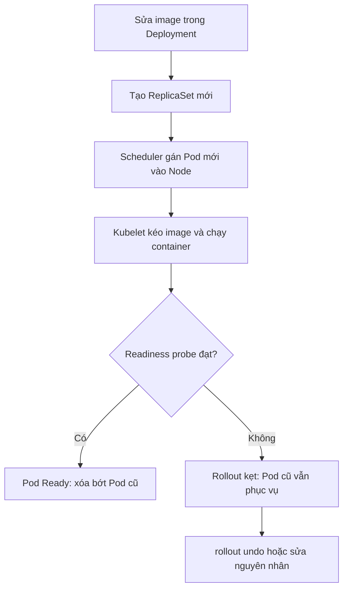

# Slide buổi 28 – Kubernetes Operations

> **Tóm tắt:** Vận hành workload trên Kubernetes: rollout, rollback, scale, đọc events, và chẩn đoán ImagePullBackOff, CrashLoopBackOff, Pending theo quy trình từ triệu chứng đến nguyên nhân gốc. Bài lab đầy đủ: [Buổi 28](../../labs/week-14/session-28.md).

## Slide 1: Mục tiêu buổi học

- Giải thích Deployment cập nhật Pod bằng ReplicaSet mới, vai trò `maxSurge` và `maxUnavailable`.
- Dùng `rollout status`, `history`, `undo` và `scale`.
- Đọc `describe` và `events` để tìm lý do thật sự Pod không chạy.
- Chẩn đoán ImagePullBackOff, CrashLoopBackOff, Pending bằng bằng chứng.
- Viết Troubleshooting report 5 mục.

---

## Slide 2: Vấn đề thực tế

- Trước buổi demo CLB, một bạn đẩy bản `club-api` mới lên cluster.
- Web vẫn chạy nhưng bản mới không lên; `get pods` đầy chữ đỏ, cả nhóm chat "sập rồi".
- Không có quy trình: xóa Pod, apply lại, đổi lung tung cho tới khi "có vẻ ổn".
- Lần sau lỗi quay lại vì chưa biết nguyên nhân gốc.

---

## Slide 3: Rollout là thay ReplicaSet

- Đổi `spec.template` (image, env, probe) thì Deployment tạo ReplicaSet mới; Pod chuyển dần từ cũ sang mới.
- ReplicaSet cũ giữ lại với 0 replica làm điểm quay về; chỉ đổi `replicas` thì không có revision mới.

| Tham số | Ý nghĩa | Mặc định |
| --- | --- | --- |
| `maxSurge` | Số Pod dư tối đa trong lúc cập nhật | 25% (làm tròn lên) |
| `maxUnavailable` | Số Pod tối đa không sẵn sàng | 25% (làm tròn xuống) |
| `revisionHistoryLimit` | Số ReplicaSet cũ giữ lại | 10 |
| `progressDeadlineSeconds` | Hết hạn thì rollout coi là thất bại | 600 |

- 3 replicas: surge 1, unavailable 0: tạo 1 Pod mới, chờ Ready rồi mới xóa 1 Pod cũ.
- Bản mới hỏng thì Pod cũ vẫn phục vụ: an toàn, nhưng lỗi dễ bị bỏ sót.

---

## Slide 4: Ba trạng thái lỗi kinh điển

| Trạng thái | Nghĩa là | Bằng chứng đầu tiên |
| --- | --- | --- |
| `ImagePullBackOff` | Kubelet không kéo được image | `describe pod`, Events |
| `CrashLoopBackOff` | Container thoát liên tục | `logs --previous`, Last State |
| `Pending` | Scheduler chưa gán Node | Events `FailedScheduling` |

- `BackOff` là thời gian chờ tăng dần (10s, 20s, 40s, tối đa 5 phút), không phải lỗi riêng.
- Nguyên nhân thật nằm ở lần thất bại trước đó.

---

## Slide 5: Bộ công cụ chẩn đoán

| Lệnh | Dùng khi |
| --- | --- |
| `kubectl get pods -o wide` | Xem trạng thái, restart, node |
| `kubectl describe pod TEN_POD` | Events, Last State, exit code |
| `kubectl get events --sort-by=.lastTimestamp` | Dòng thời gian trong namespace |
| `kubectl logs TEN_POD --previous` | Log lần chạy trước khi crash |
| `kubectl rollout undo deployment/TEN` | Quay về revision trước |

- Events chỉ giữ khoảng 1 giờ: lưu output vào `evidence/` ngay khi chẩn đoán.

---

## Slide 6: Kiến trúc rollout

- Lỗi ở nút nào thì ra trạng thái nào? Nút C: Pending. Nút D: ImagePullBackOff hoặc CrashLoopBackOff. Nút E: Running nhưng 0/1.

---

## Slide 7: Quy trình chẩn đoán chuẩn

- Trạng thái, rồi events, rồi logs: luôn theo thứ tự này.
- Không đoán mò, không xóa Pod rồi hy vọng.

---

## Slide 8: Demo 1 – deploy và nâng cấp

- Tạo Deployment `web` 3 replicas với `nginx:1.26` trong namespace `ops-demo`, chờ `rollout status`.
- Đổi image sang `nginx:1.27`, xem hai ReplicaSet: một mới (3 Pod), một cũ (0 Pod).
- Hỏi lớp: phía sau lệnh create có những object nào? Vì sao ReplicaSet cũ vẫn còn?
- Lỗi hay gặp: gõ sai tên container trong `set image` (ở đây là `nginx`).

---

## Slide 9: Demo 2 – tag sai, lỗi im lặng

- Đặt tag không tồn tại, `rollout status --timeout=45s` hết thời gian.
- Ba Pod cũ vẫn `Running`, một Pod mới `ImagePullBackOff`: người dùng không thấy lỗi.
- Không chạy `rollout status` thì không ai biết bản mới chưa lên.

---

## Slide 10: Demo 3 – đọc nguyên nhân rồi rollback

- Đọc events loại Warning trước khi `undo` để biết vì sao.
- `undo` đưa `spec.template` về revision liền trước.
- Rollback xong chưa hết việc: phải tìm vì sao tag sai lọt vào và phòng tránh.

---

## Slide 11: Lab – ba lần tự phá, tự sửa

| Lỗi | Cách gây | Bằng chứng ở đâu | Cách sửa |
| --- | --- | --- | --- |
| ImagePullBackOff | Tag không tồn tại | Events của `describe pod` | `rollout undo`, sửa tag |
| CrashLoopBackOff | Container `exit 1` vì thiếu biến | `logs --previous`, `Exit Code` | Thêm biến, sửa nguyên nhân gốc |
| Pending | `requests.cpu` quá lớn | Events `FailedScheduling` | Giảm `requests` |

- Gợi ý exit code: 1 lỗi ứng dụng, 137 bị kill (xem `Reason`), 127 lệnh không tồn tại.
- Không dùng `undo` cho `crashy`: revision 1 cũng hỏng.
- Lệnh từng bước nằm trong [Buổi 28 – Kubernetes Operations](../../labs/week-14/session-28.md); nhớ `rollout status --timeout` và lưu output vào `evidence/`.

---

## Slide 12: Lỗi thường gặp

| Triệu chứng | Nguyên nhân | Xử lý |
| --- | --- | --- |
| `ImagePullBackOff` với image tự build | Chưa `kind load docker-image` | Nạp image vào kind |
| `ImagePullBackOff` với `unauthorized` | Image private chưa có imagePullSecret | Tạo Secret docker-registry, không commit token |
| `CrashLoopBackOff`, `logs` trống | Đang xem log container mới | `logs --previous` |
| `Pending`, `Insufficient cpu` | `requests` lớn hơn chỗ trống | Giảm `requests` |
| `rollout status` treo lâu | Chờ tới `progressDeadlineSeconds` | Thêm `--timeout=60s` |

- Undo xong mà lỗi quay lại lần deploy sau là do chỉ rollback, chưa sửa nguyên nhân gốc.

---

## Slide 13: Thử thách L2 và tình huống tổng hợp

- Ba tình huống `scenario-07`, `08`, `09`: chỉ nhận triệu chứng, tự tìm nguyên nhân gốc.
- Trên ứng dụng thật: đổi image `club-api` sang `9.9.9`, giải thích vì sao web vẫn chạy, rồi khôi phục.
- Viết `report.md` 5 mục: triệu chứng, bằng chứng, nguyên nhân gốc, cách khắc phục, phòng tránh.
- Tình huống tổng hợp: sau cập nhật có Pod không Ready (`Running` nhưng `0/1`) nhưng web vẫn mở được.
- Chi tiết: [Buổi 28 – Thử thách nâng cao](../../labs/week-14/session-28-challenge.md).

---

## Slide 14: Recap

- Rollout tạo ReplicaSet mới; ReplicaSet cũ giữ lại để `rollout undo`.
- Luôn chạy `rollout status` sau deploy vì Pod cũ che lỗi.
- Thứ tự chẩn đoán: `get pods`, `describe`, `logs --previous`, rồi mới sửa.
- ImagePullBackOff là lỗi lấy image, CrashLoopBackOff là app thoát liên tục, Pending là chưa được xếp lịch.
- Rollback cứu dịch vụ, không thay việc tìm nguyên nhân gốc.
- Report 5 mục: triệu chứng, bằng chứng, nguyên nhân, cách sửa, phòng tránh.
