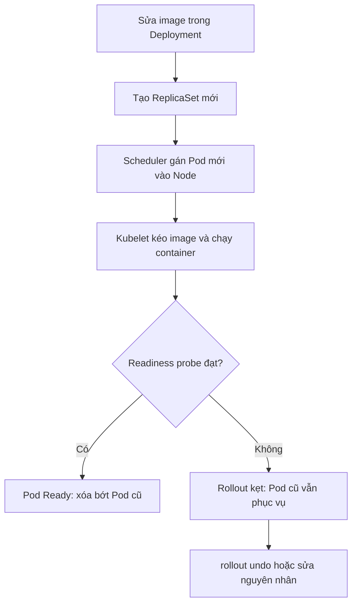
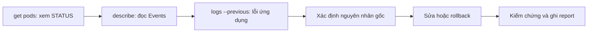

# Slide buổi 28 – Kubernetes Operations

> **Tóm tắt:** Vận hành workload trên Kubernetes: rollout, rollback, scale, đọc events, và chẩn đoán ImagePullBackOff, CrashLoopBackOff, Pending theo quy trình từ triệu chứng đến nguyên nhân gốc.

## Slide 1: Mục tiêu buổi học

- Giải thích Deployment cập nhật Pod bằng ReplicaSet mới, vai trò `maxSurge` và `maxUnavailable`.
- Dùng `rollout status`, `history`, `undo` và `scale`.
- Đọc `describe` và `events` để tìm lý do thật sự Pod không chạy.
- Chẩn đoán ImagePullBackOff, CrashLoopBackOff, Pending bằng bằng chứng.
- Viết Troubleshooting report 5 mục.

::: details Ghi chú giảng viên
2 phút. Nhấn: buổi này là buổi "đọc bằng chứng", không phải buổi thuộc lệnh. Học viên sẽ tự phá ba lỗi rồi tự sửa.
:::

---

## Slide 2: Vấn đề thực tế

- Trước buổi demo CLB, một bạn đẩy bản `club-api` mới lên cluster.
- Web vẫn chạy nhưng bản mới không lên; `get pods` đầy chữ đỏ, cả nhóm chat "sập rồi".
- Không có quy trình: xóa Pod, apply lại, đổi lung tung cho tới khi "có vẻ ổn".
- Lần sau lỗi quay lại vì chưa biết nguyên nhân gốc.

::: details Ghi chú giảng viên
2 phút. Hỏi lớp: "Bạn sẽ làm gì đầu tiên?" Ghi các đáp án lên bảng, cuối buổi so với quy trình chuẩn.
:::

---

## Slide 3: Rollout là thay ReplicaSet

- Đổi `spec.template` (image, env, probe) thì Deployment tạo ReplicaSet mới.
- Pod chuyển dần từ ReplicaSet cũ sang mới (RollingUpdate).
- ReplicaSet cũ giữ lại với 0 replica làm điểm quay về.
- Chỉ đổi `replicas` thì không có revision mới.

::: details Ghi chú giảng viên
2 phút. Câu hỏi: "Vì sao ReplicaSet cũ không bị xóa?" (Để rollback.)
:::

---

## Slide 4: maxSurge và maxUnavailable

| Tham số | Ý nghĩa | Mặc định |
| --- | --- | --- |
| `maxSurge` | Số Pod dư tối đa trong lúc cập nhật | 25% (làm tròn lên) |
| `maxUnavailable` | Số Pod tối đa không sẵn sàng | 25% (làm tròn xuống) |
| `revisionHistoryLimit` | Số ReplicaSet cũ giữ lại | 10 |
| `progressDeadlineSeconds` | Hết hạn thì rollout coi là thất bại | 600 |

- 3 replicas: surge 1, unavailable 0: tạo 1 Pod mới, chờ Ready rồi mới xóa 1 Pod cũ.
- Bản mới hỏng thì Pod cũ vẫn phục vụ: an toàn, nhưng lỗi dễ bị bỏ sót.

::: details Ghi chú giảng viên
3 phút. Hỏi: "Với 2 replicas, maxUnavailable là bao nhiêu?" (25% của 2 làm tròn xuống thành 0.)
:::

---

## Slide 5: Ba trạng thái lỗi kinh điển

| Trạng thái | Nghĩa là | Bằng chứng đầu tiên |
| --- | --- | --- |
| `ImagePullBackOff` | Kubelet không kéo được image | `describe pod`, Events |
| `CrashLoopBackOff` | Container thoát liên tục | `logs --previous`, Last State |
| `Pending` | Scheduler chưa gán Node | Events `FailedScheduling` |

- `BackOff` là thời gian chờ tăng dần (10s, 20s, 40s, tối đa 5 phút), không phải lỗi riêng.
- Nguyên nhân thật nằm ở lần thất bại trước đó.

::: details Ghi chú giảng viên
3 phút. Nhấn: dòng STATUS chỉ là triệu chứng, lý do nằm ở describe và events. Câu hỏi: "BackOff là lỗi gì?" (Không phải lỗi, chỉ là chờ.)
:::

---

## Slide 6: Bộ công cụ chẩn đoán

| Lệnh | Dùng khi |
| --- | --- |
| `kubectl get pods -o wide` | Xem trạng thái, restart, node |
| `kubectl describe pod TEN_POD` | Events, Last State, exit code |
| `kubectl get events --sort-by=.lastTimestamp` | Dòng thời gian trong namespace |
| `kubectl logs TEN_POD --previous` | Log lần chạy trước khi crash |
| `kubectl rollout undo deployment/TEN` | Quay về revision trước |

- Events chỉ giữ khoảng 1 giờ: lưu output vào `evidence/` ngay khi chẩn đoán.

::: details Ghi chú giảng viên
2 phút. Thay `TEN_POD` bằng tên thật khi gõ lệnh. Nhắc học viên dùng `tee -a evidence/command-output.txt`.
:::

---

## Slide 7: Kiến trúc rollout



::: details Ghi chú giảng viên
3 phút. Chỉ vào từng nút và hỏi: lỗi ở nút nào thì ra trạng thái nào? (Nút C: Pending. Nút D: ImagePullBackOff hoặc CrashLoopBackOff. Nút E: Running nhưng 0/1.)
:::

---

## Slide 8: Quy trình chẩn đoán chuẩn



- Trạng thái, rồi events, rồi logs: luôn theo thứ tự này.
- Không đoán mò, không xóa Pod rồi hy vọng.

::: details Ghi chú giảng viên
2 phút. So với danh sách đáp án lớp đưa ra ở Slide 2. Đây là khung dùng cho cả buổi.
:::

---

## Slide 9: Demo 1 – deploy và nâng cấp

```bash
kubectl create namespace ops-demo
kubectl create deployment web --image=nginx:1.26 --replicas=3 -n ops-demo
kubectl set image deployment/web nginx=nginx:1.27 -n ops-demo
kubectl rollout status deployment/web -n ops-demo
kubectl get rs -n ops-demo
```

```text
deployment "web" successfully rolled out
NAME             DESIRED   CURRENT   READY   AGE
web-5d9f8c7b6    3         3         3       10s
web-7c6b4f9d8    0         0         0       2m
```

- Hai ReplicaSet: một mới (3 Pod), một cũ (0 Pod).
- Lỗi hay gặp: gõ sai tên container trong `set image` (ở đây là `nginx`).

::: details Ghi chú giảng viên
Tên ReplicaSet trên máy bạn sẽ khác. Chạy `rollout status` sau lần tạo đầu để chờ Pod sẵn sàng. 4 phút. Hỏi: "Phía sau lệnh create có những object nào?" (Deployment, ReplicaSet, 3 Pod.)
:::

---

## Slide 10: Demo 2 – tag sai, lỗi im lặng

```bash
kubectl set image deployment/web nginx=nginx:1.27-khong-ton-tai -n ops-demo
kubectl rollout status deployment/web -n ops-demo --timeout=45s
kubectl get pods -n ops-demo
```

```text
error: timed out waiting for the condition
web-5d9f8c7b6-aaaaa    1/1     Running            0          2m
web-6f7d9b5c4-ddddd    0/1     ImagePullBackOff   0          45s
```

- 3 Pod cũ vẫn phục vụ, người dùng không thấy lỗi.
- Không chạy `rollout status` thì không ai biết bản mới chưa lên.

::: details Ghi chú giảng viên
4 phút. Hỏi lớp: "Người dùng có thấy lỗi không?" (Không.) Nhấn lý do phải luôn chạy `rollout status` sau deploy. Output rút gọn, danh sách Pod thực tế dài hơn.
:::

---

## Slide 11: Demo 3 – đọc nguyên nhân rồi rollback

```bash
kubectl get events -n ops-demo --field-selector type=Warning --sort-by=.lastTimestamp
kubectl rollout undo deployment/web -n ops-demo
kubectl rollout status deployment/web -n ops-demo
kubectl delete namespace ops-demo
```

- Đọc events trước khi undo để biết vì sao.
- `undo` đưa `spec.template` về revision liền trước.
- Rollback xong chưa hết việc: phải tìm vì sao tag sai lọt vào.

::: details Ghi chú giảng viên
3 phút. Dòng cuối dọn namespace demo. Hỏi: "Rollback xong là hết việc chưa?" (Chưa, cần phòng tránh lần sau.)
:::

---

## Slide 12: Lab – chuẩn bị và history

```bash
kubectl create namespace ops-lab
kubectl config set-context --current --namespace=ops-lab
kubectl apply -f source/web.yaml
kubectl rollout status deployment/web
kubectl annotate deployment/web kubernetes.io/change-cause="deploy nginx 1.26" --overwrite
kubectl rollout history deployment/web
```

```text
REVISION  CHANGE-CAUSE
1         deploy nginx 1.26
```

- `change-cause` là ghi chú cho người; thiếu nó cột này là `none`.
- Lỗi hay gặp: quên `kubectl config set-context` nên lệnh chạy sai namespace.

::: details Ghi chú giảng viên
Phát file `source/web.yaml` (Deployment `web`, 3 replicas, nginx:1.26) từ bài lab. 5 phút. Sau lab nhắc học viên đặt lại namespace mặc định nếu cần.
:::

---

## Slide 13: Lab – nâng cấp và scale

```bash
kubectl set image deployment/web nginx=nginx:1.27
kubectl annotate deployment/web kubernetes.io/change-cause="upgrade nginx 1.27" --overwrite
kubectl scale deployment/web --replicas=5
kubectl scale deployment/web --replicas=3
kubectl rollout history deployment/web
```

```text
REVISION  CHANGE-CAUSE
1         deploy nginx 1.26
2         upgrade nginx 1.27
```

- Scale chỉ đổi `replicas`, không tạo revision mới.

::: details Ghi chú giảng viên
Hỏi: "Sau hai lần scale, history có mấy revision?" (Vẫn 2.) 4 phút. Nếu học viên thấy `none` ở change-cause revision 2, họ chưa chạy lệnh annotate.
:::

---

## Slide 14: Break 1 – ImagePullBackOff

```bash
kubectl set image deployment/web nginx=nginx:1.27.999
kubectl rollout status deployment/web --timeout=45s
kubectl describe pod TEN_POD_LOI | sed -n '/Events:/,$p'
```

```text
Warning  Failed   47s  kubelet  Failed to pull image "nginx:1.27.999": ... not found
Warning  Failed   20s  kubelet  Error: ImagePullBackOff
```

- Nguyên nhân gốc: tag không tồn tại trong registry.
- Tìm từ khóa `not found`, `manifest unknown`, `unauthorized`.
- Khôi phục: `kubectl rollout undo deployment/web`, rồi kiểm tra image bằng `jsonpath`.

::: details Ghi chú giảng viên
Câu chữ thông báo thay đổi tùy runtime, dạy học viên tìm từ khóa chứ không đối chiếu từng chữ. 6 phút. Sau undo, `get deployment web -o jsonpath` phải ra `nginx:1.27`; revision được đánh số lại.
:::

---

## Slide 15: Break 2 – CrashLoopBackOff

```bash
kubectl apply -f source/crash.yaml
kubectl get pods -l app=crashy -w
kubectl logs deploy/crashy --previous
kubectl describe pod -l app=crashy | grep -A6 "Last State"
```

```text
booting
FATAL: thieu bien DB_HOST
    Last State:     Terminated
      Reason:       Error
      Exit Code:    1
```

- Gợi ý exit code: 1 lỗi ứng dụng, 137 bị kill (xem `Reason`), 127 lệnh không tồn tại.
- Sửa nguyên nhân gốc: thêm biến `DB_HOST` và giữ tiến trình chạy.
- Không dùng `undo` ở đây: revision 1 cũng hỏng.

::: details Ghi chú giảng viên
Phát `source/crash.yaml` (busybox:1.36 in log lỗi rồi `exit 1`). 7 phút. Lỗi hay gặp: `logs` trống vì xem log container mới khởi động lại, dùng `--previous`.
:::

---

## Slide 16: Break 3 – Pending

```bash
kubectl create deployment hungry --image=nginx:1.27 --replicas=1
kubectl set resources deployment/hungry --requests=cpu=100
kubectl get events --field-selector reason=FailedScheduling
```

```text
Warning   FailedScheduling   pod/hungry-yyyyyyyyyy-bbbbb   0/1 nodes are available: 1 Insufficient cpu. ...
```

- Pod `Pending` chưa chạy nên không có log: bằng chứng nằm ở events.
- Nguyên nhân gốc: `requests.cpu` là 100 core, Node chỉ có vài core.
- Sửa: `kubectl set resources deployment/hungry --requests=cpu=100m`.

::: details Ghi chú giảng viên
Rolling update che lỗi lần nữa: Pod cũ vẫn Running. 5 phút. Hỏi: "Scheduler dựa trên request hay mức dùng thực tế?" (Request.) Dọn dẹp: `kubectl delete deployment hungry crashy`.
:::

---

## Slide 17: Lỗi thường gặp

| Triệu chứng | Nguyên nhân | Xử lý |
| --- | --- | --- |
| `ImagePullBackOff` với image tự build | Chưa `kind load docker-image` | Nạp image vào kind |
| `ImagePullBackOff` với `unauthorized` | Image private chưa có imagePullSecret | Tạo Secret docker-registry, không commit token |
| `CrashLoopBackOff`, `logs` trống | Đang xem log container mới | `logs --previous` |
| `Pending`, `Insufficient cpu` | `requests` lớn hơn chỗ trống | Giảm `requests` |
| `rollout status` treo lâu | Chờ tới `progressDeadlineSeconds` | Thêm `--timeout=60s` |

::: details Ghi chú giảng viên
2 phút. Nhắc: undo xong mà lỗi quay lại lần deploy sau thì do chỉ rollback, chưa sửa nguyên nhân gốc.
:::

---

## Slide 18: Thử thách L2

- Xử lý ba tình huống trong `examples/troubleshooting/scenario-07`, `scenario-08`, `scenario-09`: chỉ nhận triệu chứng.
- Trên ứng dụng thật: đổi image `club-api` sang `9.9.9`, giải thích vì sao web vẫn chạy, rồi khôi phục.
- Viết `report.md` 5 mục cho ít nhất hai sự cố.

```bash
kubectl -n club set image deployment/club-api api=club-api:9.9.9
kubectl -n club rollout status deployment/club-api --timeout=60s
kubectl -n club rollout undo deployment/club-api
```

```text
## Sự cố NN – tên ngắn
1. Triệu chứng  2. Bằng chứng  3. Nguyên nhân gốc  4. Cách khắc phục  5. Phòng tránh
```

::: details Ghi chú giảng viên
Gợi ý cho học viên kẹt: `maxUnavailable` của 2 replicas làm tròn xuống 0, nên Pod cũ chỉ bị xóa khi Pod mới Ready. Nguyên nhân: tag `9.9.9` chưa từng được build hay nạp vào kind. Cách phát hành đúng: build `club-api:1.0.1`, `kind load docker-image`, rồi `set image`.
:::

---

## Slide 19: Tình huống tổng hợp – Pod 0/1 sau deploy

- Triệu chứng: sau cập nhật, có Pod không Ready nhưng web vẫn mở được.
- `get pods`: `Running` nhưng `0/1`, không có RESTARTS.
- `describe pod`: tìm `Readiness probe failed ... statuscode: 404`.
- Đối chiếu `readinessProbe.path` với route thật của `starter-project/backend/app.js` (`/health`, `/ready`).
- Nguyên nhân gốc: probe không khớp route; không phải lỗi image hay tài nguyên.

::: details Ghi chú giảng viên
Mentor đặt trước path thành `/readyz` rồi apply. 5 phút. Lưu ý: backend starter không ghi log từng request nên `kubectl logs` không chỉ ra đường dẫn sai. Liên hệ buổi 26 (Tình huống 10).
:::

---

## Slide 20: Recap

- Rollout tạo ReplicaSet mới; ReplicaSet cũ giữ lại để `rollout undo`.
- Luôn chạy `rollout status` sau deploy vì Pod cũ che lỗi.
- Thứ tự chẩn đoán: `get pods`, `describe`, `logs --previous`, rồi mới sửa.
- ImagePullBackOff là lỗi lấy image, CrashLoopBackOff là app thoát liên tục, Pending là chưa được xếp lịch.
- Rollback cứu dịch vụ, không thay việc tìm nguyên nhân gốc.
- Report 5 mục: triệu chứng, bằng chứng, nguyên nhân, cách sửa, phòng tránh.

::: details Ghi chú giảng viên
2 phút. Hỏi lại: "Khi nào rollout undo không giúp được?" (Không có revision tốt trước đó, hoặc lỗi nằm ngoài template như Secret, ConfigMap.) Nhắc nộp `lab-28/`.
:::
