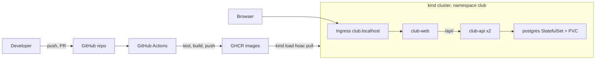
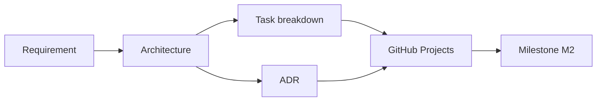

# Slide buổi 29 – Architecture & Planning

> **Tóm tắt:** Nhóm Capstone chốt requirement, vẽ kiến trúc, tạo repo từ starter-project, dựng GitHub Projects có backlog kèm tiêu chí hoàn thành và viết ba ADR đầu tiên. Bài lab đầy đủ: [Buổi 29](../../labs/week-15/session-29.md).

## Slide 1: Mục tiêu buổi học

- Biến đề bài thành requirement kiểm chứng được, mỗi dòng một tiêu chí chấp nhận
- Vẽ kiến trúc bằng mermaid: CI/CD, cluster, luồng request, nơi lưu dữ liệu
- Tạo repo nhóm từ `starter-project/`, chặn `.env` bằng `.gitignore`
- Dựng GitHub Project với ít nhất 12 Issue có owner, size, milestone
- Viết ít nhất 3 ADR có so sánh lựa chọn thật

::: details Ghi chú giảng viên
Mở buổi (3 phút). Nhấn mạnh: hôm nay không viết code ứng dụng, sản phẩm là kế hoạch dùng được cho ba buổi còn lại. Hỏi lớp: "Nhóm nào đã từng làm đồ án mà đến cuối mới biết ai làm gì?"
:::

---

## Slide 2: Ôn tập nhanh (15 phút đầu)

- Compose: `docker compose down` giữ volume, `down -v` xóa volume
- CI trên Pull Request: test, validate, build thử image
- Kubernetes: Deployment, StatefulSet, Service, Ingress trên kind
- Ba câu hỏi nhanh cho cả lớp, trả lời miệng
- Mỗi người chọn một mảng sẽ nhận trong nhóm

::: details Ghi chú giảng viên
15 phút ôn tập theo khung giờ buổi học. Gọi ngẫu nhiên: "Xóa Pod postgres thì dữ liệu mất không? Vì sao?" (không, do PVC của StatefulSet). Dùng để lớp nhớ lại toàn bộ stack trước khi vẽ kiến trúc.
:::

---

## Slide 3: Vấn đề thực tế

- Nhóm hào hứng, mở máy code ngay, không có kế hoạch chung
- Hai tuần sau: ba kiểu API khác nhau, không ai review ai
- `.env` chứa mật khẩu bị đẩy lên GitHub
- Ngày demo mới biết không ai có manifest Kubernetes chạy được
- Nguyên nhân gốc: thiếu bức tranh chung, thiếu định nghĩa "xong", thiếu người chịu trách nhiệm

::: details Ghi chú giảng viên
Kể như câu chuyện (2 phút). Chốt: lỗi không do thiếu kỹ năng mà do thiếu kế hoạch. Ba thứ nhóm sẽ làm hôm nay: repo sạch, bảng công việc, ADR.
:::

---

## Slide 4: Requirement phải kiểm chứng được

| Loại | Ví dụ | Kiểm chứng |
| --- | --- | --- |
| Chức năng | `POST /api/members` trả 201, sai dữ liệu trả 400 | `curl`, test tự động |
| Phi chức năng | Dữ liệu còn sau recreate | `down` rồi `up`, GET lại |
| Bảo mật | Không có secret trong Git | `git log -p`, rà soát |

- Xấu: "API chạy tốt". Tốt: "`GET /api/members/999` trả 404 với JSON có trường `error`"

::: details Ghi chú giảng viên
Cho lớp viết lại một requirement xấu thành tốt (2 phút). Từ "tốt" không kiểm chứng được, mã trạng thái thì có. Mã F1-F8 lấy từ đề bài Capstone.
:::

---

## Slide 5: Kiến trúc trả lời bốn câu hỏi

- Có những thành phần nào?
- Chúng nói chuyện với nhau ra sao?
- Dữ liệu nằm ở đâu?
- Code đi từ máy developer tới nơi chạy bằng đường nào?
- Starter-project đã trả lời một phần: frontend, backend, postgres, network `club-network`

::: details Ghi chú giảng viên
Không vẽ đẹp, vẽ đúng. Mentor sẽ đối chiếu sơ đồ với `compose.yaml` và `k8s/`. Hỏi: "Mũi tên này mang dữ liệu gì?"
:::

---

## Slide 6: Thành phần của starter-project

| Thành phần | Thực tế trong repo |
| --- | --- |
| Frontend | Nginx tĩnh, proxy `/api/` sang `backend:3000`, image `club-web:1.0.0` |
| Backend | Node.js 22, Express 5, pg, Deployment `club-api` 2 replicas |
| Database | PostgreSQL, `database/init.sql`, volume `postgres-data` |
| Cấu hình | `.env`, ConfigMap `club-config`, Secret `club-secrets` |

::: details Ghi chú giảng viên
Chiếu song song file thật. Nhắc: không commit giá trị secret thật, chỉ `.env.example`.
:::

---

## Slide 7: Chia việc theo lát cắt dọc

- Chia theo công cụ (A Docker, B Kubernetes, C Actions) dẫn tới tích hợp muộn
- Chia theo kết quả: "Xóa được thành viên từ giao diện" gồm API, test, frontend, README
- Mỗi lát cắt review và demo được ngay
- Issue tốt: tiêu đề bắt đầu bằng động từ, có owner, size, milestone, checklist
- Size: S dưới 1 giờ, M 1-3 giờ, L trên 3 giờ (nên tách)

::: details Ghi chú giảng viên
Hỏi: "Nếu A làm Docker và B làm Kubernetes riêng, ai phát hiện image không khớp manifest, và khi nào?"
:::

---

## Slide 8: Definition of Done và ADR

- DoD: review chéo, test xanh, tài liệu cập nhật, không có secret
- ADR: một quyết định một file, tối đa một trang, đặt tại `docs/adr/`
- Nội dung: bối cảnh, lựa chọn đã cân nhắc, quyết định, hệ quả
- Không sửa ADR cũ; tạo ADR mới thay thế
- Template: `templates/adr-template.md`

::: details Ghi chú giảng viên
ADR sẽ là tư liệu cho buổi bảo vệ kỹ thuật (buổi 32). Câu hỏi: "Vì sao chọn StatefulSet cho PostgreSQL?" dễ trả lời hơn nếu đã viết lý do từ tuần đầu.
:::

---

## Slide 9: Kiến trúc mục tiêu



::: details Ghi chú giảng viên
Đi theo hai luồng: luồng code (trái) và luồng request (phải). Dữ liệu nằm trên PVC nên xóa Pod không mất dữ liệu.
:::

---

## Slide 10: Quy trình lập kế hoạch



- Mỗi Issue gắn milestone M2, M3 hoặc M4 theo tài liệu milestones của Capstone

::: details Ghi chú giảng viên
Nhắc lớp thứ tự: không viết ADR trước khi có kiến trúc, không tạo Issue trước khi có requirement.
:::

---

## Slide 11: Demo 1 - repo từ starter-project và .gitignore

```bash
mkdir -p ~/demo-club && cp -a ~/devops-course/starter-project/. ~/demo-club/
cd ~/demo-club
git init -b main
cp .env.example .env
git check-ignore -v .env
git status --short | grep -c "\.env$"
```

- Kết quả mong đợi: `.gitignore:1:.env	.env` và số `0`
- Lỗi hay gặp: dùng `cp -r` không có `/.` nên mất file ẩn

::: details Ghi chú giảng viên
Demo 10 phút gồm slide 11-13. Hỏi lớp: "Em tạo `.env` bây giờ, `git status` có hiện không? Làm sao biết chắc?" Đáp: bằng chứng là `git check-ignore -v`, không phải niềm tin.
:::

---

## Slide 12: Demo 2 - sơ đồ và ADR mẫu

- Dán sơ đồ mermaid vào README, thêm một thành phần nhóm tự quyết (ví dụ quét image)
- Hỏi: "Thành phần mới nằm ở đâu trong luồng? Vì sao?"
- ADR mẫu: chiến lược tag image
  - Chỉ `latest`: không truy vết, không rollback
  - Tag theo SHA: truy vết chính xác
  - SHA cộng semver khi gắn tag git: truy vết và dễ đọc
- Đọc to phần Hệ quả: "Điều gì khó hơn sau quyết định này?"

::: details Ghi chú giảng viên
Đọc ADR trong 3 phút. Hệ quả cần có cả mặt dễ hơn và mặt khó hơn (manifest k8s phải cập nhật tag mỗi lần triển khai).
:::

---

## Slide 13: Demo 3 - GitHub Projects

- Tạo Issue "Add DELETE /api/members/:id" với checklist tiêu chí hoàn thành
- Gán owner, size M, milestone M2, kéo thẻ qua các cột
- Cột Status: Backlog, Ready, In progress, In review, Done
- Quy tắc WIP: mỗi người tối đa 2 thẻ In progress

```markdown
- [ ] 204 khi xóa thành công, 404 khi không có id
- [ ] Có ít nhất 2 test
- [ ] PR được reviewer chéo duyệt, CI xanh
```

::: details Ghi chú giảng viên
Giao diện GitHub Projects thay đổi theo thời gian; nếu không thấy nút, dẫn học viên tới tài liệu chính thức. Nhấn mạnh checklist chính là DoD của Issue.
:::

---

## Slide 14: Lab - năm phần trong 60 phút

| Phần | Nội dung | Phút |
| --- | --- | --- |
| 1 | Requirement và tiêu chí chấp nhận | 10 |
| 2 | Repo nhóm từ starter-project | 12 |
| 3 | Kiến trúc và phân vai | 12 |
| 4 | GitHub Projects và backlog | 14 |
| 5 | ADR | 12 |

- Làm trong WSL (`~/club-management`), không dùng `/mnt/c`

::: details Ghi chú giảng viên
Trưởng nhóm thao tác tạo repo, người còn lại clone về máy mình để kiểm tra. Đặt đồng hồ hiển thị cho lớp.
:::

---

## Slide 15: Lab L1 - repo sạch và first commit

```bash
cd ~/club-management
cp -a ~/devops-course/starter-project/. ~/club-management/
mkdir -p docs/adr
cp .env.example .env
git init -b main
git check-ignore -v .env
git add .
git status --short | grep -E "\.env$|node_modules" || echo "OK: khong co file nhay cam"
```

- Mong đợi: dòng `.gitignore:1:.env	.env` và `OK: khong co file nhay cam`
- Lỗi: `Permission denied (publickey)` khi push, dùng URL HTTPS hoặc thêm SSH key

::: details Ghi chú giảng viên
Lần commit đầu là lúc dễ lỡ tay nhất. Đi quanh lớp kiểm tra nhóm nào bỏ qua bước `check-ignore`.
:::

---

## Slide 16: Lab L1 - PR đầu tiên và bảo vệ nhánh

- Không push thẳng `main`; tạo nhánh `docs/add-pr-template`
- Mở PR, gán reviewer chéo, Squash and merge
- Branch protection: yêu cầu PR, 1 approval, status check `test`
- Repo cá nhân miễn phí có thể thiếu tính năng: ghi quy ước vào README
- Checklist L1: 12 Issue, `docs/requirements.md` F1-F8, README có sơ đồ và bảng phân vai

```bash
git switch -c docs/add-pr-template
git push -u origin docs/add-pr-template
```

::: details Ghi chú giảng viên
Check `test` chỉ xuất hiện sau khi CI chạy lần đầu ở buổi 30. Vòng review phải khép kín, không ai review PR của chính mình.
:::

---

## Slide 17: Lab L2 - thử thách

- ADR thứ tư: mock database hay database thật trong CI (so sánh 2 lựa chọn, mỗi bên một rủi ro)
- Sơ đồ phụ thuộc giữa các Issue bằng mermaid, chỉ ra đường găng tới M2
- Bảng rủi ro `docs/risks.md`: 5 rủi ro, tín hiệu cảnh báo, phương án dự phòng
- Gợi ý: xem `tests/health.test.js` và `db.js` để thấy cách tách tầng dữ liệu

::: details Ghi chú giảng viên
Cho nhóm khá. Gợi ý phương án dự phòng Ingress: `kubectl port-forward`. Đường gợi ý: API, Test, CI, Publish.
:::

---

## Slide 18: Phá lỗi - secret bị commit

```bash
mkdir -p ~/break-secret && cd ~/break-secret
git init -b main
echo "DB_PASSWORD=mat-khau-gia-lap" > .env
git add . && git commit -m "Add config"
git ls-files
```

- Triệu chứng: `git ls-files` in ra `.env`, không có thông báo lỗi nào
- Điều tra: `git check-ignore -v .env`, `git log --oneline --all -- .env`
- Xử lý: đổi (rotate) mật khẩu trước, sau đó `git rm --cached .env`
- Dọn dẹp: `rm -rf ~/break-secret`

::: details Ghi chú giảng viên
Chỉ làm trên repo thử nghiệm. Hỏi: "Xóa file ở commit sau có đủ không?" Không, lịch sử Git vẫn giữ bản cũ. Rotate là bước bắt buộc.
:::

---

## Slide 19: Lỗi thường gặp

| Triệu chứng | Cách xử lý |
| --- | --- |
| Backlog chỉ có "Làm Docker" | Viết lại theo kết quả, kèm checklist |
| Issue không có tiêu chí hoàn thành | Thêm checklist, áp DoD ở PR template |
| `.env` hiện trong `git status` | `cp -a` giữ file ẩn, kiểm tra `check-ignore` |
| Mermaid không hiển thị | Đặt nhãn trong ngoặc kép, rút ngắn |
| PR không tự đóng Issue | Thêm `Closes #12` vào mô tả PR |

::: details Ghi chú giảng viên
Chọn 2-3 dòng liên quan nhất tới nhóm đang làm. Một người nhận gần hết Issue cũng là dấu hiệu xấu: chia lại theo vòng review chéo.
:::

---

## Slide 20: Recap và nộp bài

- Requirement tốt đi kèm cách kiểm chứng; "xong" được định nghĩa trước khi code
- Chia task theo kết quả, mỗi Issue có owner, size, milestone, checklist
- ADR ghi lựa chọn và hệ quả; thay thế chứ không sửa lịch sử
- Secret đã lộ thì phải rotate; kiểm tra `.gitignore` trước commit đầu
- Nộp `lab-29/` theo template: `evidence/command-output.txt`, `report.md`, `source/`
- Buổi sau: triển khai CRUD, Compose, CI, publish GHCR

::: details Ghi chú giảng viên
Dành 15 phút cuối để mỗi nhóm trình bày 2 phút kiến trúc và một ADR, các nhóm khác đặt một câu hỏi. Nhắc không đưa `.env` hay token vào bài nộp.
:::
