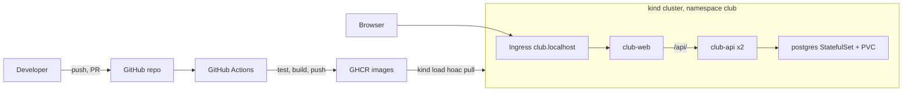
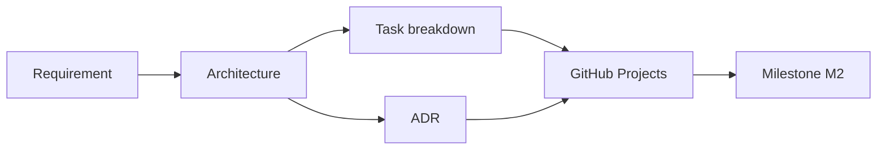

# Slide buổi 29 – Architecture & Planning

> **Tóm tắt:** Nhóm Capstone chốt requirement, vẽ kiến trúc, tạo repo từ starter-project, dựng GitHub Projects có backlog kèm tiêu chí hoàn thành và viết ba ADR đầu tiên. Bài lab đầy đủ và lệnh: [Buổi 29 – Architecture & Planning](../../labs/week-15/session-29.md). Kịch bản dạy: [Kịch bản mentor buổi 29](../../mentors/sessions/session-29.md).

## Slide 1: Mục tiêu buổi học

- Biến đề bài thành requirement kiểm chứng được, mỗi dòng một tiêu chí chấp nhận
- Vẽ kiến trúc bằng mermaid: CI/CD, cluster, luồng request, nơi lưu dữ liệu
- Tạo repo nhóm từ `starter-project/`, chặn `.env` bằng `.gitignore`
- Dựng GitHub Project với ít nhất 12 Issue có owner, size, milestone
- Viết ít nhất 3 ADR có so sánh lựa chọn thật

---

## Slide 2: Ôn tập nhanh

- Compose: `docker compose down` giữ volume, `down -v` xóa volume
- CI trên Pull Request: test, validate, build thử image
- Kubernetes: Deployment, StatefulSet, Service, Ingress trên kind
- Mỗi người chọn một mảng sẽ nhận trong nhóm

---

## Slide 3: Vấn đề thực tế

- Nhóm hào hứng, mở máy code ngay, không có kế hoạch chung
- Hai tuần sau: ba kiểu API khác nhau, không ai review ai
- `.env` chứa mật khẩu bị đẩy lên GitHub
- Ngày demo mới biết không ai có manifest Kubernetes chạy được
- Nguyên nhân gốc: thiếu bức tranh chung, thiếu định nghĩa "xong", thiếu người chịu trách nhiệm

---

## Slide 4: Requirement phải kiểm chứng được

| Loại | Ví dụ | Kiểm chứng |
| --- | --- | --- |
| Chức năng | `POST /api/members` trả 201, sai dữ liệu trả 400 | `curl`, test tự động |
| Phi chức năng | Dữ liệu còn sau recreate | `down` rồi `up`, GET lại |
| Bảo mật | Không có secret trong Git | `git log -p`, rà soát |

- Xấu: "API chạy tốt". Tốt: "`GET /api/members/999` trả 404 với JSON có trường `error`"

---

## Slide 5: Kiến trúc trả lời bốn câu hỏi

- Có những thành phần nào?
- Chúng nói chuyện với nhau ra sao?
- Dữ liệu nằm ở đâu?
- Code đi từ máy developer tới nơi chạy bằng đường nào?
- Starter-project đã trả lời một phần:

| Thành phần | Thực tế trong repo |
| --- | --- |
| Frontend | Nginx tĩnh, proxy `/api/` sang `backend:3000`, image `club-web:1.0.0` |
| Backend | Node.js 22, Express 5, pg, Deployment `club-api` 2 replicas |
| Database | PostgreSQL, `database/init.sql`, volume `postgres-data` |
| Cấu hình | `.env`, ConfigMap `club-config`, Secret `club-secrets` |

---

## Slide 6: Chia việc theo lát cắt dọc

- Chia theo công cụ (A Docker, B Kubernetes, C Actions) dẫn tới tích hợp muộn
- Chia theo kết quả: "Xóa được thành viên từ giao diện" gồm API, test, frontend, README
- Mỗi lát cắt review và demo được ngay
- Issue tốt: tiêu đề bắt đầu bằng động từ, có owner, size, milestone, checklist
- Size: S dưới 1 giờ, M 1-3 giờ, L trên 3 giờ (nên tách)

---

## Slide 7: Definition of Done và ADR

- DoD: review chéo, test xanh, tài liệu cập nhật, không có secret
- ADR: một quyết định một file, tối đa một trang, đặt tại `docs/adr/`
- Nội dung: bối cảnh, lựa chọn đã cân nhắc, quyết định, hệ quả
- Không sửa ADR cũ; tạo ADR mới thay thế
- Template: `templates/adr-template.md`

---

## Slide 8: Kiến trúc mục tiêu

---

## Slide 9: Quy trình lập kế hoạch

- Mỗi Issue gắn milestone M2, M3 hoặc M4 theo tài liệu milestones của Capstone

---

## Slide 10: Demo - repo nhóm mẫu

- Tạo repo từ `starter-project/` bằng `cp -a` có dấu chấm cuối để giữ file ẩn
- Chứng minh `.env` bị chặn bằng `git check-ignore -v`, không bằng niềm tin
- Dán sơ đồ mermaid vào README, thêm một thành phần nhóm tự quyết (ví dụ quét image)
- Đọc to phần Hệ quả của ADR chiến lược tag: "Điều gì khó hơn sau quyết định này?"
- Tạo Issue "Add DELETE /api/members/:id": owner, size M, milestone M2, kéo qua các cột
- Quy tắc WIP: mỗi người tối đa 2 thẻ `In progress`

---

## Slide 11: Lab - năm phần trong 60 phút

| Phần | Nội dung | Phút |
| --- | --- | --- |
| 1 | Requirement và tiêu chí chấp nhận | 10 |
| 2 | Repo nhóm từ starter-project | 12 |
| 3 | Kiến trúc và phân vai | 12 |
| 4 | GitHub Projects và backlog | 14 |
| 5 | ADR | 12 |

- Làm trong WSL (`~/club-management`), không dùng `/mnt/c`
- Lệnh từng bước: [Buổi 29 – Architecture & Planning](../../labs/week-15/session-29.md)
- L1: repo sạch, PR đầu tiên, branch protection, 12 Issue, requirement F1-F8, README có sơ đồ và bảng phân vai
- L2: ADR thứ tư về chiến lược test, sơ đồ phụ thuộc và đường găng, bảng rủi ro

---

## Slide 12: Phá lỗi - secret bị commit

- Triệu chứng: `git ls-files` in ra `.env`, không có thông báo lỗi nào
- Điều tra: `git check-ignore -v .env`, `git log --oneline --all -- .env`
- Xử lý: đổi (rotate) mật khẩu trước, sau đó gỡ file khỏi theo dõi
- Xóa file ở commit sau không đủ, lịch sử Git vẫn giữ bản cũ
- Chỉ thực hành trên repo thử nghiệm, kịch bản đầy đủ ở [Buổi 29 – Thử thách thêm](../../labs/week-15/session-29-challenge.md)

---

## Slide 13: Lỗi thường gặp

| Triệu chứng | Cách xử lý |
| --- | --- |
| Backlog chỉ có "Làm Docker" | Viết lại theo kết quả, kèm checklist |
| Issue không có tiêu chí hoàn thành | Thêm checklist, áp DoD ở PR template |
| `.env` hiện trong `git status` | `cp -a` giữ file ẩn, kiểm tra `check-ignore` |
| Mermaid không hiển thị | Đặt nhãn trong ngoặc kép, rút ngắn |
| PR không tự đóng Issue | Thêm `Closes #12` vào mô tả PR |

---

## Slide 14: Recap và nộp bài

- Requirement tốt đi kèm cách kiểm chứng; "xong" được định nghĩa trước khi code
- Chia task theo kết quả, mỗi Issue có owner, size, milestone, checklist
- ADR ghi lựa chọn và hệ quả; thay thế chứ không sửa lịch sử
- Secret đã lộ thì phải rotate; kiểm tra `.gitignore` trước commit đầu
- Nộp `lab-29/` theo template: `evidence/command-output.txt`, `report.md`, `source/`
- Buổi sau: triển khai CRUD, Compose, CI, publish GHCR
