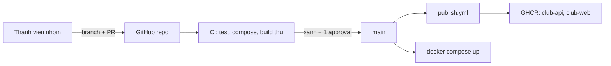
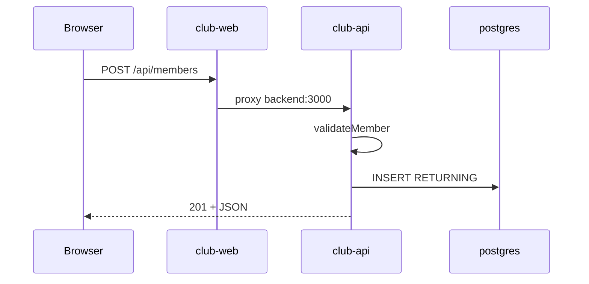

# Slide buổi 30 – Implementation

> **Tóm tắt:** Nhóm hoàn thiện CRUD API có test, giao diện web, Compose, CI trên Pull Request và publish image lên GHCR bằng PR nhỏ và review chéo, đạt mốc M2. Bài lab đầy đủ: [Buổi 30](../../labs/week-15/session-30.md).

## Slide 1: Mục tiêu buổi học

- Triển khai `GET /api/members/:id`, `POST`, `PUT`, `DELETE` với validation và mã trạng thái đúng
- Viết ít nhất 5 test chạy bằng `npm test` mà không cần PostgreSQL
- Chạy cả stack bằng Compose, chứng minh dữ liệu còn sau recreate
- CI trên Pull Request và publish image lên GHCR
- Làm việc theo PR nhỏ, review chéo

::: details Ghi chú giảng viên
Mở buổi 3 phút. Đích: sau 60 phút lab, `main` chạy được từ đầu đến cuối, kể cả khi vài tính năng nâng cao còn dang dở.
:::

---

## Slide 2: Ôn tập nhanh (15 phút đầu)

- Kế hoạch buổi 29: ai giữ vai trò nào, Issue nào ở cột Ready
- `git switch -c`, `git push -u`, mở PR, review
- Dockerfile multi-stage của backend và healthcheck Postgres
- Mỗi nhóm xác nhận `git status -sb` sạch và `.env` bị `.gitignore` chặn

```bash
cd ~/club-management && git status -sb && git check-ignore -v .env
```

::: details Ghi chú giảng viên
Hỏi nhanh từng nhóm: Issue đầu tiên bạn sẽ nhận là gì? Ai review PR của bạn? Phát hiện sớm nhóm nào chưa có repo.
:::

---

## Slide 3: Vấn đề thực tế

- Mỗi người code rất lâu trên máy riêng, ghép vào phút cuối
- API đổi tên trường mà frontend không biết
- Compose thiếu biến môi trường
- CI chưa từng chạy nên không ai biết test đang đỏ
- Lỗi tích hợp dồn thành một cục, không gỡ nổi trong 30 phút cuối

::: details Ghi chú giảng viên
Hỏi lớp: "Ai từng ghép code ngày cuối và hỏng?" Nguyên tắc hôm nay: tích hợp liên tục theo lát cắt nhỏ, mỗi PR 20-30 phút.
:::

---

## Slide 4: Lát cắt dọc và PR nhỏ

| Thứ tự | Lát cắt | Vai trò | Kiểm chứng |
| --- | --- | --- | --- |
| 1 | Tách tầng dữ liệu, CRUD, test | A Backend | `npm test` |
| 2 | Form thêm, xóa | B Frontend | Trình duyệt |
| 3 | Compose, volume | C Data | `docker compose ps` |
| 4 | CI, publish GHCR | D CI/CD | Tab Actions |

- Một PR một việc, diff dưới khoảng 200 dòng, mô tả "đã kiểm chứng bằng lệnh nào"

::: details Ghi chú giảng viên
Nhóm 3 người gộp vai trò nhưng giữ vòng review chéo. Merge theo thứ tự A, B, C, D để mọi người rebase lên `main` mới.
:::

---

## Slide 5: Tách tầng dữ liệu để test không cần DB

- Handler gọi thẳng `pool.query` thì test cần PostgreSQL thật
- Handler chỉ nói chuyện với đối tượng `repo`: list, get, create, update, remove
- Production truyền `repo` thật (SQL), test truyền `repo` giả trong bộ nhớ
- Đây là dependency injection đơn giản: truyền phụ thuộc qua tham số hàm

```js
export function createApp(repo = pgMembersRepo, db = pool) { /* ... */ }
```

::: details Ghi chú giảng viên
Hỏi: "Nếu không tách, CI cần thêm gì?" (service container PostgreSQL). Test nhanh và chạy offline là lợi ích chính.
:::

---

## Slide 6: Mã trạng thái HTTP của CRUD

| Thao tác | Thành công | Lỗi |
| --- | --- | --- |
| `GET /api/members/:id` | 200 | 400 id sai, 404 không có |
| `POST /api/members` | 201 | 400 dữ liệu sai, 409 trùng email |
| `PUT /api/members/:id` | 200 | 400, 404, 409 |
| `DELETE /api/members/:id` | 204 không body | 400, 404 |

- `email` là UNIQUE; PostgreSQL báo trùng bằng mã `23505`, API đổi thành 409 thay vì 500

::: details Ghi chú giảng viên
Mã trạng thái là một phần của hợp đồng API. Hỏi: "PUT id không tồn tại trả mã nào?" Đáp: 404.
:::

---

## Slide 7: Ba lớp kiểm tra trước khi merge

| Lớp | Công cụ | Câu hỏi |
| --- | --- | --- |
| Logic | `npm test` | Handler và validation đúng chưa? |
| Cấu hình | `docker compose config --quiet` | Compose hợp lệ, đủ biến chưa? |
| Đóng gói | `docker build` trong CI, không push | Image còn build được không? |

- Branch protection chặn merge khi CI đỏ

::: details Ghi chú giảng viên
Nhắc: CI trên PR không cần đăng nhập registry vì `push: false`. Publish chỉ chạy sau khi merge vào `main`.
:::

---

## Slide 8: Kiến trúc luồng làm việc và luồng request





::: details Ghi chú giảng viên
Dùng hai sơ đồ cùng lúc: trái là quy trình nhóm, phải là đường đi của một request. Dữ liệu sai bị chặn ở validation, không chạm tới DB.
:::

---

## Slide 9: Truy vấn tham số hóa và middleware lỗi

- Giá trị người dùng đi qua `$1`, `$2`, không nối chuỗi: an toàn trước SQL injection
- Express 5 tự chuyển lỗi của handler async vào middleware lỗi
- `23505` thành 409; JSON hỏng thành 400; lỗi khác thành 500 và ghi log
- Không lộ chi tiết lỗi nội bộ cho client

```js
const r = await pool.query(
  "DELETE FROM members WHERE id = $1", [id]);
```

::: details Ghi chú giảng viên
Hỏi: "Vì sao dùng `$1` thay vì nối chuỗi?" Gợi ý cho lớp nghĩ tới đầu vào độc hại như một câu SQL được nhét vào trường name.
:::

---

## Slide 10: Demo - hiện trạng chỉ có GET

```bash
cd ~/club-management
cp .env.example .env
docker compose up -d --build
curl -i -X POST http://localhost:3000/api/members \
  -H "Content-Type: application/json" \
  -d '{"name":"Test User","email":"test.user@example.com"}'
```

- Mong đợi: `404 Not Found` vì chưa có route `POST`
- Lỗi: cổng 3000 hoặc 8080 đang bận do stack cũ; chạy `docker compose down` trước

::: details Ghi chú giảng viên
Demo 8-10 phút gồm slide 10-11. Chạy trên curl trong WSL, không dùng PowerShell vì quote JSON dễ sai.
:::

---

## Slide 11: Demo - một route, một PR, CI chặn merge

- Tạo nhánh, thêm duy nhất `GET /api/members/:id` cùng một test
- Chạy `npm test` trước và sau khi sửa: thấy vòng đỏ rồi xanh
- Mở PR, cho lớp xem tab Checks, nhờ một học viên approve
- Cố tình push commit làm test đỏ: nút merge bị chặn
- Hỏi: "Vì sao mỗi PR chỉ một route?"

::: details Ghi chú giảng viên
Ý chính: PR nhỏ dễ review, conflict ít. Hỏi thêm: nếu hai người cùng sửa `app.js` thì conflict xảy ra ở đâu và giảm bằng cách nào (PR nhỏ, rebase thường xuyên).
:::

---

## Slide 12: Lab vai trò A - repo, validation, CRUD

- Tạo `backend/members-repo.js` chứa toàn bộ SQL
- Thay `backend/app.js` bằng factory `createApp(repo, db)`, vẫn export `app` để `health.test.js` chạy
- `validateMember` và `parseId` chặn dữ liệu sai ở rìa API
- Giữ `GET /health` và `GET /ready`

```bash
git switch main && git pull
git switch -c feature/api-crud
```

::: details Ghi chú giảng viên
Mã đầy đủ nằm trong bài lab; học viên chép từ đó. Giải thích vì sao `parseId` giới hạn tới 2147483647: kiểu INTEGER của cột SERIAL.
:::

---

## Slide 13: Lab vai trò A - test với repo giả

```bash
cd backend && npm test
```

```text
ℹ tests 8
ℹ pass 8
ℹ fail 0
```

- Test dùng `createApp(fakeRepo(), { query: async () => {} })` và `listen(0)` để lấy cổng ngẫu nhiên
- Dòng tổng kết có thể là `# tests 8` (kiểu TAP); điều cần nhìn: 8 pass, 0 fail
- Không có Node 22 trong WSL: `docker run --rm -v "$PWD/backend":/app -w /app node:22-alpine sh -c "npm ci && npm test"`
- Lỗi: test treo, server chưa đóng trong `finally`

::: details Ghi chú giảng viên
Cho lớp thấy một test cố tình sai để nhận ra output đỏ. Nhắc 8 test gồm cả 400, 404, 409 chứ không chỉ đường thành công.
:::

---

## Slide 14: Lab vai trò B và C - giao diện và dữ liệu bền vững

- B: form thêm, nút Delete; dùng `textContent`, không dùng `innerHTML` để tránh XSS
- B: sửa HTML phải `--build` lại và tải lại bằng Ctrl+F5
- C: chứng minh F8 bằng vòng `down` rồi `up`

```bash
docker compose down
docker compose up -d
until curl -sf http://localhost:3000/ready > /dev/null; do sleep 2; done
curl -s http://localhost:3000/api/members
```

- Mong đợi: bản ghi `Persist Check` vẫn còn; `down -v` mới xóa volume

::: details Ghi chú giảng viên
Hỏi: "`down` khác `down -v` thế nào?" Nhắc `init.sql` chỉ chạy khi volume còn trống, nên đổi schema phải xử lý riêng.
:::

---

## Slide 15: Lab vai trò D - CI trên PR và publish GHCR

```yaml
on:
  push:
    branches: [main]
  pull_request:
permissions:
  contents: read
```

- Ba job: `test`, `validate-compose`, `build-images` (`push: false`)
- `DB_PASSWORD: ci-only-password` chỉ là giá trị giả cho `compose config`
- `publish.yml`: bỏ tiền tố `starter-project/` bằng `sed`, kiểm tra `context: backend` và `context: frontend`
- Cần `permissions: packages: write` và `GITHUB_TOKEN`, không dán token vào file

::: details Ghi chú giảng viên
Check name chỉ hiện sau lần chạy đầu tiên, nên bật branch protection sau khi PR CI đầu tiên chạy xong. Sau merge: `gh run list --workflow publish.yml --limit 3`.
:::

---

## Slide 16: Review chéo và kiểm tra bản clone sạch

- Vòng review A, D, C, B, A: kéo nhánh về, chạy lệnh trong mô tả PR, để lại một nhận xét cụ thể
- Merge theo thứ tự A, B, C, D rồi rebase
- Dừng stack cũ trước khi thử clone sạch vì trùng cổng 3000 và 8080

```bash
git clone git@github.com:ORG/club-management.git ~/clean-check
cd ~/clean-check && cp .env.example .env && docker compose up -d --build
curl -s http://localhost:3000/api/members
```

::: details Ghi chú giảng viên
Chọn người chưa đụng vào code để chạy theo README. Nếu không chạy được thì dự án chưa xong. Thay ORG bằng tên thật.
:::

---

## Slide 17: Lab L2 - thử thách

- Tag image truy vết được: đẩy tag git `v1.1.0`, Packages hiển thị tag; giải thích vì sao không chỉ dùng `latest`
- Chặn merge khi test đỏ: ảnh chụp PR bị chặn, rồi sửa và merge
- Chạy thử trên kind: `club-api:1.1.0`, `kind load docker-image`, `kubectl set image`, `port-forward`
- Chọn ít nhất hai thử thách, ghi vào `report.md`

```bash
git tag v1.1.0 && git push origin v1.1.0
```

::: details Ghi chú giảng viên
Với kind: `init.sql` không tự chạy trên Kubernetes, cần nạp bằng `kubectl exec -i -n club postgres-0 -- psql -U club -d clubdb`. Tên cluster xem bằng `kind get clusters`.
:::

---

## Slide 18: Phá lỗi - đổi tên trường API làm trống giao diện

- A đổi truy vấn thành `name AS full_name`; B vẫn đọc `m.name`
- Triệu chứng: API 200, giao diện cột Name trống, test cũ vẫn xanh

```bash
docker compose up -d --build backend
curl -s http://localhost:3000/api/members
```

- Điều tra: DevTools tab Network, so tên trường JSON, `git log -p -- backend/members-repo.js`
- Nguyên nhân gốc: đổi contract không thông báo và không có test bảo vệ
- Phòng tránh: assertion về tên trường, ghi contract trong README

::: details Ghi chú giảng viên
Học viên phá, chẩn đoán, rồi khôi phục bằng `git restore`. Hỏi: "Test nào sẽ bắt được lỗi này?" (một test khẳng định các khóa của JSON).
:::

---

## Slide 19: Lỗi thường gặp

| Triệu chứng | Cách xử lý |
| --- | --- |
| `POST` trả `400 Invalid JSON body` | Thêm header Content-Type, chạy curl trong WSL |
| `POST` trả 500 khi email trùng | Xử lý mã `23505` thành 409 |
| Frontend báo 502 | `docker compose ps`, restart frontend |
| Thêm cột mà DB không có | `down -v` rồi `up` (local), migration nếu có dữ liệu |
| Push GHCR bị `denied` | Kiểm tra `packages: write` và bước login |

::: details Ghi chú giảng viên
Nhắc tên image GHCR phải viết thường. Với conflict lớn: nhánh sống quá lâu, rebase lên `main` mỗi lần có PR merge.
:::

---

## Slide 20: Recap và nộp bài

- PR nhỏ liên tục an toàn hơn merge lớn vào phút cuối
- Tách tầng dữ liệu qua tham số `repo` giúp test nhanh, không cần DB
- 400, 404, 409 là một phần hợp đồng API và phải có test
- CI kiểm tra ba lớp; branch protection biến CI thành cổng chặn thật
- Nộp `lab-30/`: output `npm test`, `docker compose ps`, curl CRUD, `report.md`, không có secret
- Buổi sau: kiểm thử triển khai, failure injection, checklist bảo mật

::: details Ghi chú giảng viên
Kiểm tra checklist L1 trên màn hình từng nhóm trong 15 phút cuối. Nhắc mỗi người có ít nhất một PR đã merge và đã review một PR khác.
:::
