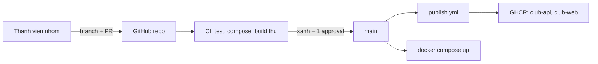
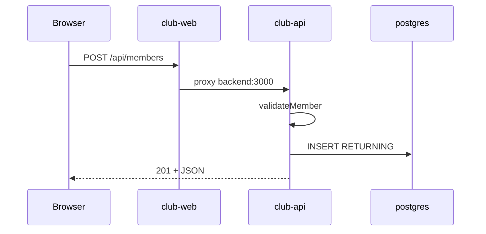

# Slide buổi 30 – Implementation

> **Tóm tắt:** Nhóm hoàn thiện CRUD API có test, giao diện web, Compose, CI trên Pull Request và publish image lên GHCR bằng PR nhỏ và review chéo, đạt mốc M2. Bài lab đầy đủ và lệnh: [Buổi 30 – Implementation](../../labs/week-15/session-30.md). Kịch bản dạy: [Kịch bản mentor buổi 30](../../mentors/sessions/session-30.md).

## Slide 1: Mục tiêu buổi học

- Triển khai `GET /api/members/:id`, `POST`, `PUT`, `DELETE` với validation và mã trạng thái đúng
- Viết ít nhất 5 test chạy bằng `npm test` mà không cần PostgreSQL
- Chạy cả stack bằng Compose, chứng minh dữ liệu còn sau recreate
- CI trên Pull Request và publish image lên GHCR
- Làm việc theo PR nhỏ, review chéo

---

## Slide 2: Ôn tập nhanh

- Kế hoạch buổi 29: ai giữ vai trò nào, Issue nào ở cột Ready
- `git switch -c`, `git push -u`, mở PR, review
- Dockerfile multi-stage của backend và healthcheck Postgres
- Mỗi nhóm xác nhận `git status -sb` sạch và `.env` bị `.gitignore` chặn

---

## Slide 3: Vấn đề thực tế

- Mỗi người code rất lâu trên máy riêng, ghép vào phút cuối
- API đổi tên trường mà frontend không biết
- Compose thiếu biến môi trường
- CI chưa từng chạy nên không ai biết test đang đỏ
- Lỗi tích hợp dồn thành một cục, không gỡ nổi trong 30 phút cuối

---

## Slide 4: Lát cắt dọc và PR nhỏ

| Thứ tự | Lát cắt | Vai trò | Kiểm chứng |
| --- | --- | --- | --- |
| 1 | Tách tầng dữ liệu, CRUD, test | A Backend | `npm test` |
| 2 | Form thêm, xóa | B Frontend | Trình duyệt |
| 3 | Compose, volume | C Data | `docker compose ps` |
| 4 | CI, publish GHCR | D CI/CD | Tab Actions |

- Một PR một việc, diff dưới khoảng 200 dòng, mô tả "đã kiểm chứng bằng lệnh nào"

---

## Slide 5: Tách tầng dữ liệu để test không cần DB

- Handler gọi thẳng `pool.query` thì test cần PostgreSQL thật
- Handler chỉ nói chuyện với đối tượng `repo`: list, get, create, update, remove
- Production truyền `repo` thật (SQL), test truyền `repo` giả trong bộ nhớ
- Đây là dependency injection đơn giản: truyền phụ thuộc qua tham số hàm

```js
export function createApp(repo = pgMembersRepo, db = pool) { /* ... */ }
```

---

## Slide 6: Mã trạng thái HTTP của CRUD

| Thao tác | Thành công | Lỗi |
| --- | --- | --- |
| `GET /api/members/:id` | 200 | 400 id sai, 404 không có |
| `POST /api/members` | 201 | 400 dữ liệu sai, 409 trùng email |
| `PUT /api/members/:id` | 200 | 400, 404, 409 |
| `DELETE /api/members/:id` | 204 không body | 400, 404 |

- `email` là UNIQUE; PostgreSQL báo trùng bằng mã `23505`, API đổi thành 409 thay vì 500

---

## Slide 7: Ba lớp kiểm tra trước khi merge

| Lớp | Công cụ | Câu hỏi |
| --- | --- | --- |
| Logic | `npm test` | Handler và validation đúng chưa? |
| Cấu hình | `docker compose config --quiet` | Compose hợp lệ, đủ biến chưa? |
| Đóng gói | `docker build` trong CI, không push | Image còn build được không? |

- Branch protection chặn merge khi CI đỏ

---

## Slide 8: Luồng làm việc và luồng request





---

## Slide 9: Truy vấn tham số hóa và middleware lỗi

- Giá trị người dùng đi qua `$1`, `$2`, không nối chuỗi: an toàn trước SQL injection
- Express 5 tự chuyển lỗi của handler async vào middleware lỗi
- `23505` thành 409; JSON hỏng thành 400; lỗi khác thành 500 và ghi log
- Không lộ chi tiết lỗi nội bộ cho client

---

## Slide 10: Demo - một route, một PR, CI chặn merge

- Hiện trạng: starter-project chỉ có `GET`, `POST` trả 404
- Tạo nhánh, thêm duy nhất `GET /api/members/:id` cùng một test
- Chạy `npm test` trước và sau khi sửa: thấy vòng đỏ rồi xanh
- Mở PR, xem tab Checks, nhờ một học viên approve
- Cố tình push commit làm test đỏ: nút merge bị chặn

---

## Slide 11: Lab - bốn vai trò làm song song

- A: `members-repo.js`, `createApp(repo, db)`, `validateMember`, `parseId`, test với repo giả
- B: form thêm, nút Delete; dùng `textContent`, không dùng `innerHTML` để tránh XSS
- C: chứng minh F8 bằng vòng `down` rồi `up`, chờ `/ready` trước khi đọc dữ liệu
- D: `ci.yml` ba job (`test`, `validate-compose`, `build-images` với `push: false`) và `publish.yml` sửa context
- Lệnh và mã gợi ý: [Buổi 30 – Implementation](../../labs/week-15/session-30.md), [Mã gợi ý và thử thách](../../labs/week-15/session-30-challenge.md)

---

## Slide 12: Review chéo và bản clone sạch

- Vòng review A, D, C, B, A: kéo nhánh về, chạy lệnh trong mô tả PR, để lại một nhận xét cụ thể
- Merge theo thứ tự A, B, C, D rồi rebase
- Dừng stack cũ trước khi thử clone sạch vì trùng cổng 3000 và 8080
- Người chưa từng đụng vào code chạy theo README: không chạy được thì dự án chưa xong

---

## Slide 13: Phá lỗi và lỗi thường gặp

- Đổi tên trường API (`name` thành `full_name`): API 200, giao diện trống, test cũ vẫn xanh
- Phòng tránh: ghi contract trong README, test khẳng định tên trường, smoke test với PostgreSQL thật

| Triệu chứng | Cách xử lý |
| --- | --- |
| `POST` trả `400 Invalid JSON body` | Thêm header Content-Type, chạy curl trong WSL |
| `POST` trả 500 khi email trùng | Xử lý mã `23505` thành 409 |
| Frontend báo 502 | `docker compose ps`, restart frontend |
| Thêm cột mà DB không có | `down -v` rồi `up` (local), migration nếu có dữ liệu |
| Push GHCR bị `denied` | Kiểm tra `packages: write` và bước login |

---

## Slide 14: Recap và nộp bài

- PR nhỏ liên tục an toàn hơn merge lớn vào phút cuối
- Tách tầng dữ liệu qua tham số `repo` giúp test nhanh, không cần DB
- 400, 404, 409 là một phần hợp đồng API và phải có test
- CI kiểm tra ba lớp; branch protection biến CI thành cổng chặn thật
- Nộp `lab-30/`: output `npm test`, `docker compose ps`, curl CRUD, `report.md`, không có secret
- Thử thách L2: tag semver, chặn merge khi test đỏ, chạy thử trên kind
- Buổi sau: kiểm thử triển khai, failure injection, checklist bảo mật
