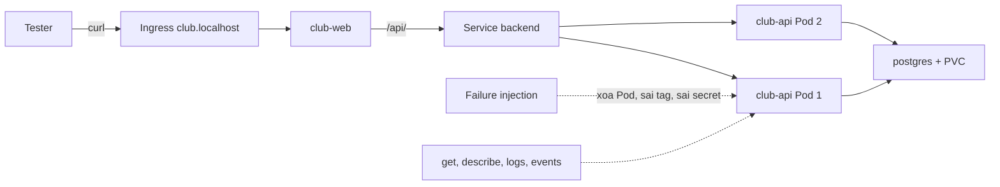

# Slide buổi 31 – Testing & Troubleshooting

> **Tóm tắt:** Kiểm thử hệ thống capstone từ máy sạch, cố ý phá bằng failure injection, đọc trạng thái, events và log để tìm nguyên nhân gốc, rồi ghi lại thành troubleshooting log và runbook.

## Slide 1: Mục tiêu buổi học

- Chạy clean-clone test cho Compose và kiểm chứng dữ liệu còn sau `down` rồi `up`
- Thực hiện 3 failure injection có kiểm soát trên kind
- Chẩn đoán bằng `get`, `describe`, `logs`, `events` thay vì đoán mò
- Áp dụng checklist bảo mật cơ bản
- Viết troubleshooting log 5 mục và runbook ngắn

::: details Ghi chú giảng viên
Mở buổi trong 2 phút. Nhấn mạnh: hôm nay là buổi "tự phá hệ thống của mình". Nhắc đây là mốc M3 của capstone. Hỏi lớp: nhóm nào đã thử clone repo của mình sang một thư mục khác chưa?
:::

---

## Slide 2: Vấn đề thực tế - "chạy trên máy tôi"

- Máy người viết code có sẵn image cũ, file `.env`, volume cũ
- Bạn cùng nhóm clone repo: `docker compose up` báo thiếu `DB_PASSWORD`
- Trên kind: Pod `club-api` báo `ImagePullBackOff` vì chưa ai `kind load`
- Code không sai, nhưng hệ thống chỉ chạy trên đúng một máy

::: details Ghi chú giảng viên
Kể câu chuyện trong 2 phút. Câu hỏi cho lớp: trong repo của nhóm, thứ gì đang "ẩn" trên máy bạn mà chưa nằm trong Git? Gợi ý: `.env`, image đã build, volume, biến môi trường.
:::

---

## Slide 3: Kiểm thử không chỉ là npm test

| Tầng | Câu hỏi | Công cụ |
| --- | --- | --- |
| Unit test | Logic đúng? | `npm test` |
| Build test | Image build từ đầu được? | `docker compose build` |
| Smoke test | Đường quan trọng còn sống? | `curl /health /ready` |
| Failure injection | Hỏng thì phản ứng thế nào? | `kubectl delete pod` |
| Clean-machine | Người khác làm lại được? | Clone mới + README |

::: details Ghi chú giảng viên
Happy path chỉ là một dòng trong bảng. Phần lớn lỗi thật nằm ở các dòng còn lại. 2 phút.
:::

---

## Slide 4: Failure injection và quy tắc an toàn

- Cố ý gây lỗi có kiểm soát để xác nhận hệ thống tự hồi phục và người vận hành nhận ra tín hiệu
- Chỉ làm trên local hoặc cluster của chính nhóm
- Mỗi lần một lỗi, ghi lại thời điểm và lệnh
- Biết cách hoàn tác trước khi bắt đầu
- Dự đoán triệu chứng trước khi chạy lệnh

::: details Ghi chú giảng viên
Yêu cầu học viên viết dự đoán ra giấy trước mỗi sự cố. So sánh dự đoán với thực tế mới là phần học được. 2 phút.
:::

---

## Slide 5: Quy trình chẩn đoán từ ngoài vào trong

| Bước | Lệnh |
| --- | --- |
| 1. Trạng thái | `kubectl get pods -n club` |
| 2. Sự kiện | `kubectl describe pod TEN_POD -n club` |
| 3. Log | `kubectl logs TEN_POD -n club` (thêm `--previous` nếu đã restart) |
| 4. Cấu hình | `kubectl get deployment club-api -n club -o yaml` |
| 5. Kết nối | `kubectl exec` hoặc `kubectl port-forward` rồi `curl` |

::: details Ghi chú giảng viên
`TEN_POD` là tên Pod thật, ví dụ `club-api-7d9f8b6c5-abcde`. Đề nghị cả lớp thuộc thứ tự này: get, describe, logs, config. 2 phút.
:::

---

## Slide 6: Kiến trúc hệ thống đang kiểm thử



::: details Ghi chú giảng viên
Chỉ theo đường đi của một request. Hỏi: nếu Pod 1 hỏng, request đi đâu? 2 phút.
:::

---

## Slide 7: Readiness và liveness trong dự án

- Service chỉ gửi traffic tới Pod đã qua readiness (`GET /ready`)
- `/ready` chạy `SELECT 1`: mất DB thì trả 503, Pod thành `0/1`
- Liveness (`GET /health`) chỉ báo tiến trình còn sống, không kiểm tra DB
- Vì vậy mất DB làm Pod `0/1` nhưng không bị restart
- Rolling update giữ Pod cũ nếu Pod mới không Ready

::: details Ghi chú giảng viên
Đây là kiến thức nền cho sự cố B và C. Câu hỏi: nếu liveness gọi `/ready`, DB gián đoạn 10 giây sẽ gây hậu quả gì? (Đáp: restart cả backend, tệ hơn.) 3 phút.
:::

---

## Slide 8: Demo 1 - trạng thái khỏe mạnh

```bash
kubectl get pods -n club
curl -s http://club.localhost/api/members
```

- Mong đợi: hai Pod `club-api` `1/1 Running`, một `club-web`, một `postgres-0`
- API trả mảng JSON có Alice và Bob
- Lỗi thường gặp: `club.localhost` không phân giải, dùng `port-forward`

::: details Ghi chú giảng viên
Hỏi lớp trước khi chạy bước sau: "Nếu tôi xóa một Pod club-api, người dùng có thấy lỗi không?" Cho 30 giây dự đoán.
:::

---

## Slide 9: Demo 2 - xóa Pod backend

```bash
kubectl delete pod -n club -l app=club-api --field-selector=status.phase=Running --wait=false
kubectl get pods -n club -w
```

- Mong đợi: Pod chuyển `Terminating`, Pod mới `ContainerCreating` rồi `Running`
- Lệnh này xóa cả hai Pod, nên có khoảng ngắn không có backend (có thể thấy 502 hoặc 503)
- Trong lab chỉ xóa một Pod để thấy khác biệt

::: details Ghi chú giảng viên
Nói rõ với lớp vì sao demo này khác sự cố A. Hỏi: replica thứ hai giúp gì? Ctrl+C để thoát chế độ theo dõi. 3 phút.
:::

---

## Slide 10: Demo 3 - tag image không tồn tại, rồi hoàn tác

```bash
kubectl set image deployment/club-api api=club-api:9.9.9 -n club
kubectl get pods -n club
kubectl rollout undo deployment/club-api -n club
kubectl rollout status deployment/club-api -n club
```

- Mong đợi: một Pod mới `ErrImagePull` rồi `ImagePullBackOff`, hai Pod cũ vẫn `Running`
- Sau `undo`: `deployment "club-api" successfully rolled out`
- Ba lệnh `get`, `describe`, `events` đã đủ để tìm nguyên nhân

::: details Ghi chú giảng viên
Hỏi: người dùng có bị gián đoạn không, vì sao? (Rolling update không tắt Pod cũ khi Pod mới chưa Ready.) 3 phút.
:::

---

## Slide 11: Lab Phần 1 - clean-clone test (Compose)

```bash
cd ~/work && rm -rf clean-check && git clone "$REPO_URL" clean-check && cd clean-check
git ls-files | grep -E '(^|/)\.env$' || echo "OK: khong co .env trong Git"
cp .env.example .env
docker compose config -q && echo "compose hop le"
docker compose up -d --build
```

- Mong đợi: `OK: khong co .env trong Git`, `compose hop le`, ba service `running`, `postgres` healthy
- Làm đúng theo README, không dùng kiến thức ngoài README
- Lỗi: thiếu `.env.example` thì ghi vào danh sách lỗi README

::: details Ghi chú giảng viên
Phần này khoảng 12 phút. Nếu `.env` bị liệt kê trong Git thì dừng lại, đó là lỗi bảo mật phải xử lý trước. Thay `ORG/club-management` bằng repo nhóm khi đặt `REPO_URL`.
:::

---

## Slide 12: Lab Phần 1 - smoke test và dữ liệu bền

```bash
curl -s http://localhost:8080/api/members
curl -s -o /dev/null -w "health=%{http_code}\n" http://localhost:3000/health
curl -s -o /dev/null -w "ready=%{http_code}\n" http://localhost:3000/ready
docker compose down
docker compose up -d
curl -s http://localhost:8080/api/members
```

- Mong đợi: JSON thành viên, `health=200`, `ready=200`, dữ liệu còn sau `down` rồi `up`
- `down` không có `-v` nên volume `postgres-data` được giữ
- Cổng 8080 hoặc 3000 bận: `docker ps` hoặc đổi `WEB_PORT` trong `.env`

::: details Ghi chú giảng viên
Nếu API nhóm chưa có POST, kiểm tra dữ liệu mẫu Alice và Bob còn nguyên. Trước khi sang kind, nhắc chạy `docker compose down` để tránh tranh chấp cổng.
:::

---

## Slide 13: Lab Phần 2 - triển khai lên kind

```bash
docker build -t club-api:1.0.0 ./backend
docker build -t club-web:1.0.0 ./frontend
kind load docker-image club-api:1.0.0 club-web:1.0.0
kubectl apply -f k8s/namespace.yaml
kubectl create secret generic club-secrets -n club --from-literal=db-password='DAT_MAT_KHAU_THU_NGHIEM' --dry-run=client -o yaml | kubectl apply -f -
kubectl apply -f k8s/configmap.yaml -f k8s/postgres.yaml -f k8s/backend.yaml -f k8s/frontend.yaml -f k8s/ingress.yaml
kubectl rollout status deployment/club-api -n club
```

- Mong đợi: `successfully rolled out`, mọi Pod `Running` và Ready
- Secret tạo bằng lệnh, không commit file chứa mật khẩu
- Cluster tên khác mặc định: thêm `--name TEN_CLUSTER`

::: details Ghi chú giảng viên
Mật khẩu phải khớp mật khẩu PostgreSQL đã khởi tạo trên PVC. Nếu dùng lại PVC cũ với mật khẩu khác, backend sẽ không vào được DB. Đo độ trễ bằng vòng lặp 5 request curl với `-w "%{http_code} %{time_total}s\n"`.
:::

---

## Slide 14: Lab Phần 3 - sự cố A và B

```bash
POD=$(kubectl get pods -n club -l app=club-api -o jsonpath='{.items[0].metadata.name}')
kubectl delete pod "$POD" -n club
kubectl set image deployment/club-api api=club-api:9.9.9 -n club
kubectl get events -n club --sort-by=.lastTimestamp | tail -8
kubectl rollout undo deployment/club-api -n club
```

- A: mã `200` liên tục, Pod mới thay thế Pod bị xóa
- B: một Pod `ImagePullBackOff`, events có `Failed to pull image`
- Nguyên nhân B: image `club-api:9.9.9` không có trong node kind
- Ghi một dòng troubleshooting log cho mỗi sự cố

::: details Ghi chú giảng viên
Chạy A và B tuần tự, không song song. Giữa hai sự cố, xác nhận cluster đã khỏe lại bằng `kubectl get pods`. Khoảng 10 phút cho hai sự cố.
:::

---

## Slide 15: Lab Phần 3 - sự cố C, sai mật khẩu DB

```bash
ORIG_PW=$(kubectl get secret club-secrets -n club -o jsonpath='{.data.db-password}' | base64 -d)
kubectl create secret generic club-secrets -n club --from-literal=db-password='SAI_MAT_KHAU' --dry-run=client -o yaml | kubectl apply -f -
kubectl rollout restart deployment/club-api -n club
NEWPOD=$(kubectl get pods -n club -l app=club-api --sort-by=.metadata.creationTimestamp -o name | tail -n 1)
kubectl exec "$NEWPOD" -n club -- wget -qO- http://localhost:3000/api/members
kubectl logs "$NEWPOD" -n club --tail=10
```

- Mong đợi: Pod mới `Running` nhưng `0/1`, hai Pod cũ vẫn `1/1`
- `wget` báo `500`, log có `password authentication failed for user "club"`
- Phải gọi thẳng vào Pod mới: Ingress không gửi request tới Pod chưa Ready
- Hoàn tác bằng Secret gốc trong `ORIG_PW` rồi `rollout restart`

::: details Ghi chú giảng viên
Điểm hay: vì sao `0/1` mà không restart? `/ready` trả 503, `/health` vẫn 200. Nhắc `unset ORIG_PW` sau khi hoàn tác. Biến môi trường từ Secret chỉ đọc khi container khởi động nên phải `rollout restart`.
:::

---

## Slide 16: Lab Phần 4 và 5 - log, bảo mật, ghi nhận

```bash
kubectl logs -l app=club-api -n club --tail=5 --prefix
docker run --rm club-api:1.0.0 id
grep -n -A3 "^permissions" .github/workflows/*.yml
```

- Mong đợi: log có tiền tố tên Pod; `id` in `uid=1000(node)`, không phải `uid=0(root)`
- Workflow có khối `permissions`, chỉ cấp quyền cần thiết
- Troubleshooting log 5 mục: sự cố, triệu chứng, nguyên nhân gốc, cách xác minh, cách sửa, phòng tránh
- Bổ sung `docs/runbook.md`: xem log, events, restart, rollback, scale

::: details Ghi chú giảng viên
Nếu có Trivy, quét image và ghi số lỗ hổng HIGH và CRITICAL. Với phần scale: 50 request tuần tự cho kết quả gần nhau trước và sau khi thêm replica, vì nút thắt là client, Ingress và một PostgreSQL.
:::

---

## Slide 17: Phá lỗi và debug - rollout treo mãi

Triệu chứng: "Sau khi áp cấu hình mới, `kubectl rollout status` treo, một Pod backend mới `0/1`, web vẫn dùng được."

```bash
kubectl get pods -n club
kubectl describe pod -n club -l app=club-api
kubectl logs TEN_POD_MOI -n club --tail=20
kubectl get configmap club-config -n club -o yaml
kubectl get svc -n club
```

- Tìm: `Readiness probe failed ... 503`, log `ENOTFOUND postgress`, `DB_HOST: postgress`
- Chỉ có route `/api/members` mới ghi log lỗi, `/ready` thì không

::: details Ghi chú giảng viên
Mentor gây lỗi bằng `kubectl patch configmap club-config` đổi `DB_HOST` thành `postgress` rồi `rollout restart` (học viên không biết). Nguyên nhân gốc: tên host sai nên DNS không phân giải. Sửa bằng `kubectl apply -f k8s/configmap.yaml` và `rollout restart`. Tham khảo scenario-03 và scenario-10.
:::

---

## Slide 18: Lỗi thường gặp

| Triệu chứng | Cách xử lý |
| --- | --- |
| Compose báo thiếu `DB_PASSWORD` | Tạo `.env` từ `.env.example` |
| `ImagePullBackOff` trên kind | `kind load docker-image`, kiểm tra tag |
| Pod `0/1`, `/ready` trả 503 | Kiểm tra Secret, ConfigMap, log `postgres-0` |
| Đổi Secret nhưng app không đổi | `kubectl rollout restart deployment/club-api -n club` |
| `club.localhost` không vào được | Thử `curl --resolve`, hoặc `port-forward` |

::: details Ghi chú giảng viên
Cho lớp 2 phút đọc bảng, hỏi dòng nào đã gặp. Cảnh báo: xóa PVC để đổi mật khẩu sẽ mất dữ liệu, chỉ làm khi test.
:::

---

## Slide 19: Challenge (L2) - ra đề cho nhóm bên cạnh

- Thiết kế một failure injection mới, chỉ gây một lỗi, hoàn tác bằng 1-2 lệnh
- Chỉ chạy trên cluster của nhóm nhận, không nói nguyên nhân
- Nhóm nhận nộp báo cáo 5 mục trong 15 phút
- Nhóm ra đề nhận xét: bằng chứng đủ chưa, có đi từ ngoài vào trong không
- Ý tưởng: sai `DB_HOST`, sai path readiness, memory limit quá thấp, `nodeSelector` không tồn tại

::: details Ghi chú giảng viên
Gợi ý nhắc: với trường manifest gốc không có (như `nodeSelector`), ưu tiên `kubectl rollout undo` để hoàn tác. Duyệt kịch bản của từng nhóm trước khi chạy.
:::

---

## Slide 20: Recap

- Kiểm thử gồm clean-clone, smoke test và failure injection, không chỉ unit test
- Chẩn đoán theo thứ tự trạng thái, sự kiện, log, cấu hình
- Readiness quyết định nhận traffic, liveness quyết định restart
- Biến môi trường từ Secret và ConfigMap chỉ có hiệu lực sau khi Pod khởi động lại
- Mỗi sự cố cần ghi: triệu chứng, nguyên nhân gốc, cách xác minh, cách sửa, cách phòng tránh

::: details Ghi chú giảng viên
Chốt buổi, 2 phút. Nhắc nộp `lab-31/` trong repo cá nhân và chuẩn bị cho buổi 32: chạy thử kịch bản demo có bấm giờ.
:::
