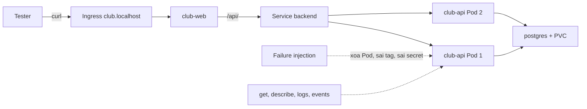

# Slide buổi 31 – Testing & Troubleshooting

> **Tóm tắt:** Kiểm thử hệ thống capstone từ máy sạch, cố ý phá bằng failure injection, đọc trạng thái, events và log để tìm nguyên nhân gốc, rồi ghi lại thành troubleshooting log và runbook. Lệnh lab: [Buổi 31](../../labs/week-16/session-31.md).

## Slide 1: Mục tiêu buổi học

- Chạy clean-clone test cho Compose và kiểm chứng dữ liệu còn sau `down` rồi `up`
- Thực hiện 3 failure injection có kiểm soát trên kind
- Chẩn đoán bằng `get`, `describe`, `logs`, `events` thay vì đoán mò
- Áp dụng checklist bảo mật cơ bản
- Viết troubleshooting log 5 mục và runbook ngắn

---

## Slide 2: Vấn đề thực tế - "chạy trên máy tôi"

- Máy người viết code có sẵn image cũ, file `.env`, volume cũ
- Bạn cùng nhóm clone repo: `docker compose up` báo thiếu `DB_PASSWORD`
- Trên kind: Pod `club-api` báo `ImagePullBackOff` vì chưa ai `kind load`
- Code không sai, nhưng hệ thống chỉ chạy trên đúng một máy

---

## Slide 3: Kiểm thử không chỉ là npm test

| Tầng | Câu hỏi | Công cụ |
| --- | --- | --- |
| Unit test | Logic đúng? | `npm test` |
| Build test | Image build từ đầu được? | `docker compose build` |
| Smoke test | Đường quan trọng còn sống? | `curl /health /ready` |
| Failure injection | Hỏng thì phản ứng thế nào? | `kubectl delete pod` |
| Clean-machine | Người khác làm lại được? | Clone mới + README |

---

## Slide 4: Failure injection và quy tắc an toàn

- Cố ý gây lỗi có kiểm soát để xác nhận hệ thống tự hồi phục và người vận hành nhận ra tín hiệu
- Chỉ làm trên local hoặc cluster của chính nhóm
- Mỗi lần một lỗi, ghi lại thời điểm và lệnh
- Biết cách hoàn tác trước khi bắt đầu
- Dự đoán triệu chứng trước khi chạy lệnh

---

## Slide 5: Quy trình chẩn đoán từ ngoài vào trong

| Bước | Lệnh |
| --- | --- |
| 1. Trạng thái | `kubectl get pods -n club` |
| 2. Sự kiện | `kubectl describe pod TEN_POD -n club` |
| 3. Log | `kubectl logs TEN_POD -n club` (thêm `--previous` nếu đã restart) |
| 4. Cấu hình | `kubectl get deployment club-api -n club -o yaml` |
| 5. Kết nối | `kubectl exec` hoặc `kubectl port-forward` rồi `curl` |

---

## Slide 6: Kiến trúc hệ thống đang kiểm thử

---

## Slide 7: Readiness và liveness trong dự án

- Service chỉ gửi traffic tới Pod đã qua readiness (`GET /ready`)
- `/ready` chạy `SELECT 1`: mất DB thì trả 503, Pod thành `0/1`
- Liveness (`GET /health`) chỉ báo tiến trình còn sống, không kiểm tra DB
- Vì vậy mất DB làm Pod `0/1` nhưng không bị restart
- Rolling update giữ Pod cũ nếu Pod mới không Ready

---

## Slide 8: Demo outline - dự đoán, phá, quan sát, sửa

- Trạng thái khỏe: hai Pod `club-api` `1/1`, API trả JSON có Alice và Bob
- Xóa Pod backend: Pod chuyển `Terminating`, Pod mới `ContainerCreating` rồi `Running`
- Đổi sang tag image không tồn tại: một Pod `ImagePullBackOff`, Pod cũ vẫn `Running`
- Hoàn tác bằng `rollout undo`, ba lệnh `get`, `describe`, `events` đã đủ
- Dự đoán trước, rồi mới chạy lệnh

---

## Slide 9: Lab Phần 1 và 2 - clean clone, kind

- Phần 1: clone vào thư mục mới, làm đúng README, smoke test `/health`, `/ready`, `/api/members`, dữ liệu còn sau `down` rồi `up`
- Phần 2: build image có tag phiên bản, `kind load`, tạo Secret bằng lệnh, `apply`, nạp schema vào `postgres-0`, đo 5 lần `curl -w`
- Mong đợi: ba service `running`, mọi Pod `Running` và Ready
- Thiếu `.env.example` thì ghi vào danh sách lỗi README

---

## Slide 10: Lab Phần 3 - ba sự cố bắt buộc

- A, xóa một Pod backend: mã `200` liên tục, Pod mới thay thế
- B, sai tag image: một Pod `ImagePullBackOff`, events có `Failed to pull image`
- C, sai mật khẩu DB: Pod mới `0/1`, `wget` vào Pod mới báo `500`, log có lỗi xác thực
- Chụp trạng thái trước, trong, sau; hoàn tác từng sự cố trước khi sang sự cố sau

---

## Slide 11: Lab Phần 4 và 5 - bảo mật, hiệu năng, ghi nhận

- Bảo mật: không `.env` trong Git, `id` không in `uid=0`, workflow có khối `permissions`, quét image nếu có Trivy
- Hiệu năng: 50 request tuần tự cho kết quả gần nhau khi thêm replica, vì nút thắt là client, Ingress và một PostgreSQL
- Troubleshooting log: sự cố, triệu chứng, nguyên nhân gốc, cách xác minh, cách sửa, phòng tránh
- Runbook: xem log, events, restart, rollback, scale

---

## Slide 12: Phá lỗi và debug - rollout treo mãi

Triệu chứng: "Sau khi áp cấu hình mới, `kubectl rollout status` treo, một Pod backend mới `0/1`, web vẫn dùng được."

- Đi theo thứ tự trạng thái, sự kiện, log, cấu hình
- Chỉ có route `/api/members` mới ghi log lỗi, `/ready` thì không
- Hướng điều tra đầy đủ: [Buổi 31 – Thử thách nâng cao](../../labs/week-16/session-31-challenge.md)

---

## Slide 13: Challenge (L2) - ra đề cho nhóm bên cạnh

- Thiết kế một failure injection mới, chỉ gây một lỗi, hoàn tác bằng 1-2 lệnh
- Chỉ chạy trên cluster của nhóm nhận, không nói nguyên nhân
- Nhóm nhận nộp báo cáo 5 mục trong 15 phút
- Nhóm ra đề nhận xét: bằng chứng đủ chưa, có đi từ ngoài vào trong không

---

## Slide 14: Recap

- Kiểm thử gồm clean-clone, smoke test và failure injection, không chỉ unit test
- Chẩn đoán theo thứ tự trạng thái, sự kiện, log, cấu hình
- Readiness quyết định nhận traffic, liveness quyết định restart
- Biến môi trường từ Secret và ConfigMap chỉ có hiệu lực sau khi Pod khởi động lại
- Mỗi sự cố cần ghi: triệu chứng, nguyên nhân gốc, cách xác minh, cách sửa, cách phòng tránh
