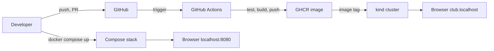
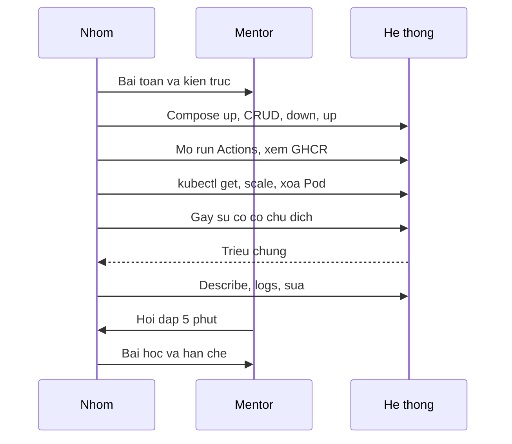

# Slide buổi 32 – Final Demo & Review

> **Tóm tắt:** Mỗi nhóm demo hệ thống Club Management từ Compose, CI/CD tới Kubernetes, xử lý một sự cố có chủ đích, bảo vệ kỹ thuật, rồi peer review và rút ra bài học. Lệnh lab: [Buổi 32](../../labs/week-16/session-32.md).

## Slide 1: Mục tiêu buổi học

- Trình bày kiến trúc và luồng từ commit tới Pod trong 10 phút, mỗi người nói một đoạn
- Chạy demo trực tiếp: Compose, GitHub Actions và Kubernetes trên kind
- Chẩn đoán một sự cố có chủ đích ngay trên màn hình
- Giải thích quyết định kỹ thuật khi bị hỏi bất kỳ phần nào
- Peer review bằng bằng chứng, rút ra lessons learned

---

## Slide 2: Vấn đề thực tế - bàn giao hệ thống

- Chạy được trên máy một người chưa phải là sẵn sàng vận hành
- Người nhận bàn giao cần biết: chạy thế nào, hỏng thì xem gì, ai hiểu phần nào
- Ngoài đời: sprint review, bàn giao cho đội vận hành, postmortem
- Buổi này chấm cả cách xử lý lỗi, không chỉ kết quả cuối

---

## Slide 3: Demo tốt và demo kém

| Yếu tố | Demo kém | Demo tốt |
| --- | --- | --- |
| Nội dung | Đọc lại README | Chạy thật, giải thích |
| Cấu trúc | Theo thứ tự file | Theo luồng bài toán tới bài học |
| Dự phòng | Không có | Trạng thái sạch, video, ảnh chụp |
| Phân vai | Một người nói | Ai cũng nói và trả lời được |
| Sự cố | Giấu hoặc xóa làm lại | Nói to, giả thuyết, kiểm chứng |

---

## Slide 4: Bảo vệ kỹ thuật và bằng chứng

- 5 phút hỏi đáp sau demo, mentor hỏi vì sao chứ không hỏi là gì
- Mentor chọn bất kỳ thành viên trả lời bất kỳ phần nào
- Trả lời theo ba bước: kết luận, lý do, bằng chứng (lệnh hoặc file)
- Phát biểu cần kèm thứ kiểm chứng được

---

## Slide 5: Phát biểu và bằng chứng tương ứng

| Phát biểu | Bằng chứng |
| --- | --- |
| Dữ liệu không mất khi recreate | `docker compose down` rồi `up`, gọi lại `GET /api/members` |
| Pipeline chặn code lỗi | Một run đỏ trong tab Actions |
| Pod tự phục hồi | `kubectl delete pod` rồi `kubectl get pods -w` |
| Image truy ngược về commit | Tag SHA hoặc phiên bản trên GHCR |
| Secret không nằm trong Git | `git ls-files` không có file Secret thật |

---

## Slide 6: Luồng từ commit tới người dùng

---

## Slide 7: Kịch bản 10 phút

---

## Slide 8: Demo

- Compose: ba service `running`, `postgres` healthy, dữ liệu còn sau `down` rồi `up`; `down -v` sẽ làm mất dữ liệu
- Kubernetes: scale lên 3 rồi về 2, xóa Pod và quan sát Pod mới do ReplicaSet tạo
- Sự cố sai tag image: Pod mới `ImagePullBackOff`, Pod cũ vẫn phục vụ, `rollout undo` khôi phục
- Nhận xét theo ba mục: điều tốt, rủi ro chính, một việc nên làm tiếp

---

## Slide 9: Lab Phần 1 - preflight và phân vai

- Working tree sạch trên `main`, context `kind-club`, node `Ready`, không container lạ chiếm cổng 8080
- Chọn trạng thái xuất phát: (a) chưa apply manifest, triển khai ngay trên màn hình, hoặc (b) đã triển khai sẵn
- Ghi tên người nói cho từng đoạn, mỗi người ít nhất một đoạn
- Tạo `docs/demo-commands.md` không chứa secret; quay video dự phòng 2-3 phút và lưu ảnh chụp run Actions xanh
- Video chỉ dùng khi sự cố mạng và phải báo mentor

---

## Slide 10: Lab Phần 2 - demo 10 phút và sự cố do mentor chọn

- Thứ tự: kiến trúc, Git, Compose, CI/CD, Kubernetes, sự cố, bài học
- CI/CD: mở run xanh, một run đỏ đã sửa, package trên GHCR, giải thích `packages: write`
- Mentor chọn một trong ba loại đã luyện ở buổi 31: sai tag image, sai mật khẩu DB, readiness fail
- Nhóm không được biết trước; quy trình: nói to điều thấy, đọc log và events, nêu giả thuyết, kiểm chứng

---

## Slide 11: Lab Phần 3 và 4 - hỏi đáp, peer review

- Hỏi đáp 5 phút: ví dụ liveness và readiness khác gì, `down` và `down -v`, Secret có thực sự bí mật không
- Mỗi người điền template peer review cho từng bạn, kèm link PR hoặc Issue cụ thể
- Không chia sẻ nội dung peer review với nhau
- Lessons learned vào `report.md`: điều tốt, điều chưa tốt, điều sẽ làm khác

---

## Slide 12: Phá lỗi và debug - mất dữ liệu trước demo

- Triệu chứng: giao diện mở bình thường, chỉ còn dữ liệu mẫu từ `init.sql`
- Nguyên nhân gốc: `down -v` xóa named volume, dữ liệu nằm trong volume
- Phòng tránh: chỉ dùng `down`, có script seed, sao lưu `pg_dump`, không "dọn dẹp" sát giờ demo
- Hướng điều tra đầy đủ: phần Phá lỗi nâng cao của [Buổi 32](../../labs/week-16/session-32.md)

---

## Slide 13: Challenge (L2) - failure injection tự chọn

- Trình bày một failure injection do nhóm chọn, có giả thuyết trước khi chạy
- Ví dụ: xóa Pod `postgres-0`, ép backend crash, làm hỏng probe
- Đề xuất cải tiến có ưu tiên: ít nhất 3 mục cho hệ thống, 2 mục cho khóa học
- Trả lời: nút thắt đầu tiên khi nhiều người dùng, và cần đổi gì khi rời kind

---

## Slide 14: Recap

- Demo tốt là chạy thật, đi theo luồng từ commit tới Pod, có kế hoạch dự phòng
- Cả nhóm phải hiểu toàn bộ hệ thống
- Chứng minh bằng lệnh, log, run Actions, lịch sử Git
- Khi lỗi: nói to điều thấy, đọc log và events, giả thuyết, kiểm chứng
- `down -v` và xóa PVC làm mất dữ liệu, chỉ dùng có chủ ý
- Nộp `lab-32/` cùng peer review gửi riêng cho mentor
