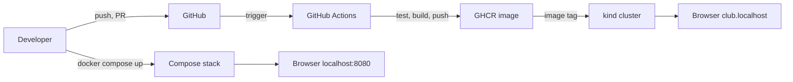
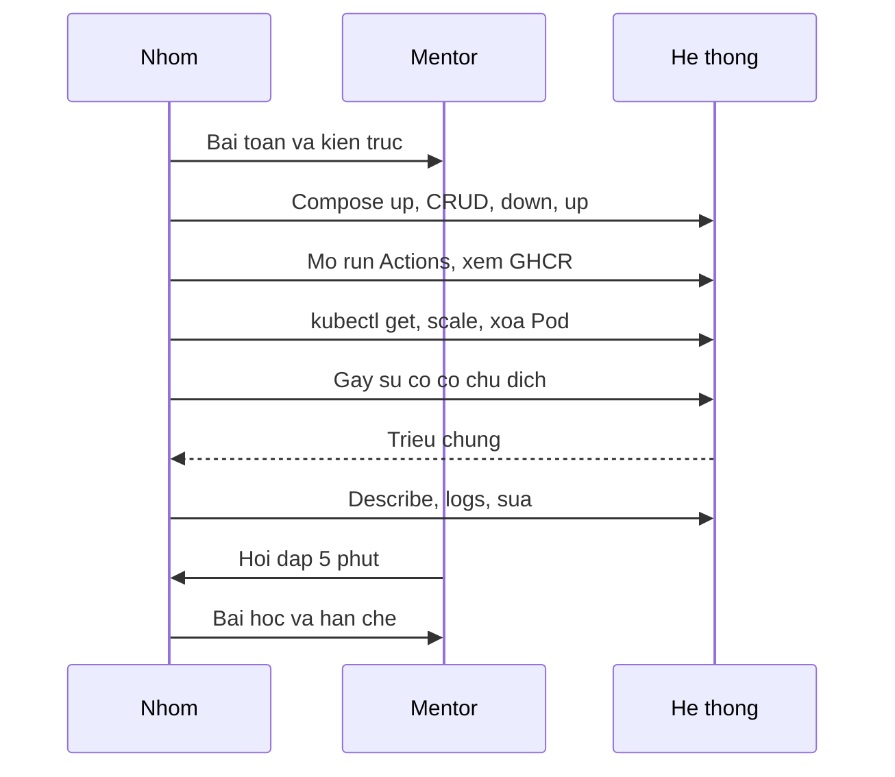

# Slide buổi 32 – Final Demo & Review

> **Tóm tắt:** Mỗi nhóm demo hệ thống Club Management từ Compose, CI/CD tới Kubernetes, xử lý một sự cố có chủ đích, bảo vệ kỹ thuật, rồi peer review và rút ra bài học.

## Slide 1: Mục tiêu buổi học

- Trình bày kiến trúc và luồng từ commit tới Pod trong 10 phút, mỗi người nói một đoạn
- Chạy demo trực tiếp: Compose, GitHub Actions và Kubernetes trên kind
- Chẩn đoán một sự cố có chủ đích ngay trên màn hình
- Giải thích quyết định kỹ thuật khi bị hỏi bất kỳ phần nào
- Peer review bằng bằng chứng, rút ra lessons learned

::: details Ghi chú giảng viên
Mở buổi trong 2 phút. Công bố thứ tự các nhóm và lịch: 10 phút demo, 5 phút hỏi đáp mỗi nhóm. Nhóm không demo đóng vai reviewer.
:::

---

## Slide 2: Vấn đề thực tế - bàn giao hệ thống

- Chạy được trên máy một người chưa phải là sẵn sàng vận hành
- Người nhận bàn giao cần biết: chạy thế nào, hỏng thì xem gì, ai hiểu phần nào
- Ngoài đời: sprint review, bàn giao cho đội vận hành, postmortem
- Buổi này chấm cả cách xử lý lỗi, không chỉ kết quả cuối

::: details Ghi chú giảng viên
Nói 2 phút. Câu hỏi: nếu mai CLB giao dự án này cho khóa sau, họ cần gì để tiếp quản? Dẫn vào ý "bằng chứng thay cho lời kể".
:::

---

## Slide 3: Demo tốt và demo kém

| Yếu tố | Demo kém | Demo tốt |
| --- | --- | --- |
| Nội dung | Đọc lại README | Chạy thật, giải thích |
| Cấu trúc | Theo thứ tự file | Theo luồng bài toán tới bài học |
| Dự phòng | Không có | Trạng thái sạch, video, ảnh chụp |
| Phân vai | Một người nói | Ai cũng nói và trả lời được |
| Sự cố | Giấu hoặc xóa làm lại | Nói to, giả thuyết, kiểm chứng |

::: details Ghi chú giảng viên
2 phút. Nhấn mạnh dòng cuối: mentor đánh giá cao nhóm xử lý lỗi bình tĩnh hơn nhóm không bao giờ lỗi.
:::

---

## Slide 4: Bảo vệ kỹ thuật và bằng chứng

- 5 phút hỏi đáp sau demo, mentor hỏi vì sao chứ không hỏi là gì
- Mentor chọn bất kỳ thành viên trả lời bất kỳ phần nào
- Trả lời theo ba bước: kết luận, lý do, bằng chứng (lệnh hoặc file)
- Phát biểu cần kèm thứ kiểm chứng được

::: details Ghi chú giảng viên
Ví dụ câu hỏi: "Image cuối chứa gì và không chứa gì, vì sao chọn vậy?" Danh sách câu hỏi đầy đủ ở mục 6 của demo-guide. 2 phút.
:::

---

## Slide 5: Phát biểu và bằng chứng tương ứng

| Phát biểu | Bằng chứng |
| --- | --- |
| Dữ liệu không mất khi recreate | `docker compose down` rồi `up`, gọi lại `GET /api/members` |
| Pipeline chặn code lỗi | Một run đỏ trong tab Actions |
| Pod tự phục hồi | `kubectl delete pod` rồi `kubectl get pods -w` |
| Image truy ngược về commit | Tag SHA hoặc phiên bản trên GHCR |
| Secret không nằm trong Git | `git ls-files` không có file Secret thật |

::: details Ghi chú giảng viên
Mỗi dòng là một điểm rubric. Yêu cầu nhóm chuẩn bị sẵn tab hoặc lệnh cho từng dòng. 2 phút.
:::

---

## Slide 6: Luồng từ commit tới người dùng



::: details Ghi chú giảng viên
Đây là đường đi cần kể trong demo. Hỏi một thành viên bất kỳ: "image trên kind đến từ đâu?" Nhắc: trên kind của lab, image có thể nạp bằng `kind load docker-image`. 2 phút.
:::

---

## Slide 7: Kịch bản 10 phút



::: details Ghi chú giảng viên
Phân bổ phút: kiến trúc 1, Git 1,5, Compose 1,5, CI/CD 1,5, Kubernetes 2, sự cố 1,5, bài học 1. Khớp bảng phút trong demo-guide.
:::

---

## Slide 8: Demo mentor 1 - Compose và dữ liệu bền

```bash
docker compose up -d --build
docker compose ps
curl -s http://localhost:3000/health
docker compose down
docker compose up -d
curl -s http://localhost:3000/api/members
```

- Mong đợi: ba service `running`, `postgres` healthy, danh sách thành viên còn sau khi khởi động lại
- Lỗi thường gặp: cổng 8080 bận, đổi `WEB_PORT` trong `.env`
- `down -v` sẽ xóa volume và mất dữ liệu

::: details Ghi chú giảng viên
Hỏi lớp: "Backend gọi PostgreSQL bằng tên gì, vì sao phân giải được?" (Đáp: `postgres`, DNS nội bộ của network `club-network`.) Tiếp: "Nếu chạy `down -v` thì sao?" 3 phút.
:::

---

## Slide 9: Demo mentor 2 - scale và tự phục hồi

```bash
kubectl get pods -n club
kubectl scale deployment club-api -n club --replicas=3
kubectl rollout status deployment/club-api -n club
kubectl scale deployment club-api -n club --replicas=2
kubectl delete pod -n club -l app=club-api --wait=false
kubectl get pods -n club -w
```

- Mong đợi: 3 Pod `Running` sau scale; Pod mới xuất hiện sau khi xóa
- Nhãn `app=club-api` phải khớp manifest: `kubectl get pods -n club --show-labels`
- Ctrl+C để dừng chế độ theo dõi

::: details Ghi chú giảng viên
Hỏi: "Ai tạo ra Pod mới? Nếu xóa Deployment thay vì Pod thì sao?" (Đáp: ReplicaSet do Deployment quản lý.) 3 phút.
:::

---

## Slide 10: Demo mentor 3 - sự cố sai tag image

```bash
kubectl set image deployment/club-api api=club-api:does-not-exist -n club
kubectl get pods -n club
kubectl describe pod -n club -l app=club-api
kubectl rollout undo deployment/club-api -n club
```

- Mong đợi: Pod mới `ErrImagePull` rồi `ImagePullBackOff`, Pod cũ vẫn phục vụ
- Phần Events của `describe` nêu lý do không kéo được image
- Sau `rollout undo`, mọi Pod về `Running`

::: details Ghi chú giảng viên
Hỏi: "Vì sao người dùng chưa thấy lỗi?" và "Làm sao biết tên container `api` mà không đoán?" Đáp: `kubectl get deployment club-api -n club -o jsonpath='{.spec.template.spec.containers[*].name}'`. Sau demo, nhận xét mẫu theo ba mục: điều tốt, rủi ro chính, một việc nên làm tiếp.
:::

---

## Slide 11: Lab Phần 1 - chuẩn bị trạng thái sạch

```bash
cd ~/devops-capstone
git switch main
git pull
git status --short
kubectl config current-context
kubectl get nodes
```

- Mong đợi: working tree sạch, context dạng `kind-TEN_CLUSTER`, node `Ready`
- Demo trên nhánh sửa dở hoặc sai context là nguyên nhân số một khiến demo hỏng
- Làm trong WSL2, không dùng `/mnt/c`

::: details Ghi chú giảng viên
15 phút đầu buổi thay cho phần ôn tập. Đi quanh các nhóm kiểm tra context. Lỗi hay gặp: `kubectl` trỏ nhầm cluster, dùng `kubectl config use-context` để sửa.
:::

---

## Slide 12: Lab Phần 1 - preflight cổng và Docker

```bash
docker ps --format '{{.Names}}\t{{.Ports}}'
docker compose config --quiet && echo "compose hop le"
kind get clusters
kubectl get ns club
docker image ls club-api
```

- Mong đợi: không container lạ chiếm cổng 8080, `compose hop le`, image có tag phiên bản như `1.0.0`
- Chọn trạng thái xuất phát: (a) chưa apply manifest, triển khai ngay trên màn hình, hoặc (b) đã triển khai sẵn
- Lỗi cổng bận xem scenario-01

::: details Ghi chú giảng viên
Mỗi nhóm thống nhất trạng thái xuất phát. Namespace `club` có thể báo `NotFound` đúng với lựa chọn (a). 5 phút.
:::

---

## Slide 13: Lab Phần 1 - phân vai và dự phòng

- Ghi tên người nói cho từng đoạn trong bảng kịch bản của demo-guide
- Mỗi người ít nhất một đoạn
- Tạo `docs/demo-commands.md` chứa các lệnh demo, không chứa secret
- Quay video dự phòng 2-3 phút và lưu ảnh chụp run Actions xanh
- Video chỉ dùng khi sự cố mạng và phải báo mentor

::: details Ghi chú giảng viên
Cho nhóm 3 phút chia vai. Nhắc: mentor có thể chỉ định bất kỳ ai trả lời bất kỳ phần nào, nên phân vai không có nghĩa chỉ hiểu phần của mình.
:::

---

## Slide 14: Lab Phần 2 - demo trực tiếp 10 phút

```bash
git log --oneline -n 10
git shortlog -sn --no-merges
kubectl get pods,svc,ingress -n club
kubectl scale deployment club-api -n club --replicas=3
kubectl rollout status deployment/club-api -n club
```

- Thứ tự: kiến trúc, Git, Compose, CI/CD, Kubernetes, sự cố, bài học
- Mong đợi: nhiều tác giả trong `shortlog`; Pod `Running`, Ingress host `club.localhost`
- CI/CD: mở run xanh, một run đỏ đã sửa, package trên GHCR, giải thích `packages: write`

::: details Ghi chú giảng viên
Bấm giờ từng nhóm và giơ thẻ nhắc còn 2 phút. Với 4 nhóm, mỗi nhóm khoảng 15 phút kể cả hỏi đáp; đông hơn thì chia hai phòng.
:::

---

## Slide 15: Sự cố do mentor chọn

| Sự cố | Cách gây | Hướng xử lý |
| --- | --- | --- |
| Sai tag image | `kubectl set image` tag không tồn tại | `describe pod`, events, `rollout undo` |
| Sai mật khẩu DB | Sửa Secret rồi `rollout restart` | Pod mới `0/1`; xem log của Pod mới |
| Readiness fail | Sửa path probe sai | `describe pod`, `kubectl get endpoints backend -n club` |

- Nhóm không được biết trước sự cố nào
- Quy trình: nói to điều thấy, đọc log và events, nêu giả thuyết, kiểm chứng

::: details Ghi chú giảng viên
Mentor chuẩn bị lệnh gây lỗi sẵn. Với sai mật khẩu, nhắc nhóm xem log của Pod mới chứ không phải Pod cũ. Quá 2 phút chưa xong thì chuyển sang video dự phòng và giải thích.
:::

---

## Slide 16: Lab Phần 3 và 4 - hỏi đáp, peer review

- Hỏi đáp 5 phút: ví dụ liveness và readiness khác gì, `down` và `down -v`, Secret có thực sự bí mật không
- Mỗi người điền template peer review cho từng bạn, kèm link PR hoặc Issue cụ thể
- Không chia sẻ nội dung peer review với nhau
- Lessons learned vào `report.md`: điều tốt, điều chưa tốt, điều sẽ làm khác
- Ghi nhận xét mentor vào mục "Có thể cải thiện gì"

::: details Ghi chú giảng viên
Nhận xét tốt nêu hành vi quan sát được, không đánh giá con người. Ví dụ tốt: "Bạn A mở PR số 12 sửa probe". Ví dụ kém: "Bạn A làm việc không tích cực". 10 phút.
:::

---

## Slide 17: Phá lỗi và debug - mất dữ liệu trước demo

```bash
docker compose down -v
docker compose up -d
curl -s http://localhost:3000/api/members
```

- Triệu chứng: giao diện mở bình thường, chỉ còn dữ liệu mẫu từ `init.sql`
- Điều tra: `docker volume ls`, lịch sử lệnh (cờ `-v`), `docker compose logs postgres`
- Nguyên nhân gốc: `-v` xóa named volume, dữ liệu nằm trong volume
- Phòng tránh: chỉ dùng `down`, có script seed, sao lưu `pg_dump`, không "dọn dẹp" sát giờ demo

::: details Ghi chú giảng viên
So với scenario-04. Đây là tình huống sai lầm dễ xảy ra nhất. Câu hỏi cho lớp: dữ liệu nằm trong container hay trong volume? 3 phút.
:::

---

## Slide 18: Lỗi thường gặp khi demo

| Triệu chứng | Cách xử lý |
| --- | --- |
| Cổng 8080 bận | `docker ps`, hoặc đổi `WEB_PORT` |
| Pod `ErrImagePull` | `kind load docker-image club-api:1.0.0`, kiểm tra tag |
| Ingress không mở được | Kiểm tra `kubectl get pods -n ingress-nginx` |
| Run Actions đỏ sát giờ | Dùng run xanh gần nhất, giải thích run đỏ |
| Demo quá 10 phút | Bấm giờ khi luyện, cắt phần ít quan trọng |

::: details Ghi chú giảng viên
Cho các nhóm đọc bảng trong lúc chờ lượt. Nhấn mạnh: không sửa vội trên `main` ngay trước demo.
:::

---

## Slide 19: Challenge (L2) - failure injection tự chọn

- Trình bày một failure injection do nhóm chọn, có giả thuyết trước khi chạy
- Ví dụ: xóa Pod `postgres-0`, ép backend crash, làm hỏng probe
- Với Pod PostgreSQL bị xóa: StatefulSet tạo lại, PVC giữ dữ liệu, backend phục hồi
- Đề xuất cải tiến có ưu tiên: ít nhất 3 mục cho hệ thống, 2 mục cho khóa học
- Trả lời: nút thắt đầu tiên khi nhiều người dùng, và cần đổi gì khi rời kind

::: details Ghi chú giảng viên
Tên `postgres-0` giả định StatefulSet tên `postgres`, lấy tên thật từ `kubectl get pods`. Đề xuất cụ thể như "thêm quét lỗ hổng image vào CI, fail khi có Critical" tốt hơn "cải thiện bảo mật".
:::

---

## Slide 20: Recap

- Demo tốt là chạy thật, đi theo luồng từ commit tới Pod, có kế hoạch dự phòng
- Cả nhóm phải hiểu toàn bộ hệ thống
- Chứng minh bằng lệnh, log, run Actions, lịch sử Git
- Khi lỗi: nói to điều thấy, đọc log và events, giả thuyết, kiểm chứng
- `down -v` và xóa PVC làm mất dữ liệu, chỉ dùng có chủ ý
- Nộp `lab-32/` cùng peer review gửi riêng cho mentor

::: details Ghi chú giảng viên
Kết thúc khóa học: cảm ơn các nhóm, thu feedback về khóa học (đưa vào đề xuất cải tiến). Nhắc không commit `.env`, password hay Secret thật trong bài nộp.
:::
