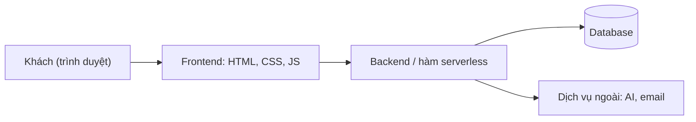
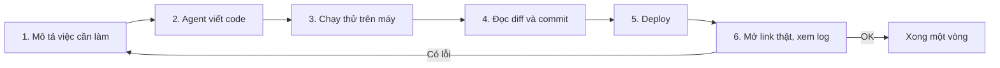

# 00 Từ prompt tới production

> **Tóm tắt:** Bản đọc 10 phút: deploy là gì, các thành phần của một ứng dụng web và 7 quy tắc sống còn trước khi đưa bất kỳ nội dung nào lên Internet.

::: tip Bạn làm gì: đọc 10 phút để có bản đồ
**Kết quả:** một câu mô tả sản phẩm và danh sách các thành phần sản phẩm cần (tĩnh hay có database). Không cần cài đặt gì.

**Thời gian:** 10 phút đọc, 5 phút làm phần "Thực hành". Phần mở rộng ở cuối đọc sau và không bắt buộc.

**Đây là bước đầu của Chặng 1 "Có link công khai"** (00, 01, 02). Track này độc lập với khóa DevOps 16 tuần. Thuật ngữ chưa quen: [Thuật ngữ](../resources/glossary.md).
:::

## Bạn sẽ làm được gì

- Giải thích được deploy, repo, secret bằng ví dụ cụ thể.
- Xác định sản phẩm là web tĩnh hay cần thêm backend và database.
- Nắm 7 quy tắc sống còn để tránh lộ secret, tránh mất tiền và tránh tin vào báo cáo sai của AI.

## Chưa có AI nào? Làm thế này

Không cần công cụ trả phí. Mở một chatbot AI miễn phí (ví dụ Claude hoặc ChatGPT) và nhờ nó viết một file `index.html` đơn giản cho sản phẩm. Hoặc tải trang mẫu [vibe-static-site.zip](https://devops-course.tiennhm.io.vn/downloads/vibe-static-site.zip) và dùng trực tiếp ở bài 02.

## Khái niệm trong 5 phút

Bài này chỉ cần nắm 3 thuật ngữ: deploy, repo, secret.

| Tiếng Việt | Thuật ngữ | Ý nghĩa |
| --- | --- | --- |
| Triển khai | **Deploy** | Đưa sản phẩm từ laptop lên Internet để người khác mở được bằng link |
| Kho mã nguồn | **Repo** (repository, kho code trên Git và GitHub) | Nơi lưu code và lịch sử thay đổi, cho phép quay lại phiên bản cũ khi sản phẩm bị hỏng |
| Thông tin bí mật | **Secret** (mật khẩu, khóa, lưu trong env var) | Thông tin không được công khai: không dán vào chat, không đưa vào repo |

Khi code mới chỉ chạy trên laptop, người khác chưa truy cập được sản phẩm. Deploy là bước làm cho sản phẩm truy cập được từ Internet.

Nguyên tắc chung: **nếu làm được bằng web tĩnh (chỉ gồm các file có sẵn) thì không thêm backend và database.** Mỗi thành phần thêm vào là một điểm có thể hỏng và một điểm có thể bị tấn công.

::: details Các thuật ngữ còn lại: hosting, domain, HTTPS, frontend, backend, database, build, serverless, log

Tra đầy đủ ở [Thuật ngữ](../resources/glossary.md). Tóm tắt:

| Tiếng Việt | Thuật ngữ | Ý nghĩa |
| --- | --- | --- |
| Dịch vụ lưu trữ và chạy web | Hosting | Máy tính của nhà cung cấp chạy sản phẩm liên tục 24/7 |
| Tên miền | Domain | Tên dễ nhớ như `clb-cua-toi.com`, trỏ tới nơi sản phẩm đang chạy |
| Giao thức web an toàn | HTTPS | Kết nối được mã hóa, trình duyệt hiển thị biểu tượng ổ khóa |
| Nhật ký hệ thống | Log | Bản ghi các sự kiện đã xảy ra, dùng để tìm nguyên nhân khi có sự cố |

- **Frontend**: phần người dùng nhìn thấy (trang, nút, form). Phần này chạy trong trình duyệt của người dùng và được viết bằng HTML, CSS, JavaScript.
- **Backend**: phần chạy trên server, xử lý các việc người dùng không được thấy (kiểm tra đăng nhập, gửi email, gọi AI).
- **Database** (cơ sở dữ liệu): nơi lưu dữ liệu lâu dài (danh sách người đăng ký, bài viết).
- **Static (tĩnh)**: chỉ gồm các file có sẵn, server chỉ trả file cho người dùng. Loại này rẻ, nhanh, an toàn và nhiều nền tảng cho host miễn phí.
- **Dynamic (động)**: có backend và thường có database, kết quả phụ thuộc vào người dùng.
- **Build**: bước đóng gói, biến mã nguồn thành các file chạy được. Web HTML thuần không cần build, còn React, Next.js, Vite thì cần.
- **Serverless**: người học chỉ viết từng hàm nhỏ, nhà cung cấp vận hành server. Mô hình này phù hợp với backend nhẹ.



:::

### 7 quy tắc sống còn

1. **Không dán secret vào chat với AI** và không đưa vào repo. Khóa được lưu trong env var (biến môi trường) hoặc trang cài đặt của nền tảng.
2. **Đọc diff** (bảng so sánh trước và sau khi sửa) trước khi commit. Agent có thể thực hiện thay đổi ngoài ý muốn.
3. **Commit thường xuyên.** Mỗi lần sản phẩm chạy được là một điểm lưu để quay lại.
4. **Mỗi lần một thay đổi.** Thêm đăng nhập, đổi giao diện, thêm thanh toán: thực hiện lần lượt, không gộp.
5. **Xem log trước khi hỏi.** Dán đúng dòng lỗi (đã xóa secret) giúp agent xác định nguyên nhân nhanh hơn nhiều.
6. **Đặt giới hạn chi phí** (spending cap, quota, cảnh báo) trước khi mở cho nhiều người dùng. Ưu tiên gói miễn phí.
7. **Không tin báo cáo "đã chạy" khi chưa tự mở link thật** bằng trình duyệt ẩn danh (hoặc điện thoại dùng 4G). Câu báo cáo "đã deploy xong" của agent không phải bằng chứng.

## Thực hành từng bước

Bài này là bài vẽ bản đồ, thực hiện trên giấy hoặc trong ứng dụng ghi chú.

1. Chọn sản phẩm muốn làm (ví dụ trang giới thiệu CLB có form đăng ký) và viết một câu mô tả.
   - Kết quả: một câu rõ ràng, ví dụ "Trang cho người lạ biết CLB làm gì và để lại email".
2. Gạch dưới những phần cần: chỉ hiển thị thông tin (tĩnh), có lưu dữ liệu (cần database), có đăng nhập (cần xác thực, tức authentication: bước kiểm tra danh tính người dùng).
   - Kết quả: danh sách 1 đến 3 thành phần. Danh sách càng ngắn càng tốt.
3. Đối chiếu bảng sau để xác định sản phẩm cần những bài nào **về sau**. Dù kết quả là gì, bước tiếp theo vẫn là bài 01, rồi bài 02 (Chặng 1). Không chuyển sang bài khác trước.

| Sản phẩm | Sau Chặng 1 (00, 01, 02) cần thêm |
| --- | --- |
| Chỉ hiển thị thông tin | Không cần gì thêm: dừng ở Chặng 1 là đủ |
| Cần gọi AI hoặc gửi email bằng khóa bí mật | [03 Fullstack serverless](03-fullstack-serverless.md) |
| Cần lưu dữ liệu và đăng nhập | [04 Supabase](04-supabase.md) hoặc [05 Firebase](05-firebase.md) |

4. Viết ra 3 rủi ro đáng lo nhất (lộ khóa, tốn tiền, trang sập). Đây là lý do cần đọc kỹ module 07.
   - Kết quả: một danh sách ngắn, được đối chiếu lại ở cuối track.

## Nếu bị lỗi

| Triệu chứng | Nguyên nhân thường gặp | Cách xử lý |
| --- | --- | --- |
| Agent nói "đã deploy xong" nhưng mở link thấy lỗi hoặc trang trắng | Agent chưa chạy thật, hoặc build lỗi nhưng agent bỏ qua | Tự mở link bằng cửa sổ ẩn danh, mở tab log của nền tảng và dán dòng lỗi cho agent |
| Chạy được trên máy, lên mạng thì hỏng | Thiếu env var trên nền tảng, hoặc file `.env` không được đưa lên (đây là hành vi đúng và có chủ đích) | Thêm biến trong trang cài đặt của nền tảng, deploy lại |
| Agent sửa một lỗi thì sinh ra ba lỗi khác | Yêu cầu quá rộng, nhiều thay đổi diễn ra cùng lúc | Quay lại commit gần nhất và giao lại từng việc nhỏ |
| Agent đề nghị "tắt kiểm tra cho chạy được" | Agent chọn giải pháp tắt | Từ chối và yêu cầu tìm nguyên nhân gốc. Xem [Xử lý sự cố](08-troubleshooting.md) |
| Lỡ dán khóa vào chat hoặc commit lên GitHub | Thao tác nhầm | Coi như khóa đã lộ: vào dịch vụ đó tạo khóa mới (rotate), vô hiệu khóa cũ, sau đó mới dọn repo |
| Không biết bắt đầu từ đâu | Có quá nhiều lựa chọn công cụ | Làm theo Chặng 1 ở [trang chủ track](index.md) |

## Tự kiểm tra

1. Hosting và domain khác nhau thế nào?
2. Khi nào một sản phẩm không cần backend?
3. Vì sao nên kết nối app-builder với GitHub?
4. Kể 3 điều cần quét khi đọc diff của agent.
5. Agent báo "đã deploy xong". Bước tiếp theo là gì?

<details><summary>Đáp án</summary>

1. Hosting là nơi sản phẩm chạy. Domain là tên gọi (địa chỉ) trỏ tới nơi đó. Domain có thể đổi mà không cần đổi hosting.
2. Khi chỉ hiển thị thông tin có sẵn và không cần bí mật hay dữ liệu riêng từng người dùng. Khi đó web tĩnh là đủ.
3. Để có bản sao code riêng, có thể đổi công cụ hoặc nền tảng mà không phải làm lại, và có lịch sử để quay lui.
4. File lạ (nhất là `.env`), chuỗi giống khóa viết thẳng trong code, dòng xóa hoặc tắt kiểm tra bảo mật.
5. Tự mở link thật bằng cửa sổ ẩn danh, thử chức năng chính, xem log của nền tảng nếu có gì lạ.

</details>

## Checklist hoàn thành

- [ ] Tôi giải thích được deploy, repo, secret bằng ví dụ của mình.
- [ ] Tôi biết sản phẩm của mình là tĩnh hay cần backend và database.
- [ ] Tôi thuộc 7 quy tắc sống còn (có thể chép ra giấy dán cạnh màn hình).
- [ ] Tôi biết module nào đọc tiếp.

## Tiếp theo

Bước kế tiếp: [01 Git và GitHub](01-git-github.md), đưa code lên repository một cách an toàn.

::: details Tra cứu thêm
- Chọn nơi deploy: [So sánh nền tảng](platforms.md).
- Prompt mẫu: [Thư viện prompt](prompt-library.md).
- Với sản phẩm đã làm bằng Lovable, Bolt, v0 hoặc Replit: sau bài 01 có thể đọc [10 App-builder](10-app-builders.md).
- Toàn bộ lộ trình: [trang chủ track](index.md).
:::

::: details Mở rộng (đọc sau, không bắt buộc): công cụ, vòng lặp với AI, cách giao việc, review diff

#### Hosting khác domain

Hosting là nơi sản phẩm chạy. Domain là tên gọi để người dùng tìm tới sản phẩm. Có thể dùng hosting mà không có domain riêng (địa chỉ miễn phí như `ten-ban.github.io` hay `ten-ban.vercel.app`) và đổi domain sau mà không phải làm lại sản phẩm.

#### Ba loại công cụ, đừng nhầm

| Loại | Ví dụ | Hợp với | Lưu ý |
| --- | --- | --- | --- |
| App-builder (nói là ra app, host sẵn) | Lovable, Bolt, v0, Replit | Làm nhanh bản thử, không cần cài đặt | Dễ bị phụ thuộc vào một nền tảng. Nên kết nối GitHub để có bản sao code |
| Coding agent (agent sửa code trong dự án của người học) | Claude Code, Cursor, GitHub Copilot agent, Codex CLI, Gemini CLI | Dự án thật, có kiểm soát và có lịch sử Git | Cần biết đọc diff ở mức tối thiểu |
| Nền tảng host (nơi sản phẩm chạy) | GitHub Pages, Vercel, Netlify, Cloudflare, Supabase, Firebase | Chạy sản phẩm lâu dài | Mỗi nơi hợp một kiểu sản phẩm, xem [So sánh nền tảng](platforms.md) |

Một quy trình phổ biến: dùng app-builder hoặc coding agent để tạo code, đưa code vào GitHub, rồi kết nối GitHub với nền tảng host. GitHub đóng vai trò điểm trung gian, cho phép đổi công cụ bất cứ lúc nào.

#### Vòng lặp vibe-code



Vòng lặp càng ngắn càng tốt: mỗi vòng chỉ có một thay đổi nhỏ. Khi sản phẩm hỏng, nguyên nhân nằm ở thay đổi vừa thực hiện.

#### Giao việc cho agent hiệu quả

Một yêu cầu tốt có bốn phần: **bối cảnh** (dự án là gì), **mục tiêu** (kết quả quan sát được), **ràng buộc** (không đổi gì ngoài X, không đụng file khóa), **cách kiểm tra** (mở trang nào, kết quả mong đợi là gì).

| Yêu cầu yếu | Yêu cầu tốt |
| --- | --- |
| "Làm web đẹp đẹp rồi deploy" | "Trang giới thiệu CLB, 1 file HTML, có form đăng ký tên và email. Chưa deploy. Cho tôi lệnh chạy thử và cách kiểm tra" |
| "Sửa lỗi đi" | "Mở trang /api/hello báo 500. Đây là log (dán log, đã xóa secret). Hãy giải thích nguyên nhân trước, chưa sửa" |
| "Cài hết mọi thứ cần thiết" | "Chỉ thêm đúng một thư viện để gửi email, nói rõ vì sao cần" |

#### Review diff trong 1 phút

**Diff** là bảng so sánh "trước và sau" của những thay đổi mà agent đã thực hiện. Không cần hiểu từng dòng, chỉ cần quét ba điểm:

1. Có file lạ không (đặc biệt `.env` và file chứa khóa)?
2. Có chuỗi trông như khóa hoặc mật khẩu viết thẳng trong code không?
3. Có dòng nào xóa kiểm tra bảo mật, tắt xác thực, hoặc tắt chế độ an toàn "cho chạy được" không?

Khi gặp một trong ba điểm trên: dừng lại, hỏi agent lý do và không commit.

#### Nhờ AI agent làm giúp

Prompt sau yêu cầu agent đóng vai người hướng dẫn và phân loại sản phẩm:

```text
Tôi là người mới, chưa biết lập trình. Tôi muốn làm: [mô tả 1-2 câu].
Hãy giúp tôi:
1. Cho biết sản phẩm này là web tĩnh hay cần backend và database, giải thích bằng ví dụ đời thường.
2. Đề xuất cách đơn giản nhất, ít thành phần nhất.
3. Liệt kê những thứ bí mật (khóa, mật khẩu) sản phẩm sẽ cần, KHÔNG yêu cầu tôi gửi giá trị thật.
4. Chưa viết code. Hỏi lại tôi nếu thiếu thông tin.
```

Người học tự kiểm tra: đề xuất có nhiều thành phần hơn mức cần không, và có yêu cầu dán khóa thật không (nếu có thì từ chối).

Không giao cho agent: dán secret hoặc dữ liệu cá nhân của người dùng, nâng cấp gói trả phí, nhập thông tin thẻ, xóa database thật.

:::

## Tài liệu chính thức

- GitHub Docs, bắt đầu với Git: https://docs.github.com/en/get-started
- MDN, web hoạt động thế nào: https://developer.mozilla.org/en-US/docs/Learn_web_development/Getting_started/Web_standards/How_the_web_works
- Vercel, bắt đầu nhanh: https://vercel.com/docs/getting-started-with-vercel
