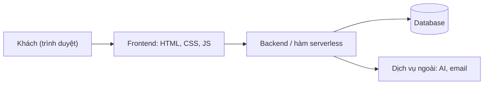
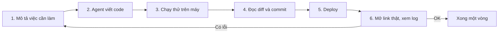

# 00 Từ prompt tới production

> **Tóm tắt:** Bản đọc 10 phút: deploy là gì, các mảnh ghép của một ứng dụng web và 7 quy tắc sống còn trước khi đưa bất cứ thứ gì lên Internet.

::: tip Bạn làm gì: đọc 10 phút để có bản đồ
**Bạn sẽ tạo ra:** một câu mô tả sản phẩm của mình và danh sách mảnh ghép nó cần (tĩnh hay có database). Không cần cài gì.

**Thời gian:** 10 phút đọc, 5 phút làm phần "Thực hành". Phần mở rộng ở cuối là đọc sau, không bắt buộc.

**Đây là bước đầu của Chặng 1 "Có link công khai"** (00, 01, 02). Track này độc lập với khóa DevOps 16 tuần. Thuật ngữ lạ: [Thuật ngữ](../resources/glossary.md).
:::

## Bạn sẽ làm được gì

- Giải thích deploy, repo, secret bằng ví von đời thường.
- Biết sản phẩm của mình là web tĩnh hay cần thêm backend và database.
- Thuộc 7 quy tắc sống còn để không lộ secret, không mất tiền, không bị AI "nói dối".

## Chưa có AI nào? Làm thế này

Bạn không cần công cụ trả tiền. Mở một chatbot AI miễn phí (ví dụ Claude hoặc ChatGPT), nhờ nó viết một file `index.html` đơn giản cho sản phẩm của bạn. Hoặc tải trang mẫu [vibe-static-site.zip](https://devops-course.tiennhm.io.vn/downloads/vibe-static-site.zip) và dùng luôn ở bài 02.

## Khái niệm trong 5 phút

Chỉ cần nhớ 3 từ cho bài này: deploy, repo, secret.

| Đời thường | Thuật ngữ | Ý nghĩa |
| --- | --- | --- |
| Mang món đồ từ bếp nhà ra mặt phố, mở cửa đón khách | **Deploy** | Đưa sản phẩm từ laptop lên Internet để người khác mở được bằng link |
| Sổ lưu mọi phiên bản công thức | **Repo** (kho code trên Git và GitHub) | Nơi cất code và lịch sử thay đổi, quay lại được khi hỏng |
| Két sắt | **Secret** (mật khẩu, khóa, lưu trong env var) | Thứ không được treo ngoài cửa: không dán vào chat, không đưa vào repo |

Bạn làm xong món đồ trong bếp nhà mình (code chạy trên laptop) thì chưa ai thấy được. Deploy là mở cửa cho khách bước vào.

Quy tắc ngón tay cái: **nếu làm được bằng web tĩnh (chỉ là các file có sẵn) thì đừng thêm backend và database.** Mỗi mảnh ghép thêm vào là thêm một chỗ có thể hỏng và một chỗ có thể bị tấn công.

::: details Các thuật ngữ còn lại: hosting, domain, HTTPS, frontend, backend, database, build, serverless, log

Tra đầy đủ ở [Thuật ngữ](../resources/glossary.md). Tóm tắt:

| Đời thường | Thuật ngữ | Ý nghĩa |
| --- | --- | --- |
| Mặt bằng thuê | Hosting | Máy tính của người khác chạy sản phẩm của bạn 24/7 |
| Địa chỉ nhà | Domain | Tên dễ nhớ như `clb-cua-toi.com` trỏ tới mặt bằng đó |
| Biển hiệu có khóa | HTTPS | Kết nối được mã hóa, trình duyệt hiện ổ khóa |
| Sổ nhật ký cửa hàng | Log | Ghi lại chuyện gì xảy ra, đọc khi có sự cố |

- **Frontend**: phần khách nhìn thấy (trang, nút, form). Chạy trong trình duyệt của khách. Viết bằng HTML, CSS, JavaScript.
- **Backend**: phần "trong bếp" xử lý việc khách không được thấy (kiểm tra đăng nhập, gửi email, gọi AI). Chạy trên server.
- **Database**: kho lưu dữ liệu lâu dài (danh sách người đăng ký, bài viết).
- **Static (tĩnh)**: chỉ là các file có sẵn, server chỉ việc đưa file cho khách. Rẻ, nhanh, an toàn, nhiều nơi cho host miễn phí.
- **Dynamic (động)**: có backend và thường có database, kết quả phụ thuộc người dùng.
- **Build**: bước "đóng gói" biến code nguồn thành file chạy được. Web HTML thuần không cần build. React, Next.js, Vite thì cần.
- **Serverless**: bạn chỉ viết từng hàm nhỏ, nhà cung cấp lo server. Hợp với backend nhẹ.



:::

### 7 quy tắc sống còn

1. **Không dán secret vào chat với AI**, không đưa vào repo. Khóa nằm trong env var hoặc trang cài đặt của nền tảng.
2. **Đọc diff** trước khi commit. Agent giỏi nhưng vẫn có thể làm điều bạn không ngờ.
3. **Commit thường xuyên.** Mỗi lần chạy được là một điểm lưu để quay lại.
4. **Một thay đổi một lần.** Thêm đăng nhập, đổi giao diện, thêm thanh toán: làm lần lượt, không gộp.
5. **Xem log trước khi hỏi.** Dán đúng dòng lỗi (đã xóa secret) giúp agent và bạn sửa nhanh gấp nhiều lần.
6. **Đặt giới hạn chi phí** (spending cap, quota, cảnh báo) trước khi mở cho nhiều người dùng. Ưu tiên gói miễn phí.
7. **Đừng tin "đã chạy" nếu chưa tự mở link thật** bằng trình duyệt ẩn danh (hoặc điện thoại dùng 4G). Agent nói đã deploy xong không phải bằng chứng.

## Thực hành từng bước

Bài này là bài vẽ bản đồ, làm trên giấy hoặc trong ghi chú.

1. Nghĩ về sản phẩm bạn muốn làm (ví dụ trang giới thiệu CLB có form đăng ký). Viết một câu mô tả.
   - Bạn sẽ thấy: một câu rõ ràng, ví dụ "Trang cho người lạ biết CLB làm gì và để lại email".
2. Gạch dưới những phần cần: chỉ hiển thị thông tin (tĩnh), có lưu dữ liệu (cần database), có đăng nhập (cần xác thực).
   - Bạn sẽ thấy: danh sách 1 đến 3 mảnh ghép. Càng ít càng tốt.
3. Đối chiếu bảng sau để biết sản phẩm của bạn cần những bài nào **về sau**. Dù kết quả là gì, bước tiếp theo của bạn vẫn là bài 01, rồi bài 02 (Chặng 1). Đừng nhảy sang bài khác trước.

| Sản phẩm của bạn | Sau Chặng 1 (00, 01, 02) cần thêm |
| --- | --- |
| Chỉ hiển thị thông tin | Không cần gì thêm: dừng ở Chặng 1 là đủ |
| Cần gọi AI hoặc gửi email bằng khóa bí mật | [03 Fullstack serverless](03-fullstack-serverless.md) |
| Cần lưu dữ liệu và đăng nhập | [04 Supabase](04-supabase.md) hoặc [05 Firebase](05-firebase.md) |

4. Viết ra 3 thứ bạn sợ nhất (lộ khóa, tốn tiền, trang sập). Đây là lý do bạn sẽ đọc kỹ module 07.
   - Bạn sẽ thấy: một danh sách ngắn. Cuối track bạn đối chiếu lại.

## Nếu bị lỗi

| Triệu chứng | Nguyên nhân thường gặp | Cách xử lý |
| --- | --- | --- |
| Agent nói "đã deploy xong" nhưng mở link thấy lỗi hoặc trang trắng | Agent chưa chạy thật, hoặc build lỗi mà nó bỏ qua | Tự mở link bằng cửa sổ ẩn danh, mở tab log của nền tảng, dán dòng lỗi cho agent |
| Chạy được trên máy, lên mạng thì hỏng | Thiếu env var trên nền tảng, hoặc file `.env` không được đưa lên (đúng, và là điều tốt) | Thêm biến trong trang cài đặt của nền tảng, deploy lại |
| Agent sửa một lỗi thì sinh ra ba lỗi khác | Yêu cầu quá rộng, nhiều thay đổi cùng lúc | Quay lại commit gần nhất, giao lại từng việc nhỏ |
| Agent đề nghị "tắt kiểm tra cho chạy được" | Nó chọn đường tắt | Từ chối, yêu cầu tìm nguyên nhân gốc. Xem [Xử lý sự cố](08-troubleshooting.md) |
| Lỡ dán khóa vào chat hoặc commit lên GitHub | Thao tác nhầm | Coi như khóa đã lộ: vào dịch vụ đó tạo khóa mới (rotate), vô hiệu khóa cũ, rồi mới dọn repo |
| Không biết bắt đầu từ đâu | Quá nhiều lựa chọn công cụ | Đi theo Chặng 1 ở [trang chủ track](index.md) |

## Tự kiểm tra

1. Hosting và domain khác nhau thế nào?
2. Khi nào một sản phẩm không cần backend?
3. Vì sao nên kết nối app-builder với GitHub?
4. Kể 3 điều cần quét khi đọc diff của agent.
5. Agent báo "đã deploy xong". Bạn làm gì tiếp theo?

<details><summary>Đáp án</summary>

1. Hosting là nơi sản phẩm chạy. Domain là tên gọi (địa chỉ) trỏ tới nơi đó. Có thể đổi domain mà không đổi hosting.
2. Khi chỉ hiển thị thông tin có sẵn và không cần bí mật hay dữ liệu riêng từng người dùng. Khi đó web tĩnh là đủ.
3. Để có bản sao code của riêng bạn, đổi công cụ hay nền tảng được mà không phải làm lại, và có lịch sử để quay lui.
4. File lạ (nhất là `.env`), chuỗi giống khóa viết thẳng trong code, dòng xóa hoặc tắt kiểm tra bảo mật.
5. Tự mở link thật bằng cửa sổ ẩn danh, thử chức năng chính, xem log của nền tảng nếu có gì lạ.

</details>

## Checklist hoàn thành

- [ ] Tôi giải thích được deploy, repo, secret bằng ví dụ của mình.
- [ ] Tôi biết sản phẩm của mình là tĩnh hay cần backend và database.
- [ ] Tôi thuộc 7 quy tắc sống còn (có thể chép ra giấy dán cạnh màn hình).
- [ ] Tôi biết module nào đọc tiếp.

## Tiếp theo

Bước kế: [01 Git và GitHub](01-git-github.md), đưa code lên kho an toàn.

::: details Tra cứu thêm
- Chọn nơi deploy: [So sánh nền tảng](platforms.md).
- Prompt mẫu: [Thư viện prompt](prompt-library.md).
- Đã làm sản phẩm bằng Lovable, Bolt, v0 hay Replit: sau bài 01 có thể đọc [10 App-builder](10-app-builders.md).
- Toàn bộ lộ trình: [trang chủ track](index.md).
:::

::: details Mở rộng (đọc sau, không bắt buộc): công cụ, vòng lặp với AI, cách giao việc, review diff

#### Hosting khác domain

Hosting là nơi sản phẩm ở. Domain là tên gọi để người ta tìm tới. Bạn có thể có hosting mà không có domain (dùng địa chỉ miễn phí như `ten-ban.github.io` hay `ten-ban.vercel.app`) và đổi domain sau mà không phải làm lại sản phẩm.

#### Ba loại công cụ, đừng nhầm

| Loại | Ví dụ | Hợp với | Lưu ý |
| --- | --- | --- | --- |
| App-builder (nói là ra app, host sẵn) | Lovable, Bolt, v0, Replit | Làm nhanh bản thử, không cần cài gì | Dễ bị khóa vào một nơi. Nên kết nối GitHub để có bản sao code |
| Coding agent (agent sửa code trong dự án của bạn) | Claude Code, Cursor, GitHub Copilot agent, Codex CLI, Gemini CLI | Dự án thật, có kiểm soát, có lịch sử Git | Cần biết đọc diff tối thiểu |
| Nền tảng host (nơi sản phẩm chạy) | GitHub Pages, Vercel, Netlify, Cloudflare, Supabase, Firebase | Chạy sản phẩm lâu dài | Mỗi nơi hợp một kiểu sản phẩm, xem [So sánh nền tảng](platforms.md) |

Một quy trình phổ biến: dùng app-builder hoặc coding agent để tạo code, đưa code vào GitHub, kết nối GitHub với nền tảng host. GitHub là "trạm trung chuyển" giúp bạn đổi công cụ bất cứ lúc nào.

#### Vòng lặp vibe-code



Vòng lặp càng ngắn càng tốt: mỗi vòng chỉ một thay đổi nhỏ. Khi hỏng, bạn biết ngay lỗi nằm ở thay đổi vừa rồi.

#### Giao việc cho agent hiệu quả

Một yêu cầu tốt có bốn phần: **bối cảnh** (dự án là gì), **mục tiêu** (kết quả nhìn thấy được), **ràng buộc** (không đổi gì ngoài X, không đụng file khóa), **cách kiểm tra** (mở trang nào, thấy gì).

| Yêu cầu yếu | Yêu cầu tốt |
| --- | --- |
| "Làm web đẹp đẹp rồi deploy" | "Trang giới thiệu CLB, 1 file HTML, có form đăng ký tên và email. Chưa deploy. Cho tôi lệnh chạy thử và cách kiểm tra" |
| "Sửa lỗi đi" | "Mở trang /api/hello báo 500. Đây là log (dán log, đã xóa secret). Hãy giải thích nguyên nhân trước, chưa sửa" |
| "Cài hết mọi thứ cần thiết" | "Chỉ thêm đúng một thư viện để gửi email, nói rõ vì sao cần" |

#### Review diff trong 1 phút

**Diff** là bảng so sánh "trước và sau" mà agent đã sửa. Bạn không cần hiểu từng dòng, chỉ cần quét ba thứ:

1. Có file nào lạ không (đặc biệt `.env`, file chứa khóa)?
2. Có chuỗi trông như khóa hoặc mật khẩu viết thẳng trong code không?
3. Có dòng nào xóa kiểm tra bảo mật, tắt xác thực, hoặc tắt chế độ an toàn "cho chạy được" không?

Gặp một trong ba điều đó: dừng lại, hỏi agent vì sao, đừng commit.

#### Nhờ AI agent làm giúp

Prompt để agent đóng vai người hướng dẫn, giúp bạn phân loại sản phẩm:

```text
Tôi là người mới, chưa biết lập trình. Tôi muốn làm: [mô tả 1-2 câu].
Hãy giúp tôi:
1. Cho biết sản phẩm này là web tĩnh hay cần backend và database, giải thích bằng ví dụ đời thường.
2. Đề xuất cách đơn giản nhất, ít thành phần nhất.
3. Liệt kê những thứ bí mật (khóa, mật khẩu) sản phẩm sẽ cần, KHÔNG yêu cầu tôi gửi giá trị thật.
4. Chưa viết code. Hỏi lại tôi nếu thiếu thông tin.
```

Bạn phải tự kiểm tra: đề xuất có nhiều thành phần hơn mức cần không? Có yêu cầu bạn dán khóa thật không (nếu có, từ chối)?

Không giao cho agent: dán secret hoặc dữ liệu cá nhân của người dùng, bấm nâng cấp gói trả phí, nhập thông tin thẻ, xóa database thật.

:::

## Tài liệu chính thức

- GitHub Docs, bắt đầu với Git: https://docs.github.com/en/get-started
- MDN, web hoạt động thế nào: https://developer.mozilla.org/en-US/docs/Learn_web_development/Getting_started/Web_standards/How_the_web_works
- Vercel, bắt đầu nhanh: https://vercel.com/docs/getting-started-with-vercel
