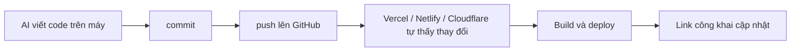

# Git và GitHub tối thiểu cho Vibe Coder

> **Tóm tắt:** Chặng 1, bước 2: đưa code lên GitHub bằng GitHub Desktop (không cần gõ lệnh), giữ .env và secret ngoài repo, biết xử lý khi lỡ lộ khóa.

::: tip Bạn làm gì: đưa code lên GitHub an toàn
**Kết quả:** một repo GitHub chứa code của dự án, có `.gitignore`, và không có file bí mật nào trong đó.

**Thời gian:** đọc 10 phút, làm 30 đến 45 phút. Phần dòng lệnh và Git nâng cao là tùy chọn.

**Cần có trước:** đã đọc [bài 00 Tư duy](00-mindset.md); có một thư mục chứa code do AI viết (ví dụ `my-site` với file `index.html`). Nếu chưa có, tải trang mẫu [vibe-static-site.zip](https://devops-course.tiennhm.io.vn/downloads/vibe-static-site.zip), giải nén ra thư mục `my-site` rồi làm tiếp (hoặc nhờ một chatbot AI viết một file `index.html` đơn giản); cần thêm một địa chỉ email để đăng ký GitHub.

**Đường đi chính:** GitHub Desktop (thao tác bằng chuột), thực hiện lần lượt Bước 1 đến 6. Người quen terminal xem mục gập "Làm bằng dòng lệnh" ở dưới.

Thuật ngữ lần đầu trong bài: [repo, commit, push, branch, diff](../resources/glossary.md).
:::

## Bạn sẽ làm được gì

- Giải thích repo, commit, push, branch là gì và vì sao Vercel, Netlify, Cloudflare Pages, GitHub Pages đều yêu cầu kết nối với GitHub.
- Tạo một repo trên GitHub và đưa code lên bằng GitHub Desktop.
- Tạo `.gitignore` và `.env.example`, rồi kiểm tra trong GitHub Desktop để chắc chắn `.env` không bị commit.
- Đọc diff (phần thay đổi) trước khi cho phép agent commit và push.
- Biết đúng thứ tự xử lý khi lỡ commit secret: xoay khóa trước, dọn lịch sử sau.

## Khái niệm trong 5 phút

**Git** là hệ thống quản lý phiên bản: nó ghi lại lịch sử thay đổi của mã nguồn dưới dạng các commit, cho phép quay lại phiên bản cũ khi cần. **GitHub** là dịch vụ lưu repository (kho mã nguồn) trên Internet, để người khác và các dịch vụ deploy đọc được mã nguồn đó.

| Từ | Ý nghĩa | Ví dụ |
| --- | --- | --- |
| repo (repository) | Thư mục dự án có kèm lịch sử thay đổi do Git quản lý | Thư mục `my-landing-page` |
| commit | Một bản ghi lưu trạng thái của dự án tại một thời điểm, kèm lời ghi chú | "Thêm nút đăng ký" |
| push | Gửi các commit mới từ máy cá nhân lên GitHub | Sau khi commit xong thì push |
| pull | Kéo thay đổi từ GitHub về máy | Khi đã sửa code trên một máy khác |
| branch | Nhánh làm việc song song, cho phép thử ý tưởng mà không ảnh hưởng bản chính | `main` là bản chính, `feature-form` là nhánh thử nghiệm |
| clone | Tải toàn bộ repo từ GitHub về máy | Lấy code mẫu của người khác |
| diff | Danh sách các dòng đã thêm và đã xóa | Màu xanh là thêm, màu đỏ là xóa |
| .gitignore | Danh sách các file mà Git bỏ qua, không đưa vào repo | `.env`, `node_modules/` |

Các nền tảng deploy đều yêu cầu GitHub vì quy trình nhanh nhất là: người học push code lên GitHub, nền tảng tự phát hiện thay đổi, tự build và tự đưa bản mới lên Internet. Cách này không cần kéo thả file hay dùng FTP.



Repo public và private khác nhau thế nào:

| | Public | Private |
| --- | --- | --- |
| Ai xem được code | Mọi người trên Internet | Chỉ chủ repo và người được mời |
| GitHub Pages | Dùng được trên gói GitHub Free | Với tài khoản gói Free thì repo phải public (theo tài liệu GitHub; gói trả phí có thể khác, cần kiểm tra trang giá) |
| Vercel, Netlify, Cloudflare Pages | Kết nối được | Thường kết nối được, nhưng giới hạn gói free có thể khác nhau, xem trang giá của từng nền tảng |
| Rủi ro | Secret lỡ commit bị lộ ngay lập tức | Lộ chậm hơn nhưng vẫn là lộ |

Nguyên tắc chọn: khi chưa chắc chắn, chọn private cho sản phẩm có dữ liệu và chọn public cho web tĩnh cần trình bày công khai. Dù chọn chế độ nào, không để secret trong repo.

## Thực hành từng bước (đường chính: GitHub Desktop)

### Bước 1. Tạo tài khoản và cài GitHub Desktop

1. Tạo tài khoản GitHub (miễn phí) và bật xác thực hai lớp (2FA, bước xác nhận thứ hai ngoài mật khẩu) trong Settings, mục Password and authentication (giao diện có thể khác đôi chút).
2. Cài **GitHub Desktop** từ [desktop.github.com](https://desktop.github.com), mở ứng dụng và đăng nhập. Trình duyệt mở ra để xác nhận quyền truy cập; mật khẩu và mã 2FA chỉ nhập trên trang GitHub, không dán vào khung chat với AI.

Kết quả: GitHub Desktop hiển thị tên tài khoản GitHub.

### Bước 2. Tạo `.gitignore` và `.env.example` TRƯỚC khi commit lần đầu

Đây là bước quan trọng nhất của cả bài. File `.gitignore` chỉ thị cho Git bỏ qua các file được liệt kê. Tạo file `.gitignore` ở thư mục gốc dự án:

```text
# Secret và cấu hình riêng của máy cá nhân
.env
.env.*
!.env.example

# Thư viện tải về, build ra tự sinh
node_modules/
dist/
build/
.next/
.vercel/
.netlify/
.wrangler/

# File rác của hệ điều hành và editor
.DS_Store
Thumbs.db
.vscode/
.idea/

# Log
*.log
```

Sau đó tạo `.env.example`, là bản mẫu liệt kê tên biến nhưng KHÔNG chứa giá trị thật. File này được phép commit để người khác (và AI) biết dự án cần những biến nào:

```bash
# Sao chép file này thành .env rồi điền giá trị thật trên máy bạn
SUPABASE_URL=https://your-project-ref.supabase.co
# Khóa công khai (publishable, kiểu cũ gọi là anon): được phép có ở frontend
SUPABASE_PUBLISHABLE_KEY=your-publishable-key-placeholder
# Khóa bí mật (secret, kiểu cũ gọi là service_role) chỉ dùng phía server, KHÔNG đưa lên frontend:
SUPABASE_SECRET_KEY=your-secret-key-placeholder
```

Tóm lại: `.env` là file chứa giá trị thật và chỉ nằm trên máy cá nhân; `.env.example` liệt kê tên các biến cần có; `.gitignore` đảm bảo `.env` không bị đưa vào repo.

### Bước 3. Thêm thư mục dự án vào GitHub Desktop

1. Vào menu File, chọn Add local repository (hoặc Create new repository) và trỏ tới thư mục `my-site`. Nếu ứng dụng báo thư mục chưa phải repo Git, chọn "create a repository" ngay trong thông báo đó.
2. Đặt tên nhánh chính là `main` nếu app hỏi.

Kết quả: cột bên trái liệt kê các file sẽ được commit.

### Bước 4. Kiểm tra rồi commit lần đầu

1. Quan sát danh sách file ở cột bên trái. Nếu có `.env` (hoặc file `.pem`, `id_rsa`, `*.key`) thì **dừng lại**: `.gitignore` sai tên hoặc sai vị trí. Sửa xong mới tiếp tục. Để kiểm tra chắc chắn hơn, dùng `git status` theo mục "Dòng lệnh" ở dưới.
2. Ghi tóm tắt vào ô Summary, ví dụ "Initial commit: first version of my site".
3. Chọn **Commit to main**.

Kết quả: danh sách file trống và tab History có một commit.

::: danger Trước khi bấm Commit: có `.env` trong danh sách không?
Nếu đã commit rồi push một khóa bí mật lên GitHub, khóa đó được coi là đã lộ vì có bot quét GitHub liên tục. Việc đầu tiên là xoay khóa (tạo khóa mới, thu hồi khóa cũ), không phải xóa commit. Xem mục "Nếu lỡ commit secret" bên dưới.
:::

### Bước 5. Publish lên GitHub

1. Chọn **Publish repository**.
2. Chọn public hoặc private bằng cách bỏ hoặc giữ dấu tick "Keep this code private". Nếu dự định dùng GitHub Pages ở [bài 02 Hosting tĩnh](02-static-hosting.md) trên gói Free thì chọn **public** (repo chỉ chứa web tĩnh, không chứa secret).
3. Chọn Publish.

Kết quả: nút đổi thành "Push origin" hoặc ứng dụng báo đã đồng bộ.

### Bước 6. Tự kiểm tra trên github.com

Mở repo trên trình duyệt (menu Repository, View on GitHub). Danh sách file phải có các file của dự án và **không** có `.env`. Tự duyệt danh sách file một lần để xác nhận.

Với mỗi lần AI sửa code về sau, vòng lặp là: xem diff trong GitHub Desktop (chọn từng file, xanh là thêm, đỏ là xóa), Commit, rồi chọn Push origin. Khi xem diff, kiểm tra ba điểm: file lạ (như `.env`), chuỗi dài giống khóa (bắt đầu bằng `sk_`, `sb_secret_`, `eyJ`, `AKIA`...), và file bị xóa ngoài ý muốn.

::: details Làm bằng dòng lệnh (tùy chọn, dành cho người quen terminal hoặc để AI agent chạy giúp)
Phần này thay cho Bước 3 đến 5 ở trên (Bước 2 `.gitignore` vẫn thực hiện như cũ). Mở terminal (Git Bash) tại thư mục dự án:

```bash
git init
git branch -M main
git status
git check-ignore -v .env
git add .
git commit -m "Initial commit: first version of my site"
gh auth login
gh repo create my-site --public --source=. --remote=origin --push
```

`git status` không được liệt kê `.env`; `git check-ignore -v .env` phải in ra quy tắc đang chặn file này. Đổi `--public` thành `--private` nếu không dùng GitHub Pages. Việc nhập mật khẩu hoặc mã xác nhận thực hiện trên trình duyệt, không dán vào chat. Hướng dẫn đầy đủ (đăng nhập, vòng lặp hằng ngày, branch, README, prompt cho agent): [Git và GitHub, dòng lệnh và agent](01-git-github-advanced.md).
:::

::: details Mẫu README.md tối thiểu (tùy chọn)
Tạo file `README.md` để ghi lại mục đích của dự án:

```text
# Ten Du An

Mot cau mo ta du an lam gi, cho ai.

## Deploy

Link trang dang chay: (dien sau khi deploy)
```
:::

::: warning Việc người học phải tự thực hiện, không giao cho agent

- Đăng nhập GitHub, nhập mật khẩu, mã 2FA.
- Dán secret, token, khóa API (API key: chuỗi ký tự cho phép một ứng dụng gọi dịch vụ của bên khác) vào chat hay prompt. Khi agent hỏi giá trị khóa, tự điền vào file `.env` trên máy cá nhân.
- Quyết định repo public hay private, và mọi thao tác có trả tiền.
- Chạy `git push --force`, `git reset --hard`, hoặc xóa repo khi chưa hiểu hậu quả.
:::

## Nếu lỡ commit secret

::: danger Khóa đã lộ là khóa đã mất
Khi một secret đã lên GitHub (kể cả repo private hoặc chỉ push vài giây), secret đó được coi là đã lộ. Xoay khóa trước, các việc khác thực hiện sau.
:::

Thực hiện đúng thứ tự sau. Khi một secret đã lên GitHub (kể cả repo private hoặc chỉ push vài giây), secret đó được coi là đã lộ vì có bot quét GitHub liên tục.

1. **Xoay khóa (rotate) trước tiên.** Vào trang quản lý khóa của dịch vụ (Supabase, Firebase, OpenAI, Stripe... ), tạo khóa mới và thu hồi hoặc xóa khóa cũ. Sau bước này khóa cũ không còn giá trị sử dụng. Theo hướng dẫn chính thức của GitHub, thu hồi khóa là bước đầu tiên và nhiều khi đã đủ để giải quyết vấn đề.
2. Cập nhật khóa mới vào `.env` trên máy và vào mục Environment Variables của nền tảng deploy, sau đó deploy lại.
3. Kiểm tra log sử dụng của dịch vụ để xác định có ai dùng khóa cũ trong khoảng thời gian bị lộ hay không (chi phí bất thường, request lạ).
4. Gỡ file khỏi danh sách theo dõi của Git và thêm vào `.gitignore` để tránh tái diễn:

```bash
git rm --cached .env
echo ".env" >> .gitignore
git add .gitignore
git commit -m "Stop tracking .env"
git push
```

5. Chỉ sau các bước trên, nếu cần làm sạch lịch sử, dùng công cụ `git filter-repo` (GitHub khuyên dùng) rồi force-push. Thao tác này làm đổi mã commit, ảnh hưởng người cộng tác và PR. Xóa lịch sử không xóa được bản sao ở fork, bản clone của người khác hoặc bản cache; vì vậy bước 1 mới là bước bảo vệ thực sự. Với repo mới chưa ai dùng, cách đơn giản nhất là xóa repo, tạo lại và vẫn xoay khóa.

Quy tắc ghi nhớ: xóa commit không làm khóa an toàn trở lại, chỉ xoay khóa mới làm được.

## Nếu bị lỗi

| Triệu chứng | Nguyên nhân thường gặp | Cách xử lý |
| --- | --- | --- |
| `.env` vẫn hiện trong `git status` dù đã ghi vào `.gitignore` | File đã được Git theo dõi từ commit trước; `.gitignore` chỉ áp dụng cho file chưa theo dõi | `git rm --cached .env`, commit, rồi xoay khóa nếu nó đã được push |
| `fatal: not a git repository` | Đang đứng sai thư mục, hoặc chưa chạy `git init` | `pwd` kiểm tra thư mục, `cd` vào đúng dự án, rồi `git init` nếu cần |
| `Authentication failed` hoặc `Permission denied` khi push | Chưa đăng nhập, đăng nhập sai tài khoản, hoặc token hết hạn | `gh auth status`; chạy lại `gh auth login`; với GitHub Desktop, đăng xuất rồi đăng nhập lại |
| `rejected ... fetch first` hoặc `non-fast-forward` | GitHub có commit mới mà máy chưa có (ví dụ README tạo trên web) | `git pull --rebase` rồi `git push`; nếu xuất hiện xung đột, nhờ agent giải thích từng chỗ trước khi sửa |
| `remote origin already exists` | Remote đã được nối trước đó | `git remote -v` xem địa chỉ; nếu sai thì `git remote set-url origin URL-dung` |
| Push bị chặn vì phát hiện secret (push protection) | GitHub nhận ra khóa trong commit | Không bỏ qua cảnh báo. Xoay khóa, xóa khóa khỏi code, sửa commit rồi push lại |
| `node_modules` hoặc file hàng trăm MB bị đẩy lên, push rất chậm hoặc bị từ chối | Thiếu `.gitignore` khi commit đầu | Thêm `.gitignore`, `git rm -r --cached node_modules`, commit lại; nếu đã push, nhờ agent hướng dẫn dọn |
| Agent tự `git push --force` hoặc `git reset --hard` làm mất code | Prompt mơ hồ, ví dụ "dọn giúp tôi" | Ghi trong prompt "không dùng force, không reset --hard"; commit thường xuyên; dùng `git reflog` nhờ agent khôi phục |
| Sau khi đổi repo thành private, trang GitHub Pages biến mất | Gói Free yêu cầu repo public để dùng Pages | Đổi lại public, hoặc dùng Vercel, Netlify, Cloudflare Pages |

## Tự kiểm tra

1. Vì sao hầu hết nền tảng deploy đều yêu cầu kết nối với GitHub?
2. Sự khác nhau giữa commit và push là gì?
3. Một file chứa khóa API đã bị push lên repo private. Việc đầu tiên cần làm là gì và vì sao không phải là xóa commit?
4. File `.env` đã hiện trong `git status` mặc dù có `.env` trong `.gitignore`. Nguyên nhân có thể là gì?
5. Nên giao cho agent việc nào và giữ việc nào cho riêng mình khi làm việc với Git?
6. Để dùng GitHub Pages trên gói GitHub Free, repo cần ở chế độ nào?

<details>
<summary>Đáp án</summary>

1. Vì push code lên GitHub là tín hiệu để nền tảng tự build và deploy bản mới; không cần tải file thủ công và đã có sẵn lịch sử để quay lại bản cũ.
2. Commit là lưu trạng thái dự án thành một bản ghi trên máy cá nhân. Push là gửi các commit đó lên GitHub.
3. Xoay khóa (tạo khóa mới, thu hồi khóa cũ). Xóa commit không đủ vì khóa có thể đã bị bot quét, nằm trong fork, bản clone hoặc cache; chỉ khi khóa cũ bị vô hiệu hóa thì mới thật sự an toàn.
4. File đã được Git theo dõi từ trước khi có `.gitignore`. Chạy `git rm --cached .env`, commit, và xoay khóa nếu file đã lên GitHub.
5. Giao cho agent: git init, tạo `.gitignore`, add, commit, tóm tắt diff. Giữ lại: đăng nhập, dán secret, quyết định public hay private, thao tác liên quan đến tiền và đồng ý các lệnh nguy hiểm như force push.
6. Public (theo tài liệu GitHub, tài khoản gói Free yêu cầu repo public để dùng Pages).

</details>

## Checklist hoàn thành

- [ ] Đã có tài khoản GitHub, bật 2FA.
- [ ] Đã đăng nhập GitHub Desktop, không dán mật khẩu hay token vào chat.
- [ ] Dự án có `.gitignore` chặn `.env`, `node_modules`, thư mục build.
- [ ] Có `.env.example` chỉ chứa tên biến và giá trị giả.
- [ ] Đã quan sát danh sách file trước khi commit và xác nhận không có `.env`.
- [ ] Đã push lên GitHub và tự mở repo trên web kiểm tra danh sách file.
- [ ] Có `README.md` tối thiểu; đã chọn public hoặc private có chủ ý.
- [ ] Biết thứ tự xử lý khi lỡ commit secret: xoay khóa trước, dọn lịch sử sau.

## Tiếp theo

Bước kế tiếp của Chặng 1: đưa repo vừa tạo lên Internet bằng [bài 02 Hosting tĩnh](02-static-hosting.md).

::: details Tra cứu thêm
- Dòng lệnh, branch, prompt Git cho agent: [Git và GitHub, dòng lệnh và agent](01-git-github-advanced.md).
- Prompt sao chép được: [Thư viện prompt](prompt-library.md); lệnh thường dùng: [Bảng lệnh CLI](cli-cheatsheet.md).
- Với sản phẩm đã làm bằng Lovable, Bolt, v0, Replit: [10 App-builder](10-app-builders.md).
- Tổng quan: [Trang chủ track Vibe Deploy](index.md).
:::

Tài liệu chính thức:

- GitHub Docs, tạo GitHub Pages: [docs.github.com/en/pages/getting-started-with-github-pages/creating-a-github-pages-site](https://docs.github.com/en/pages/getting-started-with-github-pages/creating-a-github-pages-site)
- GitHub Docs, lưu thông tin đăng nhập (gh, Git Credential Manager): [docs.github.com/en/get-started/git-basics/caching-your-github-credentials-in-git](https://docs.github.com/en/get-started/git-basics/caching-your-github-credentials-in-git)
- GitHub Docs, xóa dữ liệu nhạy cảm khỏi repo: [docs.github.com/en/authentication/keeping-your-account-and-data-secure/removing-sensitive-data-from-a-repository](https://docs.github.com/en/authentication/keeping-your-account-and-data-secure/removing-sensitive-data-from-a-repository)
- GitHub Docs, secret scanning: [docs.github.com/en/code-security/secret-scanning/introduction/about-secret-scanning](https://docs.github.com/en/code-security/secret-scanning/introduction/about-secret-scanning)
- GitHub Desktop: [desktop.github.com](https://desktop.github.com)
- GitHub CLI: [cli.github.com](https://cli.github.com)
- Git: [git-scm.com/doc](https://git-scm.com/doc)
