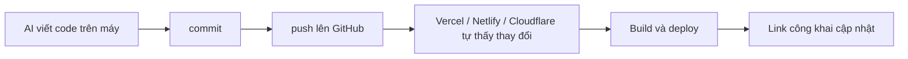

# Git và GitHub tối thiểu cho Vibe Coder

> **Tóm tắt:** Chặng 1, bước 2: đưa code lên GitHub bằng GitHub Desktop (không cần gõ lệnh), giữ .env và secret ngoài repo, biết xử lý khi lỡ lộ khóa.

::: tip Bạn làm gì: đưa code lên GitHub an toàn
**Bạn sẽ tạo ra:** một repo GitHub chứa code của bạn, có `.gitignore`, và không có file bí mật nào trong đó.

**Thời gian:** đọc 10 phút, làm 30 đến 45 phút. Phần dòng lệnh và Git nâng cao là tùy chọn.

**Cần có trước:** đã đọc [bài 00 Tư duy](00-mindset.md); có một thư mục chứa code do AI viết (ví dụ `my-site` với file `index.html`); một địa chỉ email để đăng ký GitHub.

**Đường đi duy nhất cho người chưa biết code:** GitHub Desktop (bấm chuột). Ai quen terminal hoặc đang dùng AI agent xem các mục gập ở dưới.

Thuật ngữ lần đầu trong bài: [repo, commit, push, branch, diff](../resources/glossary.md).
:::

## Bạn sẽ làm được gì

Thời lượng ước tính: 45 đến 75 phút.

- Giải thích bằng lời đơn giản repo, commit, push, branch là gì và vì sao Vercel, Netlify, Cloudflare Pages, GitHub Pages đều đòi kết nối với GitHub.
- Tạo một repo trên GitHub và đưa code lên bằng GitHub Desktop hoặc để AI agent chạy `git` giúp.
- Tạo `.gitignore` và `.env.example`, rồi dùng `git status` để chắc chắn `.env` không bị commit.
- Đọc diff (phần thay đổi) trước khi cho phép agent commit và push.
- Biết đúng thứ tự xử lý khi lỡ commit secret: xoay khóa trước, dọn lịch sử sau.

## Khái niệm trong 5 phút

Hãy tưởng tượng bạn mở một cửa hàng. Git là cuốn sổ nhật ký ghi lại mọi lần bạn sắp xếp lại cửa hàng, để lỡ bày hàng sai thì lật lại hôm qua. GitHub là kho lưu cuốn sổ đó trên mạng, để người khác (và các dịch vụ deploy) đọc được.

| Từ | Nghĩa đời thường | Ví dụ |
| --- | --- | --- |
| repo (repository) | Thư mục dự án có kèm cuốn sổ nhật ký | Thư mục `my-landing-page` |
| commit | Một trang nhật ký: ảnh chụp dự án tại một thời điểm, kèm lời ghi chú | "Thêm nút đăng ký" |
| push | Gửi các trang nhật ký mới từ máy bạn lên GitHub | Sau khi commit xong thì push |
| pull | Kéo thay đổi từ GitHub về máy | Khi bạn sửa trên máy khác |
| branch | Bản nháp song song để thử ý tưởng mà không đụng bản chính | `main` là bản chính, `feature-form` là bản nháp |
| clone | Tải cả repo từ GitHub về máy | Lấy code mẫu của người khác |
| diff | Danh sách dòng nào đã thêm, đã xóa | Màu xanh là thêm, đỏ là xóa |
| .gitignore | Danh sách thứ "đừng đưa vào sổ" | `.env`, `node_modules/` |

Vì sao mọi nền tảng deploy đều muốn GitHub? Vì cách nhanh nhất để "mở cửa hàng" là: bạn push code lên GitHub, nền tảng tự thấy thay đổi, tự build và tự đưa bản mới lên mạng. Không cần kéo thả file, không cần FTP.



Repo public và private khác nhau thế nào:

| | Public | Private |
| --- | --- | --- |
| Ai xem được code | Cả thế giới | Chỉ bạn và người bạn mời |
| GitHub Pages | Dùng được trên gói GitHub Free | Với tài khoản gói Free thì repo phải public (theo tài liệu GitHub; gói trả phí có thể khác, hãy kiểm tra trang giá) |
| Vercel, Netlify, Cloudflare Pages | Kết nối được | Thường kết nối được, nhưng giới hạn gói free có thể khác nhau, xem trang giá của từng nền tảng |
| Rủi ro | Secret lỡ commit bị lộ ngay lập tức | Lộ chậm hơn nhưng vẫn là lộ |

Quy tắc gọn: nếu không chắc, chọn private cho sản phẩm có dữ liệu, chọn public cho web tĩnh bạn muốn khoe. Dù chọn gì, không bao giờ để secret trong repo.

## Thực hành từng bước (đường chính: GitHub Desktop)

### Bước 1. Tạo tài khoản và cài GitHub Desktop

1. Tạo tài khoản GitHub (miễn phí) và bật xác thực hai lớp (2FA) trong Settings, mục Password and authentication (giao diện có thể khác chút).
2. Cài **GitHub Desktop** từ [desktop.github.com](https://desktop.github.com), mở app và bấm đăng nhập. Trình duyệt mở ra để bạn đồng ý; mật khẩu và mã 2FA chỉ gõ trên trang GitHub, không dán vào khung chat với AI.

Bạn sẽ thấy: GitHub Desktop hiện tên tài khoản của bạn.

### Bước 2. Tạo `.gitignore` và `.env.example` TRƯỚC khi commit lần đầu

Đây là bước quan trọng nhất của cả bài. `.gitignore` bảo Git "bỏ qua các file này". Tạo file `.gitignore` ở thư mục gốc dự án:

```text
# Secret và cấu hình riêng của máy bạn
.env
.env.*
!.env.example

# Thư viện tải về, build ra tự sinh
node_modules/
dist/
build/
.next/
.vercel/
.netlify/
.wrangler/

# File rác của hệ điều hành và editor
.DS_Store
Thumbs.db
.vscode/
.idea/

# Log
*.log
```

Rồi tạo `.env.example`: bản "mẫu" liệt kê tên biến nhưng KHÔNG chứa giá trị thật. File này được phép commit để người khác (và AI) biết cần những biến nào:

```bash
# Sao chép file này thành .env rồi điền giá trị thật trên máy bạn
SUPABASE_URL=https://your-project-ref.supabase.co
# Khóa công khai (publishable, kiểu cũ gọi là anon): được phép có ở frontend
SUPABASE_PUBLISHABLE_KEY=your-publishable-key-placeholder
# Khóa bí mật (secret, kiểu cũ gọi là service_role) chỉ dùng phía server, KHÔNG đưa lên frontend:
SUPABASE_SECRET_KEY=your-secret-key-placeholder
```

Giải thích nhanh: `.env` là két sắt đặt trên máy bạn, chứa chìa khóa thật. `.env.example` là tờ giấy ghi "két này cần những ngăn nào". `.gitignore` đảm bảo két không bị mang ra tiệm.

### Bước 3. Thêm thư mục dự án vào GitHub Desktop

1. Menu File, chọn Add local repository (hoặc Create new repository), trỏ tới thư mục `my-site`. Nếu app báo thư mục chưa phải repo Git, bấm "create a repository" ngay trong thông báo đó.
2. Đặt tên nhánh chính là `main` nếu app hỏi.

Bạn sẽ thấy: cột bên trái liệt kê các file sẽ được commit.

### Bước 4. Kiểm tra rồi commit lần đầu

1. Nhìn danh sách file ở cột bên trái. Nếu thấy `.env` (hoặc file `.pem`, `id_rsa`, `*.key`) thì **dừng**: `.gitignore` sai tên hoặc sai vị trí. Sửa xong mới tiếp tục. Muốn chắc hơn, dùng `git status` theo mục "Dòng lệnh" ở dưới.
2. Ghi tóm tắt vào ô Summary, ví dụ "Initial commit: first version of my site".
3. Bấm **Commit to main**.

Bạn sẽ thấy: danh sách file trống và lịch sử (tab History) có một commit.

::: danger Trước khi bấm Commit: có `.env` trong danh sách không?
Nếu bạn lỡ commit rồi push một khóa bí mật lên GitHub, coi như khóa đã lộ: bot quét GitHub liên tục. Việc đầu tiên là xoay khóa (tạo khóa mới, thu hồi khóa cũ), không phải xóa commit. Xem mục "Nếu lỡ commit secret" bên dưới.
:::

### Bước 5. Publish lên GitHub

1. Bấm **Publish repository**.
2. Chọn public hoặc private: bỏ hoặc giữ dấu tick "Keep this code private". Dự định dùng GitHub Pages ở [bài 02 Hosting tĩnh](02-static-hosting.md) trên gói Free thì chọn **public** (repo chỉ chứa web tĩnh, không chứa secret).
3. Bấm Publish.

Bạn sẽ thấy: nút đổi thành "Push origin" hoặc báo đã đồng bộ.

### Bước 6. Tự kiểm tra trên github.com

Mở repo trên trình duyệt (menu Repository, View on GitHub). Bạn sẽ thấy các file của bạn và **không** thấy `.env`. Hãy tự bấm duyệt danh sách file một lần.

Mỗi lần AI sửa code về sau, vòng lặp là: xem diff trong GitHub Desktop (bấm từng file, xanh là thêm, đỏ là xóa), Commit, bấm Push origin. Khi xem diff, tìm ba thứ: file lạ (như `.env`), chuỗi dài giống khóa (bắt đầu bằng `sk_`, `sb_secret_`, `eyJ`, `AKIA`...), file bị xóa ngoài ý muốn.

::: details Dòng lệnh: làm các bước trên bằng git và gh (tùy chọn)

Chọn cách này nếu bạn quen terminal hoặc muốn AI agent chạy lệnh giúp. Các bước dưới đây thay cho Bước 1, 3, 4, 5 ở trên (Bước 2 `.gitignore` vẫn làm như cũ).

#### Bước 1. Chuẩn bị tài khoản và công cụ

1. Có tài khoản GitHub (miễn phí) và bật xác thực hai lớp (2FA) trong phần Settings, mục Password and authentication (giao diện có thể khác chút).
2. Cài **một** trong hai đường đi, chọn cái bạn thấy dễ hơn:
   - **GitHub Desktop**: ứng dụng bấm chuột, hợp nhất với người chưa từng dùng terminal.
   - **Git + GitHub CLI (`gh`)**: dùng terminal, hợp với việc để AI agent làm giúp.
3. Nếu chọn terminal, kiểm tra đã cài:

```bash
git --version
gh --version
```

Bạn sẽ thấy: hai dòng hiện số phiên bản. Nếu báo "command not found", cài Git và GitHub CLI từ trang chính thức (link ở cuối bài) rồi mở lại terminal.

4. Khai báo tên và email để dấu vết commit có chủ (chỉ làm một lần):

```bash
git config --global user.name "Ten Cua Ban"
git config --global user.email "email-cua-ban@example.com"
```

Gợi ý: GitHub có tùy chọn email riêng tư dạng `noreply` nếu bạn không muốn lộ email thật.

#### Bước 2. Đăng nhập GitHub một lần, theo cách ít đau đầu nhất

Bạn không cần tự tạo token hay khóa SSH nếu dùng một trong hai cách sau.

| Cách | Làm gì | Khi nào chọn |
| --- | --- | --- |
| GitHub Desktop | Mở app, bấm đăng nhập, trình duyệt mở ra để bạn đồng ý | Chưa từng dùng terminal |
| GitHub CLI | Chạy `gh auth login`, chọn GitHub.com, chọn HTTPS, đồng ý để Git dùng thông tin đăng nhập của GitHub, làm theo trình duyệt | Dùng terminal hoặc AI agent |

```bash
gh auth login
gh auth status
```

Bạn sẽ thấy: `gh auth status` báo "Logged in to github.com". Việc nhập mật khẩu hay mã xác nhận là việc của bạn trên trình duyệt, đừng dán vào khung chat với AI.

Personal Access Token (PAT) và SSH key chỉ cần khi cách trên không chạy được (ví dụ máy chủ không có trình duyệt). Hiểu ngắn gọn: PAT là "mật khẩu tạm có giới hạn quyền" thay cho mật khẩu thật; SSH key là "chìa khóa cặp" đặt sẵn trên máy. Nếu phải dùng PAT, tạo token với quyền nhỏ nhất, đặt hạn dùng ngắn, và đối xử với nó như một secret (không dán vào repo, không dán vào prompt). Xem hướng dẫn chính thức ở cuối bài.

#### Bước 3. Tạo thư mục dự án và khởi tạo Git

Giả sử AI đã viết code vào thư mục `my-site`:

```bash
cd my-site
git init
git branch -M main
```

Bạn sẽ thấy: thông báo "Initialized empty Git repository". Nhánh chính tên là `main`.

Với GitHub Desktop: menu File, chọn Add local repository (hoặc Create new repository), trỏ tới thư mục `my-site`.

#### Bước 5. Kiểm tra bằng `git status` rằng secret không bị gom vào

Giả sử bạn có file `.env` thật. Chạy:

```bash
git status
```

Bạn sẽ thấy: danh sách "Untracked files" có `.gitignore`, `.env.example`, `index.html`... nhưng KHÔNG có `.env`. Nếu `.env` hiện trong danh sách, dừng lại: `.gitignore` sai tên, sai vị trí, hoặc bạn đã lỡ `git add` file đó trước đó.

Kiểm tra chắc chắn thêm một lệnh:

```bash
git check-ignore -v .env
```

Bạn sẽ thấy: một dòng chỉ ra quy tắc nào trong `.gitignore` đang chặn `.env`. Không có đầu ra nghĩa là `.env` chưa được chặn.

#### Bước 6. Commit đầu tiên

```bash
git add .
git status
git commit -m "Initial commit: first version of my site"
```

Lệnh `git add .` gom mọi thay đổi (trừ file bị ignore) vào "giỏ". Chạy `git status` lần nữa để thấy "Changes to be committed" và xác nhận không có `.env`. Sau đó `git commit` đóng giỏ thành một trang nhật ký.

Với GitHub Desktop: tick các file ở cột bên trái, ghi tóm tắt vào ô Summary, bấm Commit to main. Hãy nhìn danh sách file: nếu thấy `.env` thì đừng commit.

#### Bước 7. Tạo repo trên GitHub và push

Cách A, dùng GitHub CLI (một lệnh):

```bash
gh repo create my-site --private --source=. --remote=origin --push
```

Đổi `--private` thành `--public` nếu bạn muốn repo công khai (ví dụ để dùng GitHub Pages trên gói Free). Bạn sẽ thấy: GitHub in ra link repo, ví dụ `https://github.com/ten-ban/my-site`.

Cách B, dùng GitHub Desktop: bấm Publish repository, bỏ hoặc giữ dấu tick "Keep this code private" tùy ý, bấm Publish.

Cách C, làm trên web rồi nối về máy:

```bash
git remote add origin https://github.com/ten-ban/my-site.git
git push -u origin main
```

Bạn sẽ thấy: mở link repo trên trình duyệt, thấy các file của bạn, và không thấy `.env`. Hãy tự bấm kiểm tra danh sách file trên GitHub một lần.

#### Bước 8. Vòng lặp hằng ngày: sửa, xem diff, commit, push

```bash
git status
git diff
git add .
git commit -m "Describe what changed in a few words"
git push
```

`git diff` hiện từng dòng đã đổi. Với người mới, bạn không cần hiểu từng ký tự; hãy tìm ba điều: có file lạ không (ví dụ `.env`, `*.pem`, `id_rsa`), có chuỗi dài giống khóa không (bắt đầu bằng `sk_`, `sb_secret_`, `eyJ`, `AKIA`...), AI có xóa nhiều file ngoài ý muốn không. GitHub Desktop có khung diff sẵn, bấm vào từng file để xem.

#### Bước 9. Branch: thử ý tưởng mà không làm hỏng bản đang chạy

Rất hữu ích khi bạn nhờ AI "thử đổi giao diện": nếu hỏng thì bỏ nhánh, bản chính vẫn nguyên.

```bash
git switch -c try-new-design
# ... nhờ AI sửa, xem thử ...
git add .
git commit -m "Try new design"
git push -u origin try-new-design
```

Nếu ưng ý, mở Pull Request (PR) trên GitHub rồi bấm Merge để gộp vào `main`. Nếu không ưng:

```bash
git switch main
git branch -D try-new-design
```

Mẹo: Vercel, Netlify, Cloudflare Pages thường tạo link xem thử (preview) riêng cho mỗi nhánh hoặc PR, nên bạn thử thoải mái mà không đụng trang chính. Chi tiết xem [bài 02 Hosting tĩnh](02-static-hosting.md).

#### Bước 10. README, license và vài việc nhỏ cho repo

Một `README.md` tối thiểu giúp bạn (và AI ở các phiên sau) nhớ dự án là gì:

```text
# Ten Du An

Mot cau mo ta du an lam gi, cho ai.

## Chay thu tren may

1. Cai Node.js (neu du an can)
2. Sao chep .env.example thanh .env va dien gia tri cua ban
3. Chay: npm install roi npm run dev

## Deploy

Link trang dang chay: (dien sau khi deploy)
```

Về license (giấy phép): nếu repo public và bạn muốn người khác được dùng lại, thêm file `LICENSE` (ví dụ MIT, rất phổ biến). Khi tạo repo trên web, GitHub có sẵn ô chọn license. Nếu không thêm license, mặc định người khác không có quyền dùng lại code của bạn. Với sản phẩm kinh doanh hoặc có dữ liệu riêng, hãy để private và không cần license.

Bật thêm cho an toàn: trong Settings của repo, mục Security (giao diện có thể khác chút), xem secret scanning. Theo tài liệu GitHub, secret scanning chạy miễn phí trên repo public (repo private tùy gói, xem trang giá GitHub); đừng coi nó là lưới an toàn duy nhất.

:::

::: details Cách khác: nhờ AI agent làm giúp (prompt sao chép được)


Agent (Claude Code, Cursor, Copilot agent, Codex, Gemini CLI...) làm tốt các việc lặp lại với Git. Bạn là người duyệt cuối.

Prompt 1, khởi tạo repo an toàn:

```text
Hãy giúp tôi đưa dự án trong thư mục hiện tại lên GitHub, theo thứ tự:
1. Kiểm tra xem đã có git repo chưa; nếu chưa thì git init và đặt nhánh là main.
2. Tạo .gitignore phù hợp loại dự án này (phải chặn .env, .env.*, node_modules, dist, build) và tạo .env.example chỉ chứa TÊN biến với giá trị giả.
3. Quét toàn bộ thư mục tìm chuỗi giống secret (API key, token, mật khẩu, service_role) đang nằm trong code. Nếu có, DỪNG và báo tôi, đừng commit.
4. Chạy git status và cho tôi xem danh sách file sẽ được commit. CHỜ tôi xác nhận.
5. Sau khi tôi xác nhận: git add, git commit với thông điệp rõ ràng. Chưa push.
Không tạo repo, không push, không đụng tới file .env.
```

Prompt 2, trước mỗi lần commit:

```text
Trước khi commit, hãy chạy git status và git diff, rồi tóm tắt bằng tiếng Việt đơn giản:
- Những file nào bị thay đổi, thêm, xóa.
- Có file nào tên .env, *.pem, id_rsa, *.key, hoặc nội dung giống khóa bí mật không.
- Có thay đổi nào ngoài phạm vi tôi yêu cầu không.
Đừng commit cho đến khi tôi nói "ok commit".
```

Prompt 3, tạo repo và push (chỉ khi bạn đã đọc diff):

```text
Tôi đã đăng nhập gh CLI. Hãy tạo repo private tên my-site trên tài khoản của tôi từ thư mục hiện tại và push nhánh main. Sau khi xong, in ra link repo và liệt kê các file đã lên GitHub để tôi kiểm tra không có file .env.
```

Việc bạn phải tự làm, đừng giao cho agent:

- Đăng nhập GitHub, nhập mật khẩu, mã 2FA. Tự chạy `gh auth login` và bấm xác nhận trên trình duyệt.
- Dán secret, token, khóa API vào chat hay prompt. Nếu agent hỏi giá trị khóa, hãy tự điền vào file `.env` trên máy bạn.
- Quyết định repo public hay private, và mọi thao tác có trả tiền.
- Chạy `git push --force`, `git reset --hard`, hoặc xóa repo mà bạn chưa hiểu hậu quả. Nếu agent đề nghị, hỏi lại "lệnh này làm mất gì?" trước khi đồng ý.

Bạn kiểm tra gì sau khi agent làm xong: mở repo trên github.com, xem danh sách file và lịch sử commit; tìm tên file `.env`; mở thử một vài file code xem có khóa dán cứng không.

:::

::: warning Việc bạn phải tự làm, đừng giao cho agent

- Đăng nhập GitHub, nhập mật khẩu, mã 2FA.
- Dán secret, token, khóa API vào chat hay prompt. Nếu agent hỏi giá trị khóa, hãy tự điền vào file `.env` trên máy bạn.
- Quyết định repo public hay private, và mọi thao tác có trả tiền.
- Chạy `git push --force`, `git reset --hard`, hoặc xóa repo mà bạn chưa hiểu hậu quả.
:::

## Nếu lỡ commit secret

::: danger Khóa đã lộ là khóa đã mất
Khi một secret đã lên GitHub (kể cả repo private hoặc chỉ push vài giây), coi như nó đã lộ. Xoay khóa trước, mọi việc khác sau.
:::

Bình tĩnh và làm đúng thứ tự. Khi một secret đã lên GitHub (kể cả repo private hoặc chỉ push vài giây), coi như nó đã lộ: có bot quét GitHub liên tục.

1. **Xoay khóa (rotate) trước tiên.** Vào trang quản lý khóa của dịch vụ (Supabase, Firebase, OpenAI, Stripe... ), tạo khóa mới và thu hồi/xóa khóa cũ. Sau bước này khóa cũ vô dụng. Theo hướng dẫn chính thức của GitHub, thu hồi khóa là bước đầu tiên và nhiều khi đã đủ để giải quyết vấn đề.
2. Cập nhật khóa mới vào `.env` trên máy và vào mục Environment Variables của nền tảng deploy, rồi deploy lại.
3. Kiểm tra log sử dụng của dịch vụ xem có ai dùng khóa cũ trong khoảng thời gian lộ không (chi phí lạ, request lạ).
4. Gỡ file khỏi theo dõi của Git và thêm vào `.gitignore` để lần sau không tái diễn:

```bash
git rm --cached .env
echo ".env" >> .gitignore
git add .gitignore
git commit -m "Stop tracking .env"
git push
```

5. Chỉ sau đó, nếu muốn làm sạch lịch sử, dùng công cụ `git filter-repo` (GitHub khuyên dùng) rồi force-push. Điều này làm đổi mã commit, ảnh hưởng người cộng tác và PR. Lưu ý: xóa lịch sử không xóa được bản sao ở fork, bản clone của người khác hay bản cache; vì vậy bước 1 mới là bước thật sự bảo vệ bạn. Nếu thấy phức tạp, với repo mới tinh chưa ai dùng, cách đơn giản nhất là xóa repo, tạo lại, và vẫn nhớ xoay khóa.

Quy tắc ghi nhớ: xóa commit không làm khóa an toàn lại, chỉ xoay khóa mới làm được.

## Nếu bị lỗi

| Triệu chứng | Nguyên nhân thường gặp | Cách xử lý |
| --- | --- | --- |
| `.env` vẫn hiện trong `git status` dù đã ghi vào `.gitignore` | File đã được Git theo dõi từ commit trước; `.gitignore` chỉ áp dụng cho file chưa theo dõi | `git rm --cached .env`, commit, rồi xoay khóa nếu nó đã được push |
| `fatal: not a git repository` | Bạn đang đứng sai thư mục, hoặc chưa `git init` | `pwd` kiểm tra thư mục, `cd` vào đúng dự án, rồi `git init` nếu cần |
| `Authentication failed` hoặc `Permission denied` khi push | Chưa đăng nhập, đăng nhập sai tài khoản, hoặc token hết hạn | `gh auth status`; chạy lại `gh auth login`; với GitHub Desktop, đăng xuất rồi đăng nhập lại |
| `rejected ... fetch first` hoặc `non-fast-forward` | GitHub có commit mới mà máy bạn chưa có (ví dụ README tạo trên web) | `git pull --rebase` rồi `git push`; nếu hiện xung đột, nhờ agent giải thích từng chỗ trước khi sửa |
| `remote origin already exists` | Đã nối remote trước đó | `git remote -v` xem địa chỉ; sai thì `git remote set-url origin URL-dung` |
| Push bị chặn vì phát hiện secret (push protection) | GitHub nhận ra khóa trong commit | Đừng bỏ qua cảnh báo. Xoay khóa, xóa khóa khỏi code, sửa commit rồi push lại |
| `node_modules` hoặc file hàng trăm MB bị đẩy lên, push rất chậm hoặc bị từ chối | Thiếu `.gitignore` khi commit đầu | Thêm `.gitignore`, `git rm -r --cached node_modules`, commit lại; nếu đã push, nhờ agent hướng dẫn dọn |
| Agent tự `git push --force` hoặc `git reset --hard` làm mất code | Prompt mơ hồ kiểu "dọn giúp tôi" | Dặn trong prompt "không dùng force, không reset --hard"; commit thường xuyên; dùng `git reflog` nhờ agent lấy lại |
| Sau khi đổi repo thành private, trang GitHub Pages biến mất | Gói Free yêu cầu repo public để dùng Pages | Đổi lại public, hoặc dùng Vercel, Netlify, Cloudflare Pages |

## Tự kiểm tra

1. Vì sao hầu hết nền tảng deploy đều yêu cầu kết nối với GitHub?
2. Sự khác nhau giữa commit và push là gì?
3. Bạn lỡ push file chứa khóa API lên repo private. Việc đầu tiên cần làm là gì và vì sao không phải là xóa commit?
4. File `.env` đã hiện trong `git status` mặc dù có `.env` trong `.gitignore`. Nguyên nhân có thể là gì?
5. Nên giao cho agent việc nào và giữ việc nào cho riêng mình khi làm việc với Git?
6. Bạn muốn dùng GitHub Pages trên gói GitHub Free. Repo cần ở chế độ nào?

<details>
<summary>Đáp án</summary>

1. Vì push code lên GitHub là tín hiệu để nền tảng tự build và deploy bản mới; không cần tải file thủ công, lại có sẵn lịch sử để quay lại bản cũ.
2. Commit là lưu ảnh chụp dự án vào sổ nhật ký trên máy bạn. Push là gửi các commit đó lên GitHub.
3. Xoay khóa (tạo khóa mới, thu hồi khóa cũ). Xóa commit không đủ vì khóa có thể đã bị bot quét, nằm trong fork, bản clone hoặc cache; chỉ khóa cũ bị vô hiệu hóa mới thật sự an toàn.
4. File đã được Git theo dõi từ trước khi có `.gitignore`. Chạy `git rm --cached .env`, commit, và xoay khóa nếu nó đã lên GitHub.
5. Giao: git init, tạo `.gitignore`, add, commit, tóm tắt diff. Giữ lại: đăng nhập, dán secret, quyết định public hay private, thao tác tiền bạc, và đồng ý các lệnh nguy hiểm như force push.
6. Public (theo tài liệu GitHub, tài khoản gói Free yêu cầu repo public để dùng Pages).

</details>

## Checklist hoàn thành

- [ ] Đã có tài khoản GitHub, bật 2FA.
- [ ] Đã đăng nhập bằng GitHub Desktop hoặc `gh auth login`, không dán mật khẩu hay token vào chat.
- [ ] Dự án có `.gitignore` chặn `.env`, `node_modules`, thư mục build.
- [ ] Có `.env.example` chỉ chứa tên biến và giá trị giả.
- [ ] Đã chạy `git status` và `git check-ignore -v .env` để xác nhận `.env` không bị commit.
- [ ] Đã push lên GitHub và tự mở repo trên web kiểm tra danh sách file.
- [ ] Có `README.md` tối thiểu; đã chọn public hoặc private có chủ ý.
- [ ] Biết thứ tự xử lý khi lỡ commit secret: xoay khóa trước, dọn lịch sử sau.

## Tiếp theo

- Chặng 1, bước cuối: đưa repo vừa tạo lên mạng bằng [bài 02 Hosting tĩnh](02-static-hosting.md).
- Nếu bạn cần backend nhỏ (API, form): [bài 03 Fullstack serverless](03-fullstack-serverless.md).
- Prompt có thể sao chép cho nhiều việc khác: [Thư viện prompt](prompt-library.md). Lệnh Git và CLI thường dùng: [Bảng lệnh CLI](cli-cheatsheet.md).
- Quay lại tổng quan: [Trang chủ track Vibe Deploy](index.md).
- Khi muốn đi sâu về Git trong khóa DevOps, xem [Hướng dẫn cài môi trường](../resources/setup-guide.md).

Tài liệu chính thức:

- GitHub Docs, tạo GitHub Pages: [docs.github.com/en/pages/getting-started-with-github-pages/creating-a-github-pages-site](https://docs.github.com/en/pages/getting-started-with-github-pages/creating-a-github-pages-site)
- GitHub Docs, lưu thông tin đăng nhập (gh, Git Credential Manager): [docs.github.com/en/get-started/git-basics/caching-your-github-credentials-in-git](https://docs.github.com/en/get-started/git-basics/caching-your-github-credentials-in-git)
- GitHub Docs, xóa dữ liệu nhạy cảm khỏi repo: [docs.github.com/en/authentication/keeping-your-account-and-data-secure/removing-sensitive-data-from-a-repository](https://docs.github.com/en/authentication/keeping-your-account-and-data-secure/removing-sensitive-data-from-a-repository)
- GitHub Docs, secret scanning: [docs.github.com/en/code-security/secret-scanning/introduction/about-secret-scanning](https://docs.github.com/en/code-security/secret-scanning/introduction/about-secret-scanning)
- GitHub Desktop: [desktop.github.com](https://desktop.github.com)
- GitHub CLI: [cli.github.com](https://cli.github.com)
- Git: [git-scm.com/doc](https://git-scm.com/doc)
