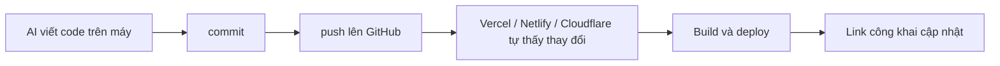

# Git và GitHub tối thiểu cho Vibe Coder

> **Tóm tắt:** Chặng 1, bước 2: đưa code lên GitHub bằng GitHub Desktop (không cần gõ lệnh), giữ .env và secret ngoài repo, biết xử lý khi lỡ lộ khóa.

::: tip Bạn làm gì: đưa code lên GitHub an toàn
**Bạn sẽ tạo ra:** một repo GitHub chứa code của bạn, có `.gitignore`, và không có file bí mật nào trong đó.

**Thời gian:** đọc 10 phút, làm 30 đến 45 phút. Phần dòng lệnh và Git nâng cao là tùy chọn.

**Cần có trước:** đã đọc [bài 00 Tư duy](00-mindset.md); có một thư mục chứa code do AI viết (ví dụ `my-site` với file `index.html`). Chưa có? Tải trang mẫu [vibe-static-site.zip](https://devops-course.tiennhm.io.vn/downloads/vibe-static-site.zip), giải nén ra thư mục `my-site` rồi làm tiếp (hoặc nhờ một chatbot AI viết cho bạn một file `index.html` đơn giản); một địa chỉ email để đăng ký GitHub.

**Đường đi chính:** GitHub Desktop (bấm chuột), làm lần lượt Bước 1 đến 6. Ai quen terminal xem mục gập "Làm bằng dòng lệnh" ở dưới.

Thuật ngữ lần đầu trong bài: [repo, commit, push, branch, diff](../resources/glossary.md).
:::

## Bạn sẽ làm được gì

- Giải thích bằng lời đơn giản repo, commit, push, branch là gì và vì sao Vercel, Netlify, Cloudflare Pages, GitHub Pages đều đòi kết nối với GitHub.
- Tạo một repo trên GitHub và đưa code lên bằng GitHub Desktop.
- Tạo `.gitignore` và `.env.example`, rồi kiểm tra trong GitHub Desktop để chắc chắn `.env` không bị commit.
- Đọc diff (phần thay đổi) trước khi cho phép agent commit và push.
- Biết đúng thứ tự xử lý khi lỡ commit secret: xoay khóa trước, dọn lịch sử sau.

## Khái niệm trong 5 phút

Hãy tưởng tượng bạn mở một cửa hàng. Git là cuốn sổ nhật ký ghi lại mọi lần bạn sắp xếp lại cửa hàng, để lỡ bày hàng sai thì lật lại hôm qua. GitHub là kho lưu cuốn sổ đó trên mạng, để người khác (và các dịch vụ deploy) đọc được.

| Từ | Nghĩa đời thường | Ví dụ |
| --- | --- | --- |
| repo (repository) | Thư mục dự án có kèm cuốn sổ nhật ký | Thư mục `my-landing-page` |
| commit | Một trang nhật ký: ảnh chụp dự án tại một thời điểm, kèm lời ghi chú | "Thêm nút đăng ký" |
| push | Gửi các trang nhật ký mới từ máy bạn lên GitHub | Sau khi commit xong thì push |
| pull | Kéo thay đổi từ GitHub về máy | Khi bạn sửa trên máy khác |
| branch | Bản nháp song song để thử ý tưởng mà không đụng bản chính | `main` là bản chính, `feature-form` là bản nháp |
| clone | Tải cả repo từ GitHub về máy | Lấy code mẫu của người khác |
| diff | Danh sách dòng nào đã thêm, đã xóa | Màu xanh là thêm, đỏ là xóa |
| .gitignore | Danh sách thứ "đừng đưa vào sổ" | `.env`, `node_modules/` |

Vì sao mọi nền tảng deploy đều muốn GitHub? Vì cách nhanh nhất để "mở cửa hàng" là: bạn push code lên GitHub, nền tảng tự thấy thay đổi, tự build và tự đưa bản mới lên mạng. Không cần kéo thả file, không cần FTP.



Repo public và private khác nhau thế nào:

| | Public | Private |
| --- | --- | --- |
| Ai xem được code | Cả thế giới | Chỉ bạn và người bạn mời |
| GitHub Pages | Dùng được trên gói GitHub Free | Với tài khoản gói Free thì repo phải public (theo tài liệu GitHub; gói trả phí có thể khác, hãy kiểm tra trang giá) |
| Vercel, Netlify, Cloudflare Pages | Kết nối được | Thường kết nối được, nhưng giới hạn gói free có thể khác nhau, xem trang giá của từng nền tảng |
| Rủi ro | Secret lỡ commit bị lộ ngay lập tức | Lộ chậm hơn nhưng vẫn là lộ |

Quy tắc gọn: nếu không chắc, chọn private cho sản phẩm có dữ liệu, chọn public cho web tĩnh bạn muốn khoe. Dù chọn gì, không bao giờ để secret trong repo.

## Thực hành từng bước (đường chính: GitHub Desktop)

### Bước 1. Tạo tài khoản và cài GitHub Desktop

1. Tạo tài khoản GitHub (miễn phí) và bật xác thực hai lớp (2FA) trong Settings, mục Password and authentication (giao diện có thể khác chút).
2. Cài **GitHub Desktop** từ [desktop.github.com](https://desktop.github.com), mở app và bấm đăng nhập. Trình duyệt mở ra để bạn đồng ý; mật khẩu và mã 2FA chỉ gõ trên trang GitHub, không dán vào khung chat với AI.

Bạn sẽ thấy: GitHub Desktop hiện tên tài khoản của bạn.

### Bước 2. Tạo `.gitignore` và `.env.example` TRƯỚC khi commit lần đầu

Đây là bước quan trọng nhất của cả bài. `.gitignore` bảo Git "bỏ qua các file này". Tạo file `.gitignore` ở thư mục gốc dự án:

```text
# Secret và cấu hình riêng của máy bạn
.env
.env.*
!.env.example

# Thư viện tải về, build ra tự sinh
node_modules/
dist/
build/
.next/
.vercel/
.netlify/
.wrangler/

# File rác của hệ điều hành và editor
.DS_Store
Thumbs.db
.vscode/
.idea/

# Log
*.log
```

Rồi tạo `.env.example`: bản "mẫu" liệt kê tên biến nhưng KHÔNG chứa giá trị thật. File này được phép commit để người khác (và AI) biết cần những biến nào:

```bash
# Sao chép file này thành .env rồi điền giá trị thật trên máy bạn
SUPABASE_URL=https://your-project-ref.supabase.co
# Khóa công khai (publishable, kiểu cũ gọi là anon): được phép có ở frontend
SUPABASE_PUBLISHABLE_KEY=your-publishable-key-placeholder
# Khóa bí mật (secret, kiểu cũ gọi là service_role) chỉ dùng phía server, KHÔNG đưa lên frontend:
SUPABASE_SECRET_KEY=your-secret-key-placeholder
```

Giải thích nhanh: `.env` là két sắt đặt trên máy bạn, chứa chìa khóa thật. `.env.example` là tờ giấy ghi "két này cần những ngăn nào". `.gitignore` đảm bảo két không bị mang ra tiệm.

### Bước 3. Thêm thư mục dự án vào GitHub Desktop

1. Menu File, chọn Add local repository (hoặc Create new repository), trỏ tới thư mục `my-site`. Nếu app báo thư mục chưa phải repo Git, bấm "create a repository" ngay trong thông báo đó.
2. Đặt tên nhánh chính là `main` nếu app hỏi.

Bạn sẽ thấy: cột bên trái liệt kê các file sẽ được commit.

### Bước 4. Kiểm tra rồi commit lần đầu

1. Nhìn danh sách file ở cột bên trái. Nếu thấy `.env` (hoặc file `.pem`, `id_rsa`, `*.key`) thì **dừng**: `.gitignore` sai tên hoặc sai vị trí. Sửa xong mới tiếp tục. Muốn chắc hơn, dùng `git status` theo mục "Dòng lệnh" ở dưới.
2. Ghi tóm tắt vào ô Summary, ví dụ "Initial commit: first version of my site".
3. Bấm **Commit to main**.

Bạn sẽ thấy: danh sách file trống và lịch sử (tab History) có một commit.

::: danger Trước khi bấm Commit: có `.env` trong danh sách không?
Nếu bạn lỡ commit rồi push một khóa bí mật lên GitHub, coi như khóa đã lộ: bot quét GitHub liên tục. Việc đầu tiên là xoay khóa (tạo khóa mới, thu hồi khóa cũ), không phải xóa commit. Xem mục "Nếu lỡ commit secret" bên dưới.
:::

### Bước 5. Publish lên GitHub

1. Bấm **Publish repository**.
2. Chọn public hoặc private: bỏ hoặc giữ dấu tick "Keep this code private". Dự định dùng GitHub Pages ở [bài 02 Hosting tĩnh](02-static-hosting.md) trên gói Free thì chọn **public** (repo chỉ chứa web tĩnh, không chứa secret).
3. Bấm Publish.

Bạn sẽ thấy: nút đổi thành "Push origin" hoặc báo đã đồng bộ.

### Bước 6. Tự kiểm tra trên github.com

Mở repo trên trình duyệt (menu Repository, View on GitHub). Bạn sẽ thấy các file của bạn và **không** thấy `.env`. Hãy tự bấm duyệt danh sách file một lần.

Mỗi lần AI sửa code về sau, vòng lặp là: xem diff trong GitHub Desktop (bấm từng file, xanh là thêm, đỏ là xóa), Commit, bấm Push origin. Khi xem diff, tìm ba thứ: file lạ (như `.env`), chuỗi dài giống khóa (bắt đầu bằng `sk_`, `sb_secret_`, `eyJ`, `AKIA`...), file bị xóa ngoài ý muốn.

::: details Làm bằng dòng lệnh (tùy chọn, cho ai quen terminal hoặc để AI agent chạy giúp)
Thay cho Bước 3 đến 5 ở trên (Bước 2 `.gitignore` vẫn làm như cũ). Mở terminal (Git Bash) tại thư mục dự án:

```bash
git init
git branch -M main
git status
git check-ignore -v .env
git add .
git commit -m "Initial commit: first version of my site"
gh auth login
gh repo create my-site --public --source=. --remote=origin --push
```

`git status` không được liệt kê `.env`; `git check-ignore -v .env` phải in ra quy tắc đang chặn nó. Đổi `--public` thành `--private` nếu không dùng GitHub Pages. Việc nhập mật khẩu hay mã xác nhận bạn tự làm trên trình duyệt, đừng dán vào chat. Hướng dẫn đầy đủ (đăng nhập, vòng lặp hằng ngày, branch, README, prompt cho agent): [Git và GitHub, dòng lệnh và agent](01-git-github-advanced.md).
:::

::: details Mẫu README.md tối thiểu (tùy chọn)
Tạo file `README.md` để bạn nhớ dự án là gì:

```text
# Ten Du An

Mot cau mo ta du an lam gi, cho ai.

## Deploy

Link trang dang chay: (dien sau khi deploy)
```
:::

::: warning Việc bạn phải tự làm, đừng giao cho agent

- Đăng nhập GitHub, nhập mật khẩu, mã 2FA.
- Dán secret, token, khóa API vào chat hay prompt. Nếu agent hỏi giá trị khóa, hãy tự điền vào file `.env` trên máy bạn.
- Quyết định repo public hay private, và mọi thao tác có trả tiền.
- Chạy `git push --force`, `git reset --hard`, hoặc xóa repo mà bạn chưa hiểu hậu quả.
:::

## Nếu lỡ commit secret

::: danger Khóa đã lộ là khóa đã mất
Khi một secret đã lên GitHub (kể cả repo private hoặc chỉ push vài giây), coi như nó đã lộ. Xoay khóa trước, mọi việc khác sau.
:::

Bình tĩnh và làm đúng thứ tự. Khi một secret đã lên GitHub (kể cả repo private hoặc chỉ push vài giây), coi như nó đã lộ: có bot quét GitHub liên tục.

1. **Xoay khóa (rotate) trước tiên.** Vào trang quản lý khóa của dịch vụ (Supabase, Firebase, OpenAI, Stripe... ), tạo khóa mới và thu hồi/xóa khóa cũ. Sau bước này khóa cũ vô dụng. Theo hướng dẫn chính thức của GitHub, thu hồi khóa là bước đầu tiên và nhiều khi đã đủ để giải quyết vấn đề.
2. Cập nhật khóa mới vào `.env` trên máy và vào mục Environment Variables của nền tảng deploy, rồi deploy lại.
3. Kiểm tra log sử dụng của dịch vụ xem có ai dùng khóa cũ trong khoảng thời gian lộ không (chi phí lạ, request lạ).
4. Gỡ file khỏi theo dõi của Git và thêm vào `.gitignore` để lần sau không tái diễn:

```bash
git rm --cached .env
echo ".env" >> .gitignore
git add .gitignore
git commit -m "Stop tracking .env"
git push
```

5. Chỉ sau đó, nếu muốn làm sạch lịch sử, dùng công cụ `git filter-repo` (GitHub khuyên dùng) rồi force-push. Điều này làm đổi mã commit, ảnh hưởng người cộng tác và PR. Lưu ý: xóa lịch sử không xóa được bản sao ở fork, bản clone của người khác hay bản cache; vì vậy bước 1 mới là bước thật sự bảo vệ bạn. Nếu thấy phức tạp, với repo mới tinh chưa ai dùng, cách đơn giản nhất là xóa repo, tạo lại, và vẫn nhớ xoay khóa.

Quy tắc ghi nhớ: xóa commit không làm khóa an toàn lại, chỉ xoay khóa mới làm được.

## Nếu bị lỗi

| Triệu chứng | Nguyên nhân thường gặp | Cách xử lý |
| --- | --- | --- |
| `.env` vẫn hiện trong `git status` dù đã ghi vào `.gitignore` | File đã được Git theo dõi từ commit trước; `.gitignore` chỉ áp dụng cho file chưa theo dõi | `git rm --cached .env`, commit, rồi xoay khóa nếu nó đã được push |
| `fatal: not a git repository` | Bạn đang đứng sai thư mục, hoặc chưa `git init` | `pwd` kiểm tra thư mục, `cd` vào đúng dự án, rồi `git init` nếu cần |
| `Authentication failed` hoặc `Permission denied` khi push | Chưa đăng nhập, đăng nhập sai tài khoản, hoặc token hết hạn | `gh auth status`; chạy lại `gh auth login`; với GitHub Desktop, đăng xuất rồi đăng nhập lại |
| `rejected ... fetch first` hoặc `non-fast-forward` | GitHub có commit mới mà máy bạn chưa có (ví dụ README tạo trên web) | `git pull --rebase` rồi `git push`; nếu hiện xung đột, nhờ agent giải thích từng chỗ trước khi sửa |
| `remote origin already exists` | Đã nối remote trước đó | `git remote -v` xem địa chỉ; sai thì `git remote set-url origin URL-dung` |
| Push bị chặn vì phát hiện secret (push protection) | GitHub nhận ra khóa trong commit | Đừng bỏ qua cảnh báo. Xoay khóa, xóa khóa khỏi code, sửa commit rồi push lại |
| `node_modules` hoặc file hàng trăm MB bị đẩy lên, push rất chậm hoặc bị từ chối | Thiếu `.gitignore` khi commit đầu | Thêm `.gitignore`, `git rm -r --cached node_modules`, commit lại; nếu đã push, nhờ agent hướng dẫn dọn |
| Agent tự `git push --force` hoặc `git reset --hard` làm mất code | Prompt mơ hồ kiểu "dọn giúp tôi" | Dặn trong prompt "không dùng force, không reset --hard"; commit thường xuyên; dùng `git reflog` nhờ agent lấy lại |
| Sau khi đổi repo thành private, trang GitHub Pages biến mất | Gói Free yêu cầu repo public để dùng Pages | Đổi lại public, hoặc dùng Vercel, Netlify, Cloudflare Pages |

## Tự kiểm tra

1. Vì sao hầu hết nền tảng deploy đều yêu cầu kết nối với GitHub?
2. Sự khác nhau giữa commit và push là gì?
3. Bạn lỡ push file chứa khóa API lên repo private. Việc đầu tiên cần làm là gì và vì sao không phải là xóa commit?
4. File `.env` đã hiện trong `git status` mặc dù có `.env` trong `.gitignore`. Nguyên nhân có thể là gì?
5. Nên giao cho agent việc nào và giữ việc nào cho riêng mình khi làm việc với Git?
6. Bạn muốn dùng GitHub Pages trên gói GitHub Free. Repo cần ở chế độ nào?

<details>
<summary>Đáp án</summary>

1. Vì push code lên GitHub là tín hiệu để nền tảng tự build và deploy bản mới; không cần tải file thủ công, lại có sẵn lịch sử để quay lại bản cũ.
2. Commit là lưu ảnh chụp dự án vào sổ nhật ký trên máy bạn. Push là gửi các commit đó lên GitHub.
3. Xoay khóa (tạo khóa mới, thu hồi khóa cũ). Xóa commit không đủ vì khóa có thể đã bị bot quét, nằm trong fork, bản clone hoặc cache; chỉ khóa cũ bị vô hiệu hóa mới thật sự an toàn.
4. File đã được Git theo dõi từ trước khi có `.gitignore`. Chạy `git rm --cached .env`, commit, và xoay khóa nếu nó đã lên GitHub.
5. Giao: git init, tạo `.gitignore`, add, commit, tóm tắt diff. Giữ lại: đăng nhập, dán secret, quyết định public hay private, thao tác tiền bạc, và đồng ý các lệnh nguy hiểm như force push.
6. Public (theo tài liệu GitHub, tài khoản gói Free yêu cầu repo public để dùng Pages).

</details>

## Checklist hoàn thành

- [ ] Đã có tài khoản GitHub, bật 2FA.
- [ ] Đã đăng nhập GitHub Desktop, không dán mật khẩu hay token vào chat.
- [ ] Dự án có `.gitignore` chặn `.env`, `node_modules`, thư mục build.
- [ ] Có `.env.example` chỉ chứa tên biến và giá trị giả.
- [ ] Đã nhìn danh sách file trước khi commit và xác nhận không có `.env`.
- [ ] Đã push lên GitHub và tự mở repo trên web kiểm tra danh sách file.
- [ ] Có `README.md` tối thiểu; đã chọn public hoặc private có chủ ý.
- [ ] Biết thứ tự xử lý khi lỡ commit secret: xoay khóa trước, dọn lịch sử sau.

## Tiếp theo

Bước kế của Chặng 1: đưa repo vừa tạo lên mạng bằng [bài 02 Hosting tĩnh](02-static-hosting.md).

::: details Tra cứu thêm
- Dòng lệnh, branch, prompt Git cho agent: [Git và GitHub, dòng lệnh và agent](01-git-github-advanced.md).
- Prompt sao chép được: [Thư viện prompt](prompt-library.md); lệnh thường dùng: [Bảng lệnh CLI](cli-cheatsheet.md).
- Đã làm sản phẩm bằng Lovable, Bolt, v0, Replit: [10 App-builder](10-app-builders.md).
- Tổng quan: [Trang chủ track Vibe Deploy](index.md).
:::

Tài liệu chính thức:

- GitHub Docs, tạo GitHub Pages: [docs.github.com/en/pages/getting-started-with-github-pages/creating-a-github-pages-site](https://docs.github.com/en/pages/getting-started-with-github-pages/creating-a-github-pages-site)
- GitHub Docs, lưu thông tin đăng nhập (gh, Git Credential Manager): [docs.github.com/en/get-started/git-basics/caching-your-github-credentials-in-git](https://docs.github.com/en/get-started/git-basics/caching-your-github-credentials-in-git)
- GitHub Docs, xóa dữ liệu nhạy cảm khỏi repo: [docs.github.com/en/authentication/keeping-your-account-and-data-secure/removing-sensitive-data-from-a-repository](https://docs.github.com/en/authentication/keeping-your-account-and-data-secure/removing-sensitive-data-from-a-repository)
- GitHub Docs, secret scanning: [docs.github.com/en/code-security/secret-scanning/introduction/about-secret-scanning](https://docs.github.com/en/code-security/secret-scanning/introduction/about-secret-scanning)
- GitHub Desktop: [desktop.github.com](https://desktop.github.com)
- GitHub CLI: [cli.github.com](https://cli.github.com)
- Git: [git-scm.com/doc](https://git-scm.com/doc)
