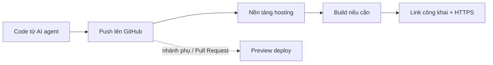

# Deploy web tĩnh lên 4 nơi

> **Tóm tắt:** Đưa cùng một trang web tĩnh lên GitHub Pages, Cloudflare (Workers static assets, kèm Pages), Netlify và Vercel bằng cả giao diện lẫn CLI, rồi so sánh preview, rollback, domain, HTTPS và giới hạn gói miễn phí.

Đây là bài thứ hai của track "Vibe Deploy". Ở bài trước bạn đã đưa code lên GitHub ([01-git-github.md](01-git-github.md)). Bây giờ ta biến repo đó thành một đường link công khai. Web tĩnh là loại dễ deploy nhất, miễn phí ở cả bốn nơi, và là bước đệm tốt cho phần có backend ở [bài 03](03-fullstack-serverless.md).

## Bạn sẽ làm được gì

Thời lượng ước tính: 60 đến 90 phút nếu thử cả 4 nơi (mỗi nơi khoảng 10 đến 15 phút).

- Hiểu "web tĩnh" là gì và vì sao nó rẻ, nhanh, khó hỏng.
- Có link công khai của cùng một sản phẩm trên GitHub Pages, Cloudflare, Netlify và Vercel.
- Biết xem preview deploy trước khi lên bản chính, và quay lui (rollback) khi lỡ làm hỏng.
- Biết gắn domain riêng và để HTTPS tự bật.
- Tự sửa được hai lỗi kinh điển: trang trắng/mất CSS trên GitHub Pages, và lỗi 404 khi refresh trang trong Single Page App.

## Khái niệm trong 5 phút

**Deploy giống mở cửa hàng.** Code trên máy bạn là món hàng còn nằm trong kho nhà. Deploy là thuê một mặt bằng (hosting), bày hàng ra, và treo biển địa chỉ (URL) để ai cũng ghé được.

**Web tĩnh** là website chỉ gồm các file có sẵn: `index.html`, `style.css`, `script.js`, ảnh. Máy chủ chỉ việc đưa file cho trình duyệt, không tính toán gì. Giống tờ rơi đã in sẵn: phát cho ai cũng như nhau. Vì vậy nó nhanh, rẻ và gần như không sập.

Web **không tĩnh** (có đăng nhập, lưu dữ liệu, gọi AI bằng key bí mật) cần thêm backend. Phần đó nằm ở [bài 03](03-fullstack-serverless.md), [bài 04](04-supabase.md) và [bài 05](05-firebase.md).

Hai thuật ngữ cần nhớ:

| Thuật ngữ | Nghĩa đơn giản | Ví dụ |
| --- | --- | --- |
| Build | Bước "đóng gói" code thành file tĩnh cuối cùng. Web HTML thuần không cần build | `npm run build` tạo thư mục `dist` |
| Output directory (publish directory) | Thư mục chứa file cuối cùng sẽ được đưa lên mạng | `dist`, `build`, hoặc `.` (chính thư mục gốc) |

Luồng chung của cả 4 nơi gần như giống nhau:



Quy tắc dễ nhớ: nhánh chính (thường là `main`) tạo bản **production** (người dùng thật thấy). Nhánh khác hoặc Pull Request tạo bản **preview** (link tạm để bạn xem thử). Cả Cloudflare, Netlify và Vercel đều làm vậy. GitHub Pages thì không có preview tự động.

Sản phẩm dùng xuyên suốt bài: thư mục `examples/vibe/static-site/` (HTML, CSS, JS thuần, không cần build). Bạn cũng có thể dùng sản phẩm tĩnh của chính mình, chỉ cần có `index.html` ở thư mục gốc hoặc trong một thư mục con rõ ràng.

## Thực hành từng bước

### Bước 0. Chuẩn bị repo

1. Tạo một repo GitHub mới, ví dụ `my-static-site`, và đưa nội dung của `examples/vibe/static-site/` vào **thư mục gốc** của repo (file `index.html` nằm ngay ngoài cùng). Cách làm chi tiết xem [01-git-github.md](01-git-github.md).
2. Kiểm tra trên máy trước khi deploy. Mở thẳng `index.html` bằng trình duyệt, hoặc chạy một server thử:

```bash
npx serve .
```

Bạn sẽ thấy: terminal in ra địa chỉ như `http://localhost:3000`; mở lên thấy trang chạy đúng, CSS và JS hoạt động.

3. Kiểm tra đường dẫn tài nguyên trong HTML. Dùng **đường dẫn tương đối**:

```html
<link rel="stylesheet" href="style.css" />
<script src="script.js"></script>
```

Tránh viết `href="/style.css"` (có dấu `/` đầu). Lý do nằm ở phần GitHub Pages bên dưới.

### Phần A. GitHub Pages

URL mặc định:

- Repo tên `USERNAME.github.io` cho **user site**: `https://USERNAME.github.io/`
- Repo tên khác cho **project site**: `https://USERNAME.github.io/TEN-REPO/`

**Cách nhanh nhất (giao diện, publish từ branch):**

1. Trong repo, bấm **Settings** (nếu không thấy, dùng menu dấu ba chấm trên thanh tab).
2. Ở thanh bên, mục "Code, planning, and automation", chọn **Pages**.
3. Tại "Build and deployment", đặt **Source** là **Deploy from a branch**.
4. Chọn branch `main`, thư mục `/ (root)` (hoặc `/docs` nếu web nằm trong `docs`), bấm **Save**.
5. Chờ 1 đến 2 phút. Vào tab **Actions** để xem tiến trình, hoặc tải lại trang Settings > Pages.

Bạn sẽ thấy: dòng "Your site is live at ..." kèm link. Giao diện có thể khác chút.

**Cách dùng GitHub Actions** (khi sản phẩm cần build, ví dụ Vite hoặc React): đặt **Source** là **GitHub Actions**, rồi thêm file `.github/workflows/pages.yml`. Ví dụ cho web tĩnh không cần build, đưa nguyên thư mục gốc lên:

```yaml
name: Deploy Pages

on:
  push:
    branches: [main]
  workflow_dispatch:

permissions:
  contents: read
  pages: write
  id-token: write

concurrency:
  group: pages
  cancel-in-progress: true

jobs:
  deploy:
    runs-on: ubuntu-latest
    environment:
      name: github-pages
    steps:
      - uses: actions/checkout@v4
      - uses: actions/upload-pages-artifact@v3
        with:
          path: .
      - id: deployment
        uses: actions/deploy-pages@v4
```

Nếu có bước build, thêm các bước `actions/setup-node`, `npm ci`, `npm run build` trước bước upload và đổi `path: .` thành `path: dist`. Phiên bản của các action có thể đã tăng; kiểm tra gợi ý trong mục Pages hoặc kho `actions/deploy-pages`.

**Preview:** GitHub Pages không có preview theo Pull Request. Muốn xem trước, hãy thử `npx serve` trên máy, hoặc dùng 3 nền tảng còn lại.

**Rollback:** Sửa lại (`git revert` rồi push) hoặc quay về commit cũ. Với Actions, vào tab **Actions**, mở lần chạy cũ tốt và chạy lại (**Re-run all jobs**).

**Domain riêng:**

1. Vào **Settings > Pages**, ô **Custom domain**, nhập domain, bấm **Save**. Làm bước này **trước** khi sửa DNS để tránh bị người khác chiếm subdomain.
2. Ở nhà cung cấp domain, tạo bản ghi DNS: subdomain (như `www.example.com`) dùng `CNAME` trỏ tới `USERNAME.github.io` (không ghi tên repo); domain gốc (`example.com`) dùng bản ghi `A` trỏ tới các IP GitHub công bố, hoặc `ALIAS`/`ANAME`.
3. Khi DNS xong, tick **Enforce HTTPS**. Có thể mất tới 24 giờ mới hiện.

Chi tiết và danh sách IP luôn lấy từ tài liệu chính thức (liên kết ở cuối bài), đừng chép IP từ nguồn khác. Tài liệu GitHub còn khuyến nghị: tránh bản ghi DNS wildcard (dạng `*.example.com`) vì có nguy cơ bị chiếm subdomain, và nên xác minh domain (domain verification) trong cài đặt tài khoản trước khi gắn vào repo.

**Giới hạn đáng biết** (theo tài liệu GitHub, kiểm tra 10/2026): site tối đa 1 GB; băng thông mềm 100 GB mỗi tháng; mềm 10 lần build mỗi giờ (không áp dụng nếu build bằng workflow Actions tự viết); một lần deploy chạy quá 10 phút sẽ thất bại. Chỉ phù hợp web tĩnh, không chạy được backend. GitHub Pages **không dành cho** dịch vụ thương mại (bán hàng, thanh toán, SaaS thương mại) và không nên chứa dữ liệu nhạy cảm như mật khẩu hay số thẻ. Nếu dự án của bạn thuộc loại đó, hãy đọc trang giới hạn chính thức ở cuối bài.

### Phần B. Cloudflare (Workers với static assets, và Pages)

URL mặc định: `TEN-DU-AN.TEN-TAI-KHOAN.workers.dev` cho Workers, `TEN-DU-AN.pages.dev` cho Pages.

Cloudflare có hai sản phẩm host web tĩnh. Kiểm tra 10/2026: trang tài liệu Cloudflare Pages ghi Workers là nền tảng ứng dụng chính và khuyên **bắt đầu dự án mới bằng Workers** (kèm static assets), có hướng dẫn chuyển dự án Pages sang Workers; tài liệu không nói Pages bị ngừng. Vì vậy bài này dạy **Workers static assets làm đường chính**, còn Pages ở mục B2 là đường cũ vẫn dùng được (dự án Pages có sẵn, hoặc khi bạn đang theo một hướng dẫn cũ). Tài liệu Cloudflare thay đổi thường xuyên, hãy xem lại các link cuối bài.

#### B1. Workers static assets (đường chính cho dự án mới)

Ý tưởng: bạn có một Worker (chương trình nhỏ chạy trên mạng lưới Cloudflare) và khai báo "thư mục này là file tĩnh". Khi deploy, Cloudflare tải file tĩnh lên và phục vụ chúng cùng Worker. Web thuần HTML không cần viết code Worker.

Bước 1. Đặt web trong thư mục `public` ở gốc repo (có `public/index.html`). Tạo file `wrangler.jsonc` ở gốc repo:

```jsonc
{
  "name": "ten-du-an",
  "compatibility_date": "2026-10-21",
  "assets": {
    "directory": "./public"
  }
}
```

`name` là tên Worker (viết thường, không dấu, dùng gạch ngang), cũng thành một phần của URL. `compatibility_date` là ngày "chốt phiên bản hành vi" của môi trường chạy; dùng ngày bạn tạo dự án. Không có dòng `main` nghĩa là chỉ phục vụ file tĩnh. Nếu bạn thích file TOML thì dùng `wrangler.toml` với `name`, `compatibility_date` và mục `[assets]` có `directory = "./public"`; hai kiểu tương đương. Ví dụ đầy đủ (có thêm Worker nhỏ trả JSON) nằm ở [cloudflare-workers-static](../examples/vibe/cloudflare-workers-static/README.md).

Bước 2. Chạy thử trên máy:

```bash
npx wrangler dev
```

Bạn sẽ thấy một địa chỉ `http://localhost:8787` (cổng có thể khác); mở lên thấy trang của bạn.

Bước 3a (nên dùng, tự deploy mỗi lần push): đưa repo lên GitHub, vào dashboard Cloudflare, **Workers & Pages**, **Create application**, chọn **GitHub** (tính năng này tên là Workers Builds), chọn repo, kiểm tra cấu hình rồi bấm **Save and Deploy**. Điều kiện quan trọng: tên Worker trong dashboard phải trùng `name` trong `wrangler.jsonc`, nếu không build sẽ lỗi. Bạn sẽ thấy: build chạy, rồi có link `workers.dev` để mở. Nhánh chính tạo bản production; nhánh khác tạo bản **Preview** (xem trong mục Previews của Worker). Nếu repo chưa có file cấu hình, Cloudflare có thể tự đề xuất một Pull Request thêm cấu hình, bạn đọc kỹ rồi mới merge.

Bước 3b (CLI, deploy thủ công):

```bash
npx wrangler login
npx wrangler deploy
```

Lệnh đầu mở trình duyệt để bạn tự đăng nhập. Lệnh thứ hai tải file trong `public` lên và in ra link `workers.dev`. Đây là deploy lên production, hãy thử bằng `npx wrangler dev` trước.

**SPA (React, Vue, Vite...):** thêm `not_found_handling` vào mục `assets` để đường dẫn không khớp file nào trả `index.html` với status 200, nhờ đó refresh `/about` không bị 404. Với Vite, `directory` thường là `./dist`:

```jsonc
{
  "name": "ten-du-an",
  "compatibility_date": "2026-10-21",
  "assets": {
    "directory": "./dist",
    "not_found_handling": "single-page-application"
  }
}
```

Nếu web nhiều trang và bạn muốn trang 404 riêng, đặt giá trị `"404-page"` và có file `404.html`. Không khai báo thì đường dẫn không khớp trả 404. Với Vite, đặt build command là `npm run build` trong cài đặt Builds để thư mục `dist` được tạo trước khi deploy.

**Preview:** mỗi nhánh không phải production có một URL Preview riêng khi bật Workers Builds.

**Rollback:** trong trang của Worker, mở tab **Deployments** và chọn phiên bản cũ chạy tốt; hoặc dùng `npx wrangler rollback` (xem [cli-cheatsheet.md](cli-cheatsheet.md)). Giao diện hay đổi, nếu không thấy nút thì đối chiếu tài liệu Workers.

**Domain riêng:** vào Worker, **Settings**, **Domains & Routes**, **Add**, **Custom Domain**, nhập tên miền hoặc subdomain. Điều kiện: domain đã nằm trong tài khoản Cloudflare (zone đang hoạt động) và hostname chưa có bản ghi CNAME. Cloudflare tự tạo bản ghi DNS và cấp chứng chỉ HTTPS. Có thể khai báo trong file cấu hình bằng mục `routes` có `pattern` và `custom_domain` đặt `true`, rồi chạy `npx wrangler deploy`.

**Giới hạn đáng biết:** request tới file tĩnh không tính vào hạn mức request của Worker (theo tài liệu Cloudflare); request chạy code Worker mới tính, gói Free khoảng 100.000 request mỗi ngày (kiểm tra 10/2026). Giới hạn số file, kích thước file và số lần build của gói Free thay đổi theo thời gian, hãy xem trang giá và giới hạn Workers. Backend nhỏ chạy trên cùng Worker sẽ gặp ở [bài 03](03-fullstack-serverless.md).

#### B2. Cloudflare Pages (đường cũ, vẫn dùng được)

Pages hợp nếu bạn đã có dự án Pages hoặc theo hướng dẫn cũ; dự án mới nên dùng B1. Giao diện tạo dự án có thể đã đổi: nếu không thấy lựa chọn Pages trong **Create application**, hãy đọc trang Pages và hướng dẫn chuyển sang Workers (link cuối bài).

**Đường giao diện (kết nối Git):**

1. Vào dashboard Cloudflare, mục **Workers & Pages**, bấm **Create application**, chọn **Pages**, rồi **Connect to Git**.
2. Chọn GitHub, cho phép truy cập repo (**Install & Authorize**), chọn repo, bấm **Begin setup**.
3. Đặt tên dự án (tên này thành `TEN-DU-AN.pages.dev`) và production branch là `main`.
4. Cấu hình build. Với web HTML thuần không dùng framework preset: tài liệu Cloudflare hướng dẫn nhập `exit 0` vào **Build command** (nghĩa là "không làm gì"), và **Build output directory** là thư mục chứa `index.html` (cách ít rắc rối nhất là để web trong một thư mục con như `public` rồi nhập đúng tên thư mục đó; nếu `index.html` nằm ở thư mục gốc repo, hãy thử `/` và đối chiếu tài liệu nếu form báo lỗi). Với Vite: build command `npm run build`, output `dist`.
5. Bấm **Save and Deploy**.

Bạn sẽ thấy: log build chạy vài chục giây, sau đó có link `.pages.dev` bấm vào xem được.

**Đường CLI (Direct Upload, không cần Git):**

```bash
npx wrangler login
npx wrangler pages project create ten-du-an --production-branch=main
npx wrangler pages deploy . --project-name=ten-du-an
```

Lệnh đầu mở trình duyệt để bạn tự đăng nhập; lệnh thứ hai tạo dự án (thay `ten-du-an` bằng tên của bạn, viết thường, không dấu); lệnh thứ ba tải thư mục hiện tại lên. Để tạo bản preview theo nhánh: `npx wrangler pages deploy . --project-name=ten-du-an --branch=ten-nhanh`. Lưu ý: tài liệu Cloudflare ghi rõ dự án đã kết nối Git thì không đổi sang Direct Upload được về sau. Direct Upload từ giao diện web cũng không hỗ trợ Functions: muốn có Functions, dùng Git hoặc Wrangler (xem [bài 03](03-fullstack-serverless.md)).

**Preview:** mỗi nhánh/Pull Request có một URL preview riêng, hiển thị trong danh sách **Deployments**.

**Rollback:** mở dự án, vào **Deployments**, ở bản deploy production cũ chạy tốt bấm menu ba chấm, chọn **Rollback to this deployment**. Chỉ quay về được bản production build thành công, không quay về bản preview.

**Domain riêng:** trong dự án, tab **Custom domains**, thêm domain và làm theo hướng dẫn DNS. Nếu domain đã quản lý ở Cloudflare thì gần như tự động. HTTPS tự cấp.

**SPA:** nếu dự án **không có** file `404.html` ở thư mục gốc, Pages coi đó là Single Page App và trả trang gốc cho mọi đường dẫn không khớp file nào.

**Giới hạn đáng biết** (gói Free theo tài liệu, kiểm tra 10/2026): 500 lần build mỗi tháng, mỗi lần build tối đa 20 phút, tối đa 20.000 file mỗi site, mỗi file tối đa 25 MiB, 100 domain riêng mỗi dự án. Request tới file tĩnh không giới hạn và không tính phí; chỉ request chạy Functions mới tính vào hạn mức hằng ngày. Pages Functions (backend nhỏ) sẽ gặp lại ở [bài 03](03-fullstack-serverless.md).

### Phần C. Netlify

URL mặc định: `TEN-SITE.netlify.app`.

**Cách nhanh nhất, không cần Git (kéo thả):**

1. Mở [app.netlify.com/drop](https://app.netlify.com/drop). Nên đăng nhập trước để dễ quản lý site.
2. Kéo **thư mục** (không phải file zip) chứa `index.html` vào khung Deploy.
3. Chờ vài giây.

Bạn sẽ thấy: một URL để xem site. Đây là cách ngon nhất khi cần "có link ngay" cho demo. Cập nhật bằng cách kéo thư mục mới vào mục **Deploys** của site.

**Kết nối Git (nên dùng cho dự án thật):**

1. Đăng nhập Netlify, mở [app.netlify.com/start](https://app.netlify.com/start) (hoặc nút thêm dự án mới trong trang **Projects**; tên nút có thể khác), chọn GitHub và repo.
2. Điền **Build command** (để trống nếu HTML thuần) và **Publish directory** (`.` hoặc `dist`).
3. Bấm **Deploy**.

Giao diện có thể khác chút, nên hãy ưu tiên cấu hình bằng file `netlify.toml` đặt ở thư mục gốc repo, để nền tảng đọc luôn và AI agent cũng sửa được:

```toml
[build]
  command = ""
  publish = "."

# Chỉ dùng khi là Single Page App: mọi đường dẫn trả về index.html
[[redirects]]
  from = "/*"
  to = "/index.html"
  status = 200
```

Cấu hình trong `netlify.toml` được ưu tiên hơn cấu hình trên giao diện. File thật có sẵn vẫn được phục vụ trước, nên `/assets/app.js` không bị redirect nuốt mất. Với Vite hoặc React, đổi thành `command = "npm run build"` và `publish = "dist"`.

**Đường CLI:**

```bash
npm install -g netlify-cli
netlify login
netlify deploy --dir=.
netlify deploy --dir=. --prod
```

`netlify login` mở trình duyệt để bạn tự cấp quyền. `netlify deploy` (không có `--prod`) tạo **bản nháp** với URL riêng để xem thử; thêm `--prod` mới đưa lên địa chỉ chính. Lần đầu CLI sẽ hỏi chọn hoặc tạo site. Cần Node.js 18.14 trở lên.

**Preview:** Deploy Preview cho mỗi Pull Request, và Branch deploy cho nhánh phụ nếu bạn bật.

**Rollback:** vào tab **Deploys** của site, chọn một bản deploy cũ tốt và bấm nút publish bản đó (tên nút có thể khác chút; xem mục "Manage deploys" trong tài liệu Netlify).

**Domain riêng:** mục **Domain management** của site, thêm domain; làm theo hướng dẫn DNS (hoặc dùng Netlify DNS). Chứng chỉ HTTPS tự cấp sau khi DNS đúng.

**Giới hạn đáng biết** (theo tài liệu Netlify, kiểm tra 10/2026): gói Free tính theo **credits**, có 300 credits mỗi tháng, đầu mỗi chu kỳ thanh toán được đặt lại và không cộng dồn. Gói Free là **hạn mức cứng**: hết credits thì mọi dự án bị tạm dừng và khách vào thấy trang "Site not available", và gói Free không mua thêm được credits. Mức tiêu hao tham khảo: mỗi lần deploy production thành công 15 credits (deploy lỗi, rollback, Deploy Preview và branch deploy là 0), băng thông 20 credits mỗi GB, chạy function 10 credits mỗi GB-giờ. Nghĩa là 300 credits chỉ đủ khoảng 20 lần deploy production, nên đừng bấm deploy production liên tục khi thử nghiệm; hãy dùng `netlify deploy` (bản nháp) hoặc nhánh phụ. Số liệu đổi theo thời gian, luôn đối chiếu trang giá.

### Phần D. Vercel

URL mặc định: `TEN-DU-AN.vercel.app`.

**Đường giao diện (kết nối Git):**

1. Đăng nhập Vercel bằng GitHub, bấm **Add New**, **Project**, và **Import** repo.
2. **Framework Preset:** Vercel tự nhận ra Vite, Next.js, v.v. Với HTML thuần, chọn **Other** và bỏ trống Build Command (bật Override rồi để trống nếu giao diện yêu cầu). Preset Other phục vụ thư mục `public` nếu có, nếu không thì phục vụ chính thư mục gốc. Nếu web nằm trong thư mục con, chỉnh **Root Directory** hoặc **Output Directory** cho đúng.
3. Bấm **Deploy**.

Bạn sẽ thấy: màn hình log build, rồi chúc mừng kèm ảnh chụp site và link `.vercel.app`.

**Đường CLI:**

```bash
npm install -g vercel
vercel login
vercel
vercel --prod
```

`vercel login` để bạn tự đăng nhập qua trình duyệt. Lệnh `vercel` đầu tiên hỏi vài câu thiết lập (liên kết dự án) rồi tạo deploy; theo tài liệu, **lần deploy đầu của dự án mới luôn là production**, các lần sau `vercel` tạo preview và `vercel --prod` mới lên bản chính. Thêm `--logs` để in build log khi cần chẩn đoán. Với trang tĩnh nhỏ (chỉ HTML hoặc Markdown, tối đa 10 file, 5 MB), Vercel có thể bỏ qua bước build cho nhanh.

**Preview:** mỗi nhánh và mỗi Pull Request có URL preview riêng, bot Vercel thường bình luận link ngay trong Pull Request.

**Rollback:** vào dự án, ở khung Production Deployment bấm **Instant Rollback** rồi chọn bản cũ và **Confirm Rollback**; đổi domain trỏ lại gần như tức thì. Gói Hobby chỉ quay về được bản production liền trước. Sau rollback, Vercel tắt tự động gán production cho các lần push mới; muốn trở lại bình thường, bấm **Undo Rollback** hoặc chạy `vercel promote` cho một deploy.

**Domain riêng:** vào **Settings**, **Domains**, thêm domain và làm theo hướng dẫn DNS. HTTPS tự cấp.

**SPA:** nếu là Vite hoặc React dạng SPA, thêm `vercel.json` ở thư mục gốc để đường dẫn con không bị 404:

```json
{
  "rewrites": [{ "source": "/(.*)", "destination": "/index.html" }]
}
```

**Giới hạn đáng biết:** gói Hobby chỉ dành cho **mục đích cá nhân, phi thương mại**. Site có bán hàng, quảng cáo, nhận tiền để làm site cho khách... đều thuộc dùng thương mại và cần gói trả phí (nhận quyên góp thì không tính là thương mại). Theo tài liệu fair use (kiểm tra 10/2026), mức tham khảo của Hobby gồm 100 GB Fast Data Transfer và 1.000.000 lần gọi function mỗi tháng. Tài liệu định nghĩa dùng thương mại là bất kỳ deployment nào phục vụ lợi ích tài chính của bất kỳ ai tham gia làm dự án, kể cả người được trả công viết code. Bạn tự quyết định có nâng cấp hay không; khóa này ưu tiên gói miễn phí.

### Bước cuối. So sánh sau khi thử cả 4

Điền bảng này theo trải nghiệm của chính bạn (bao nhiêu phút, gặp lỗi gì), rồi đối chiếu với bảng tham khảo:

| Tiêu chí | GitHub Pages | Cloudflare (Workers) | Netlify | Vercel |
| --- | --- | --- | --- | --- |
| URL mặc định | `USERNAME.github.io/REPO` | `TEN.TAI-KHOAN.workers.dev` | `TEN.netlify.app` | `TEN.vercel.app` |
| Cách nhanh nhất | Settings > Pages | Create application, GitHub hoặc `wrangler deploy` | Kéo thả | `vercel` |
| Preview theo Pull Request | Không có sẵn | Có | Có (Deploy Preview) | Có |
| Rollback | Revert commit hoặc chạy lại workflow cũ | Tab Deployments hoặc `wrangler rollback` | Publish bản deploy cũ | Instant Rollback (Hobby: bản liền trước) |
| SPA không 404 khi refresh | Cần mẹo `404.html` | `not_found_handling` đặt `single-page-application` | Redirect trong `netlify.toml` | `rewrites` trong `vercel.json` |
| Backend nhỏ | Không | Worker (cùng dự án) | Netlify Functions | Vercel Functions |
| Điểm cần lưu ý | Base path của project site; không dành cho dịch vụ thương mại | Tên Worker phải trùng `name` trong file cấu hình; Pages là đường cũ | Free là hạn mức cứng 300 credits mỗi tháng, hết thì site bị tạm dừng | Hobby chỉ phi thương mại |

Gợi ý chọn nhanh: demo tức thì thì Netlify Drop; sản phẩm tĩnh đơn giản, muốn ổn định lâu dài thì GitHub Pages hoặc Cloudflare (Workers static assets); dùng Next.js hoặc app có backend nhỏ thì Vercel. Chi tiết hơn ở [platforms.md](platforms.md).

### Hai vấn đề kinh điển

**1. Sai đường dẫn tài nguyên trên GitHub Pages (trang trắng hoặc mất CSS).**

Project site nằm ở `https://USERNAME.github.io/TEN-REPO/`, tức là web của bạn không nằm ở gốc `/` mà ở `/TEN-REPO/`. Nếu code viết `href="/style.css"`, trình duyệt đi tìm `https://USERNAME.github.io/style.css` (sai chỗ) và báo 404 trong tab Network.

| Cách viết | Kết quả trên project site |
| --- | --- |
| `href="style.css"` hoặc `href="./style.css"` | Đúng, tính theo thư mục hiện tại |
| `href="/style.css"` | Sai, nhảy lên gốc của `github.io` |
| `href="/TEN-REPO/style.css"` | Chạy được nhưng dính cứng tên repo, đổi tên là hỏng |

Cách sửa: dùng đường dẫn tương đối. Với dự án Vite, đặt base trong `vite.config.js`:

```js
import { defineConfig } from 'vite'

export default defineConfig({
  base: '/TEN-REPO/',
})
```

Ví dụ này dùng cho project site; nếu dùng domain riêng hoặc user site thì để `base: '/'`. Các framework khác có tùy chọn tương tự (thường tên `base`, `basePath` hoặc `publicPath`), hãy nhờ AI agent tìm đúng cho framework bạn dùng.

**2. Single Page App bị 404 khi refresh.**

SPA (React, Vue, Vite...) chỉ có **một** file thật là `index.html`. Khi bạn bấm link trong web để sang `/about`, JavaScript tự đổi màn hình mà không hỏi máy chủ. Nhưng nếu bạn **refresh** hoặc mở thẳng `/about`, trình duyệt hỏi máy chủ file `/about`; máy chủ không có file đó nên trả 404. Giống như bạn đi thẳng đến "phòng 302" mà tòa nhà chỉ có một cửa chính: phải vào cửa chính (`index.html`) trước rồi mới tìm phòng.

Cách sửa: bảo máy chủ "gặp đường dẫn lạ thì trả `index.html`".

| Nơi | Cách sửa |
| --- | --- |
| Cloudflare Workers | `not_found_handling` đặt `single-page-application` trong `assets` của `wrangler.jsonc` (Pages cũ: không có `404.html` ở gốc output là đủ) |
| Netlify | Rule `/*` tới `/index.html` với `status = 200` trong `netlify.toml` |
| Vercel | `rewrites` trong `vercel.json` (như ví dụ ở trên) |
| GitHub Pages | Không có rewrite. Mẹo phổ biến: sao chép `index.html` thành `404.html` sau build, vì GitHub Pages hiển thị `404.html` cho đường dẫn không tồn tại. Cách khác: dùng hash routing (`#/about`) |

Mẹo `404.html` hoạt động nhưng trả mã trạng thái 404 (trình duyệt vẫn hiển thị app, công cụ SEO thì không thích). Với web giới thiệu nhỏ thì chấp nhận được.

### Cách biết build lỗi: đọc build log

Khi deploy thất bại, câu trả lời gần như luôn nằm trong **build log**. Cách đọc:

1. Mở bản deploy bị đỏ (Failed). GitHub: tab **Actions**; Cloudflare, Netlify, Vercel: mục **Deployments** hoặc **Deploys**.
2. Kéo xuống **cuối** log, tìm dòng chứa `error`, `Error:`, `failed` hoặc `exit code`. Thường lỗi thật nằm ngay trên dòng "Build failed".
3. Chép đúng khoảng 20 dòng quanh chỗ lỗi (không chứa secret) để hỏi AI agent.
4. Chạy lại lệnh build trên máy (`npm run build`). Nếu máy bạn cũng lỗi, sửa tại máy; nếu máy chạy được mà server lỗi, nghi ngờ phiên bản Node, biến môi trường, hoặc sai output directory.

Với CLI, thêm cờ in log: `vercel deploy --logs`, và `netlify deploy` hiển thị log ngay trong terminal.

## Nhờ AI agent làm giúp

Dán prompt này cho agent (Claude Code, Cursor, Copilot agent...) khi đang ở thư mục dự án:

```text
Mình là người mới, cần deploy web tĩnh trong thư mục này.
1. Đọc cấu trúc dự án và cho mình biết đây là web HTML thuần hay cần build (có package.json không).
2. Nếu cần build, cho mình biết chính xác build command và output directory.
3. Kiểm tra mọi đường dẫn tới CSS, JS, ảnh có bị bắt đầu bằng dấu / không. Giải thích có hỏng khi deploy lên GitHub Pages dạng project site hay không, và sửa nếu cần.
4. Nếu là SPA (có router phía client), thêm cấu hình chống 404 khi refresh cho: netlify.toml, vercel.json, và workflow GitHub Pages hoặc 404.html.
5. Viết cho mình danh sách các bước deploy lên [GitHub Pages / Cloudflare Workers / Netlify / Vercel], mỗi bước một dòng, kèm kết quả mong đợi.
Không chạy lệnh deploy, không đăng nhập hộ, không tạo file .env chứa secret. Mỗi thay đổi hãy giải thích bằng một câu tiếng Việt.
```

Prompt khi build lỗi:

```text
Build trên [tên nền tảng] bị lỗi. Dưới đây là phần cuối của build log (mình đã xóa mọi secret):
[dán 20 đến 40 dòng log]
Hãy cho mình biết nguyên nhân gốc, cách sửa nhỏ nhất, và lệnh để mình tự kiểm tra lại trên máy trước khi push.
```

Việc bạn phải tự kiểm tra:

- Mở link deploy trên điện thoại hoặc cửa sổ ẩn danh, không chỉ trên máy bạn.
- Refresh ở một đường dẫn con (nếu là SPA).
- Mở DevTools > Network xem có file nào đỏ 404 không.
- Xem agent có vô tình thêm file chứa key vào repo không (`git status` trước khi commit).

Những việc **không giao** cho agent: dán hay gõ token, mật khẩu, API key vào đoạn chat; bấm nâng cấp gói hoặc nhập thẻ thanh toán; đồng ý điều khoản dịch vụ thay bạn. Đăng nhập CLI (`wrangler login`, `netlify login`, `vercel login`) bạn tự làm trong trình duyệt.

## Nếu bị lỗi

| Triệu chứng | Nguyên nhân thường gặp | Cách xử lý |
| --- | --- | --- |
| GitHub Pages hiện trang trắng hoặc không có CSS, tab Network báo 404 | Đường dẫn bắt đầu bằng `/` trên project site, hoặc `base` chưa đặt trong Vite | Dùng đường dẫn tương đối hoặc đặt `base: '/TEN-REPO/'`, rồi push lại |
| Mở `/about` bị 404, nhưng bấm link trong web thì chạy | SPA chưa cấu hình fallback | Thêm `netlify.toml` redirect, `vercel.json` rewrites, hoặc `404.html` cho GitHub Pages |
| Build lỗi "Cannot find module" hoặc thiếu package | Quên commit `package.json` hoặc `package-lock.json`, hoặc package chỉ cài trên máy bạn | Chạy `npm install` và `npm run build` trên máy, commit lại các file lock |
| Deploy xanh nhưng trang trống hoặc 404 ở gốc | Output/publish directory sai (ví dụ để `build` trong khi Vite xuất ra `dist`) | Sửa output directory đúng với thư mục thật được tạo ra sau build |
| Build lỗi chỉ trên server, máy bạn chạy tốt | Khác phiên bản Node, hoặc thiếu biến môi trường lúc build | Đặt phiên bản Node (trường `engines` hoặc biến `NODE_VERSION`), thêm env var trong cài đặt dự án |
| Sửa code nhưng trang vẫn cũ | Push nhầm nhánh (không phải production branch), hoặc cache trình duyệt | Kiểm tra nhánh production; làm mới cứng bằng Ctrl+Shift+R; xem tab Deployments có bản mới không |
| Domain riêng báo "Not secure" hoặc không vào được | DNS chưa cập nhật xong hoặc bản ghi sai, chứng chỉ chưa cấp | Kiểm tra bản ghi đúng loại (`CNAME` hay `A`), chờ DNS (có thể lâu tới 24 giờ), xem lại bước bật HTTPS |
| Vercel chặn deploy hoặc cảnh báo dùng thương mại | Gói Hobby chỉ cho dùng cá nhân phi thương mại | Đọc fair use guidelines; site thương mại cần gói phù hợp, tự quyết định |
| Tên file đúng trên Windows nhưng 404 trên server | Server phân biệt hoa thường: `Logo.png` khác `logo.png` | Đặt tên file đồng nhất chữ thường, khớp chính xác trong HTML |

## Tự kiểm tra

1. Vì sao `href="/style.css"` có thể làm mất CSS trên GitHub Pages dạng project site?
2. SPA refresh bị 404: nguyên nhân là gì và cách sửa trên Netlify?
3. Khác nhau giữa bản production và bản preview deploy?
4. Khi deploy lỗi, bạn đọc phần nào đầu tiên, và làm gì với nó?
5. Bạn lỡ push code làm hỏng web. Cách nhanh nhất để người dùng thấy lại bản cũ trên Vercel hoặc Cloudflare?
6. Vì sao nên thêm domain vào GitHub Pages trước khi sửa DNS?

<details>
<summary>Đáp án</summary>

1. Project site nằm ở `/TEN-REPO/`, không ở gốc. Đường dẫn bắt đầu bằng `/` đi tìm file ở gốc của `github.io`, nơi không có file đó nên 404. Dùng đường dẫn tương đối hoặc đặt `base`.
2. SPA chỉ có một file thật là `index.html`; refresh thì máy chủ tìm file theo đường dẫn nên 404. Trên Netlify thêm rule `from = "/*"`, `to = "/index.html"`, `status = 200` trong `netlify.toml`.
3. Production là bản người dùng thật thấy ở địa chỉ chính, tạo từ nhánh chính. Preview là bản tạm với URL riêng, tạo từ nhánh phụ hoặc Pull Request để xem thử trước khi gộp.
4. Đọc cuối build log, tìm dòng `error` hoặc `failed`, chép khoảng 20 dòng quanh đó (đã xóa secret) để tự đọc hoặc hỏi AI, và chạy lại `npm run build` trên máy để tái hiện lỗi.
5. Dùng rollback: Instant Rollback trên Vercel, hoặc chọn lại phiên bản cũ trong tab Deployments (hoặc `wrangler rollback`) trên Cloudflare Workers. Đổi lại đúng bản cũ gần như tức thì, rồi sửa lỗi sau.
6. Để tránh người khác đăng ký chiếm subdomain của bạn trong khoảng DNS đã trỏ nhưng GitHub chưa biết domain thuộc về repo nào.

</details>

## Checklist hoàn thành

- [ ] Sản phẩm chạy đúng khi mở bằng `npx serve .` trên máy.
- [ ] Đã dùng đường dẫn tương đối cho CSS, JS, ảnh.
- [ ] Có link công khai trên GitHub Pages.
- [ ] Có link công khai trên Cloudflare (Workers static assets).
- [ ] Có link công khai trên Netlify.
- [ ] Có link công khai trên Vercel.
- [ ] Đã tạo một Pull Request và xem được link preview ở ít nhất một nền tảng.
- [ ] Đã thử rollback ít nhất một lần.
- [ ] Đã điền bảng so sánh bằng trải nghiệm của chính mình.
- [ ] Không có secret nào trong repo (`git status` sạch các file `.env`).

## Tiếp theo

- Cần lưu dữ liệu, form, gọi API có key bí mật: sang [bài 03 (fullstack và serverless)](03-fullstack-serverless.md).
- Cần đăng nhập và database: [bài 04 (Supabase)](04-supabase.md) hoặc [bài 05 (Firebase)](05-firebase.md).
- Muốn domain riêng, bảo mật, giới hạn chi phí: [bài 07](07-domain-security-production.md). Gặp lỗi lạ: [bài 08](08-troubleshooting.md).
- So sánh nền tảng chi tiết hơn: [platforms.md](platforms.md); lệnh CLI nhanh: [cli-cheatsheet.md](cli-cheatsheet.md).

Tài liệu chính thức (giao diện và giới hạn đổi thường xuyên, luôn đối chiếu):

- GitHub Pages: [https://docs.github.com/en/pages](https://docs.github.com/en/pages)
- Giới hạn GitHub Pages: [https://docs.github.com/en/pages/getting-started-with-github-pages/github-pages-limits](https://docs.github.com/en/pages/getting-started-with-github-pages/github-pages-limits)
- Domain riêng cho GitHub Pages: [https://docs.github.com/en/pages/configuring-a-custom-domain-for-your-github-pages-site/managing-a-custom-domain-for-your-github-pages-site](https://docs.github.com/en/pages/configuring-a-custom-domain-for-your-github-pages-site/managing-a-custom-domain-for-your-github-pages-site)
- Workers static assets: [https://developers.cloudflare.com/workers/static-assets/](https://developers.cloudflare.com/workers/static-assets/)
- Workers Builds (kết nối Git): [https://developers.cloudflare.com/workers/ci-cd/builds/](https://developers.cloudflare.com/workers/ci-cd/builds/)
- Domain riêng cho Worker: [https://developers.cloudflare.com/workers/configuration/routing/custom-domains/](https://developers.cloudflare.com/workers/configuration/routing/custom-domains/)
- Chuyển từ Pages sang Workers: [https://developers.cloudflare.com/workers/static-assets/migration-guides/migrate-from-pages/](https://developers.cloudflare.com/workers/static-assets/migration-guides/migrate-from-pages/)
- Cloudflare Pages (đường cũ): [https://developers.cloudflare.com/pages/](https://developers.cloudflare.com/pages/)
- Giới hạn Cloudflare Pages: [https://developers.cloudflare.com/pages/platform/limits/](https://developers.cloudflare.com/pages/platform/limits/)
- Netlify: [https://docs.netlify.com/](https://docs.netlify.com/)
- Giá Netlify: [https://www.netlify.com/pricing/](https://www.netlify.com/pricing/)
- Vercel: [https://vercel.com/docs](https://vercel.com/docs)
- Vercel fair use: [https://vercel.com/docs/limits/fair-use-guidelines](https://vercel.com/docs/limits/fair-use-guidelines)
- Vercel Instant Rollback: [https://vercel.com/docs/instant-rollback](https://vercel.com/docs/instant-rollback)
