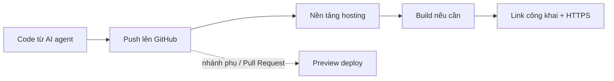

# Deploy web tĩnh: có link công khai

> **Tóm tắt:** Chặng 1, bước cuối: đưa trang web tĩnh lên GitHub Pages để có link công khai. Nền tảng khác (Cloudflare, Netlify, Vercel) gập sẵn để thử sau.

::: tip Bạn làm gì: có link công khai cho trang web của mình
**Bạn sẽ tạo ra:** một đường link dạng `ten-ban.github.io/ten-repo` mà ai cũng mở được.

**Thời gian:** đọc 10 phút, làm 20 đến 30 phút. Thử thêm nền tảng khác (không bắt buộc): mỗi nơi khoảng 10 đến 15 phút.

**Cần có trước:** repo GitHub chứa `index.html` ở [bài 01 Git và GitHub](01-git-github.md); đã đọc [bài 00 Tư duy](00-mindset.md).

**Chỉ bắt buộc MỘT nền tảng.** Khuyến nghị GitHub Pages: bạn đã có tài khoản GitHub và repo từ bài 01, không cần đăng ký thêm dịch vụ nào, không cần thẻ, và bật bằng vài cú bấm trong Settings. Các nền tảng khác nằm trong mục "Thử nền tảng khác" ở dưới.

Thuật ngữ lần đầu trong bài: [deploy, hosting, domain, HTTPS](../resources/glossary.md).
:::

Đây là bài thứ ba của Chặng 1 "Có link công khai". Ở bài trước bạn đã đưa code lên GitHub ([bài 01 Git và GitHub](01-git-github.md)). Bây giờ ta biến repo đó thành một đường link công khai. Web tĩnh là loại dễ deploy nhất, miễn phí ở cả bốn nơi, và là bước đệm tốt cho phần có backend ở [bài 03 Fullstack serverless](03-fullstack-serverless.md).

## Bạn sẽ làm được gì

Thời lượng ước tính: 20 đến 30 phút với một nền tảng. Thử thêm các nơi khác thì mỗi nơi 10 đến 15 phút.

- Hiểu "web tĩnh" là gì và vì sao nó rẻ, nhanh, khó hỏng.
- Có link công khai của sản phẩm trên GitHub Pages (hoặc nền tảng bạn chọn).
- Biết xem preview deploy trước khi lên bản chính, và quay lui (rollback) khi lỡ làm hỏng.
- Biết gắn domain riêng và để HTTPS tự bật.
- Tự sửa được hai lỗi kinh điển: trang trắng/mất CSS trên GitHub Pages, và lỗi 404 khi refresh trang trong Single Page App.

## Khái niệm trong 5 phút

**Deploy giống mở cửa hàng.** Code trên máy bạn là món hàng còn nằm trong kho nhà. Deploy là thuê một mặt bằng (hosting), bày hàng ra, và treo biển địa chỉ (URL) để ai cũng ghé được.

**Web tĩnh** là website chỉ gồm các file có sẵn: `index.html`, `style.css`, `script.js`, ảnh. Máy chủ chỉ việc đưa file cho trình duyệt, không tính toán gì. Giống tờ rơi đã in sẵn: phát cho ai cũng như nhau. Vì vậy nó nhanh, rẻ và gần như không sập.

Web **không tĩnh** (có đăng nhập, lưu dữ liệu, gọi AI bằng key bí mật) cần thêm backend. Phần đó nằm ở [bài 03 Fullstack serverless](03-fullstack-serverless.md), [bài 04 Supabase](04-supabase.md) và [bài 05 Firebase](05-firebase.md).

Hai thuật ngữ cần nhớ:

| Thuật ngữ | Nghĩa đơn giản | Ví dụ |
| --- | --- | --- |
| Build | Bước "đóng gói" code thành file tĩnh cuối cùng. Web HTML thuần không cần build | `npm run build` tạo thư mục `dist` |
| Output directory (publish directory) | Thư mục chứa file cuối cùng sẽ được đưa lên mạng | `dist`, `build`, hoặc `.` (chính thư mục gốc) |

Luồng chung của cả 4 nơi gần như giống nhau:



Quy tắc dễ nhớ: nhánh chính (thường là `main`) tạo bản **production** (người dùng thật thấy). Nhánh khác hoặc Pull Request tạo bản **preview** (link tạm để bạn xem thử). Cả Cloudflare, Netlify và Vercel đều làm vậy. GitHub Pages thì không có preview tự động.

Sản phẩm dùng xuyên suốt bài: gói mẫu `vibe-static-site.zip` (HTML, CSS, JS thuần, không cần build), lấy ở Bước 0. Bạn cũng có thể dùng sản phẩm tĩnh của chính mình.

## Chọn MỘT nền tảng cho Chặng 1

| Nền tảng | Hợp khi | Lý do |
| --- | --- | --- |
| **GitHub Pages (khuyến nghị)** | Trang giới thiệu, portfolio, landing page | Dùng luôn tài khoản và repo GitHub, không đăng ký thêm, không thẻ |
| Cloudflare (Workers static assets) | Bạn đã có hoặc sắp mua domain ở Cloudflare, muốn có preview theo nhánh | Cần thêm tài khoản Cloudflare và file cấu hình |

Netlify và Vercel cũng dùng được, xem mục "Thử nền tảng khác" ở cuối phần thực hành. Hãy làm một nơi cho xong rồi mới thử nơi khác.

## Thực hành từng bước

### Bước 0. Chuẩn bị repo

1. **Lấy file trang web mẫu.** Chọn một trong hai cách:
   - **Tải gói mẫu:** mở link https://devops-course.tiennhm.io.vn/downloads/vibe-static-site.zip, tải về, giải nén ra một thư mục tên `my-static-site`. Trong đó có `index.html`, `style.css`, `script.js`.
   - **Nhờ AI agent tạo trang mẫu:** dán cho agent câu sau. Agent sẽ tạo đúng ba file trong thư mục của bạn.

   ```text
   Tạo giúp tôi một trang giới thiệu CLB gồm ba file index.html, style.css, script.js trong thư mục hiện tại. Dùng đường dẫn tương đối (không bắt đầu bằng dấu /). Không cần cài thêm gì, không dùng thư viện ngoài.
   ```

   Hoặc dùng sản phẩm tĩnh của chính bạn: chỉ cần có `index.html` ở ngoài cùng.
2. Tạo một repo GitHub mới, ví dụ `my-static-site`, và đưa các file trong thư mục đó vào **thư mục gốc** của repo (`index.html` nằm ngay ngoài cùng). Cách làm bằng GitHub Desktop xem [bài 01 Git và GitHub](01-git-github.md).
3. Kiểm tra trên máy trước khi deploy: bấm đúp file `index.html` để mở bằng trình duyệt.

Bạn sẽ thấy: trang mở ra đúng, có màu sắc (CSS) và nút bấm chạy (JS). Không cần cài Node hay chạy server. Ai đã có Node.js có thể chạy `npx serve .` để xem qua địa chỉ `http://localhost:3000`, nhưng đây là tùy chọn.

4. Kiểm tra đường dẫn tài nguyên trong HTML. Dùng **đường dẫn tương đối**:

```html
<link rel="stylesheet" href="style.css" />
<script src="script.js"></script>
```

Tránh viết `href="/style.css"` (có dấu `/` đầu). Lý do nằm ở phần GitHub Pages bên dưới.

### Phần A. GitHub Pages

URL mặc định:

- Repo tên `USERNAME.github.io` cho **user site**: `https://USERNAME.github.io/`
- Repo tên khác cho **project site**: `https://USERNAME.github.io/TEN-REPO/`

**Cách nhanh nhất (giao diện, publish từ branch):**

1. Trong repo, bấm **Settings** (nếu không thấy, dùng menu dấu ba chấm trên thanh tab).
2. Ở thanh bên, mục "Code, planning, and automation", chọn **Pages**.
3. Tại "Build and deployment", đặt **Source** là **Deploy from a branch**.
4. Chọn branch `main`, thư mục `/ (root)` (hoặc `/docs` nếu web nằm trong `docs`), bấm **Save**.
5. Chờ 1 đến 2 phút. Vào tab **Actions** để xem tiến trình, hoặc tải lại trang Settings > Pages.

Bạn sẽ thấy: dòng "Your site is live at ..." kèm link. Giao diện có thể khác chút.

**Cách dùng GitHub Actions** (khi sản phẩm cần build, ví dụ Vite hoặc React): đặt **Source** là **GitHub Actions**, rồi thêm file `.github/workflows/pages.yml`. Ví dụ cho web tĩnh không cần build, đưa nguyên thư mục gốc lên:

```yaml
name: Deploy Pages

on:
  push:
    branches: [main]
  workflow_dispatch:

permissions:
  contents: read
  pages: write
  id-token: write

concurrency:
  group: pages
  cancel-in-progress: true

jobs:
  deploy:
    runs-on: ubuntu-latest
    environment:
      name: github-pages
    steps:
      - uses: actions/checkout@v4
      - uses: actions/upload-pages-artifact@v3
        with:
          path: .
      - id: deployment
        uses: actions/deploy-pages@v4
```

Nếu có bước build, thêm các bước `actions/setup-node`, `npm ci`, `npm run build` trước bước upload và đổi `path: .` thành `path: dist`. Phiên bản của các action có thể đã tăng; kiểm tra gợi ý trong mục Pages hoặc kho `actions/deploy-pages`.

**Preview:** GitHub Pages không có preview theo Pull Request. Muốn xem trước, hãy mở `index.html` trực tiếp trên máy, hoặc dùng các nền tảng khác trong [trang nâng cao](02-static-hosting-advanced.md).

**Rollback:** Sửa lại (`git revert` rồi push) hoặc quay về commit cũ. Với Actions, vào tab **Actions**, mở lần chạy cũ tốt và chạy lại (**Re-run all jobs**).

**Domain riêng:**

1. Vào **Settings > Pages**, ô **Custom domain**, nhập domain, bấm **Save**. Làm bước này **trước** khi sửa DNS để tránh bị người khác chiếm subdomain.
2. Ở nhà cung cấp domain, tạo bản ghi DNS: subdomain (như `www.example.com`) dùng `CNAME` trỏ tới `USERNAME.github.io` (không ghi tên repo); domain gốc (`example.com`) dùng bản ghi `A` trỏ tới các IP GitHub công bố, hoặc `ALIAS`/`ANAME`.
3. Khi DNS xong, tick **Enforce HTTPS**. Có thể mất tới 24 giờ mới hiện.

Chi tiết và danh sách IP luôn lấy từ tài liệu chính thức (liên kết ở cuối bài), đừng chép IP từ nguồn khác. Tài liệu GitHub còn khuyến nghị: tránh bản ghi DNS wildcard (dạng `*.example.com`) vì có nguy cơ bị chiếm subdomain, và nên xác minh domain (domain verification) trong cài đặt tài khoản trước khi gắn vào repo.

**Giới hạn đáng biết** (theo tài liệu GitHub, kiểm tra 10/2026): site tối đa 1 GB; băng thông mềm 100 GB mỗi tháng; mềm 10 lần build mỗi giờ (không áp dụng nếu build bằng workflow Actions tự viết); một lần deploy chạy quá 10 phút sẽ thất bại. Chỉ phù hợp web tĩnh, không chạy được backend. GitHub Pages **không dành cho** dịch vụ thương mại (bán hàng, thanh toán, SaaS thương mại) và không nên chứa dữ liệu nhạy cảm như mật khẩu hay số thẻ. Nếu dự án của bạn thuộc loại đó, hãy đọc trang giới hạn chính thức ở cuối bài.

### Hai vấn đề kinh điển

**1. Sai đường dẫn tài nguyên trên GitHub Pages (trang trắng hoặc mất CSS).**

Project site nằm ở `https://USERNAME.github.io/TEN-REPO/`, tức là web của bạn không nằm ở gốc `/` mà ở `/TEN-REPO/`. Nếu code viết `href="/style.css"`, trình duyệt đi tìm `https://USERNAME.github.io/style.css` (sai chỗ) và báo 404 trong tab Network.

| Cách viết | Kết quả trên project site |
| --- | --- |
| `href="style.css"` hoặc `href="./style.css"` | Đúng, tính theo thư mục hiện tại |
| `href="/style.css"` | Sai, nhảy lên gốc của `github.io` |
| `href="/TEN-REPO/style.css"` | Chạy được nhưng dính cứng tên repo, đổi tên là hỏng |

Cách sửa: dùng đường dẫn tương đối. Với dự án Vite, đặt base trong `vite.config.js`:

```js
import { defineConfig } from 'vite'

export default defineConfig({
  base: '/TEN-REPO/',
})
```

Ví dụ này dùng cho project site; nếu dùng domain riêng hoặc user site thì để `base: '/'`. Các framework khác có tùy chọn tương tự (thường tên `base`, `basePath` hoặc `publicPath`), hãy nhờ AI agent tìm đúng cho framework bạn dùng.

**2. Single Page App bị 404 khi refresh.**

SPA (React, Vue, Vite...) chỉ có **một** file thật là `index.html`. Khi bạn bấm link trong web để sang `/about`, JavaScript tự đổi màn hình mà không hỏi máy chủ. Nhưng nếu bạn **refresh** hoặc mở thẳng `/about`, trình duyệt hỏi máy chủ file `/about`; máy chủ không có file đó nên trả 404. Giống như bạn đi thẳng đến "phòng 302" mà tòa nhà chỉ có một cửa chính: phải vào cửa chính (`index.html`) trước rồi mới tìm phòng.

Cách sửa: bảo máy chủ "gặp đường dẫn lạ thì trả `index.html`".

| Nơi | Cách sửa |
| --- | --- |
| Cloudflare Workers | `not_found_handling` đặt `single-page-application` trong `assets` của `wrangler.jsonc` (Pages cũ: không có `404.html` ở gốc output là đủ) |
| Netlify | Rule `/*` tới `/index.html` với `status = 200` trong `netlify.toml` |
| Vercel | `rewrites` trong `vercel.json` (xem [Các nền tảng khác](02-static-hosting-advanced.md)) |
| GitHub Pages | Không có rewrite. Mẹo phổ biến: sao chép `index.html` thành `404.html` sau build, vì GitHub Pages hiển thị `404.html` cho đường dẫn không tồn tại. Cách khác: dùng hash routing (`#/about`) |

Mẹo `404.html` hoạt động nhưng trả mã trạng thái 404 (trình duyệt vẫn hiển thị app, công cụ SEO thì không thích). Với web giới thiệu nhỏ thì chấp nhận được.

### Cách biết build lỗi: đọc build log

Khi deploy thất bại, câu trả lời gần như luôn nằm trong **build log**. Cách đọc:

1. Mở bản deploy bị đỏ (Failed). GitHub: tab **Actions**; Cloudflare, Netlify, Vercel: mục **Deployments** hoặc **Deploys**.
2. Kéo xuống **cuối** log, tìm dòng chứa `error`, `Error:`, `failed` hoặc `exit code`. Thường lỗi thật nằm ngay trên dòng "Build failed".
3. Chép đúng khoảng 20 dòng quanh chỗ lỗi (không chứa secret) để hỏi AI agent.
4. Chạy lại lệnh build trên máy (`npm run build`). Nếu máy bạn cũng lỗi, sửa tại máy; nếu máy chạy được mà server lỗi, nghi ngờ phiên bản Node, biến môi trường, hoặc sai output directory.

Với CLI, thêm cờ in log: `vercel deploy --logs`, và `netlify deploy` hiển thị log ngay trong terminal.

::: details Thử nền tảng khác: Cloudflare, Netlify, Vercel (không bắt buộc)
Chỉ mở khi bạn đã có link GitHub Pages. Hướng dẫn từng nền tảng, cách xem preview theo Pull Request, rollback, domain riêng và bảng so sánh nằm ở trang riêng: [Các nền tảng khác (nâng cao)](02-static-hosting-advanced.md).
:::

## Nhờ AI agent làm giúp

Dán prompt này cho agent (Claude Code, Cursor, Copilot agent...) khi đang ở thư mục dự án:

```text
Mình là người mới, cần deploy web tĩnh trong thư mục này.
1. Đọc cấu trúc dự án và cho mình biết đây là web HTML thuần hay cần build (có package.json không).
2. Nếu cần build, cho mình biết chính xác build command và output directory.
3. Kiểm tra mọi đường dẫn tới CSS, JS, ảnh có bị bắt đầu bằng dấu / không. Giải thích có hỏng khi deploy lên GitHub Pages dạng project site hay không, và sửa nếu cần.
4. Nếu là SPA (có router phía client), thêm cấu hình chống 404 khi refresh cho: netlify.toml, vercel.json, và workflow GitHub Pages hoặc 404.html.
5. Viết cho mình danh sách các bước deploy lên [GitHub Pages / Cloudflare Workers / Netlify / Vercel], mỗi bước một dòng, kèm kết quả mong đợi.
Không chạy lệnh deploy, không đăng nhập hộ, không tạo file .env chứa secret. Mỗi thay đổi hãy giải thích bằng một câu tiếng Việt.
```

Prompt khi build lỗi:

```text
Build trên [tên nền tảng] bị lỗi. Dưới đây là phần cuối của build log (mình đã xóa mọi secret):
[dán 20 đến 40 dòng log]
Hãy cho mình biết nguyên nhân gốc, cách sửa nhỏ nhất, và lệnh để mình tự kiểm tra lại trên máy trước khi push.
```

Việc bạn phải tự kiểm tra:

- Mở link deploy trên điện thoại hoặc cửa sổ ẩn danh, không chỉ trên máy bạn.
- Refresh ở một đường dẫn con (nếu là SPA).
- Mở DevTools > Network xem có file nào đỏ 404 không.
- Xem agent có vô tình thêm file chứa key vào repo không (`git status` trước khi commit).

Những việc **không giao** cho agent: dán hay gõ token, mật khẩu, API key vào đoạn chat; bấm nâng cấp gói hoặc nhập thẻ thanh toán; đồng ý điều khoản dịch vụ thay bạn. Đăng nhập CLI (`wrangler login`, `netlify login`, `vercel login`) bạn tự làm trong trình duyệt.

## Nếu bị lỗi

| Triệu chứng | Nguyên nhân thường gặp | Cách xử lý |
| --- | --- | --- |
| GitHub Pages hiện trang trắng hoặc không có CSS, tab Network báo 404 | Đường dẫn bắt đầu bằng `/` trên project site, hoặc `base` chưa đặt trong Vite | Dùng đường dẫn tương đối hoặc đặt `base: '/TEN-REPO/'`, rồi push lại |
| Mở `/about` bị 404, nhưng bấm link trong web thì chạy | SPA chưa cấu hình fallback | Thêm `netlify.toml` redirect, `vercel.json` rewrites, hoặc `404.html` cho GitHub Pages |
| Build lỗi "Cannot find module" hoặc thiếu package | Quên commit `package.json` hoặc `package-lock.json`, hoặc package chỉ cài trên máy bạn | Chạy `npm install` và `npm run build` trên máy, commit lại các file lock |
| Deploy xanh nhưng trang trống hoặc 404 ở gốc | Output/publish directory sai (ví dụ để `build` trong khi Vite xuất ra `dist`) | Sửa output directory đúng với thư mục thật được tạo ra sau build |
| Build lỗi chỉ trên server, máy bạn chạy tốt | Khác phiên bản Node, hoặc thiếu biến môi trường lúc build | Đặt phiên bản Node (trường `engines` hoặc biến `NODE_VERSION`), thêm env var trong cài đặt dự án |
| Sửa code nhưng trang vẫn cũ | Push nhầm nhánh (không phải production branch), hoặc cache trình duyệt | Kiểm tra nhánh production; làm mới cứng bằng Ctrl+Shift+R; xem tab Deployments có bản mới không |
| Domain riêng báo "Not secure" hoặc không vào được | DNS chưa cập nhật xong hoặc bản ghi sai, chứng chỉ chưa cấp | Kiểm tra bản ghi đúng loại (`CNAME` hay `A`), chờ DNS (có thể lâu tới 24 giờ), xem lại bước bật HTTPS |
| Vercel chặn deploy hoặc cảnh báo dùng thương mại | Gói Hobby chỉ cho dùng cá nhân phi thương mại | Đọc fair use guidelines; site thương mại cần gói phù hợp, tự quyết định |
| Tên file đúng trên Windows nhưng 404 trên server | Server phân biệt hoa thường: `Logo.png` khác `logo.png` | Đặt tên file đồng nhất chữ thường, khớp chính xác trong HTML |

## Tự kiểm tra

1. Vì sao `href="/style.css"` có thể làm mất CSS trên GitHub Pages dạng project site?
2. SPA refresh bị 404: nguyên nhân là gì và cách sửa trên Netlify?
3. Khác nhau giữa bản production và bản preview deploy?
4. Khi deploy lỗi, bạn đọc phần nào đầu tiên, và làm gì với nó?
5. Bạn lỡ push code làm hỏng web. Cách nhanh nhất để người dùng thấy lại bản cũ trên Vercel hoặc Cloudflare?
6. Vì sao nên thêm domain vào GitHub Pages trước khi sửa DNS?

<details>
<summary>Đáp án</summary>

1. Project site nằm ở `/TEN-REPO/`, không ở gốc. Đường dẫn bắt đầu bằng `/` đi tìm file ở gốc của `github.io`, nơi không có file đó nên 404. Dùng đường dẫn tương đối hoặc đặt `base`.
2. SPA chỉ có một file thật là `index.html`; refresh thì máy chủ tìm file theo đường dẫn nên 404. Trên Netlify thêm rule `from = "/*"`, `to = "/index.html"`, `status = 200` trong `netlify.toml`.
3. Production là bản người dùng thật thấy ở địa chỉ chính, tạo từ nhánh chính. Preview là bản tạm với URL riêng, tạo từ nhánh phụ hoặc Pull Request để xem thử trước khi gộp.
4. Đọc cuối build log, tìm dòng `error` hoặc `failed`, chép khoảng 20 dòng quanh đó (đã xóa secret) để tự đọc hoặc hỏi AI, và chạy lại `npm run build` trên máy để tái hiện lỗi.
5. Dùng rollback: Instant Rollback trên Vercel, hoặc chọn lại phiên bản cũ trong tab Deployments (hoặc `wrangler rollback`) trên Cloudflare Workers. Đổi lại đúng bản cũ gần như tức thì, rồi sửa lỗi sau.
6. Để tránh người khác đăng ký chiếm subdomain của bạn trong khoảng DNS đã trỏ nhưng GitHub chưa biết domain thuộc về repo nào.

</details>

## Checklist hoàn thành

Bắt buộc (Chặng 1):

- [ ] Sản phẩm chạy đúng khi mở `index.html` bằng trình duyệt trên máy.
- [ ] Đã dùng đường dẫn tương đối cho CSS, JS, ảnh.
- [ ] Có link công khai trên GitHub Pages, mở được bằng cửa sổ ẩn danh và trên điện thoại.
- [ ] Không có secret nào trong repo (`git status` sạch các file `.env`).

Tùy chọn (khi thử nền tảng khác):

- [ ] Có link công khai trên Cloudflare (Workers static assets), Netlify hoặc Vercel.
- [ ] Đã tạo một Pull Request và xem được link preview ở ít nhất một nền tảng.
- [ ] Đã thử rollback ít nhất một lần.
- [ ] Đã điền bảng so sánh bằng trải nghiệm của chính mình.

## Tiếp theo

Có link rồi: bạn đã xong Chặng 1 và đã đạt mục tiêu của một buổi chiều. Muốn làm tiếp, bước kế là [bài 07 Domain, bảo mật, production](07-domain-security-production.md) (domain riêng, HTTPS, kiểm tra bảo mật) rồi [bài 11 Hoàn thiện và ra mắt](11-launch-polish.md). Chỉ khi sản phẩm cần lưu dữ liệu hoặc đăng nhập mới sang Chặng 2.

::: details Tra cứu thêm
- Cần lưu dữ liệu và đăng nhập: [bài 04 Supabase](04-supabase.md) hoặc [bài 05 Firebase](05-firebase.md).
- Cần gọi API có key bí mật: [bài 03 Fullstack serverless](03-fullstack-serverless.md).
- Gặp lỗi lạ: [bài 08 Xử lý sự cố](08-troubleshooting.md).
- So sánh nền tảng: [So sánh nền tảng](platforms.md); lệnh CLI nhanh: [Bảng lệnh CLI](cli-cheatsheet.md); lộ trình: [trang chủ track](index.md).
:::

Tài liệu chính thức (giao diện và giới hạn đổi thường xuyên, luôn đối chiếu):

- GitHub Pages: [https://docs.github.com/en/pages](https://docs.github.com/en/pages)
- Giới hạn GitHub Pages: [https://docs.github.com/en/pages/getting-started-with-github-pages/github-pages-limits](https://docs.github.com/en/pages/getting-started-with-github-pages/github-pages-limits)
- Domain riêng cho GitHub Pages: [https://docs.github.com/en/pages/configuring-a-custom-domain-for-your-github-pages-site/managing-a-custom-domain-for-your-github-pages-site](https://docs.github.com/en/pages/configuring-a-custom-domain-for-your-github-pages-site/managing-a-custom-domain-for-your-github-pages-site)
- Workers static assets: [https://developers.cloudflare.com/workers/static-assets/](https://developers.cloudflare.com/workers/static-assets/)
- Workers Builds (kết nối Git): [https://developers.cloudflare.com/workers/ci-cd/builds/](https://developers.cloudflare.com/workers/ci-cd/builds/)
- Domain riêng cho Worker: [https://developers.cloudflare.com/workers/configuration/routing/custom-domains/](https://developers.cloudflare.com/workers/configuration/routing/custom-domains/)
- Chuyển từ Pages sang Workers: [https://developers.cloudflare.com/workers/static-assets/migration-guides/migrate-from-pages/](https://developers.cloudflare.com/workers/static-assets/migration-guides/migrate-from-pages/)
- Cloudflare Pages (đường cũ): [https://developers.cloudflare.com/pages/](https://developers.cloudflare.com/pages/)
- Giới hạn Cloudflare Pages: [https://developers.cloudflare.com/pages/platform/limits/](https://developers.cloudflare.com/pages/platform/limits/)
- Netlify: [https://docs.netlify.com/](https://docs.netlify.com/)
- Giá Netlify: [https://www.netlify.com/pricing/](https://www.netlify.com/pricing/)
- Vercel: [https://vercel.com/docs](https://vercel.com/docs)
- Vercel fair use: [https://vercel.com/docs/limits/fair-use-guidelines](https://vercel.com/docs/limits/fair-use-guidelines)
- Vercel Instant Rollback: [https://vercel.com/docs/instant-rollback](https://vercel.com/docs/instant-rollback)

