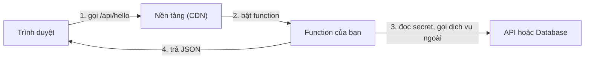

# Web có backend nhẹ: serverless trên Vercel, Netlify, Cloudflare

> **Tóm tắt:** Thêm backend nhẹ cho web bằng serverless function: viết endpoint JSON, giữ secret phía server, push lên GitHub để Vercel, Netlify hoặc Cloudflare tự build và cho bạn link.

::: tip Bạn làm gì
- **Kết quả:** một endpoint `/api/hello` chạy trên mạng, và một biến bí mật chỉ function đọc được (web nhìn không thấy).
- **Thời gian:** 60 đến 90 phút. Chỉ cần deploy một nền tảng.
- **Cần gì trước:** đã làm [Git và GitHub](01-git-github.md) và [Đưa web tĩnh lên mạng](02-static-hosting.md); có Node.js bản LTS.
- **Module trước:** [Đưa web tĩnh lên mạng](02-static-hosting.md).
:::

## Bạn sẽ làm được gì

Thời lượng ước tính: 60 đến 90 phút.

- Giải thích được serverless function là gì và khi nào web của bạn cần nó.
- Chạy thử một endpoint trả JSON trên máy mình, rồi deploy lên ít nhất một nền tảng (Vercel, Netlify hoặc Cloudflare Workers).
- Phân biệt [biến môi trường](../resources/glossary.md) phía server và biến public (`NEXT_PUBLIC_`, `VITE_`), biết vì sao secret không bao giờ được vào frontend.
- Đọc được build log và function log để tìm lỗi khi deploy hỏng.
- Dùng preview deployment để thử thay đổi trước khi lên bản chính.

## Khái niệm trong 5 phút

Hãy nghĩ web tĩnh như một tấm áp phích dán ở cửa hàng: ai đến cũng thấy y hệt nhau. Khi bạn cần "nhớ thông tin, gọi dịch vụ bên ngoài bằng chìa khóa riêng, hoặc xử lý form", bạn cần một người đứng quầy: đó là backend.

Cách truyền thống là thuê cả một cái quầy (server) mở 24/7 và tự trông. Cách serverless là thuê nhân viên theo ca: khi có khách gọi (request), nền tảng bật một nhân viên (function) lên làm đúng một việc rồi cho nghỉ. Bạn không quản lý máy, chỉ viết hàm. Tên "serverless" không có nghĩa là không có server, mà là bạn không phải trông nó.



Các nền tảng làm cùng một việc nhưng tên gọi và cú pháp khác nhau:

| | Vercel | Netlify | Cloudflare Workers (đường chính) | Cloudflare Pages Functions (đường cũ) |
| --- | --- | --- | --- | --- |
| Tên | Vercel Functions | Netlify Functions | Worker (hàm `fetch` trong `src/index.js`) kèm static assets | Pages Functions (chạy trên Workers) |
| Thư mục | `api/` ở gốc (dự án không framework) hoặc route của framework | `netlify/functions/` | `src/` và file `wrangler.jsonc` ở gốc; file tĩnh trong `public/` | `functions/` ở gốc project |
| Cách đặt đường dẫn | Theo tên file, hoặc route của framework (Next.js: `app/api/hello/route.js`) | Khai báo `config.path` trong file | Bạn tự viết bằng code trong Worker (so khớp `url.pathname`) | Theo cấu trúc thư mục trong `functions/` |
| Đọc biến môi trường | `process.env.TEN` | `process.env.TEN` | `env.TEN` (tham số `env` của hàm `fetch`) | `context.env.TEN` |
| Chạy local | `vercel dev` | `netlify dev` | `npx wrangler dev` | `npx wrangler pages dev` |

Các khái niệm đi kèm, giải bằng ví dụ đời thường:

| Khái niệm | Hiểu đơn giản | Điều cần nhớ |
| --- | --- | --- |
| Build | Khâu đóng gói hàng trước khi lên kệ | Lỗi build xem ở build log; function lỗi lúc chạy xem ở function log |
| Env var phía server | Két sắt đặt trong phòng nhân viên | Chỉ function đọc được; đặt trong dashboard của nền tảng |
| Env var public | Bảng giá dán ngoài cửa | Biến bắt đầu bằng `NEXT_PUBLIC_` (Next.js) hoặc `VITE_` (Vite) bị nhúng vào code gửi cho trình duyệt: ai cũng đọc được |
| Preview deployment | Gian hàng thử, có link riêng cho mỗi nhánh hoặc Pull Request | Thử thoải mái mà không đụng bản chính |
| Cold start | Nhân viên vừa được gọi dậy nên lần gọi đầu chậm hơn | Bình thường; hàm nhẹ thì ít cảm nhận |
| Giới hạn thời gian | Mỗi ca có giờ kết thúc | Netlify function đồng bộ: 60 giây (không chỉnh được). Vercel (Fluid compute): mặc định 300 giây, gói Hobby tối đa 300 giây. Cloudflare: xem trang giới hạn chính thức. Gói Free của Cloudflare tính Functions chung hạn mức request mỗi ngày với Workers (100.000 request mỗi ngày, đặt lại lúc nửa đêm UTC); request tới file tĩnh không tính |
| CORS | Quy định "web nào được phép hỏi quầy này" | Chỉ cần quan tâm khi web và API ở hai domain khác nhau |

Quy tắc vàng: mọi thứ trình duyệt nhìn thấy đều là công khai. Chìa khóa riêng chỉ được dùng trong function.

Giới hạn gói free thay đổi thường xuyên. Các con số nêu trong bài (kiểm tra 10/2026) chỉ để bạn có khái niệm, hãy luôn xem trang giá chính thức ở cuối bài trước khi dựa vào chúng.

## Thực hành từng bước

Bài này dùng các ví dụ có sẵn trong repo: [vercel-api](../examples/vibe/vercel-api/README.md), [netlify-function](../examples/vibe/netlify-function/README.md), [cloudflare-workers-static](../examples/vibe/cloudflare-workers-static/README.md) (đường chính của Cloudflare cho dự án mới) và [cloudflare-pages-function](../examples/vibe/cloudflare-pages-function/README.md) (đường Pages cũ). Mỗi ví dụ có endpoint `/api/hello` trả JSON và `/api/env-check` chỉ nói "biến đã cấu hình hay chưa". Bạn chỉ cần deploy một nền tảng; muốn so sánh thì làm cả ba nền tảng.

Điều kiện: đã làm [Git và GitHub](01-git-github.md), có Node.js bản LTS mới (22 trở lên là an toàn; `node --version`). Các lệnh cần đăng nhập nền tảng (`vercel dev`, `netlify dev`) là tùy chọn: nếu chưa muốn tạo tài khoản, bạn vẫn học được phần lớn bằng `node test.mjs`.

### Bước 1. Chạy kiểm tra logic trên máy

```bash
cd examples/vibe/vercel-api
node test.mjs
```

Bạn sẽ thấy `OK: vercel-api`. File test gọi hàm và xác nhận secret không bị lộ trong kết quả.

### Bước 2. Đọc code endpoint đầu tiên

Vercel (`api/hello.js`):

```js
export default {
  async fetch(request) {
    const url = new URL(request.url);
    const name = (url.searchParams.get("name") || "bạn").slice(0, 40);
    return Response.json({ message: `Xin chào ${name}` });
  },
};
```

Netlify (`netlify/functions/hello.mjs`) nhận thêm `context` và khai báo đường dẫn:

```js
export default async (req, context) => {
  return new Response("Hello, world!");
};
export const config = { path: "/api/hello" };
```

Cloudflare Workers (`src/index.js`) có một hàm `fetch` nhận mọi request, bạn tự so khớp đường dẫn:

```js
export default {
  fetch(request, env) {
    const url = new URL(request.url);
    if (url.pathname === "/api/hello") {
      return Response.json({ message: "Xin chào" });
    }
    return env.ASSETS.fetch(request);
  },
};
```

Dòng cuối chuyển các request còn lại cho file tĩnh trong `public/`. Đường Pages cũ (`functions/api/hello.js`) thì xuất hàm theo tên phương thức, ví dụ `export function onRequestGet(context)` và đọc biến qua `context.env`.

Cả ba nền tảng đều dùng chuẩn web `Request` và `Response`, nên logic gần như giống nhau. Ghi chú: các đoạn mã trên rút gọn từ file thật trong ví dụ; Netlify có thêm `export const config = { path: "/api/hello" }` (đúng như đoạn trên) để đường dẫn là `/api/hello` thay vì `/.netlify/functions/hello`. Với Vercel, mỗi file trong `api/` thành một function riêng; app lớn nên gom nhiều route vào một function hoặc dùng framework có router (Hono, Next.js). Hãy để ý hàm `slice(0, 40)`: luôn giới hạn và kiểm tra dữ liệu từ người dùng.

### Bước 3. Chạy local như trên nền tảng

Ví dụ với Vercel:

```bash
npm i -g vercel
vercel login
vercel dev
```

`vercel login` mở trình duyệt để bạn tự đăng nhập. Lần đầu chạy `vercel dev`, CLI hỏi liên kết (link) thư mục với một dự án Vercel (tài liệu Vercel yêu cầu dự án đã được liên kết); trả lời theo hướng dẫn trên màn hình.

Bạn sẽ thấy địa chỉ `http://localhost:3000`. Mở trang, bấm hai nút. `/api/env-check` trả `MY_SECRET_configured: false` vì chưa đặt biến.

Đặt biến cục bộ (file này không bao giờ commit):

```bash
echo 'MY_SECRET=gia-tri-thu-nghiem' > .env.local
```

Chạy lại, nút thứ hai báo `true` nhưng không bao giờ hiện giá trị. Với Netlify dùng `netlify dev` (cần `netlify login`); với Cloudflare Workers dùng `npx wrangler dev` và file `.dev.vars` thay cho `.env.local` (đường Pages cũ dùng `npx wrangler pages dev public`; tài liệu Cloudflare dùng `.dev.vars` hoặc `.env`, chọn một trong hai, và đều phải nằm trong `.gitignore`).

### Bước 4. Đẩy lên GitHub

```bash
git init
git add .
git status
```

::: danger Đừng đẩy secret lên GitHub
Kiểm tra trong `git status` không có `.env`, `.env.local` hay `.dev.vars` (ví dụ đã có `.gitignore` sẵn). Nếu lỡ commit một khóa thật, coi như khóa đã lộ và phải xoay (rotate) khóa ở nhà cung cấp.
:::

Rồi:

```bash
git commit -m "Add serverless demo"
git branch -M main
git remote add origin https://github.com/TEN-CUA-BAN/serverless-demo.git
git push -u origin main
```

### Bước 5. Kết nối repo với nền tảng

Chọn một nền tảng (giao diện có thể khác chút):

- Vercel: Add New, Project, chọn repo, Deploy. Dự án không framework: để Framework Preset là Other.
- Netlify: Add new project, Import an existing project, chọn repo. File `netlify.toml` trong ví dụ đã khai báo thư mục publish và functions.
- Cloudflare (đường chính, Workers): đưa repo lên GitHub, Workers & Pages, **Create application**, chọn **GitHub** (Workers Builds), chọn repo. Tên Worker trong dashboard phải trùng `name` trong `wrangler.jsonc`, nếu không build lỗi. Ví dụ đã khai báo `assets.directory` là `./public` và `run_worker_first` cho `/api/*`, nên không cần build command. Đường Pages cũ: **Create application**, **Pages**, **Connect to Git**, build output directory là `public`, nhập `exit 0` vào Build command, và thư mục `functions/` ở gốc repo (không nằm trong `public/`). Nguồn: tài liệu Cloudflare khuyên dự án mới bắt đầu bằng Workers; Pages Functions vẫn dùng được.

Bạn sẽ thấy: nền tảng chạy build, hiện build log, rồi cho bạn một địa chỉ dạng `ten-du-an.vercel.app`, `.netlify.app` hoặc `.pages.dev`.

### Bước 6. Đặt secret trên nền tảng

Mở phần Environment Variables (Vercel: Project Settings; Netlify: Project configuration, nếu gói của bạn có phạm vi biến thì đảm bảo phạm vi gồm Functions; Cloudflare: Settings, Variables and Secrets, chọn kiểu Secret; hoặc dùng `npx wrangler secret put MY_SECRET` cho Worker). Thêm `MY_SECRET` với một giá trị thử nghiệm do bạn nghĩ ra, không phải khóa thật của dịch vụ nào. Sau đó deploy lại, vì biến được chốt tại thời điểm deploy (Netlify nêu rõ điều này; với Vercel và Cloudflare cũng nên redeploy để chắc chắn).

Mở `https://dia-chi-cua-ban/api/env-check`. Bạn sẽ thấy `{"MY_SECRET_configured":true}`.

### Bước 7. Thử preview deployment

```bash
git switch -c doi-loi-chao
```

Sửa lời chào trong `hello`, commit và push nhánh này. Mở Pull Request trên GitHub. Nền tảng sẽ tạo một link preview riêng cho nhánh. Mở link đó để kiểm tra, hài lòng thì merge vào `main` để lên bản chính.

### Bước 8. Đọc log

- Build hỏng: vào Deployments, mở lần deploy lỗi, đọc Build Logs từ dưới lên, tìm dòng `Error`.
- Function lỗi lúc chạy (trang trả 500): mở Function logs (Vercel: tab Logs; Netlify: mục Logs and metrics, Functions; Cloudflare: trong Worker, mục Logs, hoặc chạy `npx wrangler tail`; Pages Functions xem trong dự án Pages; tên mục hay đổi nên xem tài liệu Cloudflare). Giao diện có thể khác chút.

Mẹo: thêm `console.log("env-check duoc goi")` rồi xem dòng này xuất hiện trong log. Không bao giờ `console.log` giá trị secret, vì log có thể được chia sẻ.

::: details Nâng cao: cron (việc chạy theo lịch) và webhook

Cron (việc chạy theo lịch): Vercel cho khai báo trong `vercel.json`, rồi gọi một endpoint của bạn bằng GET vào địa chỉ production; múi giờ luôn là UTC. Gói Hobby chỉ cho chạy tối đa một lần mỗi ngày và giờ chạy có thể lệch tới gần một tiếng (ví dụ `0 5 * * *` chạy trong khoảng 5:00 đến 5:59 UTC); khai báo dày hơn sẽ làm deploy bị từ chối. Vì endpoint cron là một địa chỉ công khai, hãy xem trang Cron Jobs của Vercel để biết cách chặn người lạ gọi (thường dùng một biến bí mật so với header Authorization).

```json
{
  "crons": [{ "path": "/api/daily", "schedule": "0 5 * * *" }]
}
```

Netlify có scheduled functions (đặt `schedule` trong `config`, giới hạn thực thi 30 giây, chỉ chạy theo lịch ở bản deploy đã publish, không chạy ở Deploy Preview), Cloudflare có Cron Triggers cho Workers (bảng chuyển từ Pages sang Workers của Cloudflare ghi Pages không có Cron Triggers). Webhook là khi dịch vụ ngoài (Stripe, GitHub) gọi vào endpoint của bạn: luôn kiểm tra chữ ký (signature) mà dịch vụ cung cấp, đừng tin mọi request đến.

:::

::: details Nâng cao: nếu agent tạo cho bạn Next.js, Vite hoặc Astro

Agent thường tạo cho bạn một framework thay vì file lẻ. Quy tắc vẫn như trên:

| Framework | Nơi viết backend nhẹ | Biến public | Ghi chú deploy |
| --- | --- | --- | --- |
| Next.js | `app/api/hello/route.js` xuất hàm `GET` | `NEXT_PUBLIC_` | Vercel nhận diện tự động |
| Vite (React, Vue) | Không có backend sẵn: thêm function riêng (`api/`, `netlify/functions/`) | `VITE_` | Build ra thư mục `dist` |
| Astro | Endpoint trong `src/pages/api/` kèm adapter của nền tảng | `PUBLIC_` | Cài adapter cho Vercel, Netlify hoặc Cloudflare |

Với cả ba, trước khi deploy hãy chạy `npm run build` ở máy: nếu máy bạn build lỗi thì nền tảng cũng lỗi.

:::

## Nhờ AI agent làm giúp

Prompt tạo app (dán vào Claude Code, Cursor, Copilot agent...):

```text
Tạo một web nhỏ bằng HTML thuần (không build) trong thư mục public/ và một serverless
function GET /api/hello trả JSON {message, time}. Dự án sẽ deploy lên Vercel.
Yêu cầu:
- Dùng chuẩn Request/Response, không cài thêm thư viện nếu không cần.
- Thêm /api/env-check chỉ trả {MY_SECRET_configured: true/false}, tuyệt đối không trả giá trị.
- Tạo .gitignore có .env, .env.*, .dev.vars*, .vercel, node_modules.
- Viết test.mjs chạy bằng node để kiểm tra hai endpoint.
- Không tự chạy lệnh deploy và không tạo file chứa khóa thật.
Cuối cùng liệt kê các file đã tạo và lệnh để tôi chạy thử.
```

Prompt sửa lỗi deploy:

```text
Deploy của tôi trên Vercel bị lỗi. Dưới đây là build log (tôi đã xóa mọi giá trị bí mật).
Hãy giải thích nguyên nhân bằng tiếng Việt đơn giản, đề xuất sửa nhỏ nhất, và nói rõ
tôi cần tự kiểm tra gì sau khi sửa. Không đổi framework, không xóa test để cho qua.

LOG:
(dán log ở đây)
```

Bạn phải tự kiểm tra:

- Mở `git status` và `git diff` trước khi commit: không có file `.env`, không có chuỗi giống khóa API trong code.
- Tìm trong code các chỗ dùng biến bắt đầu bằng `NEXT_PUBLIC_` hoặc `VITE_`: có giá trị nào là secret không?
- Chạy `node test.mjs` hoặc `npm run build` ở máy và thấy qua.
- Sau deploy, mở URL thật và thử cả hai endpoint.

::: danger Không giao cho agent
Dán secret hay khóa thật vào chat, bấm nâng cấp gói trả phí hoặc nhập thẻ, gắn domain thật khi bạn chưa kiểm tra, và tắt các bước kiểm tra "cho chạy được".
:::

Nếu agent có MCP của Vercel hay GitHub, hãy bắt đầu bằng quyền chỉ đọc và đọc kỹ từng thao tác nó xin làm.

## Nếu bị lỗi

| Triệu chứng | Nguyên nhân thường gặp | Cách xử lý |
| --- | --- | --- |
| Build lỗi `Module not found` hoặc `Cannot find module` | Thiếu thư viện trong `package.json`, hoặc sai hoa thường tên file (Windows không phân biệt, Linux của nền tảng thì có) | Chạy `npm install ten-thu-vien`, commit cả `package.json` và lockfile; kiểm tra đúng chữ hoa thường trong `import` |
| Trang mở được nhưng `/api/hello` trả 404 | Đặt sai thư mục (`api/` nằm trong `public/`, hoặc `functions/` của Pages nằm trong thư mục output) | Đưa về đúng vị trí ở bảng trên; với Workers kiểm tra `run_worker_first` có chứa `/api/*`; với Pages `functions/` nằm ở gốc project |
| Function trả 500 | Lỗi code lúc chạy, thường do biến môi trường chưa đặt nên là `undefined` | Mở Function logs, đọc thông báo; đặt biến rồi deploy lại |
| Local chạy, lên mạng thì biến rỗng | Biến chỉ có trong `.env` ở máy, chưa đặt trên dashboard; hoặc đặt xong chưa deploy lại; hoặc Cloudflare dùng `process.env` thay vì `env` (Workers) hay `context.env` (Pages Functions) | Đặt biến trên dashboard, redeploy, kiểm bằng `/api/env-check` |
| Secret hiện trong trình duyệt hoặc trong code trang | Đặt tên biến `NEXT_PUBLIC_...` hoặc `VITE_...` cho giá trị bí mật, hoặc gọi API có khóa ngay từ frontend | Chuyển lời gọi vào function, đổi tên biến bỏ tiền tố public, xoay khóa (rotate) ở nhà cung cấp vì khóa đã lộ |
| Lỗi CORS trong console: `blocked by CORS policy` | Frontend và API khác domain, API không gửi header cho phép | Ưu tiên để frontend và API cùng domain (đường dẫn `/api/...`); nếu bắt buộc khác domain, thêm header `Access-Control-Allow-Origin` với đúng domain của bạn, không dùng `*` cho API có dữ liệu riêng |
| 504 hoặc `FUNCTION_INVOCATION_TIMEOUT` | Function chạy quá giới hạn thời gian, thường do gọi dịch vụ chậm hoặc vòng lặp | Rút gọn việc, thêm timeout cho lời gọi ngoài; việc nặng nên tách sang background hoặc hàng đợi |
| Lần gọi đầu chậm, các lần sau nhanh | Cold start | Bình thường; chỉ xử lý nếu ảnh hưởng thật |
| Sửa biến môi trường rồi nhưng web vẫn dùng giá trị cũ | Biến được chốt lúc deploy | Redeploy sau mỗi lần đổi biến |

Xem thêm các lỗi chung ở [Xử lý sự cố](08-troubleshooting.md).

## Tự kiểm tra

1. Vì sao khóa API của dịch vụ trả phí không được đặt trong biến `VITE_API_KEY`?
2. Một Cloudflare Worker đọc biến môi trường bằng cách nào, khác Vercel ở điểm nào?
3. Preview deployment dùng để làm gì và khi nào được tạo?
4. Function chạy tốt ở máy nhưng trên mạng trả 500. Bạn xem ở đâu đầu tiên?
5. Endpoint `/api/env-check` trong ví dụ trả về gì, và vì sao nó không trả giá trị biến?

<details><summary>Đáp án</summary>

1. Biến có tiền tố `VITE_` bị nhúng vào code gửi cho trình duyệt, nên ai mở DevTools cũng đọc được. Khóa phải dùng trong function phía server.
2. Qua tham số `env` của hàm `fetch` (`env.TEN_BIEN`; Pages Functions thì `context.env.TEN_BIEN`); Vercel và Netlify dùng `process.env.TEN_BIEN`.
3. Để thử thay đổi trên một link riêng trước khi lên bản chính; thường được tạo khi bạn push nhánh khác `main` hoặc mở Pull Request.
4. Function logs của nền tảng (và kiểm tra biến môi trường đã đặt chưa).
5. Chỉ trả `true` hoặc `false` cho biết biến đã cấu hình chưa. Trả giá trị sẽ làm lộ secret cho bất kỳ ai gọi URL đó.

</details>

## Checklist hoàn thành

- [ ] Chạy `node test.mjs` thành công ở ít nhất một ví dụ.
- [ ] Có link công khai gọi được `/api/hello`.
- [ ] Đã đặt `MY_SECRET` trên dashboard và `/api/env-check` báo `true`.
- [ ] `.gitignore` chặn `.env`, `.dev.vars`; `git status` sạch secret.
- [ ] Đã tạo một preview deployment từ nhánh riêng.
- [ ] Biết mở build log và function log.
- [ ] Đã xem trang giá chính thức và biết gói mình đang dùng là miễn phí.

## Tiếp theo + Tài liệu chính thức

**Tiếp theo:** lưu dữ liệu thật với [Supabase](04-supabase.md) hoặc [Firebase](05-firebase.md) (chọn một). Tra cứu thêm: [Deploy cùng AI agent](06-ai-agent-deploy.md); trước khi mở cho người dùng thật, đọc [Tên miền, bảo mật, production](07-domain-security-production.md). Khi cần container, CI/CD hay tự quản lý server, quay lại [khóa DevOps](../curriculum/getting-started.md).

Tài liệu chính thức:

- Vercel Functions: https://vercel.com/docs/functions/quickstart
- Giới hạn Vercel Functions: https://vercel.com/docs/functions/limitations
- Vercel Cron Jobs: https://vercel.com/docs/cron-jobs
- Netlify Functions: https://docs.netlify.com/build/functions/get-started/
- Biến môi trường trong Netlify Functions: https://docs.netlify.com/build/functions/environment-variables/
- Cloudflare Workers static assets: https://developers.cloudflare.com/workers/static-assets/
- Workers Builds: https://developers.cloudflare.com/workers/ci-cd/builds/
- Chuyển từ Pages sang Workers: https://developers.cloudflare.com/workers/static-assets/migration-guides/migrate-from-pages/
- Cloudflare Pages Functions (đường cũ): https://developers.cloudflare.com/pages/functions/get-started/
- Biến môi trường và secret Pages Functions: https://developers.cloudflare.com/pages/functions/bindings/
- Giá Pages Functions: https://developers.cloudflare.com/pages/functions/pricing/
- Lệnh wrangler pages: https://developers.cloudflare.com/workers/wrangler/commands/pages/
