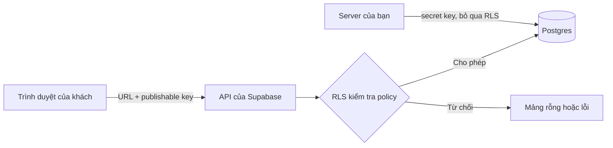

# Supabase cho người mới: database, đăng nhập và Row Level Security

> **Tóm tắt:** Dựng backend bằng Supabase (database Postgres, đăng nhập, lưu file), nối với web bằng supabase-js và bật Row Level Security để dữ liệu không bị ai cũng đọc được.

## Bạn sẽ làm được gì

Thời lượng ước tính: 60 đến 90 phút.

- Tạo một project Supabase dành cho học tập, tạo bảng và xem dữ liệu bằng Table Editor.
- Phân biệt khóa công khai (publishable, hay anon cũ) với khóa bí mật (secret, hay service_role cũ) và biết khóa nào được phép nằm trong code web.
- Bật Row Level Security (RLS), viết policy cho bảng đăng ký và tự kiểm tra bằng cách gọi API khi chưa đăng nhập.
- Nối web tĩnh với Supabase bằng supabase-js, và cấu hình Site URL, Redirect URLs để đăng nhập chạy được sau khi lên domain thật.
- Biết khi nào nên dùng Supabase CLI và vì sao chỉ cho AI agent kết nối Supabase MCP ở chế độ read-only trên project dev.

## Khái niệm trong 5 phút

Hãy tưởng tượng bạn mở một cửa hàng (web của bạn). Phía sau cửa hàng có một nhà kho (database). Supabase là dịch vụ cho thuê nhà kho đã gắn sẵn: ổ khóa cho từng người (Auth), kệ để hàng (Postgres), ngăn chứa đồ cồng kềnh như ảnh hay PDF (Storage), và một nhân viên làm việc riêng ở hậu trường (Edge Functions).

Điểm khác biệt quan trọng với cách làm truyền thống: trình duyệt của khách nói chuyện trực tiếp với nhà kho qua một cửa sổ có sẵn gọi là API. Vì khách đi thẳng vào kho, chính nhà kho phải tự quyết ai được lấy gì. Quy tắc đó gọi là Row Level Security (RLS, bảo mật theo từng dòng).



### Các mảnh ghép

| Thành phần | Ví dụ đời thường | Dùng để làm gì |
| --- | --- | --- |
| Project | Một nhà kho riêng | Mỗi sản phẩm một project, có URL dạng `https://YOUR_REF.supabase.co` |
| Postgres và Table Editor | Kệ hàng có bảng kê | Lưu dữ liệu dạng bảng, sửa như Excel |
| Auth | Ổ khóa và thẻ nhân viên | Đăng nhập bằng email, magic link (link đăng nhập gửi qua email) hoặc OAuth (Google, GitHub) |
| Storage | Ngăn chứa đồ lớn | Lưu ảnh, tệp, cũng có policy riêng |
| Edge Functions | Nhân viên hậu trường | Chạy code phía server khi cần giữ bí mật hoặc gọi dịch vụ bên thứ ba; học kỹ ở [bài serverless](./03-fullstack-serverless.md) |
| RLS | Quy định ai được vào kệ nào | Quyết định mỗi dòng dữ liệu ai đọc, ai ghi |

### Hai loại khóa, hai mức quyền

Tài liệu Supabase hiện hành dùng tên khóa mới. Khóa cũ vẫn chạy song song cho đến khi bạn tắt, và Supabase dự kiến ngừng hẳn khóa cũ vào cuối năm 2026.

| Tên mới | Tên cũ | Dạng | Được đặt ở đâu | Bị RLS chặn? |
| --- | --- | --- | --- | --- |
| Publishable key | `anon` key | `sb_publishable_...` (cũ là chuỗi JWT dài) | Code web, app trên máy người dùng | Có, RLS luôn áp dụng |
| Secret key | `service_role` key | `sb_secret_...` (cũ là chuỗi JWT dài) | Chỉ server bạn kiểm soát, Edge Function, biến môi trường | Không, bỏ qua RLS hoàn toàn |

Ví von: publishable key như chìa khóa cổng khu phố, ai cũng có thể thấy. Secret key là chìa vạn năng của chủ nhà kho. Nếu chìa vạn năng lộ ra, người lạ đọc, sửa, xóa mọi thứ mà không bị hỏi han.

Quy tắc bắt buộc:

- Secret key và service_role tuyệt đối không đặt vào frontend, repo công khai, prompt gửi cho AI, ảnh chụp màn hình hay tin nhắn chat.
- File `.env` không commit lên Git. Biến chứa khóa bí mật không đặt tên bắt đầu bằng tiền tố công khai như `NEXT_PUBLIC_` hay `VITE_`, vì các tiền tố đó khiến giá trị bị nhúng vào code gửi cho trình duyệt.
- Nếu khóa bí mật lộ: tạo khóa mới, thay ở mọi nơi dùng, kiểm tra chạy bình thường, rồi xóa khóa cũ (rotate). Làm ngay, không đợi.

Cập nhật gần nhất tôi kiểm chứng: tháng 10/2026 trên trang chính thức về API keys. Hãy mở lại trang đó nếu giao diện hoặc tên khóa khác với bài.

### RLS: vì sao đây là phần quan trọng nhất

RLS giống một bảo vệ đứng ở cửa nhà kho, mỗi lần có người xin lấy dữ liệu thì bảo vệ đối chiếu quy định (policy) rồi mới cho đi qua. Một policy hoạt động giống mệnh đề `WHERE` được tự động gắn thêm vào mọi truy vấn.

Có hai điều kiện để truy cập thành công: quyền cấp phát (grant, role có được thao tác trên bảng không) và policy (được chạm vào những dòng nào). Thiếu quyền cấp phát thì báo lỗi `42501` trước cả khi policy được xét. Tài liệu Supabase lưu ý một số project không tự cấp sẵn quyền cho bảng mới, nên ví dụ của bài tự `grant` rõ ràng cho từng role.

Bảng sau cho bạn ba tình huống cần nhớ:

| Tình huống | Điều gì xảy ra với người dùng dùng publishable key |
| --- | --- |
| RLS tắt | Ai có URL và publishable key (mà khóa này nằm ngay trong code web, ai bấm "Xem nguồn trang" cũng thấy) đều đọc, ghi, xóa được toàn bộ bảng |
| RLS bật, chưa có policy | Bị chặn hết. Đọc thì nhận mảng rỗng `[]`, ghi thì báo lỗi. An toàn nhưng trông như "mất dữ liệu" |
| RLS bật, có policy đúng | Mỗi người chỉ thấy và sửa phần mình được phép |

Nói cách khác: tắt RLS thì "bảo mật" duy nhất của bạn là hy vọng không ai tò mò. Rất nhiều sản phẩm vibe-code từng bị lộ dữ liệu chỉ vì quên bật hoặc tắt RLS cho "chạy được". Đừng làm vậy, kể cả khi AI gợi ý cách đó để hết lỗi.

Hai role bạn cần biết: `anon` là người chưa đăng nhập, `authenticated` là người đã đăng nhập. Policy luôn nên ghi rõ `to anon` hoặc `to authenticated`. Một policy `to anon using (true)` nghĩa là mọi khách vãng lai đọc được cả bảng, chỉ dùng cho dữ liệu vốn công khai.

## Thực hành từng bước

Ví dụ xuyên suốt: form đăng ký tham gia CLB. Khách chưa đăng nhập được gửi đăng ký nhưng không được đọc danh sách người khác. Chỉ quản trị viên đọc được danh sách. Mã nguồn đầy đủ nằm ở [examples/vibe/supabase](../examples/vibe/supabase/README.md).

Giao diện Supabase thay đổi thường xuyên nên dưới đây dùng tên nút ngắn; giao diện có thể khác chút.

### Bước 1. Tạo project học tập

1. Đăng ký hoặc đăng nhập tại [supabase.com](https://supabase.com) (bạn tự làm, đừng nhờ agent nhập mật khẩu).
2. Bấm New project. Đặt tên như `club-dev`. Chọn gói Free và vùng gần bạn nhất.
3. Đặt mật khẩu database mạnh, lưu vào trình quản lý mật khẩu. Không dán mật khẩu này vào chat với AI.

Bạn sẽ thấy: dashboard của project sau vài phút, có Table Editor, SQL Editor, Authentication ở thanh bên.

Về gói miễn phí: giới hạn thay đổi theo thời gian. Theo trang giá chính thức (kiểm tra ngày 21/10/2026), gói Free có tối đa 2 project hoạt động, database 500 MB mỗi project, 1 GB lưu file, 50 nghìn người dùng hoạt động mỗi tháng, và project free bị tạm dừng (pause) sau 1 tuần không hoạt động. Hãy xem [trang giá chính thức](https://supabase.com/pricing) trước khi dựa vào các con số này. Project bị pause vẫn giữ dữ liệu, bạn khôi phục bằng nút Restore trong dashboard. Với sản phẩm thật, đừng để project free ngủ quên: hoặc có người dùng đều đặn, hoặc bạn tự cân nhắc nâng gói. Việc trả tiền do bạn tự quyết, bài này không yêu cầu.

### Bước 2. Tạo bảng và bật RLS bằng SQL Editor

1. Mở SQL Editor, bấm New query.
2. Dán nội dung file `schema.sql` (xem [README của ví dụ](../examples/vibe/supabase/README.md)), bấm Run.
3. Dán tiếp file `policies.sql`, bấm Run.

Đoạn cốt lõi của `schema.sql` và `policies.sql`:

```sql
create table if not exists public.signups (
  id         bigint generated always as identity primary key,
  full_name  text not null check (char_length(full_name) between 1 and 100),
  email      text not null check (char_length(email) between 3 and 200),
  message    text,
  created_at timestamptz not null default now()
);

alter table public.signups enable row level security;

-- Ai cũng được gửi form
create policy "signups_insert_public"
  on public.signups for insert
  to anon, authenticated
  with check (true);

-- Chỉ admin được đọc danh sách
create policy "signups_select_admin"
  on public.signups for select
  to authenticated
  using (exists (select 1 from public.admins a where a.user_id = (select auth.uid())));
```

Giải thích từng phần:

- `enable row level security`: bật bảo vệ. Từ giờ mặc định đóng hết.
- `for insert ... with check`: điều kiện kiểm tra dòng mới được thêm vào.
- `for select ... using`: điều kiện lọc dòng được phép nhìn thấy.
- `auth.uid()`: id của người đang đăng nhập; viết `(select auth.uid())` giúp truy vấn nhanh hơn theo khuyến nghị trong tài liệu.

Bạn sẽ thấy: thông báo Success. Mở Table Editor, bảng `signups` hiện ra; chú ý huy hiệu RLS enabled ở đầu bảng.

### Bước 3. Lấy URL và publishable key

1. Bấm nút Connect trên đầu dashboard để xem Project URL và publishable key, hoặc vào Settings, mục API Keys.
2. Chỉ sao chép Project URL và publishable key (hoặc anon key nếu project còn dùng khóa cũ).
3. Không sao chép secret key hay service_role key ở bước này.

Bạn sẽ thấy: URL dạng `https://YOUR_REF.supabase.co` và một khóa bắt đầu bằng `sb_publishable_`.

### Bước 4. Nối web tĩnh với supabase-js

Tạo `config.js` (không cần giấu vì chỉ chứa khóa công khai, nhưng vẫn tuyệt đối không dán secret key vào đây):

```js
export const SUPABASE_URL = 'https://YOUR_REF.supabase.co'
export const SUPABASE_KEY = 'sb_publishable_YOUR_KEY_HERE'
```

Trong trang HTML:

```html
<script type="module">
  import { createClient } from 'https://cdn.jsdelivr.net/npm/@supabase/supabase-js@2/+esm'
  import { SUPABASE_URL, SUPABASE_KEY } from './config.js'

  const supabase = createClient(SUPABASE_URL, SUPABASE_KEY)

  const { error } = await supabase
    .from('signups')
    .insert({ full_name: 'Nguyen Van A', email: 'a@example.com' })

  console.log(error ? error.message : 'Đã gửi')
</script>
```

Chú ý: không gọi `.select()` ngay sau `.insert()` với khách chưa đăng nhập. `.select()` đòi quyền đọc lại dòng vừa tạo, mà khách không có quyền đó (đúng ý ta), nên cả lệnh báo lỗi vi phạm RLS và dòng không được lưu.

Chạy thử cục bộ rồi mở trang:

```bash
npx serve .
```

Bạn sẽ thấy: gửi form xong, dòng mới xuất hiện trong Table Editor, bảng `signups`.

### Bước 5. Kiểm tra RLS bằng cách gọi API khi chưa đăng nhập

Đây là bước nhiều người bỏ qua và là bước đáng tiền nhất. Bạn đóng vai kẻ lạ chỉ có URL và publishable key.

```bash
# Thử đọc danh sách đăng ký như người lạ
curl "https://YOUR_REF.supabase.co/rest/v1/signups?select=*" \
  -H "apikey: sb_publishable_YOUR_KEY_HERE"
```

Bạn sẽ thấy: mảng rỗng `[]` (hoặc lỗi quyền). Nếu thấy email của người khác, dừng ngay, kiểm tra xem RLS đã bật chưa và policy có `using (true)` cho `anon` hay không.

Bạn cũng có thể thử trong trình duyệt: Dashboard có công cụ Table Editor chạy bằng quyền admin nên luôn thấy dữ liệu, đừng dùng nó để kiểm tra RLS. Chỉ phép thử bằng publishable key mới phản ánh đúng điều người lạ thấy.

### Bước 6. Bật đăng nhập và cấu hình URL chuyển hướng

1. Vào Authentication, mục Providers, bật Email (magic link hoặc mật khẩu). OAuth Google hoặc GitHub cần thêm bước tạo ứng dụng ở nhà cung cấp, làm sau khi quen.
2. Vào Authentication, mục URL Configuration.
3. Đặt Site URL bằng địa chỉ web thật của bạn, ví dụ `https://club.example.com`. Mặc định là `http://localhost:3000`, và giá trị này sẽ khiến email xác nhận trỏ về máy của bạn.
4. Thêm vào danh sách Redirect URLs: `http://localhost:3000/**` cho lúc làm cục bộ, và địa chỉ production chính xác. Với bản xem trước của Vercel hoặc Netlify, thêm mẫu có ký tự thay thế theo hướng dẫn trong [tài liệu Redirect URLs](https://supabase.com/docs/guides/auth/redirect-urls).

Đăng nhập bằng magic link trong code:

```js
const { error } = await supabase.auth.signInWithOtp({
  email: 'a@example.com',
  options: { emailRedirectTo: window.location.origin },
})
```

Bạn sẽ thấy: email chứa link, bấm vào thì quay về đúng trang của bạn và đã đăng nhập. Nếu bị đưa về `localhost`, bạn quên đổi Site URL.

Lưu ý nhỏ: dịch vụ gửi email mặc định của Supabase chỉ phù hợp để thử. Theo [tài liệu SMTP](https://supabase.com/docs/guides/auth/auth-smtp) (kiểm tra 10/2026) nó chỉ gửi tới địa chỉ thuộc nhóm của dự án, khoảng 2 email mỗi giờ và có thể đổi không báo trước. Sản phẩm thật cần cấu hình nhà cung cấp email riêng.

#### Tạo admin đầu tiên cho một trang quản trị

Nếu web của bạn có trang admin (như [club-landing](../examples/vibe/club-landing/README.md)), làm theo thứ tự này, ít phụ thuộc vào email nhất:

1. Authentication, mục Providers (hoặc Sign In / Providers), bấm Email, xem công tắc **Confirm email**. Bật nghĩa là user phải bấm link trong email mới đăng nhập được.
2. Authentication, mục Users, Add user, Create new user: nhập email, mật khẩu mạnh, tích **Auto Confirm User**. Cách này không gửi email nào nên không đụng giới hạn ở trên.
3. Tắt "Allow new users to sign up" nếu web không cần người lạ tự tạo tài khoản. Theo tài liệu, khi tắt thì chỉ user đã có mới đăng nhập được.
4. Đánh dấu user là admin bằng một dòng trong bảng `admins` (chạy trong SQL Editor, đổi email):

```sql
insert into public.admins (user_id)
select id from auth.users where email = 'admin@example.com';
```

Policy chỉ cần hỏi "`auth.uid()` có trong bảng `admins` không", như ở bước 2. Muốn thêm hay bớt admin chỉ cần thêm hay xóa một dòng.

Vì sao **không** dùng `user_metadata` (cột `raw_user_meta_data`) để phân quyền: chính người dùng sửa được nó bằng `supabase.auth.updateUser()`, nên policy kiểu "metadata nói role là admin thì cho xem" để ai đăng nhập cũng tự phong mình làm admin chỉ bằng một dòng JavaScript. Nếu muốn đưa quyền vào token JWT, dùng `app_metadata` (người dùng không sửa được), nhưng thay đổi chỉ có hiệu lực sau khi token làm mới. Người mới nên chọn bảng `admins`: dễ đọc, dễ kiểm tra, có hiệu lực ngay.

Site URL và Redirect URLs khi chạy local và khi lên domain thật: xem bảng trong [README của club-landing](../examples/vibe/club-landing/README.md). Đăng nhập bằng mật khẩu không chuyển hướng nên hay chạy được dù quên cấu hình, nhưng mọi email Supabase gửi đi (xác nhận, đặt lại mật khẩu) vẫn dùng Site URL, nên đổi nó ngay khi có domain.

### Bước 7. Storage (ảnh, tệp) trong một phút

Vào Storage, tạo bucket (một thư mục lớn). Mặc định bucket là riêng tư. Chỉ bật Public khi tệp thật sự công khai (ví dụ ảnh bìa sự kiện). Với tệp riêng tư, bạn cần viết policy cho bảng `storage.objects`, giống tinh thần RLS ở trên. Đừng cho bucket cho phép upload không giới hạn từ `anon`: người lạ có thể nhồi đầy dung lượng của bạn.

### Bước 8. Edge Functions (nhắc ngắn)

Khi bạn cần giữ bí mật (ví dụ gọi API trả phí bằng khóa của bạn) hoặc xử lý thứ không thể tin trình duyệt, đặt code trong Edge Function. Secret key và khóa bên thứ ba được lưu bằng secrets của Supabase, không nằm trong code web. Chi tiết nằm ngoài phạm vi bài nhập môn này; xem [tài liệu Edge Functions](https://supabase.com/docs/guides/functions).

### Bước 9. Supabase CLI ở mức nhập môn

CLI hữu ích khi bạn muốn lược đồ database (schema) nằm trong Git thay vì chỉ trong dashboard, để agent và bạn cùng xem lịch sử thay đổi. Cài đặt theo tài liệu chính thức, cần Node.js 20 trở lên nếu dùng npm:

```bash
npm install supabase --save-dev
npx supabase init
```

`supabase init` chỉ tạo thư mục `supabase/` với `config.toml`, chưa đăng nhập hay nối project nào. Để nối với project trên mạng:

```bash
npx supabase login
npx supabase link --project-ref YOUR_REF
npx supabase migration new create_signups
```

Lệnh cuối tạo một file rỗng trong `supabase/migrations/`. Dán nội dung `schema.sql` và `policies.sql` vào đó rồi đẩy lên:

```bash
npx supabase db push
```

Windows có thể cài CLI bằng Scoop thay cho npm; xem [hướng dẫn CLI](https://supabase.com/docs/guides/local-development/cli/getting-started). Trang hướng dẫn nhập môn không mô tả chi tiết `login`, `link`, `db push`, nên nếu lệnh báo khác, hãy chạy `npx supabase --help` hoặc đọc [CLI reference](https://supabase.com/docs/reference/cli/introduction) nếu lệnh báo khác. Chạy `db push` chỉ với project dev; với dữ liệu thật hãy đọc kỹ bản xem trước thay đổi trước khi đồng ý. Chạy local bằng `supabase start` cần container runtime như Docker, bạn sẽ gặp ở khóa DevOps chính.

### Bước 10. Supabase MCP: cho agent nhìn vào database, nhưng có rào

MCP (Model Context Protocol) là cách để AI agent dùng công cụ ngoài, ví dụ đọc bảng hay chạy SQL trong project Supabase của bạn. Đây là con dao hai lưỡi vì agent có thể ghi và xóa dữ liệu.

Quy tắc an toàn:

- Chỉ nối với project dev, không bao giờ với production hay project chứa dữ liệu người dùng thật.
- Giới hạn bằng tham số `project_ref` (agent chỉ thấy đúng một project, các công cụ quản lý tài khoản bị tắt) và bật `read_only=true` (chạy truy vấn bằng user Postgres chỉ đọc) khi chỉ cần đọc.
- Giữ chế độ duyệt tay từng lệnh trong công cụ của bạn; đọc SQL agent định chạy trước khi bấm cho phép.
- Cẩn thận prompt injection (kẻ xấu cài chỉ thị vào dữ liệu, ví dụ trong ô lời nhắn của form, để agent đọc phải làm theo). Chính tài liệu Supabase thừa nhận các biện pháp chống chịu chỉ giảm rủi ro chứ không loại bỏ.

Ví dụ cấu hình cho Claude Code (cú pháp nhìn chung ổn định nhưng hãy đối chiếu [trang MCP chính thức](https://supabase.com/docs/guides/getting-started/mcp)):

```bash
claude mcp add --transport http supabase "https://mcp.supabase.com/mcp?project_ref=YOUR_REF&read_only=true"
```

Sau đó mở Claude Code, gõ `/mcp`, chọn supabase rồi chọn Authenticate để đăng nhập qua trình duyệt (bạn tự làm bước này; không dán token vào chat). Mở rộng quyền ghi chỉ khi bạn đang làm trên project dev và đã commit mọi thứ lên Git.

## Nhờ AI agent làm giúp

Dán prompt sau cho agent (Claude Code, Cursor, Copilot agent...). Prompt đã chứa các rào an toàn.

```text
Bối cảnh: tôi đang làm web đăng ký CLB bằng HTML + supabase-js, backend là Supabase (project DEV, KHÔNG phải production).
Tôi sẽ tự cung cấp Project URL và publishable key qua file config.js. Bạn không bao giờ cần và không được hỏi secret key, service_role key hay mật khẩu database.

Việc cần làm:
1. Viết file supabase/migrations/001_init.sql tạo bảng signups (full_name, email, message, created_at) và members (user_id tham chiếu auth.users).
2. BẬT Row Level Security cho mọi bảng trong schema public. Viết policy tối thiểu: khách chưa đăng nhập chỉ được INSERT vào signups; chỉ người đăng nhập mới SELECT members; mỗi người chỉ UPDATE được dòng của chính mình. Ghi rõ "to anon" hoặc "to authenticated" ở mọi policy.
3. Thêm check độ dài cho các cột chữ.
4. Viết code supabase-js chỉ dùng publishable key.
5. Cuối cùng liệt kê từng bảng và policy, cho tôi biết ai đọc/ghi được gì.

Ràng buộc:
- Không tắt RLS và không viết policy "using (true)" cho anon trên bảng chứa dữ liệu cá nhân, kể cả để sửa lỗi cho chạy được.
- Không đặt bất kỳ khóa nào trong code; dùng placeholder như YOUR_PROJECT_REF.
- Không tự chạy db push hay lệnh SQL trên database thật; chỉ viết file để tôi xem và chạy.
```

Bạn phải tự kiểm tra sau khi agent làm xong:

- Mở file SQL và tìm chữ `enable row level security` cho từng bảng.
- Tìm `using (true)` và `to anon`: mỗi chỗ phải có lý do chính đáng.
- Tìm chữ `service_role` hoặc `sb_secret` trong toàn bộ repo (Tìm kiếm của trình soạn thảo). Phải không có kết quả.
- Gọi API bằng `curl` như Bước 5 để chứng minh người lạ không đọc được dữ liệu riêng.

Không giao cho agent:

- Dán secret key, service_role key, mật khẩu database hay token cá nhân vào prompt hoặc file.
- Bấm nâng gói, nhập thẻ, hoặc bất kỳ quyết định thanh toán nào.
- Chạy lệnh ghi hoặc xóa trên project production.
- Dán dữ liệu cá nhân thật của người dùng (email, số điện thoại) vào cuộc trò chuyện với AI; dùng dữ liệu giả để thử.

## Nếu bị lỗi

| Triệu chứng | Nguyên nhân thường gặp | Cách xử lý |
| --- | --- | --- |
| Đọc dữ liệu chỉ nhận mảng rỗng, không có lỗi | RLS bật nhưng chưa có policy select cho role đang dùng, hoặc policy sai điều kiện | Thêm policy `for select` đúng role, kiểm tra bằng SQL Editor; đừng tắt RLS |
| Lỗi `42501` hoặc "permission denied for table" | Role thiếu quyền cấp phát (grant) trên bảng | Chạy `grant select, insert ... to` đúng role, rồi kiểm tra lại policy |
| Lỗi "new row violates row-level security policy" khi insert | `with check` không đúng, hoặc `user_id` không khớp người đăng nhập | Kiểm tra policy insert; để `user_id` mặc định là `auth.uid()` hoặc truyền đúng giá trị |
| Insert báo lỗi RLS dù policy insert đúng | Có gọi `.select()` sau insert nhưng khách không có quyền đọc dòng vừa tạo | Bỏ `.select()`, hoặc cấp quyền đọc hợp lý cho đúng role |
| Magic link đưa về `localhost` sau khi lên domain thật | Quên đổi Site URL, hoặc Redirect URLs thiếu địa chỉ production | Authentication, URL Configuration: đặt Site URL và thêm địa chỉ thật vào Redirect URLs |
| Đăng nhập OAuth báo redirect sai, hoặc đăng nhập xong về trang trắng | Địa chỉ chuyển hướng ở Google/GitHub khác địa chỉ callback của Supabase, hoặc domain bản preview chưa được cho phép | Đối chiếu địa chỉ callback hiển thị trong Providers với cấu hình bên nhà cung cấp, thêm mẫu preview vào Redirect URLs |
| Trình duyệt báo CORS khi gọi API | Gọi sai URL project, thiếu header `apikey`, hoặc gọi từ Edge Function chưa trả header CORS | Kiểm tra URL, dùng supabase-js thay cho `fetch` tự viết; với Edge Function thêm xử lý yêu cầu OPTIONS |
| Mọi lệnh gọi lỗi, dashboard hiện "Project paused" | Project free bị tạm dừng do không hoạt động | Bấm Restore trong dashboard, đợi vài phút; kiểm tra điều khoản mới trên trang giá |
| Phát hiện service_role hoặc secret key trong repo | Agent hoặc bạn dán nhầm vào code, `.env` bị commit | Tạo khóa mới và xóa khóa cũ ngay trong Settings, API Keys; xóa khỏi code; coi khóa cũ đã lộ vì lịch sử Git vẫn giữ nó |
| Không đăng ký được thêm người dùng, báo vượt giới hạn email, hoặc "Email address not authorized" | Dịch vụ email mặc định chỉ gửi tới thành viên nhóm dự án và rất ít email mỗi giờ | Tạo user bằng Add user với Auto Confirm User, hoặc cấu hình SMTP riêng |
| Admin đăng nhập được nhưng danh sách trống | User chưa có dòng trong bảng `admins` (policy dựa vào bảng này) | Chạy lệnh `insert into public.admins` ở mục tạo admin đầu tiên |

## Tự kiểm tra

1. Khóa nào được phép nằm trong code của trang web, khóa nào thì không?
2. Tắt RLS trên một bảng thì chuyện gì xảy ra với người chỉ có publishable key?
3. Bật RLS nhưng chưa tạo policy, truy vấn trả về gì? Đó là lỗi hay là hành vi đúng?
4. Vì sao Table Editor trong dashboard không dùng được để kiểm tra RLS?
5. Sau khi đưa web lên domain thật, đăng nhập bằng magic link đưa người dùng về `localhost`. Bạn sửa ở đâu?
6. Bạn muốn cho agent xem schema database. Hãy nêu ít nhất ba rào an toàn.

<details><summary>Đáp án</summary>

1. Chỉ publishable key (hoặc anon key cũ) được nằm ở frontend. Secret key và service_role không bao giờ, vì chúng bỏ qua RLS.
2. Mọi người có URL và publishable key đều đọc, ghi, xóa được toàn bộ bảng qua API.
3. Mảng rỗng, không lỗi. Đây là hành vi đúng: RLS đóng mặc định, bạn cần thêm policy để mở đúng phần cần mở.
4. Table Editor chạy bằng quyền quản trị nên luôn thấy dữ liệu. Phải thử bằng publishable key qua `curl` hoặc supabase-js khi chưa đăng nhập.
5. Authentication, URL Configuration: đổi Site URL thành địa chỉ thật và thêm địa chỉ thật vào Redirect URLs.
6. Dùng project dev, đặt `project_ref` để giới hạn một project, bật `read_only=true`, giữ duyệt tay từng lệnh, không dùng với production, không dán secret vào prompt.

</details>

## Checklist hoàn thành

- [ ] Đã tạo project Supabase dành cho học tập và lưu mật khẩu database trong trình quản lý mật khẩu.
- [ ] Đã chạy `schema.sql` và `policies.sql`, mọi bảng trong `public` đều hiện RLS enabled.
- [ ] Đã dùng `curl` với publishable key khi chưa đăng nhập và xác nhận không đọc được dữ liệu riêng.
- [ ] Web chỉ chứa publishable key; tìm trong repo không có `service_role` hay `sb_secret`.
- [ ] File `.env` (nếu có) nằm trong `.gitignore`.
- [ ] Đã đặt Site URL và Redirect URLs đúng cho cả localhost và domain thật.
- [ ] Nếu có trang admin: user admin tạo bằng dashboard, có tên trong bảng `admins`, policy không dựa vào `user_metadata`.
- [ ] Nếu dùng MCP: chỉ với project dev, có `project_ref` và `read_only=true`.

## Tiếp theo

- Bài kế tiếp là Firebase, một cách làm khác để so sánh (có thể bỏ qua nếu bạn đã chọn Supabase, khi đó sang bài 06): [Firebase](./05-firebase.md).
- Cho agent làm việc với nhiều dịch vụ cùng lúc: [AI agent và deploy](./06-ai-agent-deploy.md).
- Gắn domain và rà soát bảo mật trước khi mở cho người dùng thật: [Domain, bảo mật, production](./07-domain-security-production.md).
- Gặp lỗi chưa gặp trong bài: [Xử lý sự cố](./08-troubleshooting.md).
- Tra nhanh lệnh: [CLI cheatsheet](./cli-cheatsheet.md). Prompt mẫu: [Prompt library](./prompt-library.md). So sánh nền tảng: [Platforms](./platforms.md).
- Quay về bức tranh lớn: [Tư duy deploy](./00-mindset.md).

Tài liệu chính thức:

- [Supabase Docs](https://supabase.com/docs)
- [API keys](https://supabase.com/docs/guides/api/api-keys)
- [Row Level Security](https://supabase.com/docs/guides/database/postgres/row-level-security)
- [Redirect URLs](https://supabase.com/docs/guides/auth/redirect-urls)
- [Supabase CLI](https://supabase.com/docs/guides/local-development/cli/getting-started)
- [Supabase MCP](https://supabase.com/docs/guides/getting-started/mcp)
- [Giá và giới hạn](https://supabase.com/pricing)
