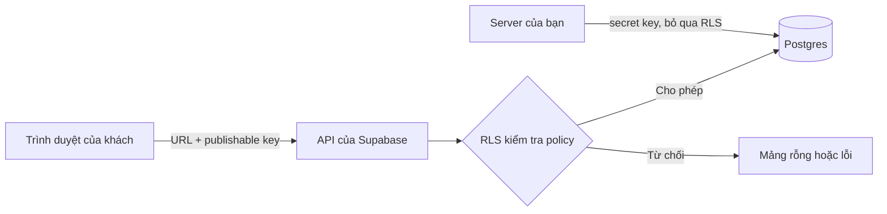

# Supabase cho người mới: database, đăng nhập và Row Level Security

> **Tóm tắt:** Dựng backend bằng Supabase (database Postgres, đăng nhập, lưu file), nối với web bằng supabase-js và bật Row Level Security để dữ liệu không bị ai cũng đọc được.

::: tip Bạn làm gì
- **Kết quả:** một database Supabase có bảng đăng ký, bật RLS, và web gửi dữ liệu vào được mà người lạ không đọc được.
- **Thời gian:** 60 đến 90 phút.
- **Cần gì trước:** tài khoản GitHub, một trang web tĩnh đã deploy, và email để đăng ký Supabase (không cần thẻ).
- **Module trước:** [02 Hosting tĩnh](02-static-hosting.md) (bạn đã có link công khai). [03 Fullstack serverless](03-fullstack-serverless.md) chỉ là tùy chọn, khi cần gọi API có khóa bí mật. Chặng 2: chọn Supabase hoặc [Firebase](05-firebase.md), không cần cả hai.
:::

## Bạn sẽ làm được gì

Thời lượng ước tính: 60 đến 90 phút.

- Tạo project Supabase học tập, tạo bảng và xem dữ liệu bằng Table Editor.
- Phân biệt khóa công khai (publishable, hay anon cũ) với khóa bí mật (secret, hay service_role cũ).
- Bật RLS, viết policy và tự kiểm tra bằng nút thử đọc như người lạ.
- Nối web tĩnh với Supabase bằng supabase-js, cấu hình Site URL và Redirect URLs.
- Biết vì sao agent chỉ nên kết nối Supabase MCP ở chế độ read-only trên project dev.

## Khái niệm trong 5 phút

Hãy tưởng tượng bạn mở một cửa hàng (web của bạn). Phía sau cửa hàng có một nhà kho (database). Supabase là dịch vụ cho thuê nhà kho đã gắn sẵn: ổ khóa cho từng người (Auth), kệ để hàng (Postgres), ngăn chứa đồ cồng kềnh như ảnh hay PDF (Storage), và một nhân viên làm việc riêng ở hậu trường (Edge Functions).

Điểm khác biệt quan trọng với cách làm truyền thống: trình duyệt của khách nói chuyện trực tiếp với nhà kho qua một cửa sổ có sẵn gọi là API. Vì khách đi thẳng vào kho, chính nhà kho phải tự quyết ai được lấy gì. Quy tắc đó gọi là Row Level Security (RLS, bảo mật theo từng dòng; [thuật ngữ](../resources/glossary.md)).



### Các mảnh ghép

| Thành phần | Ví dụ đời thường | Dùng để làm gì |
| --- | --- | --- |
| Project | Một nhà kho riêng | Mỗi sản phẩm một project, có URL dạng `https://YOUR_REF.supabase.co` |
| Postgres và Table Editor | Kệ hàng có bảng kê | Lưu dữ liệu dạng bảng, sửa như Excel |
| Auth | Ổ khóa và thẻ nhân viên | Đăng nhập bằng email, magic link (link đăng nhập gửi qua email) hoặc OAuth (Google, GitHub) |
| Storage | Ngăn chứa đồ lớn | Lưu ảnh, tệp, cũng có policy riêng |
| Edge Functions | Nhân viên hậu trường | Chạy code phía server khi cần giữ bí mật hoặc gọi dịch vụ bên thứ ba; học kỹ ở [bài serverless](03-fullstack-serverless.md) |
| RLS | Quy định ai được vào kệ nào | Quyết định mỗi dòng dữ liệu ai đọc, ai ghi |

### Hai loại khóa, hai mức quyền

Tài liệu Supabase hiện hành dùng tên khóa mới. Khóa cũ vẫn chạy song song cho đến khi bạn tắt, và Supabase dự kiến ngừng hẳn khóa cũ vào cuối năm 2026.

| Tên mới | Tên cũ | Dạng | Được đặt ở đâu | Bị RLS chặn? |
| --- | --- | --- | --- | --- |
| Publishable key | `anon` key | `sb_publishable_...` (cũ là chuỗi JWT dài) | Code web, app trên máy người dùng | Có, RLS luôn áp dụng |
| Secret key | `service_role` key | `sb_secret_...` (cũ là chuỗi JWT dài) | Chỉ server bạn kiểm soát, Edge Function, biến môi trường | Không, bỏ qua RLS hoàn toàn |

Ví von: publishable key như chìa khóa cổng khu phố, ai cũng có thể thấy. Secret key là chìa vạn năng của chủ nhà kho. Nếu chìa vạn năng lộ ra, người lạ đọc, sửa, xóa mọi thứ mà không bị hỏi han.

::: danger Secret key và service_role không bao giờ ra ngoài server
- Secret key và service_role tuyệt đối không đặt vào frontend, repo công khai, prompt gửi cho AI, ảnh chụp màn hình hay tin nhắn chat.
- File `.env` không commit lên Git. Biến chứa khóa bí mật không đặt tên bắt đầu bằng tiền tố công khai như `NEXT_PUBLIC_` hay `VITE_`, vì các tiền tố đó khiến giá trị bị nhúng vào code gửi cho trình duyệt.
- Nếu khóa bí mật lộ: tạo khóa mới, thay ở mọi nơi dùng, kiểm tra chạy bình thường, rồi xóa khóa cũ (rotate). Làm ngay, không đợi.
:::

Cập nhật gần nhất tôi kiểm chứng: tháng 10/2026 trên trang chính thức về API keys. Hãy mở lại trang đó nếu giao diện hoặc tên khóa khác với bài.

### RLS: vì sao đây là phần quan trọng nhất

RLS giống một bảo vệ đứng ở cửa nhà kho, mỗi lần có người xin lấy dữ liệu thì bảo vệ đối chiếu quy định (policy) rồi mới cho đi qua. Một policy hoạt động giống mệnh đề `WHERE` được tự động gắn thêm vào mọi truy vấn.

Có hai điều kiện để truy cập thành công: quyền cấp phát (grant, role có được thao tác trên bảng không) và policy (được chạm vào những dòng nào). Thiếu quyền cấp phát thì báo lỗi `42501` trước cả khi policy được xét. Tài liệu Supabase lưu ý một số project không tự cấp sẵn quyền cho bảng mới, nên ví dụ của bài tự `grant` rõ ràng cho từng role.

Bảng sau cho bạn ba tình huống cần nhớ:

| Tình huống | Điều gì xảy ra với người dùng dùng publishable key |
| --- | --- |
| RLS tắt | Ai có URL và publishable key (mà khóa này nằm ngay trong code web, ai bấm "Xem nguồn trang" cũng thấy) đều đọc, ghi, xóa được toàn bộ bảng |
| RLS bật, chưa có policy | Bị chặn hết. Đọc thì nhận mảng rỗng `[]`, ghi thì báo lỗi. An toàn nhưng trông như "mất dữ liệu" |
| RLS bật, có policy đúng | Mỗi người chỉ thấy và sửa phần mình được phép |

Nói cách khác: tắt RLS thì "bảo mật" duy nhất của bạn là hy vọng không ai tò mò. Rất nhiều sản phẩm vibe-code từng bị lộ dữ liệu chỉ vì quên bật hoặc tắt RLS cho "chạy được". Đừng làm vậy, kể cả khi AI gợi ý cách đó để hết lỗi.

Hai role bạn cần biết: `anon` là người chưa đăng nhập, `authenticated` là người đã đăng nhập. Policy luôn nên ghi rõ `to anon` hoặc `to authenticated`. Một policy `to anon using (true)` nghĩa là mọi khách vãng lai đọc được cả bảng, chỉ dùng cho dữ liệu vốn công khai.

## Thực hành từng bước

Ví dụ xuyên suốt: form đăng ký tham gia CLB. Khách chưa đăng nhập được gửi đăng ký nhưng không được đọc danh sách người khác. Chỉ quản trị viên đọc được danh sách. Mã nguồn đầy đủ nằm ở [examples/vibe/supabase](../examples/vibe/supabase/README.md).

Giao diện Supabase thay đổi thường xuyên nên dưới đây dùng tên nút ngắn; giao diện có thể khác chút.

### Bước 1. Tạo project học tập

1. Đăng ký hoặc đăng nhập tại [supabase.com](https://supabase.com) (bạn tự làm, đừng nhờ agent nhập mật khẩu).
2. Bấm New project. Đặt tên như `club-dev`. Chọn gói Free và vùng gần bạn nhất.
3. Đặt mật khẩu database mạnh, lưu vào trình quản lý mật khẩu. Không dán mật khẩu này vào chat với AI.

Bạn sẽ thấy: dashboard của project sau vài phút, có Table Editor, SQL Editor, Authentication ở thanh bên.

Về gói miễn phí: giới hạn thay đổi theo thời gian. Theo trang giá chính thức (kiểm tra ngày 21/10/2026), gói Free có tối đa 2 project hoạt động, database 500 MB mỗi project, 1 GB lưu file, 50 nghìn người dùng hoạt động mỗi tháng, và project free bị tạm dừng (pause) sau 1 tuần không hoạt động. Hãy xem [trang giá chính thức](https://supabase.com/pricing) trước khi dựa vào các con số này. Project bị pause vẫn giữ dữ liệu, bạn khôi phục bằng nút Restore trong dashboard. Với sản phẩm thật, đừng để project free ngủ quên: hoặc có người dùng đều đặn, hoặc bạn tự cân nhắc nâng gói. Việc trả tiền do bạn tự quyết, bài này không yêu cầu.

### Bước 2. Tạo bảng và bật RLS bằng SQL Editor

1. Mở SQL Editor, bấm New query.
2. Chép **toàn bộ** khối SQL dưới đây vào ô soạn thảo, bấm Run. Không cần tải file nào: khối này đã đủ để làm các bước tiếp theo.

```sql
-- Bảng đăng ký tham gia CLB
create table if not exists public.signups (
  id         bigint generated always as identity primary key,
  full_name  text not null check (char_length(full_name) between 1 and 100),
  email      text not null check (char_length(email) between 3 and 200 and position('@' in email) > 1),
  message    text check (message is null or char_length(message) <= 1000),
  created_at timestamptz not null default now()
);

-- Bảng quản trị viên: ai nằm trong bảng này được đọc danh sách đăng ký
create table if not exists public.admins (
  user_id uuid primary key references auth.users (id) on delete cascade
);

-- Bật Row Level Security cho MỌI bảng
alter table public.signups enable row level security;
alter table public.admins  enable row level security;

-- Quyền ở mức bảng: thu hồi hết, cấp lại tối thiểu
revoke all on public.signups from anon, authenticated;
revoke all on public.admins  from anon, authenticated;
grant insert on public.signups to anon, authenticated;
grant select on public.signups to authenticated;
grant select on public.admins  to authenticated;

-- Ai cũng được gửi form
drop policy if exists "signups_insert_public" on public.signups;
create policy "signups_insert_public"
  on public.signups for insert
  to anon, authenticated
  with check (true);

-- Chỉ admin được đọc danh sách
drop policy if exists "signups_select_admin" on public.signups;
create policy "signups_select_admin"
  on public.signups for select
  to authenticated
  using (exists (select 1 from public.admins a where a.user_id = (select auth.uid())));

-- Admin tự xem dòng của mình
drop policy if exists "admins_select_self" on public.admins;
create policy "admins_select_self"
  on public.admins for select
  to authenticated
  using (user_id = (select auth.uid()));
```

Khối này chạy lại nhiều lần được. Bản đầy đủ hơn (thêm bảng hồ sơ thành viên `members`) là hai file `schema.sql` và `policies.sql` trong [ví dụ supabase](../examples/vibe/supabase/README.md); chỉ cần khi bạn làm bài [09 Dự án mini](09-mini-project.md) theo ví dụ đó.

Giải thích từng phần:

- `enable row level security`: bật bảo vệ. Từ giờ mặc định đóng hết.
- `for insert ... with check`: điều kiện kiểm tra dòng mới được thêm vào.
- `for select ... using`: điều kiện lọc dòng được phép nhìn thấy.
- `auth.uid()`: id của người đang đăng nhập; viết `(select auth.uid())` giúp truy vấn nhanh hơn theo khuyến nghị trong tài liệu.

Bạn sẽ thấy: thông báo Success. Mở Table Editor, bảng `signups` hiện ra; chú ý huy hiệu RLS enabled ở đầu bảng.

### Bước 3. Lấy URL và publishable key

1. Bấm nút Connect trên đầu dashboard để xem Project URL và publishable key, hoặc vào Settings, mục API Keys.
2. Chỉ sao chép Project URL và publishable key (hoặc anon key nếu project còn dùng khóa cũ).
3. Không sao chép secret key hay service_role key ở bước này.

Bạn sẽ thấy: URL dạng `https://YOUR_REF.supabase.co` và một khóa bắt đầu bằng `sb_publishable_`.

### Bước 4. Nối web tĩnh với supabase-js

Bạn không cần tự viết code. Dưới đây là một file `index.html` hoàn chỉnh (form, gửi dữ liệu, nút thử RLS). Bạn chỉ sửa **hai dòng** có chữ `THAY`.

1. Trong thư mục `club-landing` của repo (hoặc thư mục web của bạn), tạo file mới tên `index.html` (GitHub Desktop: mở thư mục bằng Notepad hoặc VS Code), dán toàn bộ nội dung lấy ở trang liên kết bên dưới.
2. Thay `SUPABASE_URL` bằng Project URL và `SUPABASE_KEY` bằng publishable key đã lấy ở Bước 3. Giữ nguyên dấu nháy đơn.
3. Lưu file, commit và push bằng GitHub Desktop, đợi GitHub Pages cập nhật, rồi mở link của bạn.

Mở trang [file index.html hoàn chỉnh](04-supabase-index-html.md), sao chép toàn bộ khối mã vào file `index.html` của bạn, rồi quay lại đây.

Cách thử: mở link GitHub Pages của bạn (hoặc link Vercel, Netlify...). Mở file trực tiếp từ ổ đĩa đôi khi cũng chạy, nhưng nếu không thấy gì thì dùng link công khai cho chắc. Bản có cấu trúc nhiều file (`config.js`, `app.js`...) nằm ở [club-landing](../examples/vibe/club-landing/README.md) và gói tải về của [bài 09](09-mini-project.md). Nhờ AI agent viết lại giao diện cũng được, miễn là nó giữ đúng hai giá trị URL và publishable key.

Bạn sẽ thấy: điền form, bấm Gửi, dòng mới xuất hiện trong Table Editor, bảng `signups`.

### Bước 5. Kiểm tra RLS khi chưa đăng nhập

Đây là bước nhiều người bỏ qua và là bước đáng tiền nhất. Bạn đóng vai kẻ lạ chỉ có URL và publishable key. Không cần terminal.

**Cách 1 (dễ nhất):** trên trang vừa dựng, bấm nút **Thử đọc danh sách như người lạ**. Bạn sẽ thấy: dòng "Bị chặn" hoặc "danh sách rỗng", cả hai đều là đạt. Nếu thấy chữ CẢNH BÁO, dừng lại: kiểm tra RLS đã bật chưa và policy có `using (true)` cho `anon` hay không.

**Cách 2 (thanh địa chỉ):** mở một tab ẩn danh, dán đường dẫn sau (đổi hai chỗ viết hoa cho đúng của bạn) rồi Enter:

```text
https://YOUR_REF.supabase.co/rest/v1/signups?select=*&apikey=sb_publishable_YOUR_KEY_HERE
```

Kết quả đúng: `[]` hoặc một thông báo lỗi quyền (permission denied). Nếu trình duyệt đòi thêm header, hãy dùng Cách 1.

Table Editor trong dashboard chạy bằng quyền admin nên luôn thấy dữ liệu, đừng dùng nó để kiểm tra RLS. Chỉ phép thử bằng publishable key mới phản ánh đúng điều người lạ thấy.

::: details Cho ai quen terminal: kiểm tra bằng curl

```bash
curl "https://YOUR_REF.supabase.co/rest/v1/signups?select=*" \
  -H "apikey: sb_publishable_YOUR_KEY_HERE"
```

Mong đợi mảng rỗng `[]` hoặc lỗi quyền. Nếu thấy email của người khác, dừng ngay và kiểm tra RLS.
:::

### Bước 6. Bật đăng nhập và cấu hình URL chuyển hướng

1. Vào Authentication, mục Providers, bật Email (magic link hoặc mật khẩu). OAuth Google hoặc GitHub cần thêm bước tạo ứng dụng ở nhà cung cấp, làm sau khi quen.
2. Vào Authentication, mục URL Configuration.
3. Đặt Site URL bằng địa chỉ web thật của bạn, ví dụ `https://club.example.com`. Mặc định là `http://localhost:3000`, và giá trị này sẽ khiến email xác nhận trỏ về máy của bạn.
4. Thêm vào danh sách Redirect URLs: `http://localhost:3000/**` cho lúc làm cục bộ, và địa chỉ production chính xác. Với bản xem trước của Vercel hoặc Netlify, thêm mẫu có ký tự thay thế theo hướng dẫn trong [tài liệu Redirect URLs](https://supabase.com/docs/guides/auth/redirect-urls).

Đăng nhập bằng magic link trong code:

```js
const { error } = await supabase.auth.signInWithOtp({
  email: 'a@example.com',
  options: { emailRedirectTo: window.location.origin },
})
```

Bạn sẽ thấy: email chứa link, bấm vào thì quay về đúng trang của bạn và đã đăng nhập. Nếu bị đưa về `localhost`, bạn quên đổi Site URL.

Nếu web có trang quản trị cần tài khoản admin, cách tạo admin an toàn (không phụ thuộc email) nằm ở [Supabase nâng cao](04-supabase-advanced.md).

### Bước 7. Đọc thêm khi cần: Storage, Edge Functions, CLI, MCP

Bốn phần này không bắt buộc cho dự án đầu tay nên được tách sang trang riêng: [Supabase nâng cao](04-supabase-advanced.md) (lưu ảnh và tệp, Edge Functions, Supabase CLI, Supabase MCP cho agent). Riêng quy tắc cho agent kết nối MCP: chỉ project dev, `read_only=true`, duyệt tay từng lệnh.

## Nhờ AI agent làm giúp

Dán prompt sau cho agent (Claude Code, Cursor, Copilot agent...). Prompt đã chứa các rào an toàn.

```text
Bối cảnh: tôi đang làm web đăng ký CLB bằng HTML + supabase-js, backend là Supabase (project DEV, KHÔNG phải production).
Tôi sẽ tự điền Project URL và publishable key vào hai hằng số đầu file. Bạn không bao giờ cần và không được hỏi secret key, service_role key hay mật khẩu database.

Việc cần làm:
1. Viết file supabase/migrations/001_init.sql tạo bảng signups (full_name, email, message, created_at) và members (user_id tham chiếu auth.users).
2. BẬT Row Level Security cho mọi bảng trong schema public. Viết policy tối thiểu: khách chưa đăng nhập chỉ được INSERT vào signups; chỉ người đăng nhập mới SELECT members; mỗi người chỉ UPDATE được dòng của chính mình. Ghi rõ "to anon" hoặc "to authenticated" ở mọi policy.
3. Thêm check độ dài cho các cột chữ.
4. Viết code supabase-js chỉ dùng publishable key.
5. Cuối cùng liệt kê từng bảng và policy, cho tôi biết ai đọc/ghi được gì.

Ràng buộc:
- Không tắt RLS và không viết policy "using (true)" cho anon trên bảng chứa dữ liệu cá nhân, kể cả để sửa lỗi cho chạy được.
- Không đặt bất kỳ khóa nào trong code; dùng placeholder như YOUR_PROJECT_REF.
- Không tự chạy db push hay lệnh SQL trên database thật; chỉ viết file để tôi xem và chạy.
```

Bạn phải tự kiểm tra sau khi agent làm xong:

- Mở file SQL và tìm chữ `enable row level security` cho từng bảng.
- Tìm `using (true)` và `to anon`: mỗi chỗ phải có lý do chính đáng.
- Tìm chữ `service_role` hoặc `sb_secret` trong toàn bộ repo (Tìm kiếm của trình soạn thảo). Phải không có kết quả.
- Bấm nút thử đọc như người lạ (Bước 5) để chứng minh người lạ không đọc được dữ liệu riêng.

::: danger Không giao cho agent
- Dán secret key, service_role key, mật khẩu database hay token cá nhân vào prompt hoặc file.
- Bấm nâng gói, nhập thẻ, hoặc bất kỳ quyết định thanh toán nào.
- Chạy lệnh ghi hoặc xóa trên project production.
- Dán dữ liệu cá nhân thật của người dùng (email, số điện thoại) vào cuộc trò chuyện với AI; dùng dữ liệu giả để thử.
:::

## Nếu bị lỗi

| Triệu chứng | Nguyên nhân thường gặp | Cách xử lý |
| --- | --- | --- |
| Đọc dữ liệu chỉ nhận mảng rỗng, không có lỗi | RLS bật nhưng chưa có policy select cho role đang dùng, hoặc policy sai điều kiện | Thêm policy `for select` đúng role, kiểm tra bằng SQL Editor; đừng tắt RLS |
| Lỗi `42501` hoặc "permission denied for table" | Role thiếu quyền cấp phát (grant) trên bảng | Chạy `grant select, insert ... to` đúng role, rồi kiểm tra lại policy |
| Lỗi "new row violates row-level security policy" khi insert | `with check` không đúng, hoặc `user_id` không khớp người đăng nhập | Kiểm tra policy insert; để `user_id` mặc định là `auth.uid()` hoặc truyền đúng giá trị |
| Insert báo lỗi RLS dù policy insert đúng | Có gọi `.select()` sau insert nhưng khách không có quyền đọc dòng vừa tạo | Bỏ `.select()`, hoặc cấp quyền đọc hợp lý cho đúng role |
| Magic link đưa về `localhost` sau khi lên domain thật | Quên đổi Site URL, hoặc Redirect URLs thiếu địa chỉ production | Authentication, URL Configuration: đặt Site URL và thêm địa chỉ thật vào Redirect URLs |
| Đăng nhập OAuth báo redirect sai, hoặc đăng nhập xong về trang trắng | Địa chỉ chuyển hướng ở Google/GitHub khác địa chỉ callback của Supabase, hoặc domain bản preview chưa được cho phép | Đối chiếu địa chỉ callback hiển thị trong Providers với cấu hình bên nhà cung cấp, thêm mẫu preview vào Redirect URLs |
| Trình duyệt báo CORS khi gọi API | Gọi sai URL project, thiếu header `apikey`, hoặc gọi từ Edge Function chưa trả header CORS | Kiểm tra URL, dùng supabase-js thay cho `fetch` tự viết; với Edge Function thêm xử lý yêu cầu OPTIONS |
| Mọi lệnh gọi lỗi, dashboard hiện "Project paused" | Project free bị tạm dừng do không hoạt động | Bấm Restore trong dashboard, đợi vài phút; kiểm tra điều khoản mới trên trang giá |
| Phát hiện service_role hoặc secret key trong repo | Agent hoặc bạn dán nhầm vào code, `.env` bị commit | Tạo khóa mới và xóa khóa cũ ngay trong Settings, API Keys; xóa khỏi code; coi khóa cũ đã lộ vì lịch sử Git vẫn giữ nó |
| Không đăng ký được thêm người dùng, báo vượt giới hạn email, hoặc "Email address not authorized" | Dịch vụ email mặc định chỉ gửi tới thành viên nhóm dự án và rất ít email mỗi giờ | Tạo user bằng Add user với Auto Confirm User, hoặc cấu hình SMTP riêng |
| Admin đăng nhập được nhưng danh sách trống | User chưa có dòng trong bảng `admins` (policy dựa vào bảng này) | Chạy lệnh `insert into public.admins` ở mục tạo admin đầu tiên |

## Tự kiểm tra

1. Khóa nào được phép nằm trong code của trang web, khóa nào thì không?
2. Tắt RLS trên một bảng thì chuyện gì xảy ra với người chỉ có publishable key?
3. Bật RLS nhưng chưa tạo policy, truy vấn trả về gì? Đó là lỗi hay là hành vi đúng?
4. Vì sao Table Editor trong dashboard không dùng được để kiểm tra RLS?
5. Sau khi đưa web lên domain thật, đăng nhập bằng magic link đưa người dùng về `localhost`. Bạn sửa ở đâu?
6. Bạn muốn cho agent xem schema database. Hãy nêu ít nhất ba rào an toàn.

<details><summary>Đáp án</summary>

1. Chỉ publishable key (hoặc anon key cũ) được nằm ở frontend. Secret key và service_role không bao giờ, vì chúng bỏ qua RLS.
2. Mọi người có URL và publishable key đều đọc, ghi, xóa được toàn bộ bảng qua API.
3. Mảng rỗng, không lỗi. Đây là hành vi đúng: RLS đóng mặc định, bạn cần thêm policy để mở đúng phần cần mở.
4. Table Editor chạy bằng quyền quản trị nên luôn thấy dữ liệu. Phải thử bằng publishable key khi chưa đăng nhập (nút thử trên trang, hoặc dán URL REST kèm apikey).
5. Authentication, URL Configuration: đổi Site URL thành địa chỉ thật và thêm địa chỉ thật vào Redirect URLs.
6. Dùng project dev, đặt `project_ref` để giới hạn một project, bật `read_only=true`, giữ duyệt tay từng lệnh, không dùng với production, không dán secret vào prompt.

</details>

## Checklist hoàn thành

- [ ] Đã tạo project Supabase dành cho học tập và lưu mật khẩu database trong trình quản lý mật khẩu.
- [ ] Đã chạy khối SQL ở Bước 2, mọi bảng trong `public` đều hiện RLS enabled.
- [ ] Đã bấm nút thử đọc như người lạ (hoặc dán URL REST kèm apikey) và xác nhận không đọc được dữ liệu riêng.
- [ ] Web chỉ chứa publishable key; tìm trong repo không có `service_role` hay `sb_secret`.
- [ ] File `.env` (nếu có) nằm trong `.gitignore`.
- [ ] Đã đặt Site URL và Redirect URLs đúng cho cả localhost và domain thật.
- [ ] Nếu có trang admin: user admin tạo bằng dashboard, có tên trong bảng `admins`, policy không dựa vào `user_metadata`.
- [ ] Nếu dùng MCP: chỉ với project dev, có `project_ref` và `read_only=true`.

## Tiếp theo

**Tiếp theo:** ráp mọi thứ thành một sản phẩm hoàn chỉnh ở [Dự án nhỏ](09-mini-project.md). Nếu bạn muốn so sánh, [Firebase](05-firebase.md) là cách làm khác (bỏ qua được nếu đã chọn Supabase).

Tra cứu khi cần:

- Storage, Edge Functions, CLI, MCP: [Supabase nâng cao](04-supabase-advanced.md).
- Cho agent làm việc với nhiều dịch vụ: [Deploy cùng AI agent](06-ai-agent-deploy.md).
- Gặp lỗi chưa gặp trong bài: [Xử lý sự cố](08-troubleshooting.md).
- Lệnh nhanh: [CLI cheatsheet](cli-cheatsheet.md). Prompt mẫu: [Thư viện prompt](prompt-library.md). So sánh nền tảng: [Nền tảng hosting](platforms.md).

Tài liệu chính thức:

- [Supabase Docs](https://supabase.com/docs)
- [API keys](https://supabase.com/docs/guides/api/api-keys)
- [Row Level Security](https://supabase.com/docs/guides/database/postgres/row-level-security)
- [Redirect URLs](https://supabase.com/docs/guides/auth/redirect-urls)
- [Giá và giới hạn](https://supabase.com/pricing)
