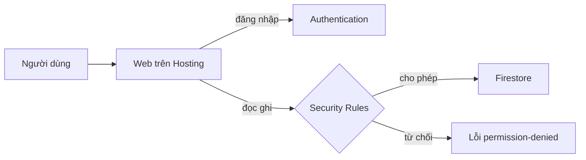

# Firebase cho người mới

> **Tóm tắt:** Dùng Firebase để có link công khai, đăng nhập Google và cơ sở dữ liệu Firestore. Tập trung vào Security Rules, gói Spark miễn phí và cách nhờ AI agent làm an toàn.

::: tip Bạn làm gì
- **Kết quả:** web có link `.web.app`, đăng nhập Google, và dữ liệu Firestore mà mỗi người chỉ thấy phần của mình.
- **Thời gian:** 60 đến 90 phút.
- **Cần gì trước:** tài khoản Google, Node.js, một trang web tĩnh; không cần thẻ (gói Spark).
- **Module trước:** [Fullstack serverless](03-fullstack-serverless.md) hoặc [Đưa web tĩnh lên mạng](02-static-hosting.md). Chặng 2: chọn Firebase hoặc [Supabase](04-supabase.md), không cần cả hai.
:::

## Bạn sẽ làm được gì

Thời lượng ước tính: 60 đến 90 phút.

- Tạo project Firebase và đưa một trang web tĩnh lên Internet bằng Firebase Hosting, có cả link xem thử (preview channel).
- Bật đăng nhập Google bằng Authentication và hiểu vì sao `firebaseConfig` không phải secret.
- Lưu dữ liệu vào Firestore và viết Security Rules theo uid, không bao giờ để chế độ mở toang.
- Thử mọi thứ an toàn trên máy bằng Emulator Suite trước khi chạm vào dữ liệu thật.
- Biết khi nào nên chọn Firebase, khi nào nên chọn [Supabase](04-supabase.md).

## Khái niệm trong 5 phút

Hãy tưởng tượng bạn mở một cửa hàng trong trung tâm thương mại do Google quản lý. Google lo mặt bằng (Hosting), bảo vệ ở cửa kiểm tra thẻ (Authentication), kho hàng (Firestore, Storage) và quy định ra vào kho (Security Rules). Bạn chỉ cần bày hàng.

| Dịch vụ | Việc nó làm | Ví dụ đời thường |
| --- | --- | --- |
| Project | Cái hộp chứa mọi thứ của một sản phẩm | Một cửa hàng |
| Hosting | Phát trang web tĩnh ra Internet, có HTTPS | Mặt bằng và biển hiệu |
| Authentication | Đăng nhập (Google, email...) và cấp uid cho từng người | Bảo vệ kiểm tra thẻ |
| Firestore | Cơ sở dữ liệu dạng document | Tủ hồ sơ có ngăn kéo |
| Storage | Lưu file, ảnh | Kho chứa đồ lớn |
| Cloud Functions | Chạy code phía server | Nhân viên làm việc sau quầy |
| Security Rules | Luật ai được đọc, ghi gì | Nội quy kho |

Mô hình chung của một app dùng Firebase: trình duyệt nói chuyện thẳng với Firebase, không có server của bạn ở giữa. Vì vậy Security Rules là hàng rào duy nhất.



### firebaseConfig không phải secret, Rules mới là hàng rào

Đoạn `firebaseConfig` (apiKey, projectId, appId...) nằm trong code web, ai mở trình duyệt cũng xem được. Điều này bình thường: nó chỉ giống địa chỉ cửa hàng, không phải chìa khóa. Thứ bảo vệ dữ liệu là Security Rules. Nếu rules mở toang thì ai biết địa chỉ cũng vào lấy hàng được.

::: danger Không đưa lên repo, frontend hay prompt
File khóa service account (JSON tải từ mục Service accounts), biến `GOOGLE_APPLICATION_CREDENTIALS`, token CI. Đây là chìa khóa admin, bỏ qua mọi rules.
:::

### Firestore khác SQL thế nào

Firestore là NoSQL ([thuật ngữ](../resources/glossary.md)). Dữ liệu nằm trong document (giống một tờ phiếu JSON), các document nằm trong collection (giống một ngăn kéo). Không có bảng, không có JOIN.

| | Firestore (NoSQL) | Supabase (Postgres, SQL) |
| --- | --- | --- |
| Hình dạng dữ liệu | Collection chứa document, lồng nhau linh hoạt | Bảng có cột cố định, liên kết bằng khóa ngoại |
| Truy vấn | Lọc đơn giản, mỗi query nhắm vào một collection | SQL đầy đủ, JOIN, báo cáo phức tạp |
| Realtime | Rất mạnh, có sẵn (`onSnapshot`) | Có, qua Realtime |
| Phân quyền | Security Rules (một ngôn ngữ riêng) | Row Level Security (SQL policy) |
| Hợp với | App di động, chat, ghi chú, dữ liệu theo từng người dùng | Dữ liệu có quan hệ, thống kê, quản lý có nhiều bảng |
| Rủi ro hay gặp | Rules lỏng, query tốn lượt đọc | Quên bật RLS |

Cách chọn nhanh: dữ liệu giống "tờ phiếu của từng người" và cần realtime thì Firebase. Dữ liệu có quan hệ (đơn hàng, sản phẩm, khách hàng) và bạn muốn học thứ dùng được lâu dài (SQL) thì Supabase. Đừng dùng cả hai cho một sản phẩm nhỏ.

### Gói Spark và gói Blaze

Firebase có gói Spark (không cần thẻ) và Blaze (trả theo mức dùng). Theo trang giá chính thức (kiểm tra ngày 21/10/2026):

| Dịch vụ | Trên Spark |
| --- | --- |
| Hosting | 10 GB lưu trữ, 360 MB truyền tải mỗi ngày |
| Firestore (Standard edition) | 1 GiB dữ liệu; 50 nghìn lượt đọc, 20 nghìn lượt ghi, 20 nghìn lượt xóa mỗi ngày |
| Authentication | 50 nghìn người dùng hoạt động hàng tháng (MAU) cho đăng nhập thông thường; đăng nhập bằng số điện thoại tính phí theo tin nhắn SMS, xem trang giá |
| Cloud Functions | Không có trên Spark, cần Blaze |
| Cloud Storage | Không có trên Spark, cần Blaze |

Các con số và danh sách này đổi theo thời gian, hãy kiểm tra [trang giá chính thức](https://firebase.google.com/pricing) trước khi quyết định.

::: danger Blaze là gói trả tiền
Blaze yêu cầu gắn thẻ thanh toán và có thể phát sinh tiền khi vượt hạn mức miễn phí. Việc nâng cấp là quyết định của riêng bạn, đừng nhờ AI agent bấm hộ. Nếu nâng cấp, hãy đặt ngay budget alert trong Google Cloud Billing, và hiểu rằng cảnh báo ngân sách chỉ báo chứ không tự ngắt dịch vụ.
:::

Với người mới, đường ưu tiên là Spark: Hosting + Authentication + Firestore là đủ cho rất nhiều sản phẩm.

## Thực hành từng bước

Bạn sẽ dùng thư mục mẫu [examples/vibe/firebase](../examples/vibe/firebase/README.md) hoặc code do AI viết cho bạn. Giao diện Firebase console đổi thường xuyên nên tên nút có thể khác chút.

### Bước 1. Tạo project (gói Spark)

Vào [Firebase console](https://console.firebase.google.com), chọn tạo project mới, đặt tên, có thể tắt Google Analytics cho đơn giản. Ghi lại Project ID (dạng `ten-du-an-ab123`).

Bạn sẽ thấy trang tổng quan của project, góc dưới trái ghi gói Spark.

### Bước 2. Cài Firebase CLI và đăng nhập

Cần Node.js đã cài sẵn.

```bash
npm i -g firebase-tools
firebase --version
firebase login
```

Bạn sẽ thấy trình duyệt mở ra để chọn tài khoản Google, sau đó terminal báo đăng nhập thành công. Bước đăng nhập do chính bạn thực hiện, không giao cho agent.

### Bước 3. Khởi tạo và deploy Hosting

Trong thư mục chứa trang web:

```bash
firebase init hosting
```

Trả lời: chọn project có sẵn, thư mục public là `public` (hoặc `dist` nếu app có bước build), không ghi đè `index.html` có sẵn. Lệnh này tạo `firebase.json` và `.firebaserc`. Sau đó:

```bash
firebase deploy --only hosting
```

Bạn sẽ thấy dòng `Hosting URL:` có dạng `https://your-firebase-project-id.web.app`. Mở link đó: web của bạn đã online với HTTPS.

### Bước 4. Link xem thử bằng preview channel

Trước khi sửa trang thật, hãy đăng lên một địa chỉ tạm:

```bash
firebase hosting:channel:deploy thu-nghiem
```

Bạn sẽ thấy một URL xem thử riêng, gửi cho bạn bè xem được mà trang thật không đổi. Chạy lại cùng tên kênh sẽ cập nhật bản xem thử. Kênh có thể đặt thời gian hết hạn, xem mục preview channel trong tài liệu chính thức ở cuối bài.

### Bước 5. Bật Authentication

Trong console: Build, Authentication, Get started, tab Sign-in method, bật Google, chọn email hỗ trợ, lưu. Sau đó vào tab Settings, mục Authorized domains và kiểm tra tên miền của bạn có trong danh sách (`your-firebase-project-id.web.app` thường có sẵn; domain riêng phải tự thêm).

Lấy cấu hình web: Project settings, mục Your apps, thêm Web app, sao chép đoạn `firebaseConfig` vào code (ví dụ mẫu: `public/app.js`). Đây không phải secret.

### Bước 6. Tạo Firestore ở chế độ production

Build, Firestore Database, Create database. Khi được hỏi, chọn production mode (khóa mọi truy cập). Tránh test mode: nó mở toang dữ liệu và tự hết hạn sau một thời gian, khiến app đang chạy bỗng lỗi.

### Bước 7. Viết Security Rules theo uid

Mở `firestore.rules`. Ví dụ rút gọn dưới đây cho mỗi người chỉ đọc và ghi ghi chú của chính mình (bản đầy đủ có kiểm tra độ dài, trường hợp lệ ở thư mục mẫu):

```text
rules_version = '2';
service cloud.firestore {
  match /databases/{database}/documents {
    match /notes/{noteId} {
      allow read, delete: if request.auth != null
        && request.auth.uid == resource.data.ownerId;
      allow create: if request.auth != null
        && request.auth.uid == request.resource.data.ownerId;
      allow update: if request.auth != null
        && request.auth.uid == resource.data.ownerId
        && request.resource.data.ownerId == resource.data.ownerId;
    }
  }
}
```

Cách đọc: `resource.data` là dữ liệu hiện có trong database; `request.resource.data` là dữ liệu sắp được ghi; `request.auth.uid` là mã của người đang đăng nhập. Mọi đường dẫn không được khai báo đều bị chặn.

Ba kiểu rules KHÔNG nên dùng:

```text
allow read, write: if true;                 // ai cũng đọc ghi được
allow read, write: if request.auth != null; // đăng nhập là xem được dữ liệu của người khác
allow read, write: if request.time < timestamp.date(2026, 12, 1); // kiểu test mode, hết hạn là hỏng
```

Kiểu thứ hai chỉ chấp nhận khi dữ liệu đó thật sự dùng chung cho mọi người đã đăng nhập.

### Bước 8. Thử bằng Emulator Suite

Emulator chạy Authentication, Firestore, Hosting giả lập trên máy, dữ liệu thật không bị ảnh hưởng. Cần Java JDK 11 trở lên cho Firestore Emulator.

```bash
firebase init emulators
firebase emulators:start
```

Bạn sẽ thấy bảng điều khiển tại `http://localhost:4000`. Cổng mặc định: Auth 9099, Firestore 8080, Hosting 5000, Storage 9199. Thử ghi một document khi chưa đăng nhập: rules phải từ chối. Thử đăng nhập hai người khác nhau: người A không thấy ghi chú người B.

### Bước 9. Deploy rules và kiểm tra

```bash
firebase deploy --only hosting,firestore:rules
```

Mở web, đăng nhập Google, thêm một ghi chú. Mở cửa sổ ẩn danh, đăng nhập tài khoản khác, xác nhận không thấy ghi chú cũ.

::: details Nâng cao: Cloud Functions, Storage và App Hosting (đọc để biết)

- Cloud Functions và Cloud Storage cần gói Blaze. Trước khi bấm nâng cấp, hãy tự cân nhắc: có cần thật không? Phần lớn app nhỏ chưa cần. Nếu cần backend đơn giản mà không muốn trả phí, xem [Vercel hoặc Netlify Functions](03-fullstack-serverless.md). Nếu vẫn dùng Blaze, đặt budget alert ngay.
- Storage rules mẫu (`storage.rules`) cho mỗi người một thư mục `users/uid`, chỉ nhận ảnh dưới 5 MB.
- Firebase App Hosting dành cho web app có server (ví dụ Next.js, Angular), kết nối GitHub repo để mỗi lần push là một lần phát hành; theo tài liệu chính thức nó yêu cầu gói Blaze. Với web tĩnh, Firebase Hosting là đủ.

:::

## Nhờ AI agent làm giúp

Agent rất giỏi viết code Firebase nhưng hay chọn đường tắt: mở rules cho "chạy được". Bạn phải là người kiểm tra.

Prompt khởi tạo:

```text
Tôi có một web tĩnh trong thư mục hiện tại và muốn đưa lên Firebase Hosting bằng gói Spark (miễn phí).
Hãy:
1. Kiểm tra firebase-tools đã cài chưa (firebase --version). Nếu chưa, hướng dẫn tôi lệnh cài, đừng tự chạy lệnh cài toàn cục.
2. Tạo firebase.json cho Hosting với thư mục public là "public".
3. Dùng .firebaserc với placeholder your-firebase-project-id, tôi sẽ tự thay.
4. Không deploy. Chỉ in ra các lệnh tôi cần tự chạy: firebase login, firebase deploy --only hosting.
Không dùng Cloud Functions hay Storage vì cần gói Blaze.
```

Prompt viết rules an toàn:

```text
Đây là cấu trúc dữ liệu Firestore của app tôi: collection "notes", mỗi document có ownerId, text, createdAt.
Hãy viết firestore.rules sao cho:
- Mặc định chặn tất cả.
- Mỗi người đã đăng nhập chỉ đọc, sửa, xóa document có ownerId bằng request.auth.uid của mình.
- Khi tạo, ownerId phải bằng uid của người tạo, chỉ cho phép các trường ownerId, text, createdAt, text dài tối đa 500 ký tự.
- Tuyệt đối không dùng "allow read, write: if true" và không dùng điều kiện theo ngày hết hạn.
Sau đó liệt kê 5 tình huống tấn công mà bộ rules này chặn được.
```

Prompt dùng Emulator:

```text
Hãy cấu hình Firebase Emulator (auth, firestore, hosting) trong firebase.json, rồi viết hướng dẫn thử rules:
một người chưa đăng nhập ghi vào "notes" phải bị từ chối, người A không đọc được ghi chú người B.
Chỉ chạy trên emulator, không đụng project thật.
```

::: details Nâng cao: Firebase MCP server cho agent

Với Firebase MCP server, agent có thể tự thao tác Firebase (xem rules, quản lý user, đọc ghi Firestore, deploy). Cài thủ công cho Claude Code:

```bash
claude mcp add firebase npx -- -y firebase-tools@latest mcp
claude mcp list
```

MCP server dùng chung thông tin đăng nhập với Firebase CLI, tức là agent hành động với quyền của bạn. Một số tool đổi được dữ liệu thật (deploy, ghi database, sửa user, gửi tin nhắn). Hạn chế bằng cờ `--only` (ví dụ chỉ `auth,firestore`), và đọc kỹ từng yêu cầu xin phép trước khi duyệt. Cách cài và danh sách tool có thể đổi, xem tài liệu chính thức.

:::

Bạn tự kiểm tra: rules có chữ `if true` hay `if request.auth != null` đơn độc không, query phía client có lọc theo `ownerId` không, `.env` và file service account có nằm ngoài repo không.

::: danger Không giao cho agent
Dán file service account hoặc token vào chat, bấm nâng cấp Blaze, nhập thông tin thẻ, xác nhận xóa project hoặc dữ liệu, dán dữ liệu cá nhân thật của người dùng vào prompt.
:::

## Nếu bị lỗi

| Triệu chứng | Nguyên nhân thường gặp | Cách xử lý |
| --- | --- | --- |
| `Missing or insufficient permissions` khi đọc ghi Firestore | Rules chặn, hoặc query không lọc theo `ownerId`, hoặc chưa đăng nhập | Mở Rules Playground hoặc Emulator UI để xem rule nào từ chối. Thêm `where('ownerId', '==', uid)` vào query. Đừng sửa rules thành `if true` |
| App chạy tốt vài tuần rồi đột ngột lỗi permission | Rules test mode có ngày hết hạn | Thay bằng rules theo uid rồi `firebase deploy --only firestore:rules` |
| Popup đăng nhập báo `auth/unauthorized-domain` | Tên miền chưa có trong Authorized domains | Authentication, Settings, Authorized domains, thêm domain (kể cả domain tùy chỉnh và `localhost` nếu thử cục bộ) |
| `auth/operation-not-allowed` | Chưa bật nhà cung cấp đăng nhập | Authentication, Sign-in method, bật Google (hoặc nhà cung cấp bạn dùng) |
| Hosting deploy xong nhưng vẫn thấy trang cũ hoặc trang trắng | Cache trình duyệt, sai thư mục `public` trong `firebase.json`, app có bước build nhưng chưa build | Tải lại cứng (Ctrl+Shift+R), kiểm tra `public` trỏ đúng thư mục có `index.html` (thường là `dist`), chạy build trước khi deploy |
| `Error: HTTP Error: 403` hoặc `Failed to get Firebase project` | Đăng nhập sai tài khoản Google hoặc `.firebaserc` sai Project ID | `firebase logout`, `firebase login`, rồi `firebase use` để chọn đúng project |
| Cloud Functions hoặc Storage báo cần nâng cấp, `must be on the Blaze plan` | Các dịch vụ này không có trên Spark | Chọn lại hướng không cần chúng, hoặc tự quyết định nâng cấp và đặt budget alert. Đừng để agent bấm hộ |
| Đột ngột hết lượt đọc/ghi, app báo `resource-exhausted` hoặc quota exceeded | Vượt hạn mức hằng ngày của Spark, thường do vòng lặp đọc liên tục hoặc listener quá rộng | Xem tab Usage, sửa code để đọc ít hơn (giới hạn bằng `limit`, lọc theo điều kiện), hạn mức đặt lại mỗi ngày |
| Emulator không lên, báo thiếu Java | Firestore Emulator cần JDK | Cài JDK 11 trở lên, mở terminal mới rồi chạy lại `firebase emulators:start` |

## Tự kiểm tra

1. `firebaseConfig` nằm trong code web có phải là lộ secret không? Điều gì mới là hàng rào bảo vệ dữ liệu?
2. Vì sao không nên chọn test mode khi tạo Firestore?
3. Viết điều kiện rules để chỉ chủ sở hữu (field `ownerId`) được đọc một document.
4. Dịch vụ nào trong số Hosting, Authentication, Firestore, Cloud Functions, Storage cần gói Blaze?
5. Dữ liệu của bạn có nhiều bảng liên kết và cần báo cáo thống kê. Chọn Firebase hay Supabase?
6. Bạn nên làm gì nếu lỡ commit file khóa service account lên GitHub công khai?

<details><summary>Đáp án</summary>

1. Không. `firebaseConfig` chỉ định danh project, giống địa chỉ cửa hàng. Security Rules mới là hàng rào. Thứ phải giữ kín là file khóa service account.
2. Test mode mở toang dữ liệu cho mọi người và tự hết hạn, nên vừa không an toàn vừa làm app hỏng bất ngờ. Hãy chọn production mode rồi viết rules theo uid.
3. `allow read: if request.auth != null && request.auth.uid == resource.data.ownerId;`
4. Cloud Functions và Storage (theo trang giá chính thức tại thời điểm viết). Hosting, Authentication, Firestore có hạn mức miễn phí trên Spark.
5. Supabase (Postgres, SQL) phù hợp hơn vì có quan hệ giữa các bảng và truy vấn thống kê.
6. Coi như khóa đã bị lộ: vào Google Cloud console xóa hoặc vô hiệu khóa đó và tạo khóa mới (rotate), gỡ file khỏi repo, kiểm tra hoạt động bất thường. Chỉ xóa commit là chưa đủ vì lịch sử vẫn còn.

</details>

## Checklist hoàn thành

- [ ] Có project Firebase ở gói Spark và đã ghi lại Project ID.
- [ ] `firebase deploy --only hosting` chạy xong và mở được link `.web.app`.
- [ ] Đã thử một preview channel.
- [ ] Đã bật đăng nhập Google và kiểm tra Authorized domains.
- [ ] Firestore tạo ở production mode, `firestore.rules` theo uid, không có `if true`.
- [ ] Đã thử rules bằng Emulator: người lạ bị từ chối, người A không thấy dữ liệu người B.
- [ ] Không có file service account hay `.env` thật trong repo.
- [ ] Biết rõ Cloud Functions và Storage cần Blaze và đã tự quyết định có dùng hay không.

## Tiếp theo

**Tiếp theo:** ráp mọi thứ thành một sản phẩm hoàn chỉnh ở [Dự án nhỏ](09-mini-project.md).

Tra cứu khi cần:

- Cần cơ sở dữ liệu SQL và Row Level Security: [Supabase](04-supabase.md).
- Giao việc cho agent có kiểm soát: [Deploy cùng AI agent](06-ai-agent-deploy.md).
- Gặp lỗi: [Xử lý sự cố](08-troubleshooting.md).
- Ví dụ chạy được: [examples/vibe/firebase](../examples/vibe/firebase/README.md).

Tài liệu chính thức:

- [Firebase Hosting quickstart](https://firebase.google.com/docs/hosting/quickstart)
- [Preview channels](https://firebase.google.com/docs/hosting/test-preview-deploy)
- [Firestore Security Rules](https://firebase.google.com/docs/firestore/security/get-started)
- [Emulator Suite](https://firebase.google.com/docs/emulator-suite/install_and_configure)
- [Firebase MCP server](https://firebase.google.com/docs/cli/mcp-server)
- [App Hosting](https://firebase.google.com/docs/app-hosting)
- [Bảng giá Firebase](https://firebase.google.com/pricing)
