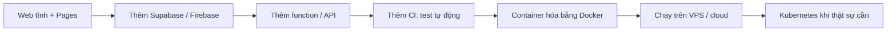

# Tên miền, bảo mật, production: nâng cao

> **Tóm tắt:** Phần đọc thêm của bài production: giám sát tối thiểu, sao lưu database và file, và các dấu hiệu cho thấy bạn nên học DevOps sâu hơn.

::: tip Bạn làm gì
- **Kết quả:** có uptime check, biết cách backup và biết khi nào nên học Docker, CI/CD.
- **Thời gian:** 20 đến 30 phút.
- **Cần gì trước:** đã xong [Tên miền, bảo mật, production](07-domain-security-production.md).
- **Module trước:** [Tên miền, bảo mật, production](07-domain-security-production.md).
:::

## Giám sát tối thiểu

| Việc | Công cụ miễn phí gợi ý | Vì sao |
| --- | --- | --- |
| Biết khi web sập | UptimeRobot, Better Stack, hoặc công cụ tương đương (kiểm tra gói free trên trang giá) | Gửi email khi web không phản hồi, kiểm tra mỗi vài phút |
| Xem log lỗi | Vercel: tab Logs. Netlify: tab Logs và Functions. Cloudflare: Workers & Pages, Logs. Supabase: Logs. Firebase: Logs Explorer | Chẩn đoán lỗi function và database |
| Biết có bao nhiêu người ghé | Vercel Web Analytics, Cloudflare Web Analytics, Plausible, Umami | Thấy xu hướng, thấy đỉnh bất thường |
| Báo lỗi trình duyệt | Sentry (có gói free, kiểm tra giới hạn) | Biết người dùng gặp lỗi gì mà bạn không thấy |

Thiết lập tối thiểu: một uptime check cho trang chủ và một cho đường API quan trọng nhất, gửi email cho bạn. Mất 5 phút.

## Sao lưu (backup)

| Thứ cần sao lưu | Cách làm |
| --- | --- |
| Code | Đã có trên GitHub. Đẩy lên thường xuyên (`git push`) |
| Database Supabase | Tài liệu Supabase nêu gói Pro, Team, Enterprise có backup tự động hằng ngày; dự án gói Free nên tự xuất dữ liệu định kỳ bằng `supabase db dump` và cất ở nơi khác (lưu ý: lệnh này chạy `pg_dump` trong container nên máy bạn cần Docker, và bản dump mặc định không gồm role tùy chỉnh) |
| Firestore | Xuất dữ liệu định kỳ (tính năng export của Firestore, có thể tốn phí lưu trữ) hoặc tự viết script; kiểm tra tài liệu Firebase |
| Ảnh/file người dùng tải lên | Tải về định kỳ, hoặc dùng tính năng sao chép của dịch vụ storage |
| Cấu hình | Giữ danh sách env var (chỉ tên biến, không ghi giá trị) trong `README.md` của dự án để dựng lại nhanh |

Ví dụ xuất dữ liệu Supabase từ máy bạn (cần cài Supabase CLI và đã link dự án, chuỗi kết nối lấy từ dashboard, đừng dán vào chat):

```bash
supabase db dump --linked -f backup-schema.sql
supabase db dump --linked --data-only -f backup-data.sql
```

Backup chỉ có giá trị nếu bạn đã thử khôi phục ít nhất một lần. Hãy thử nạp vào một dự án trống.

## Khi nào cần DevOps thật sự

Track Vibe Deploy là đường nhanh. Hầu hết dự án nhỏ, CLB, MVP, portfolio có thể dừng ở đây rất lâu. Những dấu hiệu bạn nên học thêm:

| Dấu hiệu | Nên học | Ở đâu |
| --- | --- | --- |
| "Chạy trên máy tôi được nhưng chỗ bạn thì không", cần môi trường giống hệt nhau | Docker | [Tuần 4 trong khóa chính](../labs/week-04/README.md) |
| Muốn mỗi lần push tự chạy kiểm thử trước khi lên production | CI/CD với GitHub Actions | [Giáo trình](../curriculum/syllabus.md) |
| Cần chạy backend riêng (không phải function ngắn), cron, hàng đợi, nhiều service | Docker Compose, VPS hoặc container hosting | [Giáo trình](../curriculum/syllabus.md) |
| Nhiều người cùng sửa, cần môi trường staging và quy trình duyệt | CI/CD, quản lý môi trường | [Giáo trình](../curriculum/syllabus.md) |
| Lượng người dùng lớn, cần tự co giãn, nhiều service | Kubernetes, monitoring chuyên sâu | [Giáo trình](../curriculum/syllabus.md) |
| Yêu cầu tuân thủ, dữ liệu nhạy cảm, SLA | Hạ tầng dưới dạng mã, bảo mật nâng cao | [Giáo trình](../curriculum/syllabus.md) |

Kiến trúc nâng cấp thường đi theo từng bước nhỏ, không cần nhảy thẳng lên Kubernetes:



## Tiếp theo

Quay lại [Tên miền, bảo mật, production](07-domain-security-production.md), hoặc sang [Hoàn thiện và ra mắt](11-launch-polish.md).
