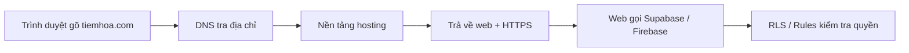

# Domain, bảo mật và vận hành thật

> **Tóm tắt:** Trỏ domain về nền tảng, giữ secret an toàn, kiểm tra bảo mật trước khi public, kiểm soát chi phí, giám sát tối thiểu, sao lưu, rollback và biết khi nào cần học DevOps sâu hơn.

::: tip Bạn làm gì
- **Kết quả:** web có địa chỉ riêng với HTTPS, secret nằm đúng chỗ, và một checklist bảo mật bạn đã đi hết trước khi gửi link cho người lạ.
- **Thời gian:** 60 đến 90 phút (phần DNS có thể phải chờ vài phút đến vài giờ để lan truyền).
- **Cần gì trước:** một sản phẩm đã có link công khai (làm xong [Dự án nhỏ](09-mini-project.md) là vừa) và tài khoản GitHub, nền tảng hosting.
- **Module trước:** [Dự án nhỏ](09-mini-project.md).
:::

## Bạn sẽ làm được gì

- Mua (hoặc dùng sẵn) một domain và trỏ nó về Vercel, Netlify, Cloudflare Pages hoặc GitHub Pages, có HTTPS tự động.
- Đặt biến môi trường và secret đúng chỗ ở từng nền tảng, biết biến nào được phép lộ ra trình duyệt, biến nào tuyệt đối không.
- Chạy checklist bảo mật 15 phút trước khi gửi link cho người lạ.
- Đặt cảnh báo chi phí, bật uptime check miễn phí, biết cách xem log và rollback khi bản mới bị hỏng.
- Biết khi nào sản phẩm của bạn đã "lớn" đến mức nên học Docker, CI/CD, Kubernetes trong khóa chính.

## Khái niệm trong 5 phút

Hãy nghĩ deploy là mở cửa hàng. Những thứ trong bài này là phần "vận hành cửa hàng thật":

| Khái niệm | Ví dụ đời thường | Trong thực tế |
| --- | --- | --- |
| Domain | Tên cửa hàng trên bảng hiệu | `tiemhoa.com` |
| DNS | Danh bạ: tên cửa hàng ứng với địa chỉ nào | Bảng ghi `A`, `CNAME`, `TXT` |
| HTTPS | Cửa có khóa, người ngoài không nghe lén được | Chứng chỉ SSL, nền tảng tự cấp |
| Env var ([thuật ngữ](../resources/glossary.md)) | Két sắt phía sau quầy, khách không nhìn thấy | `SUPABASE_SERVICE_ROLE_KEY` |
| RLS / Rules | Quy định ai được mở ngăn kéo nào | Row Level Security, Firebase Security Rules |
| Rollback | Quay về bảng giá hôm qua khi in nhầm | Promote lại bản deploy cũ |

### Luồng một người truy cập



### Các loại bản ghi DNS bạn cần biết

| Loại | Dùng để | Ví dụ |
| --- | --- | --- |
| `A` | Trỏ tên về một địa chỉ IP | `@` trỏ về một IP của nền tảng |
| `AAAA` | Giống `A` nhưng cho IPv6 | Tùy chọn |
| `CNAME` | Trỏ tên này sang một tên khác | `www` trỏ về `ten-du-an.vercel.app` |
| `ALIAS` / `ANAME` | Giống `CNAME` nhưng dùng được cho apex (chỉ một số nhà cung cấp có) | `@` trỏ về tên của nền tảng |
| `TXT` | Ghi một đoạn chữ để chứng minh quyền sở hữu | Nền tảng yêu cầu thêm để xác minh |
| `MX` | Chỉ nơi nhận email | Đừng xóa khi đổi nameserver |

Apex domain (còn gọi root domain) là `tiemhoa.com`, không có tiền tố. `www.tiemhoa.com` là subdomain. Quy tắc DNS không cho đặt `CNAME` ở apex, vì vậy apex thường dùng `A` còn `www` dùng `CNAME`.

## Thực hành từng bước

### Phần A. Domain và DNS

1. **Chọn nơi mua domain.** Các registrar phổ biến: Cloudflare Registrar (giá gốc, không bán lời), Namecheap, Porkbun, GoDaddy, hoặc mua trực tiếp trong Vercel và Netlify. Bạn tự so sánh giá năm đầu và giá gia hạn ở trang chính thức. Phần mua và thanh toán do bạn tự làm, không nhờ agent. Nếu chỉ học, có thể dùng subdomain miễn phí như `ten.vercel.app`, `ten.netlify.app`, `ten.pages.dev`, `ten.github.io` và bỏ qua phần này.

2. **Thêm domain vào dự án trên nền tảng trước, rồi mới sửa DNS.** Đây là thứ tự đúng ở mọi nơi. Nền tảng sẽ hiện chính xác giá trị cần nhập; hãy chép giá trị từ màn hình của dự án bạn, đừng chép từ bài viết cũ.

3. **Vào trang quản lý DNS của registrar (hoặc Cloudflare) và thêm bản ghi.** Bảng dưới là điểm khác nhau giữa các nơi (kiểm chứng với tài liệu chính thức tháng 10/2026, giá trị có thể đổi nên luôn ưu tiên giá trị nền tảng hiển thị):

| Nền tảng | Apex (`tiemhoa.com`) | www | Ghi chú riêng |
| --- | --- | --- | --- |
| Vercel | Bản ghi `A` với giá trị Vercel hiển thị (tài liệu nêu `76.76.21.21` hoặc giá trị riêng trên thẻ domain) | `CNAME` theo giá trị Vercel hiển thị cho dự án | Menu: Settings, Domains. CLI: `vercel domains add tiemhoa.com ten-du-an`. Nên thêm cả apex và `www` rồi đặt chuyển hướng về một bên |
| Netlify | `ALIAS` tới `apex-loadbalancer.netlify.com`, hoặc `A` tới `75.2.60.5` nếu DNS không hỗ trợ `ALIAS` | `CNAME` tới `ten-du-an.netlify.app` | Netlify khuyên dùng `www` làm domain chính khi dùng DNS bên ngoài. Không ghi `https://` vào giá trị |
| Cloudflare Pages | Apex phải đưa nameserver về Cloudflare, sau đó Cloudflare tự tạo bản ghi | `CNAME` tới `ten-du-an.pages.dev` (subdomain không cần chuyển nameserver) | Phải thêm domain trong Workers & Pages, Custom domains trước. Tự tạo CNAME mà không thêm trong dashboard có thể gây lỗi 522 |
| Cloudflare Workers (static assets) | Domain nằm ở Cloudflare (nameserver Cloudflare): thêm Custom domain trong Settings, Domains and Routes của Worker, Cloudflare tự tạo bản ghi | Tương tự apex, thêm `www` làm Custom domain | Xem [tài liệu Custom Domains của Workers](https://developers.cloudflare.com/workers/configuration/routing/custom-domains/). Domain ở nhà đăng ký khác thì chuyển nameserver hoặc dùng subdomain theo hướng dẫn hiện hành |
| GitHub Pages | 4 bản ghi `A`: `185.199.108.153`, `185.199.109.153`, `185.199.110.153`, `185.199.111.153` (có thể thêm `AAAA`) | `CNAME` tới `ten-github.github.io` (không ghi tên repo) | Thêm domain trong Settings, Pages trước. Nếu publish từ nhánh, GitHub tạo file `CNAME` trong repo; hãy `git pull` để không ghi đè. Không dùng bản ghi wildcard |

4. **Chờ DNS lan truyền (propagation).** Thường vài phút, nhưng tài liệu GitHub nói tối đa 24 giờ, Netlify nói tối đa 48 giờ, thỉnh thoảng 72 giờ. Kiểm tra nhanh trên máy:

```bash
nslookup www.tiemhoa.com
nslookup tiemhoa.com
```

Bạn sẽ thấy: địa chỉ IP hoặc tên của nền tảng. Nếu còn ra kết quả cũ hoặc "can't find", hãy chờ thêm. Có thể thử trang tra DNS online để xem từ nhiều nơi.

5. **Chờ HTTPS tự động.** Sau khi DNS đúng, nền tảng tự cấp chứng chỉ (thường vài phút). Trên GitHub Pages, ô **Enforce HTTPS** có thể mất tới 24 giờ mới bấm được. Bạn không phải mua hay cài chứng chỉ.

6. **Chọn một địa chỉ chính và chuyển hướng bên kia về nó.** Ví dụ `www.tiemhoa.com` là chính, `tiemhoa.com` chuyển hướng 301 sang. Nếu không, Google thấy hai bản trùng nhau và người dùng đăng nhập ở bên này sẽ không thấy phiên đăng nhập ở bên kia.

7. **(Tùy chọn) Dùng Cloudflare làm DNS.** Thêm domain vào Cloudflare (gói Free), đổi nameserver ở registrar sang hai nameserver Cloudflare cung cấp. Lợi ích: một bảng điều khiển DNS duy nhất, nhanh, có sẵn Turnstile và bảo vệ cơ bản. Trước khi đổi nameserver, chép toàn bộ bản ghi cũ sang, đặc biệt `MX` (email) và `TXT`, nếu không email sẽ ngừng nhận. Với Vercel và Netlify, nếu bật proxy (đám mây cam) hãy đọc kỹ hướng dẫn của nền tảng; người mới nên để chế độ chỉ DNS (đám mây xám) cho ít rắc rối.

8. **Sau khi đổi domain, cập nhật mọi nơi còn nhớ domain cũ.** Redirect URL trong Supabase Auth, Authorized domains trong Firebase Auth, CORS, biến `SITE_URL`. Đây là nguồn lỗi "đăng nhập xong nhảy về localhost" rất phổ biến (xem [Troubleshooting](08-troubleshooting.md)).

### Phần B. Biến môi trường và secret

Quy tắc vàng: **secret chỉ sống ở hai nơi là máy bạn (file `.env`, đã nằm trong `.gitignore`) và phần Environment Variables của nền tảng. Không bao giờ ở trong repo, trong chat với AI, trong ảnh chụp màn hình.**

| Nền tảng | Đặt biến ở đâu | CLI | Lưu ý |
| --- | --- | --- | --- |
| Vercel | Settings, Environment Variables (chọn Production / Preview / Development) | `vercel env add TEN_BIEN` | Đổi biến xong phải deploy lại thì bản chạy mới nhận |
| Netlify | Project configuration, Environment variables | `netlify env:set TEN_BIEN gia-tri` | Cũng cần deploy lại sau khi đổi |
| Cloudflare Pages / Workers | Settings, Variables and Secrets (chọn Secret để ẩn giá trị) | `wrangler secret put TEN_BIEN` | Secret chỉ hiện khi tạo, sau đó không xem lại được |
| GitHub Pages | Không có env var cho web tĩnh | Không có | Web tĩnh công khai hoàn toàn: mọi thứ trong file đều bị người khác đọc được. Đừng để secret ở đây. Secret cho GitHub Actions nằm ở Settings, Secrets and variables, Actions |
| Supabase Edge Functions | Dashboard hoặc CLI | `supabase secrets set TEN_BIEN=gia-tri` | Dùng khi cần gọi API có khóa bí mật |
| Firebase | Cloud Functions dùng Secret Manager | `firebase functions:secrets:set TEN_BIEN` | Cần gói Blaze cho Functions, xem phần chi phí |

**Biến public và private.** Các framework chỉ đưa ra trình duyệt những biến có tiền tố đặc biệt. Đây là tính năng an toàn, nhưng cũng là chỗ dễ nhầm:

| Framework | Tiền tố biến public | Biến không có tiền tố |
| --- | --- | --- |
| Vite (React, Vue, Svelte...) | `VITE_` | Chỉ có ở phía build/server |
| Next.js | `NEXT_PUBLIC_` | Chỉ có phía server |
| Astro | `PUBLIC_` | Chỉ có phía server |

Nếu bạn đặt `VITE_SECRET_KEY`, khóa đó sẽ nằm nguyên văn trong file JavaScript gửi cho mọi khách. Tiền tố public nghĩa là "ai cũng đọc được".

::: danger Hai loại khóa Supabase, rất quan trọng
Khóa có chữ secret hoặc `service_role` bỏ qua RLS và tuyệt đối không được nằm ở frontend, repo, prompt. Bảng dưới đây cho biết khóa nào đặt ở đâu.
:::

| Khóa | Đặt ở frontend? | Ghi chú |
| --- | --- | --- |
| Publishable (`sb_publishable_...`), khóa kiểu cũ là `anon` | Được | An toàn **chỉ khi** đã bật RLS đúng |
| Secret (`sb_secret_...`), khóa kiểu cũ là `service_role` | Tuyệt đối không | Bỏ qua mọi RLS. Chỉ dùng ở server hoặc function, không bao giờ đưa vào repo công khai, prompt hay biến có tiền tố public. Supabase còn chặn secret key khi gọi từ trình duyệt |

Theo tài liệu Supabase (kiểm tra 10/2026), publishable/secret là kiểu khóa mới, còn `anon` và `service_role` là khóa kiểu cũ và dự kiến bị ngừng dùng vào cuối năm 2026; dự án cũ có thể còn cả hai kiểu. Nguyên tắc không đổi: khóa nào có chữ secret hoặc service_role thì chỉ ở server. Xem [API keys](https://supabase.com/docs/guides/api/api-keys).

**Firebase:** `apiKey` trong cấu hình web của Firebase là định danh dự án, không phải mật khẩu, nên để trong frontend là bình thường. Bảo vệ thật sự nằm ở Security Rules và danh sách domain được phép đăng nhập. Service account JSON (file khóa quản trị) thì tuyệt đối không commit.

::: danger Nếu lỡ lộ khóa
Làm theo thứ tự dưới đây, bước 1 trước tiên.
:::

1. Vào dịch vụ phát hành khóa, tạo khóa mới (rotate) và thu hồi khóa cũ ngay. Đây là bước quan trọng nhất; xóa commit không đủ vì git lưu lịch sử và bot quét GitHub liên tục.
2. Cập nhật khóa mới trong env var của nền tảng, deploy lại.
3. Xem log dịch vụ để chắc không có truy cập lạ.
4. Mới đến lúc dọn lịch sử git (không bắt buộc nếu khóa cũ đã bị vô hiệu).

### Phần C. Checklist bảo mật trước khi public

Dành 15 phút, đi từng mục:

| # | Việc kiểm tra | Cách kiểm tra nhanh |
| --- | --- | --- |
| 1 | Không có secret trong repo | Tìm trong thư mục các chuỗi như `service_role`, `sb_secret_`, `sk_`, `secret`, `password`; xem `.gitignore` có `.env` |
| 2 | Không có secret trong lịch sử git | Chạy công cụ quét như `gitleaks detect` hoặc bật Secret scanning của GitHub (Settings, Code security; giao diện có thể khác chút) |
| 3 | RLS bật cho mọi bảng Supabase | Bảng nào chưa bật sẽ có cảnh báo trong Table Editor; xem [Supabase](04-supabase.md) |
| 4 | Policy không phải `using (true)` cho dữ liệu riêng tư | Đọc từng policy; với dữ liệu người dùng phải có điều kiện `auth.uid()` |
| 5 | Firebase Rules không phải `allow read, write: if true` | Đọc file rules; xem [Firebase](05-firebase.md). Chế độ test mode thường tự hết hạn, đừng để quá hạn mới sửa |
| 6 | Form công khai có chống spam | Thêm Captcha (Cloudflare Turnstile miễn phí, hCaptcha, reCAPTCHA) và giới hạn số lần gửi (rate limit) |
| 7 | CORS không để dấu sao cho API có xác thực | Chỉ cho phép đúng domain của bạn |
| 8 | Kiểm tra dữ liệu đầu vào (validation) ở phía server hoặc ở database | Dùng ràng buộc `check`, `not null`, độ dài tối đa; không chỉ kiểm tra bằng JavaScript trên trình duyệt |
| 9 | Đừng tin client | Giá tiền, quyền admin, số lượng, ID người dùng phải do server hoặc database quyết định, không đọc từ dữ liệu trình duyệt gửi lên |
| 10 | Quyền admin tách biệt | Tài khoản admin bật xác thực hai bước (2FA); không có route `/admin` mở cho mọi người |
| 11 | Tài khoản dịch vụ bật 2FA | GitHub, Vercel, Supabase, Firebase, registrar domain |
| 12 | Không có dữ liệu cá nhân thật trong repo và prompt | Dùng dữ liệu giả để thử |
| 13 | Đã thử đăng xuất rồi truy cập thử | Mở cửa sổ ẩn danh, thử đọc/ghi dữ liệu không đăng nhập, thử xem dữ liệu người khác |
| 14 | Nhìn lại những thứ AI đã sinh ra | Hỏi agent: "liệt kê mọi chỗ tắt kiểm tra bảo mật hoặc đặt quyền rộng để cho chạy được" |

Một bài kiểm tra thực tế mà ai cũng làm được: mở cửa sổ ẩn danh, mở Network tab (xem [Troubleshooting](08-troubleshooting.md)), dùng ứng dụng, rồi xem các request gửi đi. Nếu thấy khóa bí mật hoặc dữ liệu của người khác trong response, dừng lại và sửa trước khi public.

### Phần D. Chi phí và giới hạn

Gói miễn phí thay đổi thường xuyên. **Đừng tin con số trong bài viết (kể cả bài này); mở trang giá chính thức của từng dịch vụ và đọc dòng giới hạn.** Các điểm cần xem:

| Dịch vụ | Cần tìm gì ở trang giá | Rủi ro điển hình |
| --- | --- | --- |
| Vercel | Giới hạn của gói Hobby (băng thông, function), điều khoản dùng cho mục đích cá nhân phi thương mại | Dự án thương mại có thể không hợp lệ với gói Hobby. Gói Pro có Spend Management để đặt ngưỡng chi tiêu |
| Netlify | Credits/băng thông và số lần build mỗi tháng | Build liên tục (agent tự commit nhiều lần) ăn hết quota |
| Cloudflare Pages / Workers | Số request, số lần build, giới hạn function. Cloudflare cũng hướng dẫn host web tĩnh bằng Workers (static assets), nên xem tài liệu hiện hành xem dự án mới nên chọn Pages hay Workers | Bị vượt khi có bot gọi liên tục |
| GitHub Pages | Giới hạn dung lượng và băng thông của Pages | Không phù hợp cho web tải nặng hoặc thương mại |
| Supabase | Số project miễn phí, dung lượng DB, băng thông, tình trạng project tạm dừng khi ít hoạt động (tài liệu nêu mốc khoảng 7 ngày, kiểm tra 10/2026; xem trang Project Pausing) | Vượt quota liên tục có thể bị hạn chế (tạm dừng, chỉ đọc, trả mã 402). Gói Pro có spend cap bật mặc định |
| Firebase | Gói Spark (miễn phí) và Blaze (trả theo mức dùng) | Blaze cần thẻ và không có trần cứng; chỉ có cảnh báo ngân sách. Một vòng lặp đọc dữ liệu lỗi có thể tốn tiền |

Việc nên làm:

1. **Ưu tiên gói miễn phí và tự quyết định có trả tiền hay không.** Bài này không hướng dẫn nhập thẻ; đừng nhờ agent nhập thẻ hay bấm nâng cấp thay bạn.
2. **Nếu phải dùng gói trả theo mức dùng (như Firebase Blaze), đặt cảnh báo ngân sách ngay ngày đầu.** Trong Google Cloud Console, mục Billing, Budgets & alerts, đặt ngưỡng thấp (ví dụ vài đô la) và gửi email cho bạn. Cảnh báo không tự dừng dịch vụ, nên bạn phải theo dõi.
3. **Bật spend cap hoặc spend management nếu nền tảng có.** Xem mục billing của từng dịch vụ.
4. **Thói quen hằng tuần (5 phút, đặt lịch vào sáng thứ Hai):** mở trang Usage/Billing của từng dịch vụ, nhìn băng thông, số request, dung lượng database và hóa đơn. Nếu có số tăng đột biến, xem log để tìm ai đang gọi.
5. **Chặn nguồn gây tốn kém:** Captcha cho form, rate limit, không để API gọi AI (OpenAI, Claude, Gemini) chạy công khai không giới hạn. Nếu web của bạn gọi API AI, đặt hạn mức chi tiêu tối đa ở phía nhà cung cấp AI và để khóa ở server.

### Phần E. Rollback: quay về bản chạy tốt

Khi bản mới hỏng, việc đầu tiên là **khôi phục dịch vụ**, tìm nguyên nhân sau.

| Nền tảng | Cách rollback |
| --- | --- |
| Vercel | Project, Deployments, chọn bản cũ tốt, menu ba chấm, Instant Rollback (hoặc nút Instant Rollback trên thẻ Production). Gói Hobby chỉ quay được về bản ngay trước. Sau rollback, Vercel tắt tự động gán production, push mới sẽ không lên production cho đến khi bạn Undo Rollback hoặc chạy `vercel promote ten-deployment-hoac-url` |
| Netlify | Tab Deploys, chọn deploy cũ thành công, **Publish deploy**. Nếu auto publishing đang bật, lần push kế tiếp sẽ ghi đè; dùng **Lock to stop auto publishing** để giữ nguyên |
| Cloudflare Workers | Tab Deployments của Worker, chọn phiên bản cũ rồi Rollback; hoặc `npx wrangler rollback` (kiểm tra tài liệu Workers hiện hành) |
| Cloudflare Pages | Deployments, menu ba chấm của bản cũ, **Rollback to this deployment** |
| GitHub Pages | Không có nút rollback. Dùng Git: `git revert` commit lỗi rồi push |

Rollback bằng Git hoạt động ở mọi nền tảng:

```bash
git log --oneline -5
git revert HEAD
git push
```

`git revert` tạo một commit mới đảo ngược commit trước đó, an toàn hơn việc xóa lịch sử. Lưu ý: rollback không hoàn lại dữ liệu trong database và không đổi env var. Nếu lỗi nằm ở database (ví dụ migration xóa cột), cần khôi phục từ backup. Vì vậy hãy xuất dữ liệu trước khi chạy thay đổi lớn về schema.

### Phần F. Đọc thêm: giám sát, sao lưu, khi nào cần DevOps

Ba chủ đề này nằm ở trang [Tên miền, bảo mật, production: nâng cao](07-domain-security-production-advanced.md): giám sát tối thiểu (uptime check, log, analytics), sao lưu database và file, và các dấu hiệu cho thấy bạn nên học DevOps thật sự. Tối thiểu hãy đặt một uptime check cho trang chủ và xuất backup database ít nhất một lần.

## Nhờ AI agent làm giúp

Agent rất giỏi việc rà soát và viết cấu hình. Hãy giao cho nó phần đọc và đề xuất, bạn giữ phần quyết định và phần chứa secret.

```text
Hãy rà soát dự án này trước khi tôi public, KHÔNG sửa file nào, chỉ báo cáo.
1. Tìm mọi chỗ có thể chứa secret: chuỗi giống API key, service_role, file .env, file JSON khóa dịch vụ. Chỉ in tên file và số dòng, KHÔNG in giá trị.
2. Kiểm tra .gitignore đã chặn .env, node_modules, file khóa chưa.
3. Liệt kê biến môi trường mà code đọc, tách thành nhóm public (có tiền tố VITE_, NEXT_PUBLIC_, PUBLIC_) và private. Cảnh báo biến nào tên giống secret mà lại có tiền tố public.
4. Với Supabase: liệt kê bảng nào chưa bật RLS và policy nào quá rộng (ví dụ using (true)). Với Firebase: đọc file rules và cảnh báo allow if true.
5. Liệt kê form công khai thiếu Captcha hoặc rate limit, và API cho phép CORS dấu sao.
6. Liệt kê chỗ nào tin dữ liệu từ client (giá, quyền, user id) thay vì kiểm tra ở server hoặc database.
Trình bày thành bảng: mức độ (cao/trung bình/thấp), file, vấn đề, cách sửa đề xuất. Giải thích bằng tiếng Việt đơn giản cho người mới.
```

```text
Hãy giúp tôi viết README mục "Vận hành": liệt kê tên các biến môi trường cần có (chỉ tên và ý nghĩa, không giá trị), cách deploy, cách rollback trên nền tảng tôi dùng là [Vercel/Netlify/Cloudflare Pages/GitHub Pages], và cách xuất backup database. Không bịa giới hạn gói miễn phí; chỗ nào cần số liệu thì ghi "xem trang giá chính thức" kèm link.
```

Việc bạn phải tự kiểm tra: đọc lại báo cáo, tự mở cửa sổ ẩn danh để thử đọc dữ liệu không đăng nhập, tự xem trang Usage/Billing.

::: danger Những việc không giao cho agent
- Dán secret, `service_role`, token, mật khẩu hoặc file khóa vào khung chat. Hãy tự nhập vào dashboard hoặc dùng `vercel env add` trong terminal của bạn.
- Nhập thông tin thẻ, nâng cấp gói, bấm trả tiền, mua domain.
- Đổi nameserver hoặc xóa bản ghi `MX` khi chưa hiểu hậu quả.
- Dán dữ liệu cá nhân thật của người dùng (email, số điện thoại, dữ liệu học viên) vào prompt.
- Tắt RLS, Security Rules hay CORS "cho chạy được". Nếu agent đề nghị, hãy hỏi lại lý do và cách sửa đúng.
:::

## Nếu bị lỗi

| Triệu chứng | Nguyên nhân thường gặp | Cách xử lý |
| --- | --- | --- |
| Domain báo "Invalid configuration" hoặc "Pending" rất lâu | Còn bản ghi cũ trùng tên (`A`, `AAAA`, `CNAME` của host cũ), hoặc DNS chưa lan truyền | Xóa bản ghi xung đột, nhập đúng giá trị nền tảng hiển thị, chờ rồi kiểm tra bằng `nslookup` |
| Apex chạy nhưng `www` không (hoặc ngược lại) | Chỉ thêm một trong hai vào dự án | Thêm cả hai trong nền tảng và đặt chuyển hướng về địa chỉ chính |
| Lỗi 522 trên Cloudflare Pages | Tạo `CNAME` thủ công mà chưa thêm domain trong dashboard Pages | Thêm domain tại Custom domains của dự án Pages |
| Cảnh báo "Not secure" hoặc lỗi chứng chỉ | Chứng chỉ chưa cấp xong, hoặc có bản ghi `CAA` chặn nhà cấp chứng chỉ | Chờ vài phút đến vài giờ; kiểm tra bản ghi `CAA`; kiểm tra DNS có đúng chưa |
| Email của domain ngừng nhận sau khi đổi nameserver | Bản ghi `MX` và `TXT` không được chép sang DNS mới | Thêm lại bản ghi từ nhà cung cấp email |
| Đổi env var xong web vẫn dùng giá trị cũ | Chưa deploy lại | Redeploy; trên Vercel khi rollback thì env var cũng không đổi theo |
| Khóa bị lộ trên GitHub | Commit nhầm `.env` | Rotate khóa ngay, cập nhật env var mới, rồi mới dọn lịch sử |
| Hóa đơn hoặc usage tăng đột ngột | Bot spam form, vòng lặp gọi API, tệp lớn tải nhiều | Xem log, thêm Captcha và rate limit, đặt cảnh báo ngân sách |
| Rollback xong, push mới không lên production | Vercel tắt tự động gán production sau rollback | Bấm Undo Rollback hoặc chạy `vercel promote` |
| Công khai xong có người xem được dữ liệu của người khác | RLS tắt hoặc policy `using (true)`; Firebase rules quá rộng | Bật RLS, viết lại policy theo `auth.uid()`, kiểm tra bằng cửa sổ ẩn danh |

Chi tiết hơn về từng lỗi và cách đọc log nằm ở [Troubleshooting tổng hợp](08-troubleshooting.md).

## Tự kiểm tra

1. Vì sao không thể đặt `CNAME` ở apex domain, và thường dùng bản ghi gì thay thế?
2. Khóa `anon` và `service_role` của Supabase khác nhau thế nào? Khóa nào được đặt ở frontend?
3. Bạn lỡ commit file `.env` chứa khóa lên GitHub. Việc đầu tiên phải làm là gì?
4. Biến `VITE_API_SECRET` có an toàn không? Tại sao?
5. Sau khi Instant Rollback, vì sao push mới không lên production?
6. Dự án nào nên bắt đầu học Docker và CI/CD? (xem phần "Khi nào cần DevOps thật sự" ở [trang nâng cao](07-domain-security-production-advanced.md))

<details><summary>Đáp án</summary>

1. Chuẩn DNS không cho `CNAME` cùng tồn tại với các bản ghi khác ở apex (nơi đã có `MX`, `NS`...). Vì vậy apex dùng bản ghi `A` (hoặc `ALIAS`/`ANAME` nếu nhà cung cấp DNS hỗ trợ), còn `www` dùng `CNAME`.
2. `anon` (publishable) là khóa công khai, an toàn ở frontend khi RLS đã bật đúng. `service_role` (secret) bỏ qua RLS, chỉ dùng ở server hoặc function, không bao giờ vào frontend, repo công khai hay prompt.
3. Rotate (tạo khóa mới và thu hồi khóa cũ) tại dịch vụ phát hành khóa. Sau đó cập nhật env var, deploy lại, kiểm tra log. Dọn lịch sử git chỉ là bước sau cùng.
4. Không an toàn. Tiền tố `VITE_` khiến giá trị bị nhúng vào JavaScript gửi cho trình duyệt, ai cũng đọc được. Secret phải ở server hoặc function, không có tiền tố public.
5. Vì rollback tắt tự động gán production domain. Cần Undo Rollback hoặc `vercel promote` một deployment để bật lại.
6. Khi cần môi trường giống nhau giữa các máy, muốn kiểm thử tự động mỗi lần push, có backend riêng hoặc nhiều service, nhiều người cộng tác, hoặc lượng truy cập đòi hỏi tự co giãn.

</details>

## Checklist hoàn thành

- [ ] Domain đã trỏ đúng, có HTTPS, `www` và apex chuyển hướng về một địa chỉ chính.
- [ ] Mọi secret chỉ nằm trong `.env` (đã ignore) và env var của nền tảng.
- [ ] Đã phân biệt khóa public và khóa secret; không có `service_role` ở frontend.
- [ ] RLS (Supabase) hoặc Security Rules (Firebase) đã bật và được thử bằng cửa sổ ẩn danh.
- [ ] Form công khai có Captcha hoặc rate limit.
- [ ] Đã đặt cảnh báo chi phí và có lịch xem Usage/Billing hằng tuần.
- [ ] Đã bật uptime check và biết chỗ xem log.
- [ ] Đã xuất backup database ít nhất một lần.
- [ ] Đã thử rollback (hoặc biết chính xác các bước) trên nền tảng của mình.
- [ ] Đã bật 2FA cho GitHub, nền tảng hosting, database và registrar.

## Tiếp theo + Tài liệu chính thức

**Tiếp theo:** [Hoàn thiện và ra mắt](11-launch-polish.md) (chống spam form, preview khi chia sẻ link, analytics, Lighthouse, checklist go-live 20 mục) trước khi gửi link cho nhiều người. Đọc thêm khi cần: [nâng cao](07-domain-security-production-advanced.md) (giám sát, backup, khi nào cần DevOps), [Xử lý sự cố](08-troubleshooting.md). Dùng công cụ như Lovable, Bolt, v0, Replit thì đọc [App builders](10-app-builders.md). Muốn đi sâu hạ tầng: [giáo trình DevOps](../curriculum/syllabus.md) và [Docker ở tuần 4](../labs/week-04/README.md).

Tài liệu chính thức:

- Vercel, thêm domain: https://vercel.com/docs/domains/working-with-domains/add-a-domain
- Vercel, Instant Rollback: https://vercel.com/docs/instant-rollback
- Netlify, cấu hình DNS ngoài: https://docs.netlify.com/domains-https/custom-domains/configure-external-dns/
- Netlify, quản lý deploy: https://docs.netlify.com/site-deploys/manage-deploys/
- Cloudflare Pages, custom domains: https://developers.cloudflare.com/pages/configuration/custom-domains/
- Cloudflare Pages, rollback: https://developers.cloudflare.com/pages/configuration/rollbacks/
- GitHub Pages, custom domain: https://docs.github.com/en/pages/configuring-a-custom-domain-for-your-github-pages-site/managing-a-custom-domain-for-your-github-pages-site
- Supabase, backups: https://supabase.com/docs/guides/platform/backups
- Supabase, billing FAQ: https://supabase.com/docs/guides/platform/billing-faq
- Firebase, Firestore Security Rules: https://firebase.google.com/docs/firestore/security/get-started
