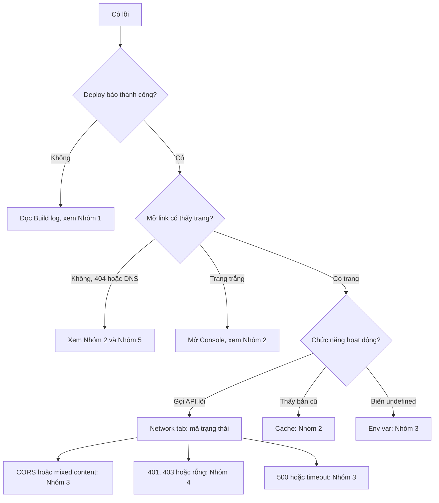

# Troubleshooting: sửa lỗi deploy theo triệu chứng

> **Tóm tắt:** Đọc console và Network tab, tra lỗi theo triệu chứng (build, trang trắng, 404, biến môi trường, CORS, Supabase, Firebase, domain, quota) và biết cách nhờ AI agent chẩn đoán đúng.

Thời lượng ước tính: 30-60 phút để đọc và thử, sau đó dùng như sổ tra cứu mỗi khi gặp lỗi.

## Bạn sẽ làm được gì

- Mở được Console và Network tab của trình duyệt, đọc ra lỗi thật thay vì đoán.
- Phân biệt lỗi ở giai đoạn build, lỗi khi chạy trên trình duyệt, lỗi ở function/server và lỗi ở database.
- Tra bảng 35 lỗi phổ biến của người vibe-code, biết nhìn ở đâu, sửa gì.
- Viết prompt chẩn đoán cho AI agent kèm đúng thông tin (log, ảnh lỗi) mà không lộ secret.

## Khái niệm trong 5 phút

Hãy nghĩ cửa hàng không bán được hàng. Trước khi sửa, phải biết hỏng ở khâu nào: xưởng làm hàng (build), kho giao hàng (hosting), quầy thu ngân (function/server), hay két tiền (database). Sửa nhầm khâu là cách mất thời gian nhất.

| Giai đoạn | Chuyện gì xảy ra | Lỗi hay gặp | Nhìn ở đâu |
| --- | --- | --- | --- |
| Build | Nền tảng chạy `npm install` rồi `npm run build` | Build failed, module not found, sai phiên bản Node | Build log trong trang Deployments |
| Phục vụ file | Nền tảng gửi file HTML/JS/CSS cho khách | 404, trang trắng, tài nguyên 404, bản cũ do cache | Network tab |
| Chạy ở trình duyệt | JavaScript chạy trên máy khách | Biến `undefined`, CORS, mixed content | Console và Network tab |
| Chạy ở server | Function/API xử lý yêu cầu | 500, timeout, thiếu env var | Function logs của nền tảng |
| Dữ liệu | Supabase/Firebase kiểm tra quyền | Danh sách rỗng, 401/403, permission-denied | Network tab, Logs của dịch vụ |

### Cây quyết định nhanh



### Đọc Console và Network tab trong 2 phút

Mở bằng phím `F12` (hoặc `Ctrl+Shift+I`; trên Mac là `Cmd+Option+I`), hoặc bấm chuột phải vào trang rồi chọn Inspect. Giao diện mỗi trình duyệt khác chút, nhưng tên tab thì giống nhau.

| Tab | Dùng để | Cách đọc |
| --- | --- | --- |
| Console | Xem lỗi JavaScript | Dòng đỏ là lỗi. Đọc dòng đầu tiên trên cùng (lỗi gốc), các dòng sau thường là hệ quả. Bên phải có tên file và số dòng |
| Network | Xem mọi yêu cầu trình duyệt gửi | Mỗi dòng là một request. Cột Status là mã trạng thái, cột Name là tài nguyên. Dòng đỏ là request thất bại |
| Application | Xem cookie, localStorage, service worker | Dùng khi nghi ngờ cache hoặc phiên đăng nhập |

Bảng mã trạng thái HTTP cần nhớ:

| Mã | Nghĩa dễ hiểu | Nghĩ tới |
| --- | --- | --- |
| 200 | Thành công | Nếu dữ liệu vẫn sai thì lỗi ở logic hoặc RLS |
| 301/302 | Chuyển hướng | Vòng lặp redirect, sai domain |
| 304 | Dùng bản trong cache | Có thể là lý do bạn thấy bản cũ |
| 400 | Yêu cầu sai | Gửi thiếu hoặc sai dữ liệu |
| 401 | Chưa đăng nhập hoặc khóa sai | Thiếu token, sai API key |
| 403 | Bị cấm | RLS, rules, CORS, quyền |
| 404 | Không tìm thấy | Sai đường dẫn, thiếu file, thiếu rewrite |
| 429 | Gọi quá nhiều | Rate limit, quota |
| 500 | Lỗi ở server | Xem function log |
| 502/504 | Server phía sau không trả lời kịp | Timeout |
| 522 | Cloudflare không nối được tới server gốc | Cấu hình domain Cloudflare Pages |

## Thực hành từng bước

Làm một lần với bất kỳ trang nào bạn đã deploy để quen tay:

1. **Mở Console.** Mở trang của bạn, nhấn `F12`, chọn tab Console. Bạn sẽ thấy: danh sách thông báo; nếu không có dòng đỏ thì phía trình duyệt không có lỗi JavaScript.
2. **Cố tình gây một lỗi nhỏ.** Gõ vào Console dòng `tenBienKhongTonTai` rồi nhấn Enter. Bạn sẽ thấy: `ReferenceError: tenBienKhongTonTai is not defined`. Đây là dạng lỗi "trang trắng" điển hình, chỉ khác là nó xảy ra trong code của bạn.
3. **Mở Network tab và tải lại trang.** Chọn tab Network, nhấn `Ctrl+Shift+R` (tải lại bỏ qua cache). Bạn sẽ thấy: danh sách request với cột Status; thường là 200.
4. **Tìm request lỗi.** Dùng bộ lọc `Fetch/XHR` để chỉ xem các lời gọi API. Bấm vào một dòng, đọc các tab Headers (địa chỉ và mã trạng thái), Response (nội dung server trả về) và Preview.
5. **Tắt cache khi thử.** Trong Network tab, tick **Disable cache** (khi DevTools đang mở). Bạn sẽ thấy: mỗi lần tải lại đều lấy bản mới, loại trừ lỗi "bản cũ".
6. **Chép lỗi để hỏi agent.** Bấm chuột phải vào dòng lỗi trong Console, chọn Copy message (hoặc chụp ảnh). Che các giá trị giống khóa trước khi gửi.
7. **Xem build log và function log.** Trên nền tảng, vào Deployments, bấm bản deploy, đọc build log từ **dòng đỏ đầu tiên**. Với function, vào mục Logs hoặc Functions và lọc theo thời gian bạn vừa gọi.

Mẹo chung: lỗi đầu tiên mới là lỗi gốc. Đừng sửa lỗi thứ 10 khi lỗi thứ nhất chưa xử lý. Mỗi lần chỉ đổi một thứ rồi thử lại.

## Nhờ AI agent làm giúp

Agent chẩn đoán rất nhanh nếu bạn đưa đúng bằng chứng. Mẫu prompt:

```text
Tôi deploy dự án lên [Vercel/Netlify/Cloudflare Pages/GitHub Pages]. Tôi gặp lỗi sau.

Triệu chứng: [mô tả bằng một câu, ví dụ: trang trắng sau khi deploy, trên máy tôi vẫn chạy]
Giai đoạn: [build / mở trang / gọi API / đăng nhập]
Thông báo lỗi nguyên văn (đã che mọi khóa và mật khẩu):
[dán 10-30 dòng quanh dòng lỗi đầu tiên]

Hãy:
1. Giải thích bằng tiếng Việt đơn giản lỗi này nghĩa là gì.
2. Liệt kê 3 nguyên nhân khả dĩ, xếp theo xác suất.
3. Với mỗi nguyên nhân, cho tôi một cách kiểm tra cụ thể (lệnh hoặc chỗ cần nhìn trong trình duyệt/dashboard).
4. Chỉ sửa code khi nguyên nhân đã được xác nhận. Nói rõ file nào, sửa gì, vì sao.
Không tắt kiểm tra bảo mật, RLS, CORS hay bỏ qua lỗi chỉ để cho chạy được.
```

Việc bạn phải tự làm: tự lấy log, tự che secret, tự xác nhận lỗi đã hết bằng cửa sổ ẩn danh.

Không giao cho agent: dán khóa thật hoặc `service_role` vào khung chat để "thử cho nhanh"; cho agent bấm nâng cấp gói khi vượt quota; để agent tắt RLS hoặc Security Rules để hết lỗi 403. Đó là cách biến lỗi nhỏ thành sự cố lớn.

## Nếu bị lỗi

Tra theo nhóm. Cột "Nhìn ở đâu" cho biết nên mở thứ gì trước. Cột "Prompt" là câu ngắn để gắn vào mẫu prompt ở trên.

### Nhóm 1. Build và cài đặt

| # | Triệu chứng | Nhìn ở đâu | Nguyên nhân thường gặp | Cách sửa | Prompt gợi ý |
| --- | --- | --- | --- | --- | --- |
| 1 | `Build failed` hoặc `Command "npm run build" exited with 1` | Build log, tìm dòng `error` đầu tiên | Lỗi cú pháp, thiếu import, TypeScript báo lỗi mà máy bạn bỏ qua | Chạy `npm run build` trên máy, sửa tới khi qua rồi mới push | "Chạy npm run build và sửa lỗi đầu tiên, giải thích vì sao" |
| 2 | `command not found: vite` hoặc `next: command not found` | Build log | Chưa cài dependency, hoặc package nằm sai mục trong `package.json`, hoặc Build Command ghi sai | Kiểm tra `npm install` chạy được; xem lại Build Command và Install Command trong cài đặt dự án | "Kiểm tra scripts và dependencies trong package.json có khớp với lệnh build không" |
| 3 | `Cannot find module 'xyz'` / `Module not found: Can't resolve './Foo'` | Build log | Chưa cài package, tên file sai hoa/thường (Windows và Mac không phân biệt, Linux của nền tảng thì có), quên commit file | Chạy `npm install xyz`; đối chiếu đúng chữ hoa/thường của tên file và import; `git status` xem file đã commit chưa | "Tìm import sai hoa thường so với tên file thật" |
| 4 | Sai phiên bản Node, ví dụ `Unsupported engine` hoặc `SyntaxError: Unexpected token` ở thư viện | Đầu build log (dòng ghi version Node) | Nền tảng dùng Node khác máy bạn | Thêm `"engines": { "node": "20.x" }` vào `package.json` hoặc đặt biến `NODE_VERSION` (Netlify) hoặc chọn Node version trong cài đặt (Vercel); kiểm tra tài liệu nền tảng để lấy phiên bản được hỗ trợ | "Thêm engines cho Node phù hợp và giải thích" |
| 5 | `npm ci` lỗi, `package-lock.json` không khớp `package.json` | Build log | Sửa `package.json` mà không cập nhật lockfile; dùng nhiều trình quản lý gói cùng lúc (npm, yarn, pnpm) | Xóa lockfile thừa, chạy `npm install` để tạo lại một lockfile, commit cả hai file | "Đồng bộ lockfile với package.json, chỉ dùng npm" |
| 6 | `ERESOLVE unable to resolve dependency tree` | Build log | Hai package đòi phiên bản phụ thuộc xung đột | Thử nâng hoặc hạ phiên bản package gây xung đột; chỉ dùng `--legacy-peer-deps` khi hiểu rõ và ghi chú lại | "Giải thích xung đột peer dependency này và đề xuất phiên bản tương thích" |
| 7 | Build chạy xong nhưng thiếu trang, `Publish directory` sai, báo không tìm thấy output | Build log cuối, cài đặt dự án | Output Directory sai (ví dụ dự án Vite là `dist`, Next.js do nền tảng lo, trang tĩnh thường là `.` hoặc `public`) | Đặt đúng Output/Publish directory theo framework; trang tĩnh thuần không cần build thì để trống Build Command | "Xác định output directory đúng cho framework này" |
| 8 | Build hết bộ nhớ hoặc quá thời gian (`JavaScript heap out of memory`) | Build log | Dự án nặng, ảnh quá lớn, bundle phình | Giảm kích thước ảnh, bỏ package thừa; kiểm tra giới hạn build của gói | "Tìm thứ làm bundle lớn và đề xuất cách giảm" |

### Nhóm 2. Trang hiển thị sai (404, trang trắng, bản cũ)

| # | Triệu chứng | Nhìn ở đâu | Nguyên nhân thường gặp | Cách sửa | Prompt gợi ý |
| --- | --- | --- | --- | --- | --- |
| 9 | Vào đường dẫn con hoặc nhấn F5 thì 404 (ví dụ `/about`) | Network tab, dòng đầu có Status 404 | App một trang (SPA, như React Router) cần máy chủ trả `index.html` cho mọi đường dẫn | Thêm rewrite: Netlify file `_redirects` với dòng `/* /index.html 200`; Vercel `vercel.json` với `rewrites`; Cloudflare Pages tương tự `_redirects`; GitHub Pages dùng `404.html` hoặc hash router | "Thêm rewrite SPA cho nền tảng tôi đang dùng" |
| 10 | Trang trắng hoàn toàn | Console, dòng đỏ trên cùng | Lỗi JavaScript khi chạy, đường dẫn `base` sai, thiếu biến môi trường | Đọc lỗi đầu tiên ở Console rồi tra theo từng loại; xem dòng số 11 và 14 của bảng Nhóm 2 | "Đọc lỗi Console này và tìm nguyên nhân gây trang trắng" |
| 11 | Trên GitHub Pages: CSS, JS, ảnh bị 404 (trang hiện trơ HTML) | Network tab, lọc các dòng đỏ; xem đường dẫn có thiếu tên repo | Trang nằm ở `ten.github.io/ten-repo/` nhưng code gọi `/style.css` (bắt đầu bằng dấu gạch chéo) | Dùng đường dẫn tương đối `./style.css`; với Vite đặt `base: '/ten-repo/'` trong `vite.config`; Next.js đặt `basePath` | "Sửa mọi đường dẫn tài nguyên để chạy dưới /ten-repo/" |
| 12 | Trên GitHub Pages không thấy gì hoặc 404 toàn bộ | Settings, Pages; tab Actions | Chưa chọn nguồn publish, hoặc file nằm sai thư mục, thiếu `index.html` ở gốc | Settings, Pages: chọn nhánh và thư mục (hoặc GitHub Actions); đảm bảo có `index.html`; chờ vài phút | "Kiểm tra cấu trúc repo có đúng để GitHub Pages phục vụ không" |
| 13 | Deploy xong vẫn thấy bản cũ | Network tab, bật Disable cache, xem Status 304 hoặc header `cache-control` | Cache trình duyệt hoặc CDN; Service Worker giữ bản cũ; xem nhầm domain/branch/preview | Tải lại cứng `Ctrl+Shift+R`; thử cửa sổ ẩn danh; Application, Service Workers, Unregister; kiểm tra deployment mới nhất đã là Production chưa | "Kiểm tra có service worker hoặc cache-control nào gây giữ bản cũ" |
| 14 | `Uncaught TypeError: Cannot read properties of undefined` ngay khi tải | Console, bấm vào link file:dòng bên phải | Code đọc dữ liệu chưa có (API chưa trả, biến môi trường thiếu) | Xem Network tab xem API có trả dữ liệu không; thêm xử lý khi chưa có dữ liệu | "Thêm kiểm tra dữ liệu rỗng ở chỗ này" |
| 15 | Ảnh hoặc font không hiện, Console báo `Failed to load resource` | Network tab, dòng đỏ | Đường dẫn sai, tên file hoa/thường, file không được commit | Kiểm tra file có trong repo và đường dẫn khớp từng ký tự | "So khớp đường dẫn ảnh với file thật trong repo" |

### Nhóm 3. Biến môi trường, CORS và gọi API

| # | Triệu chứng | Nhìn ở đâu | Nguyên nhân thường gặp | Cách sửa | Prompt gợi ý |
| --- | --- | --- | --- | --- | --- |
| 16 | `undefined` khi đọc biến môi trường (ví dụ `import.meta.env.VITE_X` là `undefined`) | Console, và env var trong dashboard | Quên đặt trên nền tảng (`.env` nằm ở máy bạn, không lên GitHub); sai tiền tố; chưa deploy lại sau khi thêm | Thêm biến trong dashboard (đúng môi trường Production/Preview), rồi redeploy | "Liệt kê biến môi trường code đang đọc để tôi tự đặt trên dashboard (không cần giá trị)" |
| 17 | Biến backend bí mật không đọc được ở frontend | Console | Biến không có tiền tố public nên không được đưa ra trình duyệt (đây là hành vi đúng) | Đừng đổi tên thành public. Gọi qua function/API phía server để dùng secret | "Chuyển lời gọi dùng khóa bí mật sang function phía server" |
| 18 | Sợ lộ khóa: thấy khóa bí mật trong Sources/Network | Sources tab, Network, Response | Đặt secret vào biến có tiền tố public, hoặc commit vào code | Rotate khóa ngay, chuyển logic vào server, xem [Domain, bảo mật](07-domain-security-production.md) | "Tìm mọi chỗ secret có thể bị đưa ra trình duyệt" |
| 19 | `Access to fetch ... has been blocked by CORS policy` | Console (dòng đỏ dài), Network (có thể thấy request OPTIONS) | API (của bạn hoặc bên thứ ba) không cho phép domain của bạn | Với API của bạn: thêm header `Access-Control-Allow-Origin` đúng domain; với API bên thứ ba không hỗ trợ trình duyệt: gọi qua function phía server. Không dùng dấu sao cho API có xác thực | "Cấu hình CORS chỉ cho phép domain production và localhost" |
| 20 | `Mixed Content: The page was loaded over HTTPS, but requested an insecure resource` | Console | Trang HTTPS nhưng gọi API, ảnh hoặc script bằng `http://` | Đổi sang `https://`; nếu API chỉ có http thì đặt sau function proxy | "Tìm mọi URL http:// trong code và đổi sang https" |
| 21 | Gọi `/api/...` ra 404 hoặc trả HTML thay vì JSON | Network, tab Response | Function đặt sai thư mục (Vercel: `api/`, Netlify: `netlify/functions/`, Cloudflare: `functions/`), hoặc gọi sai đường dẫn | Đặt file đúng thư mục theo nền tảng, xem lại đường dẫn gọi | "Kiểm tra cấu trúc thư mục function đúng quy ước của [nền tảng]" |
| 22 | Function trả 500 | Function logs của nền tảng (lọc theo thời điểm gọi) | Lỗi trong code, thiếu env var, gói thiếu dependency | Đọc stack trace trong log, sửa theo dòng lỗi đầu tiên | "Đọc log function này và nói dòng code gây lỗi" |
| 23 | `FUNCTION_INVOCATION_TIMEOUT`, `504` hoặc function chạy quá thời gian | Function logs, thời gian chạy | Tác vụ chậm (gọi AI, truy vấn lớn), giới hạn thời gian của gói ngắn | Giảm khối lượng, trả lời nhanh rồi xử lý nền, tăng giới hạn nếu gói cho phép (xem trang giá và docs) | "Tối ưu function này để chạy dưới giới hạn thời gian của gói" |

### Nhóm 4. Supabase, Firebase và đăng nhập

| # | Triệu chứng | Nhìn ở đâu | Nguyên nhân thường gặp | Cách sửa | Prompt gợi ý |
| --- | --- | --- | --- | --- | --- |
| 24 | Supabase trả danh sách rỗng `[]` dù bảng có dữ liệu (status 200) | Network, Response; Table Editor xem RLS | RLS đã bật nhưng chưa có policy `select` cho vai trò hiện tại | Viết policy đúng (ví dụ cho `select` với điều kiện cụ thể), không tắt RLS để chữa | "Viết policy select an toàn cho bảng này theo auth.uid()" |
| 25 | Supabase `401` hoặc `403`, `new row violates row-level security policy` | Network, Response; Logs của Supabase | Chưa đăng nhập, hoặc policy `insert` thiếu `with check`, hoặc dùng sai khóa (ví dụ khóa của dự án khác) | Kiểm tra người dùng đã đăng nhập chưa, thêm policy insert phù hợp. Không đưa `service_role` vào frontend | "Giải thích vì sao insert bị RLS chặn và đề xuất policy tối thiểu" |
| 26 | Supabase `Invalid API key` hoặc `JWT expired` | Network, Response | Sai URL/khóa, copy thừa khoảng trắng, nhầm dự án; phiên hết hạn | Kiểm tra URL và khóa public của đúng dự án, trong env var trên nền tảng; đăng nhập lại | "Kiểm tra cách khởi tạo supabase client có đọc đúng biến môi trường không" |
| 27 | Firebase `permission-denied` / `Missing or insufficient permissions` | Console, và tab Rules trên Firebase | Rules chặn thao tác, hoặc rules test mode đã hết hạn | Sửa rules theo đúng người dùng được phép (ví dụ `request.auth != null` và so khớp uid), rồi `firebase deploy --only firestore:rules`; dùng Rules Playground hoặc Emulator để thử. Không dùng `allow read, write: if true` | "Viết Firestore rules chỉ cho chủ sở hữu tài liệu đọc và ghi" |
| 28 | Đăng nhập xong bị đưa về `localhost` hoặc sai domain | Thanh địa chỉ sau khi đăng nhập | Redirect URL/Site URL trong cấu hình Auth vẫn là localhost hoặc domain cũ | Supabase: Authentication, URL Configuration, thêm domain production vào Site URL và Redirect URLs. Firebase: Authentication, Settings, Authorized domains thêm domain | "Tìm chỗ cấu hình redirect của auth trong code và liệt kê URL cần thêm vào dashboard" |
| 29 | Đăng nhập Google/GitHub báo `redirect_uri_mismatch` | Trang lỗi của nhà cung cấp | URL callback khai báo ở nhà cung cấp OAuth không khớp | Sao chép đúng callback URL từ Supabase/Firebase vào cấu hình OAuth app | "Cho tôi danh sách callback URL cần khai báo, tôi sẽ tự dán vào dashboard" |

### Nhóm 5. Domain, chứng chỉ và quota

| # | Triệu chứng | Nhìn ở đâu | Nguyên nhân thường gặp | Cách sửa | Prompt gợi ý |
| --- | --- | --- | --- | --- | --- |
| 30 | Domain báo `Pending`, `Invalid configuration`, hoặc `DNS_PROBE_FINISHED_NXDOMAIN` | Dashboard, mục Domains; lệnh `nslookup ten-mien` | DNS chưa lan truyền, bản ghi sai hoặc còn bản ghi cũ trùng | Nhập đúng giá trị nền tảng hiển thị, xóa bản ghi trùng, chờ rồi kiểm tra lại; xem [Domain, bảo mật](07-domain-security-production.md) | "Kiểm tra giúp các bản ghi DNS tôi liệt kê dưới đây có khớp hướng dẫn của nền tảng không" |
| 31 | `NET::ERR_CERT_COMMON_NAME_INVALID`, SSL lỗi, "Not secure" | Trình duyệt, dashboard Domains | Chứng chỉ chưa cấp xong, DNS chưa đúng, bản ghi `CAA` chặn, proxy Cloudflare cấu hình SSL không khớp | Chờ cấp chứng chỉ, kiểm tra DNS, thử chế độ DNS only để tách lỗi | "Giải thích các nguyên nhân SSL lỗi cho cấu hình DNS của tôi" |
| 32 | `ERR_TOO_MANY_REDIRECTS` | Network, chuỗi 301/302 lặp | Cloudflare SSL ở chế độ Flexible trong khi nền tảng ép HTTPS; hoặc hai quy tắc chuyển hướng www và apex đá qua lại | Đặt SSL của Cloudflare ở Full (strict) hoặc tắt proxy; chỉ giữ một quy tắc chuyển hướng | "Tìm vòng lặp redirect trong cấu hình" |
| 33 | `402`, `429`, trang báo vượt giới hạn, project bị tạm dừng | Dashboard Usage và email của dịch vụ | Vượt quota gói miễn phí (băng thông, request, dung lượng), bot spam, hoặc project Supabase gói free bị tạm dừng vì ít hoạt động (xem trang Project Pausing của Supabase) | Xem Usage để biết thứ gì vượt, giảm tải, thêm Captcha và rate limit; tự quyết định có nâng gói không (bạn tự thao tác) | "Phân tích đoạn code nào có thể gây gọi API quá nhiều" |
| 34 | Email của domain ngừng nhận sau khi đổi nameserver | Trang DNS mới | Mất bản ghi `MX` khi chuyển DNS | Thêm lại `MX` và `TXT` từ nhà cung cấp email | "Liệt kê các loại bản ghi tôi cần chép khi chuyển nameserver" |
| 35 | Deploy không tự chạy khi push lên GitHub | Dashboard, cài đặt Git; tab Settings, Integrations của GitHub | Nhánh push không phải nhánh production, mất quyền kết nối GitHub, hoặc nền tảng bị ngắt kết nối | Kiểm tra nhánh production trong cài đặt, kết nối lại GitHub App cho repo | "Kiểm tra tôi đang push lên nhánh nào và nhánh production của nền tảng là gì" |

Nếu lỗi không có trong bảng: lấy dòng lỗi đầu tiên, dán vào ô tìm kiếm cùng tên framework hoặc dịch vụ, và đọc thảo luận chính thức hoặc issue trên GitHub của dự án; sau đó đối chiếu bằng cách chạy lại trên máy (`npm run build`, `npm run dev`).

## Tự kiểm tra

1. Deploy báo thành công nhưng bạn thấy trang trắng. Mở tab nào đầu tiên và tìm gì?
2. Vì sao trên máy chạy tốt nhưng build trên nền tảng báo `Cannot find module './header'` dù file `Header.js` có tồn tại?
3. Supabase trả `200` với mảng rỗng, trong khi Table Editor thấy có dữ liệu. Nguyên nhân thường gặp và cách sửa đúng?
4. Bạn thấy `CORS policy` trong Console. Có nên đặt `Access-Control-Allow-Origin: *` cho mọi API cho nhanh không?
5. Đã deploy bản sửa nhưng vẫn thấy bản cũ. Kể ba cách kiểm tra.
6. Khi nhờ agent sửa lỗi, bạn nên đưa gì và tuyệt đối không đưa gì?

<details><summary>Đáp án</summary>

1. Tab Console, tìm dòng đỏ đầu tiên (lỗi gốc); sau đó xem tab Network để biết file hay API nào thất bại.
2. Linux (máy chủ build) phân biệt chữ hoa và thường, còn Windows và Mac thường thì không. Sửa import cho khớp chính xác tên file (`./Header`) và commit đúng tên file.
3. RLS đã bật nhưng chưa có policy `select` phù hợp cho vai trò hiện tại. Viết policy giới hạn đúng (ví dụ theo `auth.uid()`), không tắt RLS.
4. Không nên với API có xác thực hoặc dữ liệu riêng. Chỉ cho phép đúng domain của bạn; nếu cần gọi API bên thứ ba không hỗ trợ trình duyệt thì gọi qua function phía server.
5. Tải lại cứng `Ctrl+Shift+R` hoặc dùng cửa sổ ẩn danh; bật Disable cache ở Network tab và xem Status; kiểm tra deployment mới nhất đã là Production và bạn đang xem đúng domain; xem Service Worker.
6. Nên đưa: triệu chứng, giai đoạn gặp lỗi, thông báo lỗi nguyên văn và log liên quan (đã che khóa). Không đưa: khóa bí mật, `service_role`, mật khẩu, dữ liệu cá nhân thật của người dùng.

</details>

## Checklist hoàn thành

- [ ] Mở được Console và Network tab, và đọc được mã trạng thái.
- [ ] Biết phân biệt lỗi build, lỗi trình duyệt, lỗi function, lỗi database.
- [ ] Đã thử xem build log và function log trên nền tảng của mình.
- [ ] Biết tải lại cứng và dùng cửa sổ ẩn danh để loại trừ cache.
- [ ] Có sẵn mẫu prompt chẩn đoán và biết che secret trước khi gửi.
- [ ] Đã lưu trang này để tra cứu khi gặp lỗi.

## Tiếp theo + Tài liệu chính thức

Tiếp theo: làm [09 Dự án mini](09-mini-project.md) để luyện cả chuỗi từ code tới production. Xem thêm [Domain, bảo mật và vận hành thật](07-domain-security-production.md) khi lỗi liên quan DNS, secret hay chi phí.

Tài liệu chính thức:

- Chrome DevTools: https://developer.chrome.com/docs/devtools
- Vercel, Domains troubleshooting: https://vercel.com/docs/domains/troubleshooting
- Netlify, Docs: https://docs.netlify.com/
- Cloudflare Pages, Docs: https://developers.cloudflare.com/pages/
- GitHub Pages, Troubleshooting: https://docs.github.com/en/pages/getting-started-with-github-pages/troubleshooting-404-errors-for-github-pages-sites
- Supabase, Row Level Security: https://supabase.com/docs/guides/database/postgres/row-level-security
- Firebase, Security Rules: https://firebase.google.com/docs/rules
