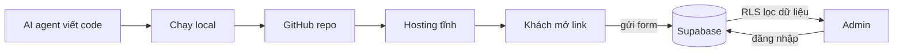

# Mini project: Landing page CLB có đăng ký thành viên

> **Tóm tắt:** Dự án cuối track: làm trong một buổi chiều một landing page CLB có form đăng ký lưu vào Supabase, trang admin có đăng nhập, có link công khai, HTTPS và RLS.

::: tip Bạn làm gì
- **Kết quả:** một landing page CLB có link công khai, form đăng ký lưu vào Supabase và trang admin có đăng nhập.
- **Thời gian:** 3 đến 4 giờ (một buổi chiều), chia làm 8 mốc.
- **Cần gì trước:** đã làm xong [Đưa web tĩnh lên mạng](02-static-hosting.md) và một backend: [Supabase](04-supabase.md) (bài này dùng Supabase; nếu bạn học Firebase thì xem thử thách trong trang chấm điểm).
- **Module trước:** [Supabase](04-supabase.md) hoặc [Firebase](05-firebase.md).
:::

## Bạn sẽ làm được gì

Thời lượng ước tính: 3 đến 4 giờ (một buổi chiều), chia làm 8 mốc.

- Có một link công khai dạng `https://ten-cua-ban.xxx` mà bất kỳ ai cũng mở được trên điện thoại.
- Có form đăng ký thành viên: người lạ điền vào thì dữ liệu nằm trong database Supabase của bạn.
- Có trang admin: chỉ bạn đăng nhập mới xem được danh sách, người lạ gọi thẳng API chỉ nhận về danh sách rỗng.
- Không lộ secret: repo công khai không chứa khóa bí mật, `.env` không bị commit.
- Giải thích được bằng lời của mình vì sao hệ thống chạy, và sửa được một lỗi cố tình bị cài.

Đây là bài "ghép lại" mọi thứ đã học: [mindset](00-mindset.md), [Git và GitHub](01-git-github.md), [static hosting](02-static-hosting.md), [Supabase](04-supabase.md), [domain và bảo mật](07-domain-security-production.md). Kẹt ở đâu, mở [Xử lý sự cố](08-troubleshooting.md).

## Khái niệm trong 5 phút

Hãy nghĩ tới một quầy đăng ký ở cổng trường.

| Ngoài đời | Trong dự án |
| --- | --- |
| Tờ rơi và bàn đăng ký | Trang web tĩnh (HTML, CSS, JS) đặt trên hosting |
| Hộp phiếu có khe nhét giấy | Bảng `members` chỉ cho phép "nhét vào" (insert) |
| Chìa khóa hộp phiếu, chỉ BTC giữ | Tài khoản admin + bảng `admins` + policy đọc |
| Quy định "ai được làm gì với hộp phiếu" | Row Level Security (RLS; [thuật ngữ](../resources/glossary.md)) |
| Chìa khóa vạn năng của chủ nhà | `service_role` hoặc secret key, không bao giờ đưa ra ngoài |
| Biển hiệu và địa chỉ quầy | Domain và HTTPS |



Điều quan trọng nhất: trang web nằm hoàn toàn trong trình duyệt của khách, ai cũng "xem mã nguồn" được. Vì vậy mọi thứ đặt trong trang đều coi như công khai. Khóa công khai (publishable) chỉ an toàn vì RLS đứng sau canh cửa. Hãy đọc lại phần anon, publishable và `service_role` ở [bài Supabase](04-supabase.md) trước khi làm mốc 5.

## Yêu cầu của sản phẩm

Chức năng bắt buộc:

1. Landing page có: giới thiệu CLB, hoạt động, form đăng ký, footer. Đọc tốt trên điện thoại.
2. Form có họ tên, email, lựa chọn quan tâm, ô đồng ý lưu dữ liệu. Có thông báo thành công và thông báo lỗi dễ hiểu.
3. Dữ liệu lưu vào bảng `members` của Supabase, chặn email trùng.
4. Trang `admin.html` có đăng nhập, xem danh sách mới nhất trước, đăng xuất.
5. Có link công khai, chạy HTTPS.
6. Có `README.md` giải thích cách chạy, cách cấu hình và cách deploy.

Ràng buộc bảo mật (không thương lượng):

- RLS bật cho mọi bảng. Khách chỉ được insert, không đọc, không sửa, không xóa.
- Chỉ dùng khóa công khai trong code frontend. `config.js` thật hoặc `.env` không nằm trong lịch sử Git.
- Không dán dữ liệu thành viên thật vào AI để "nhờ xử lý".

Mẫu tham chiếu đã chạy được nằm ở [examples/vibe/club-landing](../examples/vibe/club-landing/README.md). Hãy tự làm trước, mở mẫu để so sánh sau khi xong mỗi mốc. Nếu bạn muốn làm bản chỉ có giao diện, dùng [static-site](../examples/vibe/static-site/README.md).

## Thực hành từng bước

Mỗi mốc có việc cần làm, kết quả mong đợi và tiêu chí đo được. Dừng lại tích checklist rồi mới sang mốc tiếp.

### Mốc 1: Nhờ agent tạo bản đầu (20 phút)

Mở agent (Claude Code, Cursor, Copilot agent, Codex hoặc Gemini CLI) trong một thư mục trống tên `club-landing`. Dán prompt:

```text
Tạo landing page cho câu lạc bộ công nghệ sinh viên bằng HTML, CSS và JavaScript thuần,
KHÔNG dùng framework và KHÔNG cần bước build. Gồm các file: index.html, style.css, app.js.
Nội dung: hero, giới thiệu, 3 hoạt động, form đăng ký (họ tên, email, MSSV không bắt buộc,
lựa chọn quan tâm, ô đồng ý lưu dữ liệu), footer.
Yêu cầu: tiếng Việt, responsive cho điện thoại, tự đổi sáng/tối theo hệ thống.
Chưa kết nối database; khi submit chỉ hiện thông báo thử.
Trước khi viết, hãy liệt kê kế hoạch file ngắn gọn. Không cài thêm thư viện nào.
```

Bạn sẽ thấy: 3 file mới, mở `index.html` lên là có trang đẹp. Tiêu chí: mở được trong trình duyệt, nhìn ổn khi thu nhỏ cửa sổ về cỡ điện thoại.

### Mốc 2: Chạy local và đọc lại (15 phút)

```bash
npx serve .
```

Mở `http://localhost:3000`. Thử bấm mọi nút, gõ email sai, để trống ô bắt buộc. Rồi nhờ agent giải thích file `app.js` từng dòng và tự hỏi: "dòng nào gọi ra ngoài Internet?". Ở mốc này câu trả lời phải là: không dòng nào.

Tiêu chí: không có lỗi đỏ trong Console (nhấn F12), bạn chỉ ra được file nào lo giao diện, file nào lo hành vi.

### Mốc 3: Đưa lên GitHub (15 phút)

Trước khi commit, tạo `.gitignore` có `config.js`, `.env`, `node_modules/`. Rồi tạo repo trên GitHub và đẩy code theo [bài Git và GitHub](01-git-github.md). Chọn tên repo `club-landing`.

Bạn sẽ thấy: trang repo trên GitHub hiện đủ file. Tiêu chí: tìm trong repo chữ `secret` và `service_role` không ra kết quả nào.

### Mốc 4: Deploy bản tĩnh (20 phút)

Chọn một dịch vụ trong [bài Static hosting](02-static-hosting.md) (GitHub Pages, Netlify, Vercel hoặc Cloudflare), nối repo, để trống Build command, thư mục xuất bản là thư mục gốc. Gói miễn phí là đủ, đừng nhập thẻ.

Mốc này chỉ cần bản tĩnh chưa có Supabase, nên chưa có `config.js` và chưa cần build. Ở mốc 5 bạn sẽ đổi Build command thành `node build-config.mjs` và thư mục xuất bản thành `dist` để bản online có cấu hình.

Bạn sẽ thấy: một link công khai. Mở bằng điện thoại (tắt Wi-Fi, dùng 4G) để chắc chắn ai cũng vào được. Sửa một chữ, đẩy lên, chờ vài chục giây để thấy trang tự cập nhật.

Tiêu chí: link mở được trên thiết bị khác, và có ít nhất 2 lần deploy trong lịch sử.

### Mốc 5: Thêm Supabase và RLS (45 phút)

Đây là mốc khó nhất. Làm lần lượt:

1. Tạo project Supabase, chạy `schema.sql` (mẫu ở [club-landing/schema.sql](https://github.com/TienNHM/devops-course/blob/master/examples/vibe/club-landing/schema.sql)) trong SQL Editor.
2. Kiểm tra RLS đã bật cho cả hai bảng `members`, `admins`.
3. Tạo `config.js` từ `config.example.js`, chỉ điền URL và khóa công khai.
4. Nhờ agent nối form với `supabase-js` (prompt ở mục sau). Chạy local, gửi một đăng ký thử, kiểm tra dòng đó xuất hiện trong Table Editor.
5. Tạo user admin trong Authentication, thêm vào bảng `admins`, làm trang `admin.html` đăng nhập và xem danh sách.
6. Thử "tấn công" chính mình: dùng lệnh `curl` trong README của mẫu, đọc `members` bằng khóa công khai, không đăng nhập. Phải ra rỗng.

Chuyện admin: ở bước 5, tạo user bằng Authentication, Users, Add user và tích Auto Confirm User (không phụ thuộc email, vì email mặc định của Supabase rất hạn chế). Tắt đăng ký công khai, rồi thêm user vào `admins`. Phân quyền bằng bảng `admins`, không bằng `user_metadata` vì người dùng tự sửa được. Chi tiết ở mục "Admin đầu tiên và Supabase Auth" của [README mẫu](../examples/vibe/club-landing/README.md).

Đưa bản có Supabase lên mạng: `config.js` bị `.gitignore` chặn nên không có trên GitHub; nếu để nguyên, trang online sẽ hiện "Chưa cấu hình Supabase". Cách khuyến nghị:

7. Trong cài đặt của nền tảng, đặt biến môi trường `SUPABASE_URL` (Project URL) và `SUPABASE_KEY` (publishable key). Đây là khóa công khai, không phải bí mật; `service_role` hay `sb_secret_` thì tuyệt đối không.
8. Đặt Build command là `node build-config.mjs` và thư mục xuất bản là `dist`:

| Nền tảng | Build command | Thư mục xuất bản | Chỗ đặt biến |
| --- | --- | --- | --- |
| Vercel | `node build-config.mjs` | `dist` | Settings, Environment Variables |
| Netlify | `node build-config.mjs` | `dist` | Site configuration, Environment variables |
| Cloudflare Workers (static assets) | `node build-config.mjs`, và trong `wrangler.jsonc` đặt `assets.directory` là `./dist` | `dist` | Settings, Build, Variables and secrets (biến lúc build) |
| Cloudflare Pages (đường cũ) | `node build-config.mjs` | `dist` | Settings, Variables and Secrets (loại Text) |
| GitHub Pages | Bước build trong GitHub Actions | `path: dist` | Settings, Secrets and variables, Actions, tab Variables |

9. GitHub Pages cần thêm file workflow; bản mẫu đầy đủ nằm trong mục Deploy của README mẫu. Redeploy sau khi đặt biến, vì biến chỉ được đọc lúc build.
10. Mở link online: dòng "Chưa cấu hình Supabase" phải biến mất, `/config.js` chỉ chứa khóa `sb_publishable_`. Gửi một đăng ký thử rồi đăng nhập `/admin.html`.
11. Quay lại Supabase, Authentication, URL Configuration: đặt Site URL thành địa chỉ trang thật và thêm địa chỉ đó (có `/**`) vào Redirect URLs, giữ localhost nếu còn làm trên máy.

Cách thay thế đơn giản hơn nhưng kém gọn: `git add -f config.js` khi chắc chắn file chỉ có khóa công khai, rồi để Build command trống và thư mục xuất bản là gốc.

Tiêu chí: một đăng ký thử từ link công khai (bản đã build, không phải localhost) xuất hiện trong Supabase; `curl` ẩn danh đọc `members` trả về rỗng; admin đăng nhập thì thấy danh sách.

### Mốc 6: Domain và HTTPS (20 phút)

Dùng domain phụ miễn phí của hosting (ví dụ `ten-ban.vercel.app`, `ten-ban.pages.dev`, `ten-ban.netlify.app`, `ten-ban.github.io`) là đủ điểm. Nếu bạn tự quyết định mua domain riêng, làm theo [bài Domain, bảo mật và production](07-domain-security-production.md): đây là việc bạn tự thao tác, không giao cho agent.

Tiêu chí: thanh địa chỉ có ổ khóa (HTTPS), không có cảnh báo "mixed content" trong Console.

### Mốc 7: Rà soát bảo mật (20 phút)

Làm hết danh sách trong mục "Tự rà soát" bên dưới, rồi chụp ảnh làm bằng chứng cho bài nộp.

### Mốc 8: Demo (10 phút)

Đứng trước một người bạn, cầm điện thoại: mở link, đăng ký bằng email của bạn đó, mở admin trên laptop và cho thấy dòng mới xuất hiện. Sau đó trả lời năm câu hỏi giải thích ở mục "Mẫu bài nộp" trong [trang chấm điểm](09-mini-project-advanced.md).

## Nhờ AI agent làm giúp

Mỗi mốc có prompt gợi ý. Sao chép, sửa phần trong ngoặc vuông cho đúng dự án của bạn.

Mốc 2, hiểu code:

```text
Đọc app.js và giải thích cho người mới: từng đoạn làm gì, đoạn nào chạy khi người dùng bấm nút,
đoạn nào có gọi ra ngoài Internet. Chưa sửa gì. Chỉ ra 3 chỗ có thể gây lỗi.
```

Mốc 3, chuẩn bị GitHub:

```text
Tạo .gitignore cho dự án web tĩnh này: chặn config.js, .env, .env.*, node_modules.
Sau đó chạy git status và liệt kê file sẽ được commit. KHÔNG chạy git push, tôi sẽ tự đẩy.
```

Mốc 5, nối Supabase (dán URL và khóa công khai vào config.js bằng tay, đừng dán vào chat):

```text
Nối form đăng ký với Supabase bằng supabase-js lấy từ CDN jsdelivr (không build).
Đọc URL và khóa từ window.APP_CONFIG trong config.js (tôi sẽ tự tạo file này, đừng tạo giúp).
Chỉ insert vào bảng members (full_name, email, student_id, interest), KHÔNG gọi select sau insert.
Nếu lỗi mã 23505 thì báo "email đã đăng ký". Nếu chưa có cấu hình thì hiện thông báo thân thiện.
Viết schema.sql: bảng members, bảng admins, bật RLS, policy cho khách chỉ insert, chỉ admin được select.
Giải thích từng policy bằng tiếng Việt đơn giản. Không dùng service_role ở bất kỳ đâu.
```

Mốc 5, trang admin:

```text
Tạo admin.html và admin.js: đăng nhập bằng Supabase Auth (email và mật khẩu), hiển thị danh sách
members mới nhất trước, nút đăng xuất. Hiển thị dữ liệu bằng textContent, không dùng innerHTML.
Giải thích: vì sao nếu ai đó biết địa chỉ trang admin.html mà không đăng nhập thì vẫn không thấy dữ liệu?
```

Mốc 7, rà soát:

```text
Đóng vai người kiểm tra bảo mật. Quét toàn bộ repo tìm: khóa bí mật, service_role, sb_secret_,
innerHTML với dữ liệu người dùng, bảng thiếu RLS, policy kiểu "using (true)" cho select.
Liệt kê phát hiện kèm mức độ. KHÔNG tự sửa schema trên Supabase thật, chỉ đề xuất câu lệnh SQL để tôi đọc rồi tự chạy.
```

Bạn phải tự kiểm tra: mở file `schema.sql` và đọc từng policy; chạy `curl` ẩn danh; xem lại `git status`; mở trang trên điện thoại.

::: danger Những việc KHÔNG giao cho agent
- Dán `service_role`, secret key, mật khẩu admin hay token vào khung chat hoặc file trong repo.
- Bấm nâng cấp gói trả phí, nhập thông tin thẻ, mua domain.
- Tự chạy SQL phá hủy (`drop table`, `delete`) trên project Supabase có dữ liệu thật.
- Dán danh sách thành viên thật (họ tên, email) vào AI để "xử lý giúp".
- Tắt RLS hay đổi policy thành `using (true)` chỉ vì "cho chạy được".
:::

## Tự rà soát bảo mật (mốc 7)

| Việc cần kiểm tra | Cách kiểm tra | Đạt khi |
| --- | --- | --- |
| RLS bật | Table Editor, nhãn RLS của từng bảng | Cả `members` và `admins` đã bật |
| Khách không đọc được | `curl` ẩn danh tới `/rest/v1/members` | Trả về `[]` hoặc bị từ chối |
| Khách không sửa/xóa được | Thử `PATCH` hoặc `DELETE` bằng khóa công khai | Không có dòng nào bị đổi |
| Không có khóa bí mật trong repo | Tìm `sb_secret_`, `service_role`, `.env` trong repo và `git log -p` | Không có kết quả |
| XSS | Đăng ký thử với họ tên là một đoạn thẻ HTML in đậm, xem ở admin | Hiện nguyên chữ, không in đậm |
| Email trùng | Đăng ký hai lần cùng email | Lần hai báo đã đăng ký, không tạo dòng mới |
| Admin an toàn | Mật khẩu mạnh, tắt đăng ký công khai nếu không cần | Người lạ không tự tạo được user |
| Chi phí | Xem trang giá chính thức, chỉ dùng gói free, bật cảnh báo nếu dịch vụ có | Bạn nói được giới hạn gói free đang dùng |

## Nếu bị lỗi

| Triệu chứng | Nguyên nhân thường gặp | Cách xử lý |
| --- | --- | --- |
| Form báo lỗi, Console có `new row violates row-level security policy` | Chưa chạy `schema.sql`, hoặc policy insert sai vai trò (`to anon`) | Chạy lại `schema.sql`; kiểm tra Authentication, Policies của bảng `members` |
| Bấm gửi, thông báo thành công nhưng Table Editor trống | Đang trỏ nhầm project, hoặc ô bẫy bot bị trình duyệt tự điền | Kiểm tra `SUPABASE_URL` trong `config.js`; xóa autofill ô ẩn `website` |
| Admin đăng nhập được nhưng danh sách trống | User chưa nằm trong bảng `admins`, hoặc policy select sai | Chạy lệnh `insert into public.admins ...` đúng email; đọc lại policy "Chi admin duoc xem" |
| Local chạy, online trang không gửi được | `config.js` bị `.gitignore` chặn nên không được deploy | Dùng biến môi trường + `node build-config.mjs`, hoặc `git add -f config.js` nếu là khóa công khai |
| Console: `supabase is not defined` | Thẻ script CDN nằm sau `app.js`, hoặc mất mạng, hoặc bị chặn | Đặt script CDN trước `app.js`; thử mạng khác |
| Console: `Invalid API key` | Dán nhầm khóa, thừa khoảng trắng, hoặc khóa đã bị xoay | Copy lại khóa công khai từ Project Settings, API Keys |
| `build-config.mjs` báo "secret key" hoặc "service_role" | Bạn đặt nhầm khóa bí mật vào biến môi trường | Dừng lại, đặt khóa công khai; nếu khóa bí mật từng bị dán vào chat hoặc repo thì xoay ngay |
| Vài tuần sau, form báo lỗi hoặc admin không tải được | Project Supabase gói free bị tạm dừng vì ít hoạt động | Vào dashboard Supabase, bấm khôi phục (restore) project; đọc trang Project Pausing để biết điều kiện hiện hành |
| Trang hosting hiện 404 | Thư mục xuất bản sai, hoặc file không tên `index.html` | Kiểm tra Publish/Output directory trỏ đúng thư mục chứa `index.html` |

Một lỗi cố tình dùng cho phần chấm điểm nằm ở mục rubric trong [trang chấm điểm](09-mini-project-advanced.md).

## Chấm điểm và nộp bài

Bài được chấm trên 100 điểm theo sáu nhóm: chạy được qua link công khai (25), an toàn secret và RLS (30), trang admin (10), README (10), hiểu và giải thích (15), xử lý một lỗi cố tình (10). Có secret key hoặc `service_role` trong repo công khai là về 0 điểm nhóm 2. Bảng điểm chi tiết, mẫu bài nộp và các thử thách nâng cao nằm ở trang [Mini project: chấm điểm, nộp bài, thử thách](09-mini-project-advanced.md).

## Tự kiểm tra

1. Vì sao trang admin chỉ cần "ẩn" đường dẫn là chưa đủ an toàn?
2. Khi form gửi lên Supabase, vì sao không nên gọi `select` ngay sau `insert` trong dự án này?
3. Bạn phát hiện mình lỡ commit secret key lên repo công khai. Làm gì đầu tiên?
4. Vì sao hiển thị dữ liệu người dùng nhập bằng `textContent` an toàn hơn `innerHTML`?
5. Người chấm cài lỗi "xóa policy insert". Bạn thấy triệu chứng gì, và cách sửa nào là sai?

<details><summary>Đáp án</summary>

1. Ai biết hoặc đoán được đường dẫn đều mở được trang. Bảo vệ thật nằm ở backend: đăng nhập cộng RLS, khiến người không phải admin chỉ nhận về danh sách rỗng.
2. Khách chỉ có quyền ghi, không có quyền đọc bảng. `select` sau `insert` sẽ bị RLS từ chối và làm cả thao tác báo lỗi, dù dữ liệu có thể đã vào.
3. Xoay (rotate) khóa ngay trong dashboard để khóa cũ vô hiệu, rồi mới dọn lịch sử Git. Xóa file không đủ vì khóa vẫn nằm trong lịch sử commit.
4. `textContent` luôn coi dữ liệu là chữ thường, còn `innerHTML` có thể chạy thẻ hoặc script mà người lạ gài vào trường họ tên (XSS).
5. Triệu chứng: form báo lỗi, Console có `row-level security policy` khi insert. Cách sửa sai là tắt RLS hoặc dùng `service_role`. Cách đúng là tạo lại policy insert có điều kiện kiểm tra dữ liệu.

</details>

## Checklist hoàn thành

- [ ] Có link công khai mở được trên điện thoại, HTTPS có ổ khóa.
- [ ] Form đăng ký lưu được vào bảng `members`, email trùng được xử lý.
- [ ] RLS bật cho `members` và `admins`; `curl` ẩn danh đọc `members` ra rỗng.
- [ ] Trang admin đăng nhập xem được danh sách; chưa đăng nhập thì không thấy dữ liệu.
- [ ] Repo và lịch sử Git không chứa secret key, `service_role`, `.env`.
- [ ] `.gitignore` chặn `config.js` và `.env`.
- [ ] README có cách chạy, cấu hình, deploy và link demo.
- [ ] Đã điền bài nộp và trả lời đủ 5 câu hỏi giải thích.
- [ ] Biết cách xử lý ít nhất một lỗi thật đã gặp.

## Tiếp theo

**Tiếp theo:** [Tên miền, bảo mật, production](07-domain-security-production.md) (gắn domain riêng, rà soát bảo mật trước khi mở cho người dùng thật), rồi [Hoàn thiện và ra mắt](11-launch-polish.md). Nếu bạn làm sản phẩm bằng Lovable, Bolt, v0 hay Replit, đọc thêm [App builders](10-app-builders.md).

Khi sản phẩm lớn lên, nhìn vào bảng này để biết khi nào cần học thêm.

| Dấu hiệu | Nên học |
| --- | --- |
| Chạy trên máy bạn thì được, máy bạn khác thì lỗi | Docker trong khóa [DevOps chính](../index.md) |
| Mỗi lần sửa phải kiểm tra tay, sợ làm hỏng | CI/CD với GitHub Actions |
| Nhiều người cùng sửa, cần môi trường thử riêng | Môi trường staging, preview, quản lý cấu hình |
| Lượng người dùng lớn, cần nhiều bản chạy song song | Kubernetes, giám sát, logging |

Tra cứu: [Xử lý sự cố](08-troubleshooting.md), [Thư viện prompt](prompt-library.md), [CLI cheatsheet](cli-cheatsheet.md), [Nền tảng hosting](platforms.md). Quay lại [trang chủ track](index.md) để xem lộ trình.

Tài liệu chính thức (giao diện và gói free thay đổi, luôn đối chiếu trang chính thức):

- Supabase, Row Level Security: https://supabase.com/docs/guides/database/postgres/row-level-security
- Supabase, API keys (publishable và secret): https://supabase.com/docs/guides/api/api-keys
- Supabase, đăng nhập bằng mật khẩu: https://supabase.com/docs/guides/auth/passwords
- Supabase JavaScript client: https://supabase.com/docs/reference/javascript/installing
- GitHub Pages: https://docs.github.com/en/pages
- Vercel: https://vercel.com/docs
- Netlify: https://docs.netlify.com/
- Cloudflare Workers (static assets) và Pages: https://developers.cloudflare.com/workers/static-assets/ và https://developers.cloudflare.com/pages/
