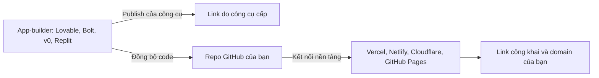

# Đường nhanh cho người dùng app-builder: Lovable, Bolt, v0, Replit

> **Tóm tắt:** Bạn đã làm app bằng Lovable, Bolt, v0 hay Replit? Bài này chỉ cách đưa code về repo GitHub của riêng bạn, deploy lên nền tảng bạn kiểm soát, rà lỗi bảo mật AI hay sinh ra và giữ chi phí credit trong tầm tay.

## Bạn sẽ làm được gì

Thời lượng ước tính: 60 đến 90 phút.

- Phân biệt "publish của chính công cụ" với "deploy lên nền tảng bạn kiểm soát", và biết khi nào dùng cái nào.
- Đồng bộ hoặc xuất code từ app-builder sang một repo GitHub thuộc tài khoản của bạn.
- Kiểm tra repo vừa có: có file `.gitignore`, không có khóa bí mật, biết app cần biến môi trường nào.
- Deploy repo đó lên Vercel, Netlify, Cloudflare Pages hoặc GitHub Pages mà không phụ thuộc vào công cụ ban đầu.
- Rà ba lỗi AI hay sinh sai: khóa lộ trong frontend, endpoint không xác thực, Supabase RLS tắt hoặc policy quá rộng.
- Quản lý credit, biết khi nào chuyển sang coding agent như Claude Code hoặc Cursor để sửa code sâu.

## Khái niệm trong 5 phút

App-builder giống một xưởng may đo có sẵn cửa hàng: bạn nói kiểu áo, xưởng may xong và treo luôn lên cửa hàng của xưởng. Tiện, nhưng áo nằm trong tiệm của người khác. Nếu tiệm đổi giá, đổi luật hay đóng cửa, bạn khó mang áo đi. Có một bản sao áo (repo của bạn) ở nhà thì bạn đem đi may sửa hoặc trưng bày ở tiệm khác được.

Hiện nay các công cụ chính (cập nhật tháng 10/2026, hãy xem lại tài liệu chính thức vì giao diện đổi nhanh):

| Công cụ | Đồng bộ GitHub | Ghi chú đã kiểm chứng |
| --- | --- | --- |
| Lovable | Có, hai chiều | Nút Connect tạo repo private mới và đồng bộ hai chiều. Nếu hai bên lệch nhau, Lovable đẩy thay đổi sang nhánh `lovable-sync`. Ngắt kết nối thì repo vẫn còn trên GitHub. Nối lại sau đó sẽ tạo repo mới |
| Bolt | Có | Bấm biểu tượng GitHub để tạo repo (mặc định private, nhánh main), hoặc mở repo có sẵn bằng cách thêm `bolt.new/` trước URL repo |
| v0 | Có | Settings, GitHub, Connect tạo repo private. Mỗi lần sửa v0 đẩy lên nhánh làm việc riêng và tạo bản xem thử (preview) trên Vercel. Nút Publish tạo và merge Pull Request vào nhánh gốc |
| Replit | Có | Import repo từ GitHub, dùng Git pane để commit và đồng bộ. Trong Git pane có tùy chọn tự đồng bộ. Tên mục và đường dẫn tài liệu từng đổi, hãy mở trang chính thức khi làm |

Hai chữ "deploy" khác nhau:



| | Publish của chính công cụ | Deploy từ repo của bạn |
| --- | --- | --- |
| Tốc độ | Nhanh nhất, một nút bấm | Mất 10 đến 20 phút thiết lập lần đầu |
| Ai giữ code | Công cụ giữ bản chính | Bạn giữ bản chính |
| Dễ đổi nhà cung cấp | Khó | Dễ |
| Hợp với | Thử nghiệm, demo nội bộ | Sản phẩm bạn muốn chạy lâu dài |

Lời khuyên: dùng publish của công cụ để thử nhanh, nhưng sớm đồng bộ repo về GitHub. Làm vậy bạn có lịch sử thay đổi, có thể đọc code, và có đường lui khi gói giá đổi hay công cụ không còn hợp.

## Thực hành từng bước

### Bước 1: Nối công cụ với GitHub

1. Đăng nhập tài khoản GitHub (xem [module 01](01-git-github.md) nếu chưa có).
2. Trong công cụ, tìm mục GitHub (Lovable: Settings của workspace rồi Git; Bolt: biểu tượng GitHub ở góc trên; v0: Project settings, GitHub; Replit: Git pane hoặc Import).
3. Cho phép ứng dụng của công cụ truy cập GitHub. Nếu được chọn, chỉ cấp quyền cho đúng repo cần dùng, không cấp cho toàn bộ tài khoản.
4. Bấm tạo repo mới. Chọn repo **private** trong lúc chưa rà soát xong.

Bạn sẽ thấy: một repo mới trong trang GitHub của bạn, có các file như `package.json`, thư mục `src` (hoặc tương tự) và một commit đầu tiên do công cụ tạo.

Lưu ý với Lovable và v0: đừng xóa repo sau khi nối, vì v0 coi repo là "nguồn sự thật" của code. Với Lovable, hãy làm việc trên một nhánh một lúc, tránh vừa sửa trong Lovable vừa đẩy commit tay lên cùng nhánh.

### Bước 2: Kiểm tra repo

Mở repo trên GitHub, hoặc clone về máy (`git clone`), rồi đi qua bảng sau:

| Kiểm tra | Cách làm | Kết quả mong muốn |
| --- | --- | --- |
| Có `.gitignore` | Tìm file ở thư mục gốc | Có dòng `.env` hoặc `.env*` |
| Không có file `.env` thật | Thanh tìm file của GitHub, gõ `.env` | Chỉ thấy `.env.example` (nếu có) |
| Không có khóa trong code | Tìm các chuỗi `sk-`, `secret`, `service_role`, `Bearer ` | Không có giá trị thật nào |
| Biết cách chạy | Đọc `package.json`, mục `scripts` | Thấy `build` và `dev` hoặc `start` |
| Biết app cần biến nào | Tìm `import.meta.env`, `process.env` | Có danh sách biến, ghi lại tên (không ghi giá trị) |

Bạn sẽ thấy: một danh sách tên biến môi trường cần khai báo ở bước deploy. Nếu bạn thấy khóa thật trong lịch sử commit, coi như khóa đã lộ: tạo khóa mới ở nhà cung cấp, thay vào, rồi mới xóa khóa cũ.

### Bước 3: Deploy từ repo lên nền tảng bạn kiểm soát

Chọn nền tảng theo loại app:

| Loại app | Gợi ý | Đọc thêm |
| --- | --- | --- |
| Trang tĩnh, build ra thư mục `dist` | GitHub Pages, Cloudflare Pages, Netlify | [module 02](02-static-hosting.md) |
| Có API route, server function | Vercel, Netlify, Cloudflare | [module 03](03-fullstack-serverless.md) |
| Có đăng nhập và database | Thêm Supabase | [module 04](04-supabase.md) |

Các bước chung:

1. Trên nền tảng đã chọn, tạo project mới và chọn "Import Git repository", rồi chọn repo vừa tạo.
2. Kiểm tra **Build command** và **Output directory**. Các app Vite thường dùng `npm run build` và thư mục `dist`. Next.js thường được nền tảng tự nhận diện. Nếu không chắc, mở file `package.json` hoặc nhờ agent đọc giúp.
3. Khai báo biến môi trường trong trang cài đặt của nền tảng (không dán vào code, không dán vào chat).
4. Bấm Deploy, đợi build xong, mở link.

Bạn sẽ thấy: một link dạng `ten-du-an.vercel.app`, `ten-du-an.netlify.app` hoặc `ten-du-an.pages.dev`. Từ lúc này mỗi lần code trong repo đổi, nền tảng tự build lại.

Nếu app dùng đăng nhập (Supabase Auth, OAuth), nhớ thêm link mới vào danh sách Site URL và Redirect URLs, vì link cũ do công cụ cấp sẽ không còn dùng được cho link mới.

### Bước 4: Biến môi trường và khóa API trong từng công cụ

Quy tắc chung (xem thêm [module 07](07-domain-security-production.md)): biến có tiền tố công khai như `VITE_` hoặc `NEXT_PUBLIC_` sẽ nằm trong code gửi tới trình duyệt, ai cũng đọc được. Chỉ đặt vào đó những giá trị vốn dành cho công khai (Supabase URL, publishable key).

| Nơi | Cách khai báo | Việc cần tránh |
| --- | --- | --- |
| Lovable, Bolt, v0, Replit | Mỗi công cụ có chỗ riêng cho secret hoặc biến môi trường (tên mục khác nhau, xem tài liệu của từng công cụ) | Dán khóa vào khung chat để "nhờ AI cắm vào". Khóa đã vào chat là khóa phải coi như lộ |
| Vercel, Netlify | Mục Environment Variables trong cài đặt project | Đặt khóa bí mật vào biến có tiền tố công khai |
| Cloudflare (Workers hoặc Pages) | Variables and Secrets trong cài đặt project | Commit file `.dev.vars` hoặc `.env` |
| Máy của bạn | File `.env` đã nằm trong `.gitignore` | Commit file này |

Khóa AI (OpenAI, Anthropic, Gemini...) và khóa trả tiền không được gọi trực tiếp từ trình duyệt. Hãy gọi qua một function chạy phía server, khóa nằm ở biến môi trường của server (xem [module 03](03-fullstack-serverless.md)).

Bạn sẽ thấy: app trên link mới chạy giống bản trong công cụ. Nếu thiếu biến, thường là trang trắng hoặc lỗi gọi API. Tra cứu ở [module 08](08-troubleshooting.md).

## Rà soát những thứ AI hay sinh sai

AI viết code rất nhanh nhưng không biết sản phẩm của bạn đang công khai. Dành 15 phút rà ba nhóm lỗi sau trước khi gửi link cho người lạ.

### 1. Khóa lộ trong frontend

- Mở link đã deploy, bấm chuột phải, xem nguồn trang hoặc mở tab Network trong DevTools. Tìm khóa có dạng `sk-`, `sb_secret_`, `service_role`, hoặc chuỗi dài lạ.
- Trong repo, tìm các chữ `apiKey`, `secret`, `token`, `service_role` ở thư mục `src`.
- Chỉ publishable key (hoặc `anon` key cũ) của Supabase được ở frontend. Secret key (hoặc `service_role` cũ) bỏ qua RLS và không bao giờ được ở frontend.

### 2. Endpoint không xác thực

- Tìm thư mục `api`, `functions`, `server`, `app/api`. Với từng endpoint hãy hỏi: ai gọi được? Có kiểm tra đăng nhập chưa? Có giới hạn số lần gọi chưa?
- Endpoint gọi dịch vụ trả tiền (AI, gửi email, SMS) mà ai cũng gọi được là cách nhanh nhất để nhận hóa đơn bất ngờ.
- Endpoint xóa hoặc sửa dữ liệu phải kiểm tra người gọi có quyền trên đúng dữ liệu đó, không chỉ kiểm tra "đã đăng nhập".

### 3. Tích hợp Supabase có sẵn và RLS

Nhiều app-builder cho nối Supabase chỉ bằng vài cú bấm và AI tự tạo bảng, policy, rồi cả lệnh SQL. Đây là chỗ rủi ro cao nhất cho người mới:

| Dấu hiệu | Vì sao nguy hiểm | Cách xử lý |
| --- | --- | --- |
| Bảng hiện cảnh báo RLS disabled trong Table Editor | Ai có URL và publishable key đều đọc, ghi, xóa được | Bật RLS rồi viết policy tối thiểu |
| Policy có điều kiện luôn đúng, ví dụ `using (true)` hoặc `with check (true)` cho role `anon` hoặc `authenticated` | Tương đương RLS tắt, nhưng nhìn như đã bảo vệ | Đổi thành điều kiện theo người dùng, ví dụ `auth.uid() = user_id` |
| Bảng thiếu cột chủ sở hữu (như `user_id`) | Không có cách nào viết policy theo từng người | Thêm cột, điền dữ liệu, rồi viết policy |
| Có secret key hoặc `service_role` trong code web | Lộ toàn bộ dữ liệu, bỏ qua RLS | Rotate khóa ngay, chuyển logic cần khóa sang function phía server |
| Lưu ảnh, file trong Storage bucket public mà chứa dữ liệu riêng | Ai có link cũng xem được | Đổi bucket thành private, viết policy cho Storage |

Cách tự thử: mở cửa sổ ẩn danh (chưa đăng nhập) và gọi API đọc bảng bằng URL cùng publishable key, hoặc dùng SQL Editor chạy thử với role `anon`. Nếu bạn lấy được dữ liệu riêng của người khác, policy đang sai. Chi tiết cách viết và thử RLS nằm ở [module 04](04-supabase.md).

Nếu bạn dùng Supabase đã nối sẵn trong công cụ, vào chính dashboard Supabase để kiểm tra RLS, đừng chỉ tin lời AI nói "đã bảo mật xong". Dự án có dữ liệu thật nên tách riêng: một project dev để thử, một project cho người dùng thật.

## Quản lý chi phí credit và token

App-builder thường tính tiền theo credit hoặc token, mỗi lần bạn nhắn một yêu cầu là tiêu một ít. Gói và hạn mức thay đổi thường xuyên, nên hãy xem trang giá hiện hành của từng công cụ thay vì tin con số cũ.

| Thói quen | Lý do |
| --- | --- |
| Gộp yêu cầu rõ ràng thành một tin thay vì nhiều tin nhỏ | Mỗi lượt đều tốn credit, và AI cần ngữ cảnh đủ để làm đúng ngay lần đầu |
| Dùng chế độ chỉ trao đổi hoặc lên kế hoạch (nếu công cụ có) trước khi bảo AI sửa code | Tránh đốt credit vào những thay đổi bạn chưa chốt |
| Khi AI lặp lại cùng một lỗi hai ba lần, dừng lại | Lặp tiếp thường chỉ đốt thêm credit. Đổi cách mô tả hoặc chuyển công cụ |
| Sửa chữ, màu sắc, nội dung nhỏ bằng tay trong repo | Không tốn credit, và học được cấu trúc code |
| Xem định kỳ trang usage, đặt giới hạn chi tiêu nếu công cụ cho phép | Tránh bất ngờ cuối tháng |
| Không bật tự động nạp thêm credit hoặc nâng gói khi chưa tính | Quyết định trả tiền luôn là của bạn |

Chi phí không chỉ nằm ở công cụ: nền tảng deploy, Supabase và API của AI cũng có hạn mức riêng. Bài [module 07](07-domain-security-production.md) có phần đặt cảnh báo chi phí.

## Khi nào nên chuyển sang coding agent

App-builder rất mạnh ở giai đoạn đầu: dựng giao diện, thử ý tưởng. Hãy cân nhắc chuyển sang coding agent (Claude Code, Cursor, hoặc tương tự, xem [module 06](06-ai-agent-deploy.md)) làm việc trên repo của bạn khi:

- AI cứ sửa chỗ này lại hỏng chỗ khác, hoặc lặp lỗi dù đã thử nhiều lần.
- Bạn cần thay đổi trải dài nhiều file: đổi cấu trúc dữ liệu, thêm phân quyền, tích hợp thanh toán, viết test.
- Bạn muốn kiểm tra bảo mật có hệ thống (agent đọc toàn bộ repo, lập danh sách endpoint, kiểm tra RLS).
- Credit hết nhanh mà tiến độ chậm.
- Bạn muốn xem diff, chạy test và tự động deploy qua GitHub.

Hai cách phối hợp:

1. **Tuần tự:** làm giao diện trong app-builder, đồng bộ về GitHub, từ đó sửa sâu bằng agent trên máy.
2. **Song song:** giữ nối hai chiều (Lovable, Replit) hoặc dùng nhánh riêng (v0). Mỗi lần chỉ một bên sửa một nhánh, để tránh xung đột.

Cách an toàn nhất: agent làm việc trên một nhánh riêng, bạn xem Pull Request rồi mới merge.

## Nhờ AI agent làm giúp

Sau khi code đã nằm trong repo trên máy, bạn có thể dán prompt sau cho Claude Code hoặc Cursor:

```text
Hãy rà soát repo này như một người kiểm tra bảo mật cho người mới. Chỉ ĐỌC và báo cáo, chưa sửa gì.
1. Liệt kê mọi biến môi trường mà code dùng (tên thôi, không in giá trị) và cho biết biến nào đang có tiền tố công khai như VITE_ hoặc NEXT_PUBLIC_.
2. Tìm chuỗi trông giống khóa bí mật trong code và lịch sử git gần đây.
3. Liệt kê mọi endpoint hoặc function phía server, nói rõ có xác thực chưa và có gọi dịch vụ tốn tiền không.
4. Nếu có file SQL hoặc migration Supabase, liệt kê từng bảng, RLS bật hay tắt, và policy nào có điều kiện luôn đúng.
5. Đề xuất cách sửa theo thứ tự ưu tiên, mỗi mục kèm lý do bằng tiếng Việt đơn giản.
Không chạy lệnh deploy, không xóa file, không đọc file .env.
```

Những việc bạn phải tự kiểm tra:

- Mở link thật ở cửa sổ ẩn danh và xem nguồn trang để chắc không có khóa.
- Vào dashboard Supabase xem RLS từng bảng, không chỉ tin báo cáo của agent.
- Đọc diff trước khi merge bất cứ thay đổi nào.

Những việc KHÔNG giao cho agent: dán khóa thật vào chat, nhập thẻ hoặc bấm nâng gói trả phí, xóa project hay database thật, xóa repo gốc.

Thêm prompt mẫu ở [Thư viện prompt](prompt-library.md).

## Nếu bị lỗi

| Hiện tượng | Nguyên nhân thường gặp | Cách xử lý |
| --- | --- | --- |
| Không thấy repo mới trên GitHub | Chưa cấp quyền cho ứng dụng của công cụ, hoặc repo nằm trong tổ chức khác | Vào GitHub, Settings, Applications và kiểm tra ứng dụng đã cài; chọn đúng tài khoản hoặc tổ chức |
| Commit từ GitHub không xuất hiện trong công cụ | Thông báo đồng bộ bị lỡ, hoặc bạn đẩy lên nhánh khác với nhánh đang nối | Đẩy thêm một commit nhỏ lên đúng nhánh đang đồng bộ, kiểm tra thẻ trạng thái đồng bộ |
| Xuất hiện nhánh lạ như `lovable-sync` | Hai bên lệch nhau nên công cụ không tự ghi đè | Mở Pull Request từ nhánh đó, đọc diff, rồi quyết định merge hoặc bỏ |
| Build trên nền tảng báo lỗi thiếu module hoặc sai phiên bản Node | Thiếu `package-lock.json`, hoặc Node khác với máy gốc | Commit file lock, đặt phiên bản Node trong cài đặt nền tảng hoặc trường `engines` |
| Trang trắng sau khi deploy | Thiếu biến môi trường, hoặc đường dẫn gốc (base path) sai trên GitHub Pages | Mở Console của trình duyệt, so danh sách biến ở Bước 2 với cài đặt, xem [module 08](08-troubleshooting.md) |
| Đăng nhập báo redirect không hợp lệ | Link mới chưa nằm trong Site URL và Redirect URLs của Supabase hoặc nhà cung cấp OAuth | Thêm link mới vào danh sách cho phép |
| Dữ liệu trống dù trong bảng có dòng | RLS bật nhưng chưa có policy hợp lệ | Viết policy tối thiểu, thử lại bằng tài khoản đã đăng nhập |
| Credit cạn giữa chừng | AI lặp lỗi hoặc prompt quá mơ hồ | Dừng, gom yêu cầu, sửa tay hoặc chuyển sang coding agent trên repo |

## Tự kiểm tra

1. Vì sao nên có repo GitHub riêng dù công cụ đã có nút Publish?

<details><summary>Đáp án</summary>

Để bạn giữ bản code chính, có lịch sử thay đổi, deploy được ở nơi khác và không bị kẹt khi công cụ đổi giá hoặc đóng cửa.

</details>

2. Biến `VITE_API_SECRET` có an toàn để chứa khóa bí mật không?

<details><summary>Đáp án</summary>

Không. Tiền tố `VITE_` khiến giá trị bị nhúng vào code gửi tới trình duyệt. Khóa bí mật phải ở function phía server.

</details>

3. Policy `using (true)` cho role `anon` trên một bảng dữ liệu riêng có vấn đề gì?

<details><summary>Đáp án</summary>

Nó cho mọi người chưa đăng nhập đọc toàn bộ bảng, gần như tương đương tắt RLS. Cần đổi thành điều kiện theo người dùng, ví dụ so `auth.uid()` với cột chủ sở hữu.

</details>

4. Khóa nào của Supabase được đặt ở frontend?

<details><summary>Đáp án</summary>

Chỉ publishable key (hoặc `anon` cũ). Secret key (hoặc `service_role` cũ) bỏ qua RLS và chỉ được dùng ở server.

</details>

5. Nêu hai dấu hiệu cho thấy bạn nên chuyển sang coding agent.

<details><summary>Đáp án</summary>

Ví dụ: AI lặp lỗi dù đã thử nhiều lần, thay đổi cần chạm nhiều file, credit cạn nhanh, cần rà bảo mật toàn repo hoặc viết test.

</details>

## Checklist hoàn thành

- [ ] Repo GitHub của tôi chứa code, tôi biết nó nối với công cụ nào và nhánh nào.
- [ ] Repo không có file `.env` thật và không có khóa bí mật trong code.
- [ ] Tôi đã ghi lại tên các biến môi trường app cần và khai báo chúng ở nền tảng deploy.
- [ ] App đã deploy từ repo lên Vercel, Netlify, Cloudflare Pages hoặc GitHub Pages và mở được ở cửa sổ ẩn danh.
- [ ] Tôi đã rà endpoint: không endpoint tốn tiền nào mở cho mọi người.
- [ ] Nếu dùng Supabase, mọi bảng đã bật RLS và không có policy luôn đúng cho dữ liệu riêng.
- [ ] Tôi biết giới hạn credit của công cụ và đã quyết định khi nào dừng hoặc chuyển sang coding agent.

## Tiếp theo và tài liệu chính thức

Tiếp theo: [11 Hoàn thiện và ra mắt](11-launch-polish.md). Nếu chưa gắn domain và chưa rà secret, chi phí, rollback thì làm trước ở [07 Domain, bảo mật, production](07-domain-security-production.md). Cần ví dụ trọn vẹn để đối chiếu: [09 Dự án mini](09-mini-project.md).

Tài liệu chính thức (nội dung và giao diện thay đổi nhanh, hãy mở bản mới nhất):

- Lovable, tích hợp GitHub: https://docs.lovable.dev/integrations/github
- Bolt, tích hợp Git: https://support.bolt.new/integrations/git
- v0, GitHub: https://v0.app/docs/github
- Replit, tài liệu: https://docs.replit.com
- Supabase, Row Level Security: https://supabase.com/docs/guides/database/postgres/row-level-security
- Supabase, API keys: https://supabase.com/docs/guides/api/api-keys
