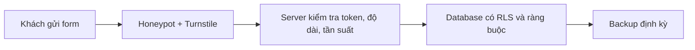

# Trước khi chia sẻ link: chống spam, SEO, analytics và go-live

> **Tóm tắt:** Làm những việc cuối trước khi gửi link cho người lạ: chống spam form, hiển thị đẹp khi chia sẻ, đo lượt truy cập riêng tư, sao lưu dữ liệu, đo tốc độ và tick checklist 20 mục.

::: tip Bạn làm gì
- **Kết quả:** form có chống spam, link chia sẻ hiện đẹp trên Zalo và Facebook, và checklist go-live 20 mục đã tick.
- **Thời gian:** 90 đến 120 phút (làm từng phần, không cần xong một lần).
- **Cần gì trước:** một sản phẩm đã có link công khai, đã qua phần bảo mật ở [Tên miền, bảo mật, production](07-domain-security-production.md).
- **Module trước:** [Tên miền, bảo mật, production](07-domain-security-production.md). Đây là chặng cuối của lộ trình.
:::

## Bạn sẽ làm được gì

- Chặn phần lớn bot spam form bằng honeypot, Cloudflare Turnstile, giới hạn độ dài và kiểm tra ở phía server.
- Làm cho link hiện tiêu đề, mô tả, ảnh đẹp khi gửi qua Zalo, Facebook, Messenger; có favicon, `sitemap.xml`, `robots.txt`.
- Gắn analytics tôn trọng riêng tư và biết khi nào cần banner cookie.
- Biết vì sao thanh toán nằm ngoài phạm vi, và cách nhận tiền an toàn mà không tự xử lý thẻ.
- Sao lưu dữ liệu Supabase hoặc Firebase ở mức thực hành, đặt lịch nhắc.
- Chạy Lighthouse, đọc cảnh báo và nhờ agent sửa đúng chỗ.
- Tick hết checklist go-live 20 mục.

## Khái niệm trong 5 phút

Hãy nghĩ bạn sắp khai trương quán. Bài [Domain, bảo mật và vận hành](07-domain-security-production.md) là khóa cửa, lắp điện nước. Bài này là phần "trước giờ mở cửa": treo biển cho đẹp, đặt chuông chống người phá rối, đặt máy đếm khách và chuẩn bị sổ sách dự phòng.

| Khái niệm | Ví dụ đời thường | Trong thực tế |
| --- | --- | --- |
| Honeypot ([thuật ngữ](../resources/glossary.md)) | Cái hộp "trống" mà chỉ kẻ gian mới thò tay vào | Ô nhập ẩn; người thật không thấy nên không điền, bot điền |
| Captcha / Turnstile | Bảo vệ hỏi nhanh "bạn là người à?" | Widget của Cloudflare, người thật thường không phải giải đố |
| Rate limit | Mỗi người chỉ được lấy số thứ tự vài lần mỗi phút | Giới hạn số request trên mỗi IP hoặc mỗi tài khoản |
| Open Graph (OG) | Tấm danh thiếp in sẵn | Thẻ meta cho Zalo, Facebook biết hiện tiêu đề, ảnh gì |
| Analytics | Máy đếm khách ở cửa | Số lượt xem trang, nguồn truy cập |
| Backup | Photo sổ sách cất ở nhà khác | File xuất dữ liệu bạn cất ngoài dịch vụ |
| Lighthouse | Phiếu khám sức khỏe tổng quát | Công cụ trong Chrome chấm tốc độ, truy cập, SEO |



Nguyên tắc xuyên suốt: mọi lớp chống spam ở trình duyệt chỉ là "biển báo". Lớp thật phải nằm ở server hoặc database, vì bot gọi thẳng API mà không qua giao diện của bạn.

## Thực hành từng bước

Làm theo thứ tự các phần A đến D. Ví dụ dùng form đăng ký của CLB (xem [club-landing](../examples/vibe/club-landing/README.md)), nhưng cách làm áp dụng cho form liên hệ bất kỳ.

### Phần A. Chống spam và bot cho form

**Bước 1. Thêm honeypot.** Thêm một ô ẩn vào form. Người thật không thấy nên để trống; bot tự động thường điền mọi ô.

```html
<form id="dang-ky" method="post">
  <label>Họ tên <input name="name" required maxlength="80" /></label>
  <label>Email <input name="email" type="email" required maxlength="120" /></label>

  <!-- Honeypot: ẩn bằng CSS, người thật không điền -->
  <div style="position:absolute; left:-9999px" aria-hidden="true">
    <label>Website <input name="website" tabindex="-1" autocomplete="off" /></label>
  </div>

  <button type="submit">Gửi</button>
</form>
```

Ở phía server, nếu `website` có nội dung thì bỏ qua yêu cầu nhưng vẫn trả về "thành công" để bot không biết mình bị phát hiện:

```js
if (body.website) {
  return Response.json({ ok: true }); // giả vờ thành công, không lưu gì
}
```

Bạn sẽ thấy: gửi form bình thường vẫn lưu được; nếu tự điền ô `website` bằng DevTools rồi gửi, dữ liệu không xuất hiện trong database.

**Bước 2. Thêm Cloudflare Turnstile.** Turnstile là captcha thân thiện của Cloudflare, có thể dùng cả khi web của bạn không nằm trên Cloudflare. Theo tài liệu Cloudflare (kiểm tra 10/2026): mỗi widget có `sitekey` (công khai, để trong HTML) và `secret key` (bí mật, chỉ ở server); token sống 300 giây và chỉ kiểm tra được một lần.

1. Vào dashboard Cloudflare, mục Turnstile, tạo một widget và nhập domain của bạn (bạn tự thao tác, giá và gói xem trang chính thức).
2. Dán script và widget vào form (thay `SITEKEY_CUA_BAN` bằng sitekey công khai của bạn):

```html
<script src="https://challenges.cloudflare.com/turnstile/v0/api.js" async defer></script>

<form id="dang-ky" method="post">
  <!-- các ô nhập như trên -->
  <div class="cf-turnstile" data-sitekey="SITEKEY_CUA_BAN"></div>
  <button type="submit">Gửi</button>
</form>
```

Khi widget nằm trong `form`, nó tự thêm một ô ẩn tên `cf-turnstile-response` chứa token. Gửi cả ô này lên server.

3. Ở server, kiểm tra token trước khi lưu dữ liệu. Secret key đặt trong biến môi trường `TURNSTILE_SECRET_KEY` (xem [Phần B của bài 07](07-domain-security-production.md)), không viết thẳng vào code:

```js
async function verifyTurnstile(token, ip) {
  const form = new FormData();
  form.append("secret", process.env.TURNSTILE_SECRET_KEY);
  form.append("response", token);
  if (ip) form.append("remoteip", ip);

  const res = await fetch(
    "https://challenges.cloudflare.com/turnstile/v0/siteverify",
    { method: "POST", body: form }
  );
  const data = await res.json();
  return data.success === true;
}
```

Tài liệu Cloudflare có sẵn khóa thử nghiệm: sitekey `1x00000000000000000000AA` luôn qua, `2x00000000000000000000AB` luôn thất bại; secret `1x0000000000000000000000000000000AA` luôn qua. Dùng chúng để thử luồng trên máy mình. Trước khi public, thay bằng khóa thật của widget (khóa thử nghiệm không bảo vệ gì cả).

Bạn sẽ thấy: widget hiện ô "Verify you are human" (hoặc tự xác minh); gửi form với token trống hoặc sai bị server từ chối.

Nếu form của bạn gửi thẳng vào Supabase Auth (đăng ký, đăng nhập), Supabase có sẵn tùy chọn bật captcha trong phần Auth, xem [tài liệu Supabase Auth Captcha](https://supabase.com/docs/guides/auth/auth-captcha). Với form ghi thẳng vào bảng, hãy cho form đi qua một function (Vercel, Netlify, Cloudflare hoặc Supabase Edge Function) để có chỗ kiểm tra token.

**Bước 3. Rate limit ở mức nền tảng.** Bạn không cần tự viết thuật toán. Hãy tìm công cụ có sẵn:

| Nơi | Việc có thể làm | Ghi chú |
| --- | --- | --- |
| Supabase Auth | Có giới hạn số email, đăng nhập, OTP mỗi giờ trong cài đặt Auth | Xem mục Rate limits trong dashboard và tài liệu; giá trị mặc định có thể đổi |
| Cloudflare | Luật rate limiting trong phần Security | Số luật và giới hạn của gói Free đọc trên trang chính thức |
| Vercel | Firewall có luật giới hạn tốc độ | Tính năng và gói áp dụng kiểm tra trong tài liệu Vercel Firewall |
| Tự làm tối thiểu | Mỗi email hoặc IP chỉ gửi form một lần trong vài phút | Dùng ràng buộc `unique` hoặc kiểm tra thời gian gửi gần nhất trong function |

Nếu chỉ làm được một việc: ràng buộc `unique` trên cột email trong database, để một email không thể đăng ký 1000 lần.

**Bước 4. Giới hạn độ dài và kiểm tra ở server hoặc database.** Đừng chỉ tin `maxlength` của HTML. Ví dụ ràng buộc cho Supabase (chạy trong SQL Editor):

```sql
alter table public.members
  add constraint name_length check (char_length(name) between 1 and 80),
  add constraint email_length check (char_length(email) between 5 and 120);
```

Và trong function: kiểm tra kiểu dữ liệu, cắt khoảng trắng, từ chối khi quá dài, giới hạn kích thước body (ví dụ không nhận quá vài KB cho form chữ).

Bạn sẽ thấy: gửi một tên dài 500 ký tự bằng công cụ như `curl` bị database hoặc function từ chối.

### Phần B. SEO và chia sẻ link tối thiểu

**Bước 5. Thẻ meta cho tiêu đề, mô tả, Open Graph và Twitter card.** Đặt trong phần `head` của trang chủ (thay nội dung và domain thật của bạn):

```html
<title>CLB Lập trình Ví dụ | Đăng ký thành viên</title>
<meta name="description" content="CLB sinh hoạt thứ Bảy hằng tuần. Đăng ký online, miễn phí." />
<link rel="canonical" href="https://ten-mien-cua-ban.vn/" />

<meta property="og:type" content="website" />
<meta property="og:title" content="CLB Lập trình Ví dụ" />
<meta property="og:description" content="Sinh hoạt thứ Bảy hằng tuần. Đăng ký online, miễn phí." />
<meta property="og:url" content="https://ten-mien-cua-ban.vn/" />
<meta property="og:image" content="https://ten-mien-cua-ban.vn/og-image.png" />

<meta name="twitter:card" content="summary_large_image" />
<meta name="twitter:title" content="CLB Lập trình Ví dụ" />
<meta name="twitter:description" content="Sinh hoạt thứ Bảy hằng tuần." />
<meta name="twitter:image" content="https://ten-mien-cua-ban.vn/og-image.png" />
```

Mẹo: ảnh `og-image.png` cỡ khoảng 1200 x 630 pixel, dùng địa chỉ đầy đủ bắt đầu bằng `https://`, dung lượng nhẹ (dưới vài trăm KB). Title nên dưới khoảng 60 ký tự, description khoảng 120-160 ký tự.

**Bước 6. Favicon, sitemap và robots.** Ba thứ này nằm ở [trang nâng cao](11-launch-polish-advanced.md#favicon-sitemap-robots): một thẻ `link` cho favicon, file `robots.txt` và `sitemap.xml` ở thư mục gốc.

**Bước 7. Kiểm tra preview khi gửi link.**

1. Mở [Facebook Sharing Debugger](https://developers.facebook.com/tools/debug/), dán link, bấm Debug. Nếu vừa sửa thẻ, bấm "Scrape Again" để xóa bản nhớ cũ.
2. Với Zalo: gửi link vào chat "Cloud của tôi" (nhắn cho chính mình) và xem thẻ hiển thị. Zalo cũng đọc thẻ Open Graph nhưng giữ bản nhớ đệm (cache); nếu còn thấy hình cũ, đổi tên file ảnh (ví dụ `og-image-v2.png`) rồi gửi lại.
3. Thử cả Messenger và một ứng dụng khác để chắc chắn.

Bạn sẽ thấy: thẻ có đúng ảnh, tiêu đề và mô tả. Nếu chỉ hiện đường link trần, thường do thiếu `og:image` hoặc ảnh dùng địa chỉ tương đối.

### Phần C. Đọc thêm: analytics, thanh toán, backup, Lighthouse

Bốn chủ đề này nằm ở trang [Hoàn thiện và ra mắt: nâng cao](11-launch-polish-advanced.md): analytics thân thiện riêng tư và cookie, vì sao thanh toán nằm ngoài phạm vi, sao lưu dữ liệu ở mức thực hành, và đo hiệu năng bằng Lighthouse (kèm prompt cho agent). Các mục 14, 15, 19, 20 của checklist go-live ở cuối bài cần trang đó.

### Phần D. Checklist go-live 20 mục

Đây là danh sách để bạn tự tick trước khi gửi link rộng rãi (phiên bản có thể sao chép nằm ở phần Checklist hoàn thành cuối bài). Mỗi nhóm có phần việc đã nói ở trên hoặc ở bài [07](07-domain-security-production.md).

| Nhóm | Mục |
| --- | --- |
| Bảo mật (1-5) | Không secret trong repo; khóa đúng loại ở frontend; RLS hoặc Rules đã kiểm tra bằng cửa sổ ẩn danh; 2FA cho các tài khoản; CORS không để dấu sao |
| Form (6-9) | Honeypot; Turnstile kiểm tra ở server; giới hạn độ dài và ràng buộc database; có rate limit hoặc ràng buộc unique |
| Chia sẻ (10-13) | Title và description; Open Graph kèm ảnh 1200 x 630; favicon; sitemap và robots |
| Đo lường (14-15) | Analytics đã bật và thấy số liệu; trang quyền riêng tư ngắn |
| Vận hành (16-18) | Uptime check; cảnh báo chi phí hoặc kiểm tra Usage hằng tuần; đã thử rollback |
| Dữ liệu và chất lượng (19-20) | Đã backup một lần và có lịch nhắc; Lighthouse đã chạy, điểm ghi lại |

## Nhờ AI agent làm giúp

Dưới đây là prompt cụ thể cho từng phần. Dán vào agent trong thư mục dự án của bạn. Agent đọc và sửa code; bạn giữ phần tài khoản, khóa và tiền.

**Prompt 1: honeypot và kiểm tra phía server.**

```text
Dự án này có form đăng ký ở file (ghi tên file). Hãy:
1. Thêm ô honeypot ẩn tên website, và ở phía server bỏ qua yêu cầu nếu ô này có giá trị (vẫn trả về thành công).
2. Thêm kiểm tra phía server: kiểu dữ liệu, cắt khoảng trắng, độ dài tên tối đa 80 và email tối đa 120, từ chối body quá lớn.
3. Đề xuất câu lệnh SQL thêm ràng buộc check độ dài và unique cho email, KHÔNG tự chạy lên database thật.
Giải thích ngắn gọn bằng tiếng Việt mỗi thay đổi. Không tạo hay in ra secret nào.
```

**Prompt 2: Turnstile.**

```text
Hãy tích hợp Cloudflare Turnstile vào form (ghi tên file) theo tài liệu chính thức của Cloudflare.
- Sitekey đọc từ biến công khai, secret key đọc từ biến môi trường TURNSTILE_SECRET_KEY ở server.
- Kiểm tra token bằng endpoint siteverify TRƯỚC khi lưu dữ liệu, từ chối nếu thất bại.
- Dùng khóa thử nghiệm của Cloudflare khi chạy trên máy, thêm file .env.example chỉ có TÊN biến, không có giá trị.
Tôi sẽ tự tạo widget và tự nhập khóa thật vào dashboard. Đừng yêu cầu tôi dán khóa vào chat.
```

**Prompt 3: SEO và chia sẻ link.**

```text
Hãy thêm vào trang chủ: title, meta description, canonical, Open Graph, Twitter card, favicon; tạo robots.txt và sitemap.xml cho các trang hiện có. Domain chính là (điền domain của bạn). Nội dung mô tả viết bằng tiếng Việt, tiêu đề dưới 60 ký tự, mô tả 120-160 ký tự. Ảnh chia sẻ dùng đường dẫn tuyệt đối https. Liệt kê những file đã sửa. Nhắc tôi cần tạo ảnh og-image 1200x630 vì bạn không tự bịa ảnh.
```

**Prompt 8: rà soát go-live.**

```text
Rà soát dự án theo checklist go-live 20 mục (tôi dán bên dưới). Với mỗi mục hãy trả lời Đạt, Chưa đạt hoặc Không xác định được từ code, kèm file bằng chứng. Chỉ báo cáo, không sửa file.
```

Việc bạn phải tự kiểm tra:

- Tự gửi form bằng cửa sổ ẩn danh, thử nhập liệu xấu (rất dài, trống, ký tự lạ).
- Tự gửi link vào Zalo, Messenger và xem thẻ hiển thị.
- Tự nhìn bảng analytics, tự mở file backup, tự chạy Lighthouse để xem điểm thật.
- Tự đọc điều khoản của nhà cung cấp analytics và thanh toán.

::: danger Việc không giao cho agent
- Dán `secret key` của Turnstile, `service_role`, token, khóa thanh toán hay chuỗi kết nối database vào prompt.
- Tạo tài khoản, đăng ký nhà cung cấp thanh toán, nhập thẻ, nâng cấp gói trả phí.
- Tự code phần nhận số thẻ hoặc xử lý webhook tiền mà không có người có kinh nghiệm xem lại.
- Dán dữ liệu thành viên thật hoặc file backup thật vào chat.
- Tắt kiểm tra Turnstile hay RLS "cho tiện thử" rồi quên bật lại.
:::

## Nếu bị lỗi

| Triệu chứng | Nguyên nhân thường gặp | Cách xử lý |
| --- | --- | --- |
| Widget Turnstile không hiện | Domain chưa nằm trong danh sách của widget, thiếu script, hoặc bị chặn bởi tiện ích | Kiểm tra domain của widget, mở tab Console xem lỗi, thử cửa sổ ẩn danh |
| Server luôn báo token không hợp lệ | Dùng sitekey thật nhưng secret thử nghiệm (hoặc ngược lại), token hết hạn sau 300 giây, hoặc dùng token hai lần | Dùng cặp khóa cùng loại, lấy token mới cho mỗi lần gửi |
| Form bình thường cũng bị chặn | Honeypot bị trình duyệt tự điền, hoặc ô ẩn dùng tên như `email` | Đặt tên ô lạ như `website`, thêm `autocomplete="off"`, không dùng tên trùng ô thật |
| Zalo hoặc Facebook vẫn hiện hình cũ | Bản nhớ đệm của nền tảng chia sẻ | Bấm Scrape Again trên Facebook Debugger, đổi tên file ảnh rồi gửi lại |
| Ảnh chia sẻ không hiện | `og:image` dùng đường dẫn tương đối, ảnh quá nặng hoặc cần đăng nhập mới xem được | Dùng địa chỉ đầy đủ `https://`, nén ảnh, kiểm tra ảnh mở được ở cửa sổ ẩn danh |

Xem thêm [Troubleshooting tổng hợp](08-troubleshooting.md) cho cách đọc log và Network tab.

## Tự kiểm tra

1. Vì sao ràng buộc độ dài chỉ ở `maxlength` của HTML là chưa đủ?
2. Honeypot hoạt động dựa trên ý tưởng gì, và vì sao server nên vẫn trả về "thành công" khi bắt được bot?
3. Trong Turnstile, khóa nào được đặt trong HTML, khóa nào chỉ ở server?
4. Bạn nhận được yêu cầu "thêm thanh toán thẻ ngay vào form". Bạn nên làm gì và không nên làm gì?
5. Backup của Supabase gói Free có tự động không, và backup có gồm file trong Storage không?
6. Link đã sửa ảnh chia sẻ nhưng Zalo vẫn hiện ảnh cũ. Bạn thử gì?
7. Điểm Lighthouse 100 có phải điều bắt buộc không?

<details><summary>Đáp án</summary>

1. Bot và người dùng kỹ thuật có thể gọi thẳng API, bỏ qua trang web của bạn nên `maxlength` không có tác dụng. Phải kiểm tra ở function và ràng buộc `check` trong database.
2. Người thật không thấy ô ẩn nên không điền, còn bot điền mọi ô. Trả về "thành công" để bot không biết bị phát hiện và không đổi cách tấn công, trong khi bạn không lưu gì.
3. `sitekey` công khai, đặt trong HTML. `secret key` bí mật, chỉ ở server (biến môi trường), dùng để gọi siteverify.
4. Dùng link thanh toán dựng sẵn của nhà cung cấp (như Stripe Payment Links) hoặc cổng nội địa có trang thanh toán; tự tạo tài khoản và link. Không tự code xử lý thẻ, không lưu số thẻ, không dán khóa thanh toán vào prompt.
5. Theo tài liệu Supabase, backup hằng ngày dành cho gói trả phí; gói Free nên tự xuất dữ liệu định kỳ. Backup không gồm file lưu qua Storage, chỉ có thông tin mô tả, nên cần tải file riêng.
6. Bản nhớ đệm. Đổi tên file ảnh (ví dụ thêm hậu tố phiên bản) và sửa `og:image` cho khớp, rồi gửi lại; kiểm tra bằng Facebook Debugger bấm Scrape Again.
7. Không. Mục tiêu hợp lý là điểm đủ tốt cho người dùng thật; không xóa tính năng chỉ để tăng điểm.

</details>

## Checklist hoàn thành

Go-live 20 mục:

- [ ] 1. Không có secret trong repo hoặc lịch sử git (đã quét)
- [ ] 2. Frontend chỉ dùng khóa publishable hoặc anon, không dùng secret hay service_role
- [ ] 3. RLS hoặc Security Rules đã thử bằng cửa sổ ẩn danh
- [ ] 4. Đã bật 2FA cho GitHub, nền tảng deploy, database và nhà đăng ký domain
- [ ] 5. CORS chỉ cho phép domain của bạn
- [ ] 6. Form có honeypot
- [ ] 7. Form có Turnstile và server kiểm tra token bằng khóa thật
- [ ] 8. Có giới hạn độ dài, kiểm tra ở server và ràng buộc database
- [ ] 9. Có rate limit của nền tảng hoặc ràng buộc `unique` chống gửi lặp
- [ ] 10. Trang có title và description riêng
- [ ] 11. Có Open Graph, Twitter card, ảnh 1200 x 630, đã thử trên Zalo và Facebook
- [ ] 12. Có favicon
- [ ] 13. Có `sitemap.xml` và `robots.txt` mở được
- [ ] 14. Analytics đã bật và thấy số liệu
- [ ] 15. Có trang quyền riêng tư ngắn, form nói rõ mục đích thu dữ liệu
- [ ] 16. Có uptime check gửi email cho bạn
- [ ] 17. Đã đặt cảnh báo chi phí hoặc lịch kiểm tra Usage hằng tuần
- [ ] 18. Đã thử rollback hoặc biết chính xác cách rollback
- [ ] 19. Đã backup dữ liệu một lần, thử mở file, đã đặt lịch nhắc
- [ ] 20. Đã chạy Lighthouse trên di động và ghi lại điểm

## Tiếp theo và tài liệu chính thức

**Tiếp theo:** bạn đã đi hết lộ trình. Gửi link cho người dùng thật, rồi quay lại xem [trang nâng cao](11-launch-polish-advanced.md) khi cần analytics, backup hay Lighthouse.

Tra cứu:

- Quay lại [Tên miền, bảo mật, production](07-domain-security-production.md) nếu chưa làm xong DNS, secret, rollback.
- Gặp lỗi lạ: [Xử lý sự cố](08-troubleshooting.md).
- Áp dụng toàn bộ vào dự án thật: [Dự án nhỏ](09-mini-project.md).
- Cần prompt mẫu thêm: [Thư viện prompt](prompt-library.md).

Tài liệu chính thức (kiểm chứng 10/2026, giao diện và gói có thể đổi):

- [Cloudflare Turnstile](https://developers.cloudflare.com/turnstile/)
- [Cloudflare Web Analytics](https://developers.cloudflare.com/web-analytics/)
- [Vercel Web Analytics](https://vercel.com/docs/analytics)
- [Plausible](https://plausible.io/docs) và [Umami](https://umami.is/docs)
- [Supabase backups](https://supabase.com/docs/guides/platform/backups)
- [Stripe Payment Links](https://docs.stripe.com/payment-links)
- [Lighthouse](https://developer.chrome.com/docs/lighthouse/overview)
- [Open Graph protocol](https://ogp.me/)
