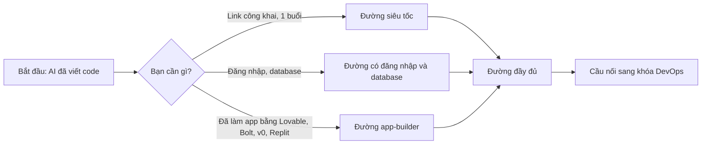

# Vibe Deploy: từ AI viết code tới link công khai

> **Tóm tắt:** Track bổ trợ cho người mới hoặc chưa biết lập trình: đưa sản phẩm do AI viết lên Internet bằng GitHub Pages, Vercel, Netlify, Cloudflare, Supabase, Firebase, an toàn và nhanh.

Bạn nhờ AI (Claude Code, Cursor, Lovable, Bolt...) viết xong một trang web hay một ứng dụng nhỏ. Nó chạy được trên máy bạn. Giờ bạn muốn bạn bè mở được bằng một đường link. Track này dạy đúng đoạn đường đó, và chỉ dạy vừa đủ để bạn không tự bắn vào chân: lộ khóa bí mật, mở database cho cả thế giới đọc, hoặc nhận hóa đơn bất ngờ.

Track này **độc lập** với 16 tuần DevOps của khóa. Bạn không cần học Docker hay Kubernetes trước. Khi sản phẩm lớn lên và cần thêm, phần cuối trang này chỉ bạn nên quay lại học gì.

## Bạn sẽ làm được gì

Sau track này, bạn có thể:

- Đưa một trang web (do AI viết) lên Internet có link công khai trong vòng 30 phút.
- Gắn tên miền riêng (domain), có HTTPS, và biết đổi sang domain khác khi cần.
- Thêm đăng nhập và database bằng Supabase hoặc Firebase, và bật đúng lớp bảo vệ (RLS hoặc Security Rules).
- Giao việc cho AI agent một cách có kiểm soát: đọc diff, xem log, không dán secret.
- Biết đặt giới hạn chi phí và chọn gói miễn phí hợp lý, tự quyết định khi nào trả tiền.

## Ai nên học

| Bạn là | Vì sao hợp |
| --- | --- |
| Sinh viên chưa từng code, muốn làm sản phẩm bằng AI | Không cần nền tảng, mọi khái niệm giải thích bằng ví dụ đời thường |
| Người đã dùng Lovable, Bolt, v0, Replit và muốn "mang sản phẩm ra khỏi nền tảng" | Có phần repo, domain, export, tránh phụ thuộc một nơi |
| Thành viên CLB cần đưa landing page, form đăng ký, trang sự kiện lên mạng | Có dự án mini hoàn chỉnh ở [module 09](09-mini-project.md) |
| Người đang học DevOps và muốn có link demo nhanh | Track này là đường tắt, cuối track có cầu nối quay lại khóa chính |

## Điều kiện cần (gần như bằng 0)

- Một laptop và trình duyệt.
- Một tài khoản GitHub miễn phí (module 01 hướng dẫn cách dùng).
- Biết gõ tiếng Việt vào khung chat. Có AI agent thì tốt, chưa có vẫn học được.
- Không cần thẻ ngân hàng. Mọi ví dụ ưu tiên gói miễn phí, bạn tự quyết định nếu muốn trả tiền.

## Ba con đường học

### Cấp 1: Đường siêu tốc, 1 buổi (khoảng 3 giờ)

Mục tiêu: có sản phẩm với link công khai và domain riêng, biết 7 quy tắc sống còn.

1. [00 Tư duy](00-mindset.md): hiểu deploy là gì, vòng lặp làm việc với AI.
2. [01 Git và GitHub](01-git-github.md): đưa code lên GitHub, làm "kho gốc" an toàn.
3. [02 Hosting tĩnh](02-static-hosting.md): GitHub Pages, Cloudflare (Workers static assets) hoặc Netlify, có link ngay.
4. [07 Domain, bảo mật, production](07-domain-security-production.md): trong đường tắt chỉ đọc hai phần: gắn domain (kèm HTTPS) và checklist bảo mật. Các phần về chi phí, giám sát, backup để lại cho đường đầy đủ.

Muốn gửi link cho người lạ ngay sau đó, đọc thêm phần B (preview khi chia sẻ link) và phần G (checklist go-live) của [11 Hoàn thiện và ra mắt](11-launch-polish.md).

Lưu ý: đường siêu tốc **chưa có database và chưa có đăng nhập**. Sản phẩm cuối là trang tĩnh (giới thiệu, landing page, portfolio). Nếu cần lưu dữ liệu người dùng, đi tiếp đường dưới.

### Đường có đăng nhập và database

Dành cho sản phẩm cần lưu dữ liệu (đăng ký, ghi chú, danh sách). Đi sau đường siêu tốc, hoặc song song nếu bạn đã quen Git.

1. Hoàn thành module 00, 01, 02.
2. [03 Fullstack serverless](03-fullstack-serverless.md): hiểu env var và API phía server.
3. [04 Supabase](04-supabase.md): database, đăng nhập, RLS. Đây là bước bắt buộc phải bật đúng lớp bảo vệ. Có thể thay bằng [05 Firebase](05-firebase.md).
4. [07 Domain, bảo mật, production](07-domain-security-production.md): đọc đủ, đặc biệt phần secret và chi phí.
5. Làm [09 Dự án mini](09-mini-project.md) để ráp lại tất cả, rồi [11 Hoàn thiện và ra mắt](11-launch-polish.md) trước khi gửi link cho nhiều người.

### Đường app-builder

Nếu bạn đã làm sản phẩm bằng Lovable, Bolt, v0 hay Replit: đọc [00 Tư duy](00-mindset.md) và [01 Git và GitHub](01-git-github.md), rồi sang [10 App-builder](10-app-builders.md) để đưa code về repo của bạn, deploy lên nền tảng bạn kiểm soát và rà lỗi bảo mật hay gặp.

### Cấp 2: Đường đầy đủ, 2 đến 3 buổi

Làm hết các module theo thứ tự, kể cả [11 Hoàn thiện và ra mắt](11-launch-polish.md). Thêm backend, database, đăng nhập, agent và dự án mini.

### Cấp 3: Cầu nối sang khóa DevOps

Khi bạn thấy cần kiểm soát sâu hơn (nhiều dịch vụ chạy chung, đội nhiều người, test tự động), xem mục "Khi nào nên học DevOps" ở cuối trang.

## Bảng module

| Module | Nội dung | Thời lượng | Kết quả |
| --- | --- | --- | --- |
| [00 Tư duy](00-mindset.md) | Deploy, frontend, backend, database, env var, vòng lặp AI | 45 phút | Hiểu bản đồ, biết 7 quy tắc sống còn |
| [01 Git và GitHub](01-git-github.md) | Repo, commit, push, .gitignore | 60 phút | Code nằm trên GitHub, không lộ secret |
| [02 Hosting tĩnh](02-static-hosting.md) | GitHub Pages, Cloudflare (Workers và Pages), Netlify, Vercel | 60 phút | Trang web có link công khai |
| [03 Fullstack serverless](03-fullstack-serverless.md) | Vercel, Netlify Functions, Cloudflare Functions | 90 phút | Có API chạy trên mạng, biết dùng env var |
| [04 Supabase](04-supabase.md) | Database, đăng nhập, RLS | 90 phút | Database có đăng nhập, bật RLS đúng |
| [05 Firebase](05-firebase.md) | Hosting, Firestore, Auth, Rules | 90 phút | Phương án thay thế Supabase, Rules an toàn |
| [06 AI agent và deploy](06-ai-agent-deploy.md) | Claude Code, Cursor, MCP, CLI | 75 phút | Agent giúp deploy mà bạn vẫn giữ quyền quyết định |
| [07 Domain, bảo mật, production](07-domain-security-production.md) | Domain, HTTPS, secret, chi phí, giám sát | 60 phút | Sản phẩm sẵn sàng cho người dùng thật |
| [08 Xử lý sự cố](08-troubleshooting.md) | Lỗi thường gặp khi deploy | Tra cứu | Biết đọc log và sửa từng bước |
| [09 Dự án mini](09-mini-project.md) | Landing page CLB hoàn chỉnh | 120 phút | Một sản phẩm thật, có domain, có form |
| [10 App-builder](10-app-builders.md) | Lovable, Bolt, v0, Replit: xuất code, repo riêng, rà bảo mật | 75 phút | Sản phẩm từ app-builder chạy trên nền tảng bạn kiểm soát |
| [11 Hoàn thiện và ra mắt](11-launch-polish.md) | Chống spam form, SEO và preview khi chia sẻ, analytics, backup, checklist go-live | 90 đến 120 phút | Sản phẩm sẵn sàng gửi link cho người lạ |

Tài liệu tra cứu đi kèm:

- [So sánh nền tảng](platforms.md): chọn nơi deploy.
- [Thư viện prompt](prompt-library.md): prompt sao chép được để giao việc cho agent.
- [Bảng lệnh CLI](cli-cheatsheet.md): các lệnh hay dùng.

Ví dụ chạy được nằm trong thư mục `examples/vibe/` của repo:

| Ví dụ | Dùng với |
| --- | --- |
| [static-site](../examples/vibe/static-site/README.md) | Hosting tĩnh, module 02 |
| [vercel-api](../examples/vibe/vercel-api/README.md) | Vercel Function, module 03 |
| [netlify-function](../examples/vibe/netlify-function/README.md) | Netlify Function, module 03 |
| [cloudflare-workers-static](../examples/vibe/cloudflare-workers-static/README.md) | Cloudflare Workers với static assets (đường chính), module 02 và 03 |
| [cloudflare-pages-function](../examples/vibe/cloudflare-pages-function/README.md) | Cloudflare Pages Functions (đường cũ), module 03 |
| [supabase](../examples/vibe/supabase/README.md) | Database và RLS, module 04 |
| [firebase](../examples/vibe/firebase/README.md) | Firebase, module 05 |
| [club-landing](../examples/vibe/club-landing/README.md) | Dự án mini, module 09 và 11 |

## Cách dùng track này cùng AI agent

Mỗi module có mục "Nhờ AI agent làm giúp" với prompt sao chép được. Nguyên tắc chung:

1. Bạn quyết định mục tiêu, agent viết lệnh và code.
2. Bạn **đọc** những gì agent định làm (đặc biệt lệnh xóa, lệnh đụng tới khóa, lệnh tốn tiền) trước khi đồng ý.
3. Bạn tự mở link thật để kiểm tra, không tin câu "đã xong".
4. Những việc không giao cho agent: dán secret vào chat, nhập thẻ, bấm nâng cấp gói trả phí, xóa dữ liệu thật.

Chưa có agent cũng không sao: làm theo phần "Thực hành từng bước" là đủ.

## Khi nào nên học DevOps

Track này đủ cho trang giới thiệu, ứng dụng nhỏ, sản phẩm thử nghiệm. Hãy quay lại khóa chính khi gặp một trong các dấu hiệu sau:

| Dấu hiệu | Nên học |
| --- | --- |
| "Chạy được trên máy tôi nhưng khác trên server" | Docker: [tuần 4 buổi 7](../labs/week-04/session-07.md) |
| Nhiều người sửa chung, hay đè code nhau | Git workflow và Pull Request, xem [tuần 1](../labs/week-01/session-01.md) |
| Muốn tự động chạy test mỗi lần đẩy code | CI/CD với GitHub Actions |
| Nhiều dịch vụ phải chạy cùng nhau, cần theo dõi và scale | Compose, rồi Kubernetes |
| Cần theo dõi lỗi, log, cảnh báo nghiêm túc | Monitoring và observability |

Xem toàn cảnh ở [Giới thiệu khóa học](../curriculum/getting-started.md) và [hướng dẫn cài môi trường](../resources/setup-guide.md).

## Tiếp theo

Bắt đầu với [00 Tư duy: từ prompt tới production](00-mindset.md). Thứ tự đầy đủ là 00, 01, 02, 03, 04, 05, 06, 07, 08, 09, 10, 11; mỗi module kết thúc bằng mục "Tiếp theo" trỏ tới bài kế.

## Tài liệu chính thức

- GitHub Pages: https://docs.github.com/en/pages
- Vercel: https://vercel.com/docs
- Netlify: https://docs.netlify.com
- Cloudflare Pages: https://developers.cloudflare.com/pages/
- Supabase: https://supabase.com/docs
- Firebase: https://firebase.google.com/docs
