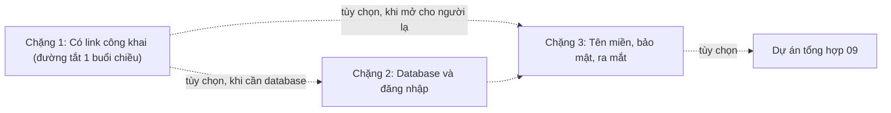

# Vibe Deploy: từ AI viết code tới link công khai

> **Tóm tắt:** Track bổ trợ cho người mới hoặc chưa biết lập trình: đưa sản phẩm do AI viết lên Internet bằng GitHub Pages, Vercel, Netlify, Cloudflare, Supabase, Firebase, an toàn và nhanh.

Bạn nhờ AI (Claude Code, Cursor, Lovable, Bolt...) viết xong một trang web hay một ứng dụng nhỏ. Nó chạy được trên máy bạn. Giờ bạn muốn bạn bè mở được bằng một đường link. Track này dạy đúng đoạn đường đó, và chỉ dạy vừa đủ để bạn không tự bắn vào chân: lộ khóa bí mật, mở database cho cả thế giới đọc, hoặc nhận hóa đơn bất ngờ.

Track này **độc lập** với 16 tuần DevOps của khóa: bạn không cần học Docker hay Kubernetes trước, và không cần làm các tuần của khóa chính. Khi sản phẩm lớn lên và cần thêm, phần cuối trang này chỉ bạn nên quay lại học gì.

::: tip Bắt đầu ở đây
**Đường tắt 1 buổi chiều (khoảng 3 đến 4 giờ): chỉ làm Chặng 1.** Bạn kết thúc với một link công khai mở được từ điện thoại. Bắt đầu bằng [00 Tư duy](00-mindset.md) (10 phút), rồi 01, rồi 02. Chưa có file web nào để đưa lên? Tải trang mẫu [vibe-static-site.zip](https://devops-course.tiennhm.io.vn/downloads/vibe-static-site.zip), hoặc nhờ một chatbot AI (ví dụ Claude, ChatGPT) viết cho bạn một file `index.html` đơn giản. Chặng 2 và 3 là tùy chọn, làm vào buổi khác khi bạn thật sự cần. Thuật ngữ lạ thì tra [Thuật ngữ](../resources/glossary.md).
:::

## Bạn sẽ làm được gì

Sau track này, bạn có thể:

- Đưa một trang web (do AI viết) lên Internet có link công khai trong vòng 30 phút.
- Gắn tên miền riêng (domain), có HTTPS, và biết đổi sang domain khác khi cần.
- Thêm đăng nhập và database bằng Supabase hoặc Firebase, và bật đúng lớp bảo vệ (RLS hoặc Security Rules).
- Giao việc cho AI agent một cách có kiểm soát: đọc diff, xem log, không dán secret.
- Biết đặt giới hạn chi phí và chọn gói miễn phí hợp lý, tự quyết định khi nào trả tiền.

## Ai nên học

| Bạn là | Vì sao hợp |
| --- | --- |
| Sinh viên chưa từng code, muốn làm sản phẩm bằng AI | Không cần nền tảng, mọi khái niệm giải thích bằng ví dụ đời thường |
| Người đã dùng Lovable, Bolt, v0, Replit và muốn "mang sản phẩm ra khỏi nền tảng" | Có phần repo, domain, export, tránh phụ thuộc một nơi |
| Thành viên CLB cần đưa landing page, form đăng ký, trang sự kiện lên mạng | Có dự án tổng hợp ở [09 Dự án mini](09-mini-project.md) (tùy chọn, sau Chặng 1 và 2) |
| Người đang học DevOps và muốn có link demo nhanh | Làm Chặng 1 là có link; cuối trang có cầu nối quay lại khóa chính |

## Điều kiện cần (gần như bằng 0)

- Một laptop và trình duyệt.
- Một tài khoản GitHub miễn phí ([01 Git và GitHub](01-git-github.md) hướng dẫn cách dùng).
- Biết gõ tiếng Việt vào khung chat. Có AI agent thì tốt, chưa có vẫn học được.
- Không cần thẻ ngân hàng. Mọi ví dụ ưu tiên gói miễn phí, bạn tự quyết định nếu muốn trả tiền.

## Lộ trình: 1 chặng bắt buộc, 2 chặng tùy chọn

Mỗi chặng kết thúc bằng một sản phẩm nhìn thấy được. Chỉ **Chặng 1** là đường chính. Chặng 2 và 3 không bắt buộc: đi tiếp khi bạn cần database, đăng nhập hoặc một dự án thật. Tick vào ô khi xong từng bước.

| Chặng | Trạng thái | Thời lượng | Làm khi nào |
| --- | --- | --- | --- |
| 1. Có link công khai | **Bắt buộc**, đủ cho một buổi chiều | 3 đến 4 giờ | Luôn luôn |
| 2. Database và đăng nhập | Tùy chọn | khoảng 2 giờ | Sản phẩm cần lưu dữ liệu hoặc có tài khoản người dùng |
| 3. Tên miền, bảo mật, ra mắt | Tùy chọn | khoảng 3 giờ | Bạn muốn domain riêng và gửi link cho người lạ |

### Chặng 1. Có link công khai (đường tắt 1 buổi chiều, khoảng 3 đến 4 giờ)

Kết quả: trang web của bạn có đường link mở được từ điện thoại của bạn bè. Chưa có database, chưa có đăng nhập. Không cần biết code, không cần cài Node.

- [ ] [00 Tư duy](00-mindset.md): hiểu deploy là gì, thuộc 7 quy tắc sống còn (10 phút đọc).
- [ ] [01 Git và GitHub](01-git-github.md): đưa code lên GitHub bằng GitHub Desktop, không lộ secret.
- [ ] [02 Hosting tĩnh](02-static-hosting.md): deploy lên GitHub Pages (chỉ cần một nền tảng), có link công khai. Bài này có link tải sẵn trang mẫu nếu bạn chưa có file nào.

Xong ba bài này là bạn đã đạt mục tiêu của buổi chiều. Phần còn lại dưới đây dùng khi cần.

### Chặng 2 (tùy chọn). Thêm database và đăng nhập (khoảng 2 giờ)

Làm khi sản phẩm cần lưu dữ liệu (form đăng ký, danh sách) hoặc có đăng nhập. Kết quả: sản phẩm lưu được dữ liệu, bật đúng lớp bảo vệ. Chọn **một** trong hai.

- [ ] [04 Supabase](04-supabase.md): database SQL, đăng nhập, RLS (khuyến nghị cho người mới).
- [ ] hoặc [05 Firebase](05-firebase.md): Firestore, Auth, Rules.

Cần gọi API có khóa bí mật (AI, email) từ phía server thì đọc thêm [03 Fullstack serverless](03-fullstack-serverless.md); bài này chỉ là tùy chọn, không phải điều kiện của bài 04.

### Chặng 3 (tùy chọn). Tên miền, bảo mật, ra mắt (khoảng 3 giờ)

Làm khi bạn muốn domain riêng và sẵn sàng gửi link cho người lạ. Bài 07 và 11 làm được ngay sau Chặng 1, không cần Chặng 2.

- [ ] [07 Domain, bảo mật, production](07-domain-security-production.md): domain, HTTPS, secret, chi phí.
- [ ] [11 Hoàn thiện và ra mắt](11-launch-polish.md): chống spam form, preview khi chia sẻ link, checklist go-live.
- [ ] Dự án tổng hợp (tùy chọn): [09 Dự án mini](09-mini-project.md) gộp bài 01, 02, 04 và 07 thành một landing page CLB hoàn chỉnh. Cần đã làm bài 04 (hoặc 05).

### Tra cứu (đọc khi cần, không nằm trên đường chính)

- [06 AI agent và deploy](06-ai-agent-deploy.md): giao việc cho Claude Code, Cursor, MCP, CLI một cách có kiểm soát.
- [08 Xử lý sự cố](08-troubleshooting.md): lỗi thường gặp khi deploy.
- [10 App-builder](10-app-builders.md): đã làm sản phẩm bằng Lovable, Bolt, v0, Replit và muốn mang code về repo của mình.
- [So sánh nền tảng](platforms.md): chọn nơi deploy.
- [Thư viện prompt](prompt-library.md): prompt sao chép được để giao việc cho agent.
- [Bảng lệnh CLI](cli-cheatsheet.md): các lệnh hay dùng.

## Bảng module

| Module | Nội dung | Thời lượng | Kết quả |
| --- | --- | --- | --- |
| [00 Tư duy](00-mindset.md) | Deploy, frontend, backend, database, env var, vòng lặp AI | 10 phút đọc | Hiểu bản đồ, biết 7 quy tắc sống còn |
| [01 Git và GitHub](01-git-github.md) | Repo, commit, push, .gitignore | 60 phút | Code nằm trên GitHub, không lộ secret |
| [02 Hosting tĩnh](02-static-hosting.md) | GitHub Pages, Cloudflare (Workers và Pages), Netlify, Vercel | 60 phút | Trang web có link công khai |
| [03 Fullstack serverless](03-fullstack-serverless.md) | Vercel, Netlify Functions, Cloudflare Functions | 90 phút | Có API chạy trên mạng, biết dùng env var |
| [04 Supabase](04-supabase.md) | Database, đăng nhập, RLS | 90 phút | Database có đăng nhập, bật RLS đúng |
| [05 Firebase](05-firebase.md) | Hosting, Firestore, Auth, Rules | 90 phút | Phương án thay thế Supabase, Rules an toàn |
| [06 AI agent và deploy](06-ai-agent-deploy.md) | Claude Code, Cursor, MCP, CLI | 75 phút | Agent giúp deploy mà bạn vẫn giữ quyền quyết định |
| [07 Domain, bảo mật, production](07-domain-security-production.md) | Domain, HTTPS, secret, chi phí, giám sát | 60 phút | Sản phẩm sẵn sàng cho người dùng thật |
| [08 Xử lý sự cố](08-troubleshooting.md) | Lỗi thường gặp khi deploy | Tra cứu | Biết đọc log và sửa từng bước |
| [09 Dự án mini](09-mini-project.md) | Dự án tổng hợp: landing page CLB (tùy chọn) | 3 đến 4 giờ | Một sản phẩm thật, có domain, có form |
| [10 App-builder](10-app-builders.md) | Lovable, Bolt, v0, Replit: xuất code, repo riêng, rà bảo mật | 75 phút | Sản phẩm từ app-builder chạy trên nền tảng bạn kiểm soát |
| [11 Hoàn thiện và ra mắt](11-launch-polish.md) | Chống spam form, SEO và preview khi chia sẻ, analytics, backup, checklist go-live | 90 đến 120 phút | Sản phẩm sẵn sàng gửi link cho người lạ |

Tài liệu tra cứu đi kèm:

- [So sánh nền tảng](platforms.md): chọn nơi deploy.
- [Thư viện prompt](prompt-library.md): prompt sao chép được để giao việc cho agent.
- [Bảng lệnh CLI](cli-cheatsheet.md): các lệnh hay dùng.

Ví dụ chạy được nằm trong thư mục `examples/vibe/` của repo:

| Ví dụ | Dùng với |
| --- | --- |
| [static-site](../examples/vibe/static-site/README.md) | Hosting tĩnh, module 02 (tải sẵn: `vibe-static-site.zip`) |
| [vercel-api](../examples/vibe/vercel-api/README.md) | Vercel Function, module 03 |
| [netlify-function](../examples/vibe/netlify-function/README.md) | Netlify Function, module 03 |
| [cloudflare-workers-static](../examples/vibe/cloudflare-workers-static/README.md) | Cloudflare Workers với static assets (đường chính), module 02 và 03 |
| [cloudflare-pages-function](../examples/vibe/cloudflare-pages-function/README.md) | Cloudflare Pages Functions (đường cũ), module 03 |
| [supabase](../examples/vibe/supabase/README.md) | Database và RLS, module 04 |
| [firebase](../examples/vibe/firebase/README.md) | Firebase, module 05 |
| [club-landing](../examples/vibe/club-landing/README.md) | Dự án mini, module 09 và 11 (tải sẵn: `vibe-club-landing.zip`) |

## Cách dùng track này cùng AI agent

Mỗi module có mục "Nhờ AI agent làm giúp" với prompt sao chép được. Nguyên tắc chung:

1. Bạn quyết định mục tiêu, agent viết lệnh và code.
2. Bạn **đọc** những gì agent định làm (đặc biệt lệnh xóa, lệnh đụng tới khóa, lệnh tốn tiền) trước khi đồng ý.
3. Bạn tự mở link thật để kiểm tra, không tin câu "đã xong".
4. Những việc không giao cho agent: dán secret vào chat, nhập thẻ, bấm nâng cấp gói trả phí, xóa dữ liệu thật.

Chưa có agent cũng không sao: làm theo phần "Thực hành từng bước" là đủ.

## Khi nào nên học DevOps

Track này đủ cho trang giới thiệu, ứng dụng nhỏ, sản phẩm thử nghiệm. Hãy quay lại khóa chính khi gặp một trong các dấu hiệu sau:

| Dấu hiệu | Nên học |
| --- | --- |
| "Chạy được trên máy tôi nhưng khác trên server" | Docker: [Buổi 07 – Container Fundamentals](../labs/week-04/session-07.md) |
| Nhiều người sửa chung, hay đè code nhau | Git workflow và Pull Request, xem [Buổi 01 – DevOps Introduction](../labs/week-01/session-01.md) |
| Muốn tự động chạy test mỗi lần đẩy code | CI/CD với GitHub Actions |
| Nhiều dịch vụ phải chạy cùng nhau, cần theo dõi và scale | Compose, rồi Kubernetes |
| Cần theo dõi lỗi, log, cảnh báo nghiêm túc | Monitoring và observability |

Xem toàn cảnh ở [Bắt đầu từ đây](../curriculum/getting-started.md) và [hướng dẫn cài môi trường](../resources/setup-guide.md).

## Tiếp theo

Bắt đầu với [00 Tư duy: từ prompt tới production](00-mindset.md), rồi đi theo Chặng 1. Mỗi module kết thúc bằng mục "Tiếp theo" trỏ tới đúng một bài kế.

## Tài liệu chính thức

- GitHub Pages: https://docs.github.com/en/pages
- Vercel: https://vercel.com/docs
- Netlify: https://docs.netlify.com
- Cloudflare Pages: https://developers.cloudflare.com/pages/
- Supabase: https://supabase.com/docs
- Firebase: https://firebase.google.com/docs
