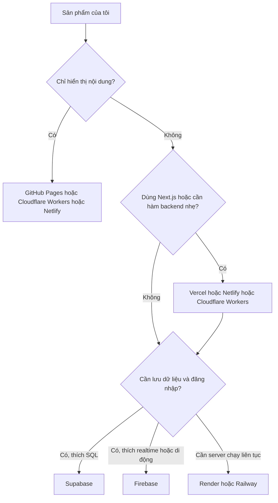

# So sánh nền tảng: tôi nên deploy ở đâu?

> **Tóm tắt:** Bảng so sánh GitHub Pages, Vercel, Netlify, Cloudflare, Supabase, Firebase, Render, Railway kèm cây quyết định, combo khuyến nghị và cảnh báo lock-in, chi phí.

::: tip Bạn làm gì: chọn nơi deploy (trang tra cứu, 2 phút)
**Bạn sẽ tạo ra:** một lựa chọn nền tảng chính và một phương án dự phòng. Dùng trang này khi cần so sánh, không cần đọc từ đầu tới cuối. Thuật ngữ (hosting, domain, serverless, lock-in): [Thuật ngữ](../resources/glossary.md).
:::

## Nếu bạn chỉ có 1 phút

- Trang giới thiệu, portfolio, landing page (chỉ hiển thị): **GitHub Pages** (đường khuyến nghị của [bài 02 Hosting tĩnh](02-static-hosting.md)).
- Cần hàm backend nhẹ hoặc dùng Next.js: **Vercel**, **Netlify** hoặc **Cloudflare Workers**.
- Cần database và đăng nhập: thêm **Supabase** (thích SQL) hoặc **Firebase** (realtime, di động).
- Cần server chạy liên tục: **Render** hoặc **Railway** (chú ý giới hạn gói free).
- Chưa chắc: chọn thứ đơn giản nhất chạy được, code nằm trên GitHub thì đổi sau vẫn dễ.

## Bạn sẽ làm được gì

Thời lượng ước tính: 30 phút đọc, dùng như trang tra cứu.

- Chọn nơi deploy phù hợp loại sản phẩm trong vòng 2 phút.
- Biết giới hạn quan trọng của từng nơi trước khi gặp bất ngờ.
- Biết lock-in là gì và giảm rủi ro bằng cách nào.

## Khái niệm trong 5 phút

Các nền tảng chia làm ba nhóm. Đừng so sánh chéo nhóm như so sánh táo với cam.

| Nhóm | Việc nó làm | Ví dụ |
| --- | --- | --- |
| Host giao diện (frontend) và hàm serverless | Đưa trang web và vài hàm backend nhẹ ra Internet | GitHub Pages, Vercel, Netlify, Cloudflare |
| Backend dựng sẵn (BaaS) | Cho sẵn database, đăng nhập, lưu file, bạn chỉ cấu hình | Supabase, Firebase |
| Host server chạy liên tục | Chạy một ứng dụng backend truyền thống | Render, Railway |

Một sản phẩm thường ghép: một nơi host giao diện cộng một BaaS (nếu cần dữ liệu).

**Lưu ý về số liệu.** Gói miễn phí đổi thường xuyên. Các con số dưới đây lấy từ tài liệu chính thức và **xác minh ngày 21/10/2026**. Trước khi quyết định, luôn mở trang giá chính thức ở cột cuối.

## Bảng so sánh

| Nền tảng | Hợp với | Ưu điểm | Giới hạn quan trọng | Gói miễn phí (xác minh 21/10/2026) |
| --- | --- | --- | --- | --- |
| GitHub Pages | Web tĩnh, tài liệu, portfolio, landing page | Miễn phí, gắn liền repo, đơn giản nhất | Chỉ tĩnh, không có backend | Site tối đa 1 GB, băng thông mềm 100 GB mỗi tháng, mềm 10 lượt build mỗi giờ (giới hạn build không áp dụng nếu deploy bằng GitHub Actions tự viết). Xem [giới hạn](https://docs.github.com/en/pages/getting-started-with-github-pages/github-pages-limits) |
| Vercel | Next.js và các framework web, API nhẹ | Deploy mỗi lần push, có bản xem thử (preview) cho từng nhánh | Gói Hobby chỉ cho dùng cá nhân, phi thương mại | Hobby: 100 GB Fast Data Transfer, 1.000.000 lượt gọi hàm, 100 deploy mỗi ngày. Xem [Hobby plan](https://vercel.com/docs/plans/hobby) |
| Netlify | Web tĩnh và web có hàm serverless, form | Dễ dùng, có Functions, kéo thả thư mục để deploy thử | Gói tính theo credit, hết credit thì dự án có thể bị tạm dừng | Free: 300 credit mỗi tháng, giới hạn cứng, không mua thêm được. Xem [gói credit](https://docs.netlify.com/manage/accounts-and-billing/billing/billing-for-credit-based-plans/credit-based-pricing-plans/) |
| Cloudflare (Workers static assets; Pages là đường cũ) | Web tĩnh, hàm biên (edge) nhanh, tên miền qua Cloudflare | Mạng lưới rộng, quản lý DNS cùng chỗ | Workers giới hạn CPU mỗi lượt gọi; Pages (đường cũ) có hạn mức build theo tháng | Workers Free: 100.000 request mỗi ngày, file tĩnh không tính request. Pages Free: 500 build mỗi tháng, 20.000 file mỗi site, 25 MiB mỗi file. Xem [Workers](https://developers.cloudflare.com/workers/platform/pricing/), [Pages](https://developers.cloudflare.com/pages/platform/limits/) |
| Supabase | Cần database Postgres, đăng nhập, lưu file | Dùng SQL chuẩn, dễ mang dữ liệu đi nơi khác | Phải tự bật RLS. Khóa kiểu mới là publishable/secret (anon/service_role là kiểu cũ). Dự án miễn phí không dùng sẽ bị tạm dừng | Free: 2 dự án đang hoạt động, 500 MB database mỗi dự án, 50.000 MAU, 1 GB lưu file, dự án không hoạt động bị tạm dừng sau 1 tuần. Xem [giá](https://supabase.com/pricing) |
| Firebase | Ứng dụng realtime, di động, đăng nhập nhanh | Hosting, Firestore, Auth gói chung, nhiều SDK | Cloud Functions bắt buộc gói Blaze (trả theo mức dùng, cần thẻ). Dữ liệu dạng tài liệu, khác SQL | Spark: Hosting 10 GB lưu trữ, 360 MB truyền tải mỗi ngày. Firestore (Standard) 1 GiB, 50.000 lượt đọc và 20.000 lượt ghi mỗi ngày. Xem [giá](https://firebase.google.com/pricing) |
| Render | Backend chạy liên tục (Node, Python), thử nghiệm | Chạy ứng dụng như trên máy mình | Free: dịch vụ tự ngủ sau 15 phút không có người truy cập, thức dậy mất khoảng 1 phút. Database free hết hạn sau 30 ngày | 750 giờ chạy mỗi tháng. Postgres free 1 GB, hết hạn 30 ngày. Xem [Free tier](https://render.com/docs/free) |
| Railway | Backend và database nhỏ, thử nhanh | Giao diện đơn giản, dựng nhiều dịch vụ nhanh | Gói Free chỉ có 1 USD credit mỗi tháng, mỗi dịch vụ giới hạn tài nguyên | Free: 1 USD credit mỗi tháng. Trial: 5 USD một lần. Xem [gói](https://docs.railway.com/reference/pricing/plans) |

Ghi chú về Cloudflare (kiểm tra 21/10/2026): trang tài liệu Cloudflare Pages ghi Workers là nền tảng ứng dụng chính và khuyên bắt đầu dự án mới bằng Workers; Workers có thể phục vụ file tĩnh qua static assets. Vì vậy các bài trong track này dạy Workers static assets làm đường chính ([bài 02 Hosting tĩnh](02-static-hosting.md), [bài 03 Fullstack serverless](03-fullstack-serverless.md)) và giữ Pages như đường cũ vẫn dùng được. Cloudflare không nói Pages bị ngừng, nhưng hãy xem lại tài liệu trước khi bắt đầu.

## Cây quyết định: Tôi nên deploy ở đâu?



## Combo khuyến nghị

| Bạn đang làm | Combo | Vì sao |
| --- | --- | --- |
| Trang giới thiệu, portfolio, tài liệu | GitHub Pages hoặc Cloudflare (Workers static assets) | Miễn phí, không backend, ít thứ để hỏng |
| Landing page có form thu email | Netlify (form hoặc Functions) hoặc Cloudflare Workers | Có chỗ xử lý form mà không cần tự dựng server |
| Ứng dụng Next.js | Vercel | Nền tảng của chính đội làm Next.js, deploy gần như tự động |
| Ứng dụng có đăng nhập và dữ liệu từng người | Vercel hoặc Cloudflare (giao diện) cộng Supabase | Postgres chuẩn, có RLS, dễ rời đi sau này |
| Ứng dụng realtime hoặc cho điện thoại | Firebase Hosting cộng Firestore và Auth | SDK đầy đủ cho web, Android, iOS |
| Backend Node có sẵn cần chạy liên tục | Render hoặc Railway | Chạy như trên máy bạn, chú ý giới hạn gói free |

Khi chưa chắc: bắt đầu bằng thứ **đơn giản nhất chạy được**. Chuyển đổi sau này dễ hơn bạn nghĩ nếu code nằm trên GitHub.

## Thực hành từng bước

1. Viết một câu mô tả sản phẩm và trả lời 3 câu hỏi: có cần backend không, có cần lưu dữ liệu không, có cần đăng nhập không.
   - Bạn sẽ thấy: ba chữ "có" hoặc "không".
2. Đi theo cây quyết định ở trên, ghi lại một lựa chọn chính và một lựa chọn dự phòng.
   - Bạn sẽ thấy: ví dụ "chính: GitHub Pages, dự phòng: Cloudflare Workers".
3. Mở trang giá chính thức của lựa chọn chính (link ở cột cuối bảng), tìm 2 con số quan trọng nhất với bạn (băng thông, số dự án, thời gian ngủ...).
   - Bạn sẽ thấy: trang giá có thể đã đổi so với bảng này, hãy tin trang chính thức.
4. Tìm mục "Spending cap" hoặc "Usage alerts" của nền tảng đã chọn, ghi lại để bật ở [module 07](07-domain-security-production.md).
   - Bạn sẽ thấy: tên mục khác nhau tùy nền tảng, giao diện có thể khác chút.

## Nhờ AI agent làm giúp

```text
Dự án của tôi: [mô tả ngắn]. Tôi là người mới, muốn dùng gói miễn phí.
Hãy đề xuất nơi deploy theo cách đơn giản nhất. Trả lời theo bảng:
nền tảng chọn, lý do, giới hạn tôi cần biết, thứ phải tự tay làm (đăng ký, bật bảo mật).
Nếu bạn nhắc tới con số gói miễn phí, hãy dẫn link trang giá chính thức để tôi tự kiểm tra,
và nói rõ nếu bạn không chắc con số còn đúng.
```

Bạn phải tự kiểm tra: mọi con số giới hạn và giá, bằng cách mở trang giá chính thức. Agent có thể nhớ số cũ.

Không giao cho agent: đăng ký bằng thẻ, bấm nâng cấp gói, bật tính năng trả phí, dán khóa API vào chat.

## Cảnh báo lock-in và chi phí

**Lock-in** là khi bạn dùng quá nhiều tính năng riêng của một nền tảng nên rời đi rất tốn công.

| Rủi ro | Mức | Cách giảm |
| --- | --- | --- |
| Code chỉ nằm trong app-builder | Cao | Kết nối GitHub ngay từ đầu, kiểm tra repo có đủ code |
| Dùng tính năng độc quyền (hàm riêng, form riêng) | Vừa | Ghi chú những chỗ phụ thuộc trong README, giữ logic chính trong code của bạn |
| Dữ liệu ở dạng khó xuất | Vừa đến cao | Chọn nơi có xuất dữ liệu (Postgres của Supabase dùng được SQL chuẩn), xuất bản sao định kỳ |
| Domain mua qua nền tảng | Thấp đến vừa | Biết cách chuyển domain, giữ thông tin đăng ký domain ở tài khoản của bạn |

Chi phí bất ngờ thường đến từ:

- Gói miễn phí giới hạn **thương mại** (ví dụ Vercel Hobby chỉ dành cho dùng cá nhân, phi thương mại). Dự án kiếm tiền cần đọc điều khoản.
- Dịch vụ nhận thẻ rồi tính theo mức dùng (như Cloud Functions của Firebase cần gói Blaze). Chỉ nâng cấp khi **bạn** hiểu và tự quyết, và đặt cảnh báo ngân sách trước.
- Bot hoặc kẻ xấu gọi API của bạn hàng triệu lần. Hàm gọi AI không có giới hạn là mục tiêu số một.
- Gói free tự ngủ hoặc hết hạn (Render) khiến sản phẩm "tự sập" và bạn tưởng lỗi code.

## Nếu bị lỗi

| Triệu chứng | Nguyên nhân thường gặp | Cách xử lý |
| --- | --- | --- |
| Trang tạm ngưng sau khi nhiều người vào | Hết băng thông, credit hoặc quota của gói free | Mở mục Usage của nền tảng, giảm tải (nén ảnh, cache) hoặc cân nhắc gói trả phí do bạn tự quyết |
| Dự án Supabase "paused" | Không hoạt động một thời gian trên gói free | Vào Dashboard, bấm khôi phục (restore) dự án, xem hướng dẫn trong tài liệu Supabase |
| Backend trên Render chậm ở lần mở đầu | Dịch vụ free đã ngủ, thức dậy mất khoảng 1 phút | Chấp nhận, hoặc chọn nền tảng không ngủ, hoặc dùng hàm serverless |
| Database free biến mất sau 30 ngày | Postgres free của Render có hạn dùng | Không dùng làm nơi lưu lâu dài, chuyển sang Supabase hoặc bản trả phí do bạn quyết |
| Cloud Functions Firebase đòi nâng cấp gói | Hàm cần gói Blaze | Xem lại có cần hàm không, hoặc chuyển phần đó sang Vercel, Netlify, Cloudflare |
| Dự án thương mại bị nhắc vi phạm điều khoản | Dùng gói cá nhân cho mục đích kiếm tiền | Đọc điều khoản gói, nâng cấp gói phù hợp hoặc đổi nền tảng |

## Tự kiểm tra

1. Web chỉ có HTML, CSS, JS không cần lưu dữ liệu: nên chọn nhóm nền tảng nào?
2. Vì sao không nên chỉ giữ code trong app-builder?
3. Firebase Spark có chạy được Cloud Functions không?
4. Kể hai nguyên nhân khiến bạn nhận hóa đơn hoặc bị tạm dừng bất ngờ.
5. Số liệu gói miễn phí trong bảng này có thể tin tuyệt đối không?

<details><summary>Đáp án</summary>

1. Host giao diện tĩnh: GitHub Pages, Cloudflare (Workers static assets) hoặc Netlify.
2. Dễ bị khóa vào một nơi. Có repo GitHub thì đổi công cụ và nền tảng được, có lịch sử để quay lui.
3. Không. Theo trang giá Firebase (xác minh 21/10/2026), Cloud Functions cần gói Blaze.
4. Ví dụ: hàm gọi AI không giới hạn bị lạm dụng, vượt quota gói free, dùng gói cá nhân cho mục đích thương mại.
5. Không. Gói miễn phí thay đổi, luôn mở trang giá chính thức trước khi quyết định.

</details>

## Checklist hoàn thành

- [ ] Tôi chọn được nơi deploy chính và một phương án dự phòng.
- [ ] Tôi đã mở trang giá chính thức và ghi lại các giới hạn quan trọng.
- [ ] Tôi biết nền tảng đã chọn có cho dùng thương mại ở gói free hay không.
- [ ] Tôi biết chỗ đặt cảnh báo chi phí hoặc spending cap.
- [ ] Code của tôi (hoặc kế hoạch) nằm trên GitHub để giảm lock-in.

## Tiếp theo

- Web tĩnh: [02 Hosting tĩnh](02-static-hosting.md).
- Hàm backend: [03 Fullstack serverless](03-fullstack-serverless.md).
- Dữ liệu và đăng nhập: [04 Supabase](04-supabase.md), [05 Firebase](05-firebase.md).
- Prompt và lệnh: [Thư viện prompt](prompt-library.md), [Bảng lệnh CLI](cli-cheatsheet.md).

## Tài liệu chính thức

- GitHub Pages: https://docs.github.com/en/pages
- Vercel pricing: https://vercel.com/pricing
- Netlify pricing: https://www.netlify.com/pricing/
- Cloudflare Workers static assets: https://developers.cloudflare.com/workers/static-assets/
- Cloudflare Pages (đường cũ): https://developers.cloudflare.com/pages/
- Cloudflare Workers: https://developers.cloudflare.com/workers/
- Supabase pricing: https://supabase.com/pricing
- Firebase pricing: https://firebase.google.com/pricing
- Render: https://render.com/docs/free
- Railway: https://docs.railway.com/reference/pricing/plans
